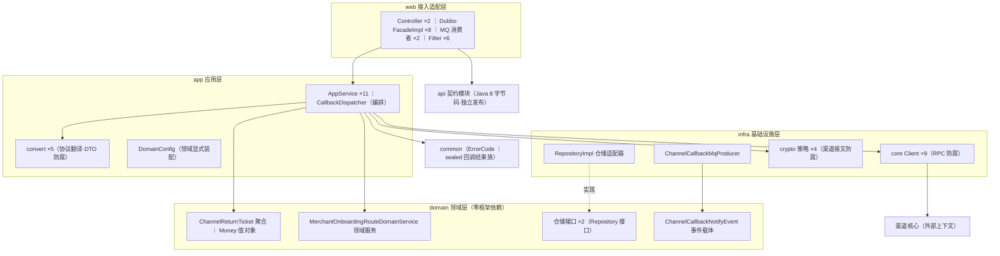
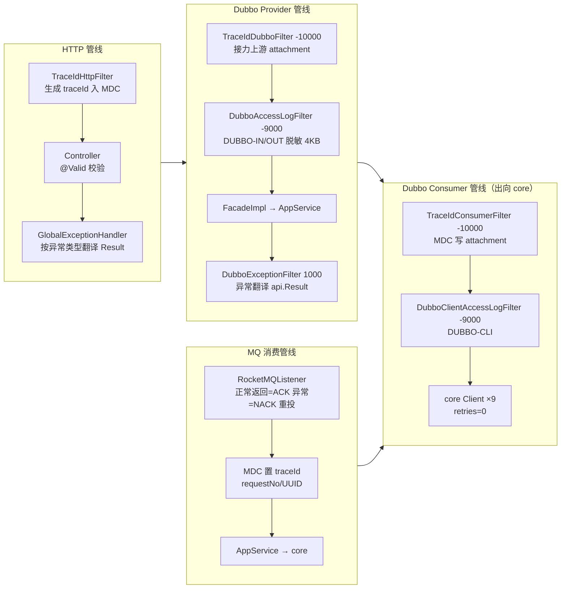
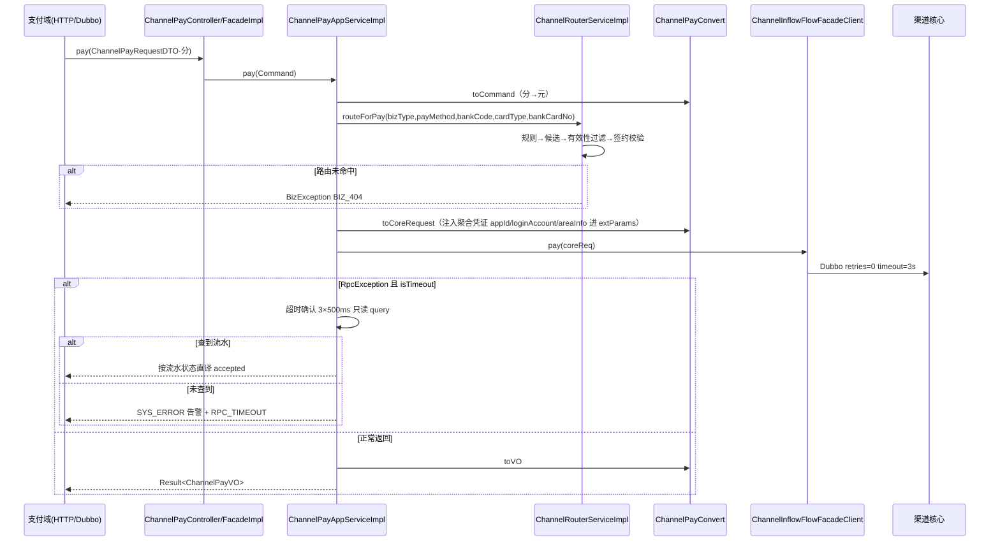
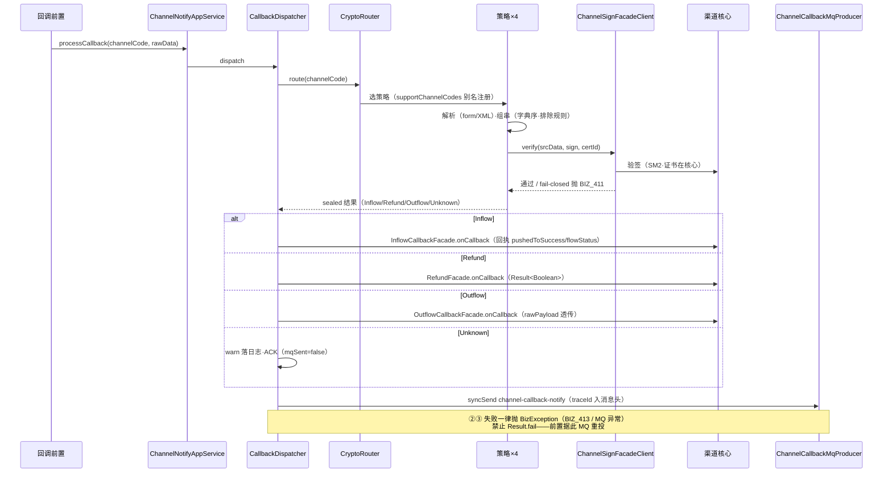
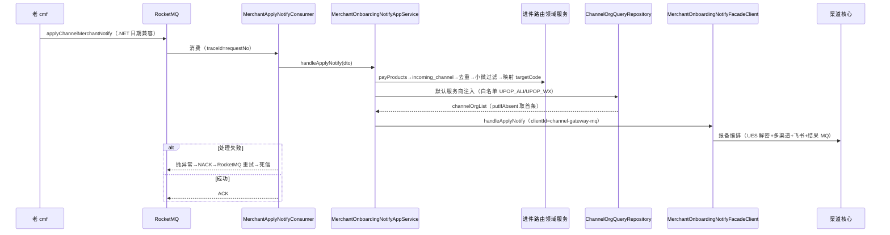
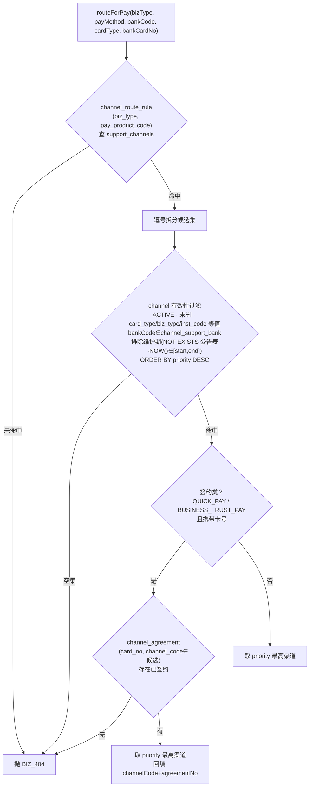

| 项 | 内容 |
|---|---|
| 适用对象 | 渠道网关研发、测试、联调方（支付域 / 回调前置 / 运营后台 / 老 cmf 接入人员）、架构评审成员 |
| 前置条件 | 已读《渠道接入层概要设计 v1.0》全文；已知渠道核心幂等三层与交易状态机 |
| 相关文档 | 《渠道接入层概要设计 v1.0》《渠道系统概要设计 v1.0》《渠道核心-Dubbo接口文档》《渠道支付中台核心方案说明》 |
| 证据口径 | 仅填写可从 channel-gateway 工程代码与配置确证的内容；本文新发现的差距单列第 11 章，与概要设计第 10 章互补 |

---

## 1. 概述

### 1.1 文档定位与术语

本文为渠道网关（channel-gateway）的详细设计（LLD）。**渠道网关即《渠道系统概要设计》中的"接入层"**，同一应用的两种称谓：文档族内对内沿用"接入层"，面向接入方时称渠道网关；本文统一使用**渠道网关**。

职责与边界（五个职责、三个不做）见概要设计 1.1 节，本文不再重复；全部机制章（概要设计第 5 章）在本文第 5、6 章展开到类与字段级。

### 1.2 运行环境

| 项 | 版本 / 值 |
|---|---|
| JDK | 17（api 契约模块以 Java 8 字节码发布） |
| Spring Boot / Cloud | 3.2.5 / 2023.0.1（+ Spring Cloud Alibaba 2023.0.1.0） |
| RPC | Apache Dubbo 3.2.7；协议端口 20880；payload 8MB；serialize-check-status=STRICT + 白名单 |
| ORM | MyBatis-Plus 3.5.7 + mysql-connector-j 8.3.0 + Druid 1.2.22（TiDB，MySQL 协议） |
| MQ | RocketMQ（rocketmq-spring 2.3.0） |
| 注册 / 配置 | Nacos 2.x（注册 + 配置一体）；ZooKeeper 仅互通验证（src/test + Maven profile interop） |
| 监控 | yylog-monitor SDK（app 标识 channel-gateway） |
| 其他 | Redisson + spring-data-redis（依赖引入，业务未使用）、Hutool 5.8.27、fastjson2、Lombok |
| 端口 | HTTP 8080；Dubbo 20880；actuator 仅 health |
| 应用名 | channel-gateway（Dubbo application 同名） |

### 1.3 部署与启动

1. 唯一可执行模块 channel-gateway-web：spring-boot-maven-plugin repackage，finalName=channel-gateway-web，mainClass=com.yypay.channel.gateway.web.ChannelGatewayApplication（@SpringBootApplication(scanBasePackages) + @EnableDubbo）。
2. JDK 17 下 Dubbo hessian2 反射需要 7 组 `--add-opens java.base/...=ALL-UNNAMED`（插件 jvmArguments 与 surefire 均已配置）。
3. 环境切换：`spring.profiles.active=${SPRING_PROFILES_ACTIVE:dev}`；dev/test/prod 三个 profile 仅声明 Nacos 地址与命名空间，DB / Dubbo registries / RocketMQ / Redis 眉目全部由 Nacos `channel-gateway.yml` 下发（spring.config.import）。
4. 停机：server.shutdown=graceful；日志目录 /opt/logs/channel-gateway（默认，可经 logging.file.path 覆盖）。
5. 互通验证（Dubbo 2.8.4 老 cmf ↔ 3.2.7）不随主应用部署：位于 infra 模块 src/test，经 Maven profile interop 以纯 Spring 上下文启动（ZK 注册，hessian2，register-mode=all）。

## 2. DDD 架构与模块结构设计

本章先定 DDD 落法（分层与依赖规则、战术设计元素、防腐层、应用层编排与 CQRS 语义），再给模块与类清单；第 3~5 章的接口、数据、流程均按本章的层与端口落位核对。

### 2.1 上下文映射和领域模型

### 2.2 领域用例与事件

### 2.3 分层架构与依赖规则

依赖规则（条款）：

1. 依赖单向：web → app → domain → common；infra 以**依赖倒置**实现 domain 仓储端口；api 被 web / app 引用，独立以 Java 8 字节码发布。
2. domain 零框架依赖（无 Spring 注解、无中间件），由 app 层 DomainConfig 以 @Bean 显式装配——领域纯度由编译期保证，禁止在 domain 出现基础设施类型。
3. 外部上下文（渠道核心、回调前置、渠道机构）一律经 infra 适配器接入；对核心契约（DTO / Result）的引用收敛在 app/convert 与 infra/client 两处，web 与 domain 禁止直接引用。
4. 事务边界在 app 层（全工程仅退票登记一个 @Transactional）；领域层无事务感知。
5. 渠道网关**不建交易聚合**（2026-07-20 无状态化决策）：交易状态机唯一拥有者是渠道核心，网关侧对交易只做编排与翻译——这是本工程 DDD 建模的第一约束。

### 2.4 战术设计元素

| 元素 | 类型 | 代码位置 | 职责与不变式 |
|---|---|---|---|
| ChannelReturnTicket | 聚合根 | domain/aggregate/entity | create 工厂校验：origOrderNo 非空（PARAM_401）、amount 为正（RISK_401）；append-only，仅 insert |
| Money | 值对象 | domain/aggregate/valueobj | 不可变；2 位 HALF_UP；同币种运算（异币种拒绝）；修改返回新实例 |
| ChannelReturnTicketFactory | 工厂 | domain/factory | BigDecimal → Money → 聚合 create，隔离构造细节 |
| ChannelReturnTicketRepository / IncomingChannelConfRepository | 端口 | domain/repository | 持久化抽象；infra 提供适配器实现（依赖倒置） |
| MerchantOnboardingRouteDomainService | 领域服务 | domain/service | 进件路由规则（去重、小微过滤、渠道码映射），无状态纯规则 |
| ChannelCallbackNotifyEvent | 领域事件载体 | domain/event | 回调状态快照；由 infra MQ 适配器发布，domain 不感知 MQ |
| sealed ChannelCallbackResult 族 | 值对象族 | common/callback | 回调解析结果的穷举类型（Inflow / Refund / Outflow / Unknown），分发器编译期穷尽 |
| ChannelReturnTicketDomainService | 领域服务 | domain/service | 落库编排与行数校验（≠1 抛 SYS_501） |

### 2.5 防腐层设计

网关作为接入层，本体就是两个上下文（上游交易域 ↔ 渠道核心）之间的防腐设施；内部分四道防腐：

| 防腐层 | 位置 | 隔离的模型差异 |
|---|---|---|
| DTO 协议防腐 | app/convert ×5 | 上游契约口径（Long 分）与内部模型（BigDecimal 元）、枚举与字符串的映射；手工逐字段，禁 BeanUtil（AgreementFacadeClient 存量例外，第 11 章 #1） |
| RPC 防腐 | infra/remote/core ×9 | 渠道核心契约与错误码：unwrap 同码映射抛 BizException；retries / timeout 集中声明（3.10） |
| 渠道报文防腐 | infra/crypto ×4 + CryptoRouter | 渠道回调协议（form / XML、组串规则、验签字段）内聚在策略中，产出 sealed 标准结果族；dispatcher 与核心不感知渠道语法（6.2） |
| 老栈互通防腐 | infra/interop（src/test） | Dubbo 2.8.4 / hessian2 / .NET 日期：纯 POJO 契约 + LegacyAspNetDateDeserializer（6.3） |

条款：新渠道回调接入 = 新增一个策略类 + Router 注册，sealed 族与分发器零改动；新增上游口径差异 = convert 内消化，禁止把换算散落进 AppService。

### 2.6 应用层编排与 CQRS 语义

1. 命令侧：ChannelPayCommand / ChannelOutflowCommand / ChannelRefundCommand 承载写意图；AppService 编排模板固定为 **校验 → 路由 → 翻译 → 委托核心 →（补偿分支）→ 翻译返回**，禁止在编排层写业务规则（规则在领域服务与核心）。
2. 查询侧：query 系列经核心查询 facade 薄转发（网关无本地读模型，不落交易数据）；query / queryUpstream / inquireUpstream 三态语义见 5.4——CQRS 的读写分离落在渠道核心，网关保持查询无副作用透传。
3. 事件侧：回调终态经 ChannelCallbackNotifyEvent 由 MQ 适配器发布（事件载体在 domain、发布在 infra）。
4. 装配：DomainConfig 两个 @Bean 显式装配领域服务；@ConfigurationProperties 绑定 channel.aggregation（8.2）。

### 2.7 模块与依赖约束

依赖单向：web → app → {domain, api} → common；infra 实现依赖倒置（domain 仓储接口）。

| 模块 | 内容 | 关键约束 |
|---|---|---|
| channel-gateway-common | ErrorCode、BizException、sealed 回调结果族、JsonUtil、MoneyUtil | 依赖仅 lombok / slf4j-api / fastjson2 / hutool，零中间件 |
| channel-gateway-api | 8 facade + DTO/VO/Query/枚举 + Result | **maven-compiler release=8**（整段覆盖父 POM 的 17 配置）；依赖仅 lombok、jakarta.validation-api、junit（test）；源码禁 Java 9+ 语法（Map.of / switch 表达式 / isBlank） |
| channel-gateway-domain | 退票聚合 + 工厂 + 仓储接口、进件路由领域服务、Money 值对象、ChannelCallbackNotifyEvent | 零框架依赖；app 层 DomainConfig @Bean 显式装配 |
| channel-gateway-infra | 持久化（8 DO + Mapper）、crypto 策略 ×4、core 客户端 ×9、MQ 生产者、interop（src/test） | 对 domain 依赖倒置 |
| channel-gateway-app | 11 个 AppService（27 公开方法）+ CallbackDispatcher、5 个 convert、2 个配置类 | 只做编排与翻译 |
| channel-gateway-web | 8 个 Dubbo 实现、2 个 Controller、5 个 Filter、MQ 消费者 ×2、全局配置 | 唯一启动模块 |

### 2.8 应用服务清单（app 层）

| 服务类 | 方法（签名要点） | 职责 |
|---|---|---|
| ChannelPayAppService | pay(ChannelPayCommand)；query / queryUpstream / inquireUpstream / close(ChannelInflowFlowQuery) | 入金受理与四类查询关单 |
| ChannelOutflowAppService | payout(ChannelOutflowCommand)；query / queryUpstream / inquireUpstream(ChannelOutflowFlowQuery) | 出金受理与三类查询 |
| ChannelRefundAppService | refund(ChannelRefundCommand) | 退款中转 |
| ChannelAgreementAppService | applyAgreement / applyOfflineCollectionAgreement / confirmAgreement / applyGatewayAgreement；notifyAgreementReceipt(xml)；notifyOfflineCollectionAgreementReceipt(xml)→String | 签约四受理 + 两回执 |
| ChannelNotifyAppService | processCallback(ChannelCallbackLogDTO) | 回调三段式入口（薄委托分发器） |
| CallbackDispatcher（callback 包） | dispatch(ChannelCallbackLogDTO) | 三段式编排：①验签 ②core onCallback ③发 MQ |
| ChannelRouterAppService | preRoute(ChannelRouterRequestDTO)→String | 预路由 |
| ChannelReturnTicketAppService | notify(ChannelReturnTicketRequestDTO) | 退票落库（@Transactional） |
| MerchantApplyAppService | applyChannelMerchant / updateChannelMerchant / refreshFundChannelMerchant / queryChannelMerchantByPayChannels | 报备同步中转四方法 |
| MerchantOnboardingNotifyAppService | handleApplyNotify / handleModifyNotify | 报备 MQ 消费中转 |

command 包为三个应用层入参载体（ChannelPayCommand / ChannelOutflowCommand / ChannelRefundCommand），由 convert 从 DTO 转换（分 → 元）。

### 2.9 转换器与配置类

| 类 | 转换职责 |
|---|---|
| ChannelPayConvert（286 行） | 请求 DTO→Command（分→元）；Command+路由结果+进件信息+**聚合凭证注入 extParams（appId / loginAccount / areaInfo）**→core ChannelInflowPayRequestDTO；core 查询响应→gateway DTO（元→分）；DTO→ChannelPayVO / ChannelPayQueryVO；BizType / PayProduct 枚举→core 字符串映射 |
| ChannelOutflowConvert | 请求→Command→core ChannelOutflowPayRequestDTO（**gateway outflowNo ↔ core payOrderNo 语义互转**）；core 响应→DTO→ChannelOutflowVO / ChannelOutflowQueryVO |
| ChannelRefundConvert | 请求→Command（分→元）→core RefundRequestDTO（4 字段）；响应反向 |
| ChannelAgreementConvert | core AgreementResponseDTO→gateway DTO（channelOrderNo 取 core submissionNo）；网关签约响应反向 |
| MerchantApplyConvert（401 行） | 报备 DTO 双向映射（apply / update / refresh / query 入参与出参）；OperationContext↔core OperationEnvironment；Date↔LocalDate |

配置类两个：DomainConfig（@Bean 装配两个领域服务）；ChannelAggregationProperties（前缀 channel.aggregation，见 8.2）。

### 2.10 web 组件清单

| 组件 | 清单 |
|---|---|
| Dubbo 实现（@DubboService） | ChannelPayFacadeImpl、ChannelOutflowFacadeImpl、ChannelRefundFacadeImpl、ChannelAgreementFacadeImpl、ChannelNotifyFacadeImpl、ChannelMerchantFacadeImpl、ChannelRouterFacadeImpl、ChannelReturnTicketFacadeImpl（薄委托 AppService 并包装 Result） |
| HTTP Controller | ChannelPayController（/channel/pay、/channel/query）；ChannelOutflowController（/channel/outflow/payout、/channel/outflow/query） |
| Filter | TraceIdHttpFilter（@Order HIGHEST）、TraceIdDubboFilter（-10000）、TraceIdConsumerFilter（-10000）、DubboAccessLogFilter（-9000）、DubboClientAccessLogFilter（-9000）、DubboExceptionFilter（1000）——经 META-INF/dubbo SPI 注册 |
| MQ 消费者 | MerchantApplyNotifyConsumer、MerchantModifyNotifyConsumer |
| 配置 | GlobalWebConfig（Jackson Long→String）、RocketMqMessageConverterConfig（.NET 日期兼容）、GlobalExceptionHandler（BizException / 校验异常 / NoResourceFoundException / 兜底 Exception 四类处理） |

### 2.11 请求处理管线

## 3. 接口详细设计

### 3.1 通用约定

| 项 | 约定 |
|---|---|
| 响应包裹 | `Result<T>`：success(boolean)、code(String，成功固定 00000)、message(String，成功固定"成功")、data(T)；静态工厂 success(data) / fail(code, message) |
| 金额 | 对外 DTO / VO 一律 **Long 分**（唯一例外：退票 amount 为 BigDecimal 元）；应用内部 BigDecimal 元 2 位（AMOUNT_SCALE=2） |
| 时间 | JSON 日期格式 yyyy-MM-dd HH:mm:ss、时区 Asia/Shanghai、non_null |
| Long 序列化 | HTTP 侧 Long / long 序列化为字符串（防前端精度丢失） |
| 重试 | 资金写方法（pay / payout / refund / close / queryUpstream / processCallback）消费方必须 retries=0；纯读 query 可 retries=2 |
| 分页 | api 模块无 PageResult；查询接口按单号定位，不做分页契约（开放问题 #5） |

### 3.2 ChannelPayFacade（入金，5 方法）

| 方法 | 入参 → 出参 | 语义 |
|---|---|---|
| pay | ChannelPayRequestDTO → Result\<ChannelPayResponseDTO\> | 下单受理；幂等键 merchantOrderNo |
| query | ChannelInflowFlowQuery → Result\<ChannelInflowQueryResponseDTO\> | 纯读本地流水（经核心查询，不改状态） |
| queryUpstream | 同上 | 主动查单补单：核心查上游 + CAS 回写 + 可能发领域事件（有副作用） |
| inquireUpstream | ChannelInflowFlowQuery → Result\<ChannelInflowUpstreamQueryDTO\> | 独立查单（对账口径）：CAS 回写但不发领域事件 |
| close | ChannelInflowFlowQuery → Result\<ChannelInflowQueryResponseDTO\> | 关单：SUCCESS 拒绝（走退款）；终态幂等返回 |

**ChannelPayRequestDTO 字段**：

| 字段 | 类型 | 校验 | 说明 |
|---|---|---|---|
| merchantOrderNo | String | @NotBlank @Size(max=32) | 商户订单号（上游） |
| merchantId | String | @NotBlank | 平台商户号 |
| amount | Long | @NotNull @Positive | 金额（分） |
| currency | String | @Pattern(^[A-Z]{3}$) | 币种，默认 CNY |
| channelType | String | — | 指定渠道类型，空走路由 |
| bizType | String | @NotBlank | BizTypeEnum code（1 充值 / 2 支付） |
| payMethod | String | @NotBlank | PayProductEnum code |
| bankCode / cardType / bankCardNo | String | — | 银行 / 卡类型（00 借记 01 贷记）/ 卡号 |
| payerNo | String | — | 付款方账户（聚合场景手机号等，空回退 bankCardNo） |
| agreementNo | String | — | 快捷协议号（快捷支付必传） |
| instMerchantId / instMerchantName | String | @NotBlank / @NotBlank | 机构侧商户号 / 名称（按笔下发） |
| notifyUrl / clientIp / extension | String | — | 回调地址 / 客户端 IP（HTTP 层空则补来源 IP）/ 透传 JSON |

**ChannelPayResponseDTO**：

| 字段 | 类型 | 说明 |
|---|---|---|
| channelOrderNo | String | 渠道侧流水号 |
| merchantOrderNo | String | 商户订单号（核心受理响应回带，可空） |
| channelType | String | 命中的渠道类型 |
| channelCode | String | 渠道返回原始码 |
| channelMessage | String | 渠道返回信息 |
| accepted | Boolean | 渠道下单是否受理 |

**ChannelInflowFlowQuery**（query / queryUpstream / inquireUpstream / close 四方法共用）：

| 字段 | 类型 | 校验 | 说明 |
|---|---|---|---|
| merchantId | String | @NotBlank | 平台商户号（租户隔离） |
| channelOrderNo | String | 三选一 | 渠道流水号（优先级最高） |
| payOrderNo | String | 三选一 | 上游支付单号（仅传时取最新一笔） |
| merchantOrderNo | String | 三选一 | 商户订单号（优先级最低） |
| status | String | — | 状态过滤，仅配合 merchantOrderNo 生效 |

注：三单号三选一由类内 @AssertTrue(isOrderNoPresent) 自校验。

**ChannelInflowQueryResponseDTO**：

| 字段 | 类型 | 说明 |
|---|---|---|
| channelOrderNo / payOrderNo / merchantOrderNo | String | 三类单号 |
| bizType | String | PAY / RECHARGE |
| payMethodCode | String | 支付方式 code |
| status | String | INIT / PROCESSING / SUCCESS / FAIL / CLOSED |
| callbackStatus | String | NOT_RECEIVED / RECEIVED / NOTIFIED_UPSTREAM |
| amount | Long | 金额（分） |
| currency | String | 币种 |
| instOrderNo | String | 机构交易号（成功回写） |
| settleDate | String | 清算日 yyyy-MM-dd |
| channelRespCode / channelRespMsg | String | 渠道外层响应码 / 信息 |
| channelSubResp | ChannelSubRespVO | 渠道子响应（sub_code / sub_msg 口径） |
| callbackTime | String | 回调时间 yyyy-MM-dd HH:mm:ss |
| upstreamRespCode / upstreamRespMsg / upstreamQueriedAt | String | queryUpstream 的上游查询富化 |

**ChannelInflowUpstreamQueryDTO**：

| 字段 | 类型 | 说明 |
|---|---|---|
| channelOrderNo / payOrderNo | String | 单号 |
| status | String | 对账回写后最新状态 |
| outcome | String | 本次查单动作：NO_QUERY / PENDING / SUCCEEDED / FAILED / COMM_FAIL |
| instOrderNo / settleDate | String | 补单成功时的回写 |
| upstreamRespCode / upstreamRespMsg / upstreamQueriedAt | String | 上游查询富化 |

### 3.3 ChannelOutflowFacade（出金，4 方法）

payout（幂等键 outflowNo，即核心 payOrderNo）、query、queryUpstream、inquireUpstream，语义与入金对称。

**ChannelOutflowRequestDTO**：

| 字段 | 类型 | 校验 | 说明 |
|---|---|---|---|
| outflowNo | String | @NotBlank | 出金业务单号（幂等键，经 convert 互转为核心 payOrderNo） |
| merchantOrderNo | String | @Size(max=32) | 可选；不传核心落 NULL 不回填 |
| merchantId | String | @NotBlank | 商户号 |
| bizType | String | @NotBlank | 3 提现 / 4 代付 |
| channelCode | String | — | 缺省按 bizType + bankCode 路由 |
| amount | Long | @NotNull @Positive | 金额（分） |
| currency | String | @Pattern(^[A-Z]{3}$) | 默认 CNY |
| accountNo / accountName | String | — | 收款账户 / 户名（**UES 票据 opaque 透传，网关不解密**） |
| bankCode | String | — | 收款行（对公必填） |
| payeeAccType | String | — | DEBIT / CORPORATE_BANK_ACCOUNT |
| notifyUrl / extParams / remark | String | — | 回调地址 / 扩展 JSON / 备注 |

**ChannelOutflowResponseDTO**：

| 字段 | 类型 | 说明 |
|---|---|---|
| channelOrderNo | String | 核心雪花号 |
| outflowNo | String | 幂等键回显 |
| merchantOrderNo | String | 可空 |
| bizType | String | WITHDRAW / PAYOUT |
| status | String | PROCESSING / SUCCESS / FAIL |
| instOrderNo | String | 机构交易号 |
| channelRespCode / channelRespMsg | String | 渠道响应码 / 信息 |

**ChannelOutflowFlowQuery**（与入金同名同注解）：

| 字段 | 说明（相对入金的差异） |
|---|---|
| merchantId / channelOrderNo / merchantOrderNo / status | 同入金（@NotBlank、三选一、状态过滤） |
| payOrderNo | 语义为上游 outflowNo（出金幂等键） |

**ChannelOutflowQueryResponseDTO**（在入金查询响应之上增加三字段，其余同构）：

| 字段 | 说明 |
|---|---|
| channelCode | 出金渠道 |
| instMerchantId | 机构侧商户号 |
| payeeAccType | DEBIT / CORPORATE_BANK_ACCOUNT |

**ChannelOutflowUpstreamQueryDTO**：与入金 UpstreamQueryDTO 同构（channelOrderNo、payOrderNo、status、outcome、instOrderNo、settleDate、upstream 三项富化）。

### 3.4 ChannelRefundFacade（1 方法）

refund(ChannelRefundRequestDTO) → Result\<ChannelRefundResponseDTO\>，幂等键 refundOrderNo。

**ChannelRefundRequestDTO**：

| 字段 | 类型 | 校验 | 说明 |
|---|---|---|---|
| refundOrderNo | String | @NotBlank | 退款单号（幂等键） |
| originalChannelOrderNo | String | @NotBlank | 原交易渠道流水号 |
| refundAmount | Long | @NotNull @Positive | 退款金额（分） |
| currency | String | @Pattern(^[A-Z]{3}$) | 默认 CNY |
| notifyUrl | String | — | 退款回调地址 |

**ChannelRefundResponseDTO**：

| 字段 | 类型 | 说明 |
|---|---|---|
| refundOrderNo | String | 退款单号 |
| originalChannelOrderNo | String | 原流水号 |
| merchantOrderNo | String | 回带，可空 |
| status | String | PROCESSING / SUCCESS / FAIL |

### 3.5 ChannelAgreementFacade（签约，6 方法）

| 方法 | 渠道报文（核心执行） | 幂等键 |
|---|---|---|
| applyAgreement | epcc.101 TrxCtgy=0201（身份认证） | merchantId + submissionNo |
| applyOfflineCollectionAgreement | epcc.111 TrxCtgy=0204（线下代扣签约；终态 epcc.113 回执） | requestNo |
| confirmAgreement | epcc.101 TrxCtgy=0202（短信确认；已确认幂等成功） | preRequestNo（协议号） |
| applyGatewayAgreement | epcc.101 TrxCtgy=0200（同步返回 epcc.105 跳转地址） | memberId + requestNo |
| gatewaySignCallback(String xml) | epcc.102 网关签约回执透传核心 | 回执单号（核心） |
| offlineCollectionAgreementCallback(String xml) | epcc.113 回执透传；返回核心已签名的 epcc.303 应答 | 回执单号（核心） |

**ChannelAgreementRequestDTO**（快捷签约）：

| 字段 | 类型 | 校验 | 说明 |
|---|---|---|---|
| requestNo | String | @NotBlank | 请求号（幂等键 merchantId + submissionNo 的组成） |
| certType | CertTypeEnum | @NotNull | 证件类型 |
| certNo | String | @NotBlank | 证件号（明文，核心加密落库与上送） |
| cardType | CardTypeEnum | @NotNull | 卡类型（校验消息误写"证件类型不能为空"，见第 11 章 #3） |
| bankAccountName | String | @NotBlank | 银行账户名 |
| bankBranch | String | — | 支行 |
| bankCardNo | String | @NotBlank | 银行卡号（明文） |
| bankCode | String | @NotBlank | 银行编码 |
| merchantId | String | @NotBlank | 商户号 |
| mobileNo | String | @NotBlank @Pattern(^1[3-9]\d{9}$) | 手机号（明文） |
| payMethod | PayProductEnum | @NotNull | PROTOCOL / AGREEMENT / GATEWAY / MANDATE_PAY |
| channelCode | String | — | 上游指定渠道 |
| extParams | String | — | 扩展 JSON |

**ChannelAgreementResponseDTO**：

| 字段 | 类型 | 说明 |
|---|---|---|
| channelOrderNo | String | 渠道流水号（取核心 submissionNo） |
| agreementNo | String | 协议号 |
| agreementStatus | String | PENDING_SMS / FAILED |
| requestTime | String | yyyy-MM-dd HH:mm:ss |

**ChannelGatewayAgreementRequestDTO**（网关签约）：

| 字段 | 类型 | 校验 | 说明 |
|---|---|---|---|
| requestNo | String | @NotBlank | 幂等号（会员级唯一） |
| memberId | String | @NotBlank | 会员 id |
| certType | CertTypeEnum | @NotNull | 证件类型 |
| certNo | String | @NotBlank | 证件号（明文） |
| bankAccountName | String | @NotBlank | 银行账户名（明文） |
| mobileNo | String | @NotBlank | 手机号 |
| bankCode | String | @NotBlank | 银行编码 |
| callbackPageUrl | String | @NotBlank | 回跳地址（EPCC ClbckUrl） |
| channelCode | String | — | 指定渠道 |

**ChannelGatewayAgreementResponseDTO**：

| 字段 | 类型 | 说明 |
|---|---|---|
| channelOrderNo | String | 渠道流水号 |
| agreementStatus | String | PENDING_REDIRECT / FAILED |
| redirectUrl | String | epcc.105 跳转地址（PENDING_REDIRECT 时返回） |
| requestTime | String | yyyy-MM-dd HH:mm:ss |

**ChannelAgreementConfirmRequestDTO**：

| 字段 | 类型 | 校验 | 说明 |
|---|---|---|---|
| preRequestNo | String | @NotBlank | 协议号，定位原签约记录（幂等键，已确认幂等成功） |
| verificationCode | String | @NotBlank @Size(max=20) | 短信验证码（EPCC AuthMsg） |

**ChannelOfflineCollectionAgreementRequestDTO**（代收签约，按域分组）：

| 分组 | 字段 | 校验要点 |
|---|---|---|
| 请求标识 | requestNo、merchantId、channelCode | requestNo / merchantId 必填；channelCode 空则签约路由 |
| 签约方账户 | bankCode、cardType、bankCardNo、bankAccountName、institutionAccount | 前四项必填 |
| 签约方证件 | certType、certNo | 必填 |
| 联系方式 | mobileNo | 机构预留手机号，可选 |
| 对公法人 | legalRepresentativeName / CertType / CertNo | 可选 |
| 业务要素 | businessType、payeeMerchantNo、payeeMerchantName、payeeCertType、payeeCertNo、payeeCountryCode、payeeAreaCode、authorizationNo | businessType 与收款商户四要素必填，其余可选 |
| 限额与周期 | amountLimit、effectiveTime、expiryTime、debitTimeUnit、debitTimeStep、debitTimeDescription、debitFrequency | 除 debitFrequency（缺省 1）外均必填；amountLimit 为 EPCC AmountText（如 CNY1000.00） |

### 3.6 ChannelMerchantFacade（报备中转，4 方法，均携带 OperationContext）

| 方法 | 判定 / 语义 |
|---|---|
| applyChannelMerchant | channelMerNo 有值=修改、无值=新增；同步中转核心（90s）；requestNo 非空时核心报备失败发飞书 |
| updateChannelMerchant | 修改报备，**单渠道 payChannel 直传核心，不做进件路由** |
| refreshFundChannelMerchant | 按记录 id 刷新报备状态 |
| queryChannelMerchantByPayChannels | 唯一幂等查询（merchantId + payChannels → 明细列表） |

**ChannelMerchantApplyRequestDTO**（68 字段，按域分组）：

| 域 | 字段 | 说明 |
|---|---|---|
| 主标识 | partnerId、memberId、payChannels(List)、channelMerNo、requestNo、orgNo | channelMerNo 有值=修改、无值=新增；requestNo 非空时核心报备失败发飞书 |
| 商户主体 | mcc、merName、merShortName、merType、servicePhone、address、provinceCode、cityCode、districtCode、merchantWebsiteName、merchantRemark、clearReason、clearCode | merType 取 CompanyTypeEnum |
| 法人 | legalName、legalPhone、legalCertNo、legalEmail | legalEmail 非必传 |
| 执照 | licenseNo、licenseStartDate、licenseExpireDate | 日期为 LocalDate；企业 / 个体必填 licenseNo |
| 证照图片 | licenseNoPath、legalPersonIdFrontPath、legalPersonIdBackPath、legalAccountInstructionPath | 平台文件 Path |
| 结算账户（旧单值组） | bankAccountNo、bankAccountName、bankAccountType、bankCode、bankName、bankNo、bankBranchName、bankBranchNo | bankAccounts 列表为空时回退本组 |
| 渠道特化 | sourceId / sourceName（支付宝）、channelId / channelName（微信）、cupHdqrsResv4 / orgCode（银联）、merchantAttr（网联）、payProducts(List) | 按进件渠道选填 |
| 银联扩展 | mchntSvcTp、bussTp、prodFunc、artifCertifTp、recnclTp、directAcqSettleIn、specDiscTp、specDiscLvl | mchntSvcTp 默认 25；artifCertifTp 默认身份证 |
| 网联扩展 | mrchntAttr、mrchntTp | — |
| 支付宝扩展 | tag、type、indirectLevel | indirectLevel 为商户等级 |
| 其他 | svcNetUrl、svcInsNm、svcInsNmICP、appId、serviceCodes、contactPersonNm、phone | svcInsNm 为 ICP 备案号 |
| 嵌套 | channelOrgList(List\<ChannelMerchantOrgInfoDTO\>)、bankAccounts(List\<ChannelMerchantBankAccountDTO\>) | channelOrgList 由**网关组装注入**（4.2 机构注入白名单） |

**ChannelMerchantUpdateRequestDTO** 与 Apply 的结构差异：

| 差异 | 字段 | 说明 |
|---|---|---|
| 新增 | subMemberId、updateType、payChannel、merchantState、parentId、merCode、channelMerchantName | updateType=SETTLE_CARD；merchantState 00 启动 / 01 注销 / 02 清退；payChannel 单渠道直传核心**不进件路由** |
| 移除 | partnerId、sourceId / sourceName、merchantAttr、requestNo、channelOrgList | 修改链路不需要 |

**ChannelMerchantApplyRespDTO**（List 承载于 ChannelMerchantApplyResponseDTO）：

| 字段 | 说明 |
|---|---|
| status | 00 成功 / 01 失败 / 02 待报备 / 03 报备中 |
| msg | 结果信息 |
| channelMerNo | 渠道商户号（缩写；与 Update 侧 channelMerchantNo 同义不同名，第 11 章 #8） |
| payChannel | 进件渠道 |

**ChannelMerchantUpdateRespDTO**：

| 字段 | 说明 |
|---|---|
| status / msg | 00 成功 / 01 失败 + 信息 |
| merchantState | 商户通道状态 |
| payChannel / channelMerchantNo | 渠道与渠道商户号（全称） |

**ChannelMerchantDetailDTO**：

| 字段 | 说明 |
|---|---|
| memberId / merName | 商户号 / 名称 |
| payChannel / channelId / channelName / channelMerNo | 渠道侧信息 |
| recordTime | 报备时间（LocalDateTime） |

**OperationContext**：

| 字段 | 说明 |
|---|---|
| clientIp / clientMac / clientId | 操作方三要素 |
| serverIp / serverName | 服务端标识 |
| extension | OperationExtension：entryList 键值对（add(key, value)） |

### 3.7 通知 / 退票 / 预路由（3 facade）

**ChannelCallbackLogDTO**：

| 字段 | 类型 | 校验 | 说明 |
|---|---|---|---|
| channelCode | String | @NotBlank | NET_UNION / UNION / UNION_QPASS / UNION_WECHAT / UNION_ALIPAY |
| rawData | String | @NotBlank | 渠道原始报文体 |

**ChannelCallbackResultDTO**：

| 字段 | 类型 | 说明 |
|---|---|---|
| channelOrderNo | String | 网关解析自报文 |
| bizType | String | INFLOW / OUTFLOW / REFUND |
| pushedToSuccess | Boolean | 核心是否已推成功；出金 / 退款为 null |
| flowStatus | String | 核心处理后流水状态（入金回传） |
| respCode / respMsg | String | 渠道响应码 / 信息 |
| mqSent | Boolean | ③ MQ 是否已发 |

**ChannelReturnTicketRequestDTO**：

| 字段 | 类型 | 校验 | 说明 |
|---|---|---|---|
| origOrderNo | String | @NotBlank | 原订单号 |
| bankCode / bankCardNo / bankAccountName | String | — | 退票银行 / 卡号 / 户名 |
| amount | BigDecimal | @NotNull @DecimalMin("0.00", inclusive=false) | 退票金额（**元，全工程唯一例外**） |
| branchName / returnComment / memo | String | — | 网点 / 退票附言 / 备注 |

**ChannelRouterRequestDTO**（无校验注解）：

| 字段 | 类型 | 说明 |
|---|---|---|
| bizType | BizTypeEnum | 业务类型 |
| payMethodEnum | PayProductEnum | 支付产品 |
| bankCode / bankCardNo | String | 银行编码 / 卡号 |
| cardTypeEnum | CardTypeEnum | 卡类型 |
| companyOrPersonal | String | 对公 / 对私标识 |

出参 Result\<String\>（channelCode）。

### 3.8 HTTP 接口（4 端点，出参均为 api/vo）

| 端点 | 出参 VO 字段 |
|---|---|
| POST /channel/pay | ChannelPayVO：channelOrderNo、merchantOrderNo、channelType、accepted、code、message（受理失败时的渠道码与信息） |
| GET /channel/query | ChannelPayQueryVO：channelOrderNo、merchantOrderNo、status、amount(Long 分)、currency、instOrderNo、settleDate、callbackTime、channelRespCode、channelRespMsg |
| POST /channel/outflow/payout | ChannelOutflowVO：channelOrderNo、outflowNo、merchantOrderNo、status、accepted（= status ≠ FAIL）、channelRespCode、channelRespMsg |
| GET /channel/outflow/query | ChannelOutflowQueryVO：channelOrderNo、merchantOrderNo、status、amount、currency、channelCode、payeeAccType、instOrderNo、settleDate、callbackTime、channelRespCode、channelRespMsg |

**ChannelSubRespVO**（嵌入两个查询响应）：channelRespCode（渠道子码 sub_code / err_code）、channelRespMsg（sub_msg / err_code_des）。

### 3.9 MQ 接口

| topic（默认值，可经 Nacos 覆盖） | 方向 / 组 | 消息体与语义 |
|---|---|---|
| applyChannelMerchantNotify | 消费；group channel-gateway-merchant-apply；CLUSTERING + CONCURRENTLY | core 契约 MerchantChannelApplyRequestDTO（同 3.6 Apply 结构，敏感字段 UES ticket）；**自动 ACK：正常返回即 ACK、抛异常即 NACK 重投**；traceId=requestNo |
| modifyChannelMerchantNotify | 消费；group channel-gateway-merchant-modify | MerchantChannelUpateRequestDTO（类名拼写兼容老 cmf）；traceId=channelMerNo→memberId→UUID |
| channel-callback-notify | 生产（syncSend，无 tag 无显式 timeout） | ChannelCallbackNotifyEvent 10 字段（见 5.5）；消息头仅 traceId；发送失败抛异常随三段式重投 |

### 3.10 对内渠道核心客户端（9 个）

| 客户端 | @DubboReference 要点 | 行为要点 |
|---|---|---|
| ChannelInflowFlowFacadeClient | retries=0, timeout=3000, check=false | Result 原样透传，app 层处理 |
| ChannelOutflowFlowFacadeClient | 同上 | 同上 |
| RefundFacadeClient | 同上 | 同上 |
| InflowCallbackFacadeClient / OutflowCallbackFacadeClient | 同上 | Result 透传（回执含 pushedToSuccess / flowStatus） |
| ChannelSignFacadeClient | 同上 | **fail-closed**：success 且 data=TRUE 才判通过，否则 warn 后返回 false |
| MerchantFacadeClient | check=false, timeout=90000 | unwrap：失败按 core code 映射同码 ErrorCode 抛 BizException（缺省 SYSTEM_ERROR）；RpcException 原样上抛 |
| MerchantOnboardingNotifyFacadeClient | check=false（无显式 timeout / retries） | 异常上抛由 MQ 重试兜底 |
| AgreementFacadeClient | check=false, retries=0（**无 timeout，默认 1s**） | **BeanUtil 拷贝；失败静默返回 null**（第 11 章 #1） |

## 4. 数据结构设计

### 4.1 写路径：channel_return_ticket

| 列 | 类型 | 说明 |
|---|---|---|
| id | bigint PK | 主键 |
| orig_order_no | varchar(64)，索引 | 原订单号 |
| bank_code / bank_card_no / bank_account_name | varchar | 退票银行 / 卡号 / 户名 |
| amount | DECIMAL(16,2) | 金额（元） |
| branch_name / return_comment / memo | varchar | 网点 / 退票附言 / 备注 |
| version / is_deleted / created_at / updated_at | — | 通用列 |

映射链：DTO → ChannelReturnTicketFactory.build（BigDecimal → Money.of 元 CNY）→ 聚合 create（不变量校验）→ Repository 手工映射 ChannelReturnTicketDO → BaseMapper.insert（无自定义 SQL）。

### 4.2 读路径：Mapper SQL 清单

| Mapper | SQL id | 语义（涉及列） |
|---|---|---|
| ChannelMapper | filterValid | 候选集有效性（status=ACTIVE、is_deleted=0、维护期 NOT EXISTS channel_maintenance_notice、ORDER BY priority DESC，仅返回 channel_code）——**现存 SQL 缺 where 笔误（概要设计第 10 章 #1）** |
| ChannelMapper | filterValidChannels | 同上并叠加可选等值（card_type、biz_type、inst_code）与 bankCode EXISTS channel_support_bank，返回完整 DO |
| ChannelRouteRuleMapper | selectByCondition | 按 (biz_type, pay_product_code) 查 support_channels（GROUP_CONCAT 逗号串） |
| ChannelRouteRuleMapper | selectByOutflow | @Select 按 (biz_type, bank_code) 查多行 support_channels |
| ChannelAgreementMapper | findSignedAgreement | (card_no, channel_code IN 候选) 查已签约协议；候选空拼 AND 1=0 防全表扫 |
| ChannelMerchantInfoMapper | findByMerchantIdAndChannel / findWithExtBankAccount | 进件主表查询；后者 LEFT JOIN channel_merchant_ext_info 取结算账户（UES ticket，不解密），LIMIT 1（唯一键 merchant+channel） |
| ChannelPartnerInfoMapper | findDefaultPartners | (ser_id, channel IN …) 取 is_default=2 且 status='1' 的默认渠道商 |
| IncomingChannelConfMapper | findByPayProducts | pay_product IN (…) 且 status=1，ORDER BY incoming_channel |

DO 与物理表映射（@TableName）：

| DO | 表 | 读写 |
|---|---|---|
| ChannelDO | channel | 读 |
| ChannelAgreementDO | channel_agreement | 读 |
| ChannelRouteRuleDO | channel_route_rule | 读 |
| ChannelDirectRouteRuleDO | channel_direct_route_rule | 未启用（生成器残留） |
| ChannelMerchantInfoDO | channel_merchant_info | 读 |
| ChannelPartnerInfoDO | channel_partner_info | 读 |
| IncomingChannelConfDO | tr_incoming_channel_conf | 读 |
| ChannelReturnTicketDO | channel_return_ticket | **写（唯一）** |

仓储实现要点：IncomingChannelConfRepositoryImpl（LinkedHashSet 去重保序）；ChannelOrgQueryRepositoryImpl——**机构注入白名单 SUPPORTED_CHANNELS = {UPOP_ALI, UPOP_WX}** 与请求渠道取交集，每渠道默认渠道商 putIfAbsent 取首条；ChannelReturnTicketRepositoryImpl（实体→DO 手工映射）。

## 5. 核心流程详细设计

### 5.1 入金受理 pay

步骤：1) 参数校验（jakarta.validation）；2) clientIp 空则以 HTTP 来源 IP（X-Forwarded-For / X-Real-IP）补全；3) 交易路由（6.1）；4) 协议翻译与凭证注入；5) 核心受理；6) 超时确认分支（常量 PAY_TIMEOUT_CONFIRM_DELAY_MS=500、PAY_TIMEOUT_CONFIRM_TIMES=3；中断即 break 并恢复中断位；每次查询异常仅 warn 继续）；7) 响应翻译（元→分）。

### 5.2 出金受理 payout

与 5.1 差异：路由走 (bizType, bankCode)（候选合并去重）；上游可指定 channelCode 直用；**无超时确认回查**——出金结果未知由核心停留 PROCESSING + 轮询兜底；outflowNo 在 convert 中互转为核心 payOrderNo；VO.accepted = status ≠ FAIL。

### 5.3 退款受理 refund

四字段精简入参（refundOrderNo、originalChannelOrderNo、refundAmount、currency）中转核心；原单 SUCCESS 与金额上界校验在核心执行；异常码透传。

### 5.4 查询三态与关单

| 方法 | 是否查上游 | 是否 CAS 回写 | 是否发领域事件 | 典型调用方 |
|---|---|---|---|---|
| query | 否 | 否 | 否 | 交易链路轮询、运营查询 |
| queryUpstream | 是 | 是 | **是** | 补单主链路 |
| inquireUpstream | 是 | 是 | **否** | 对账 / 核查场景 |
| close（仅入金） | PROCESSING 时上送渠道关单 | 是（本地 / 渠道关） | — | 防重复支付 |

### 5.5 回调三段式

MQ 事件（ChannelCallbackNotifyEvent）字段：

| 字段 | 说明 |
|---|---|
| channelCode / bizType | 渠道与业务方向（INFLOW / OUTFLOW / REFUND） |
| channelOrderNo | 渠道流水号（支付宝 / 微信 out_trade_no、银联 orderId） |
| merchantOrderNo | 核心回执富化回带，可空 |
| succeeded / respCode / respMsg | 结果三元组 |
| instOrderNo | 机构交易号（支付宝 trade_no / 银联 instOrderNo） |
| settleDate | 清算日 yyyy-MM-dd |

出金透传场景除 channelCode / bizType / channelOrderNo 外均可为空。

### 5.6 商户报备中转（MQ 路径）

同步路径（Dubbo 四方法）见 3.6；修改路径单渠道直传不路由；查询路径带 UES 账户 JOIN（opaque）。

### 5.7 签约受理

受理四方法 = 路由回填（applyAgreement / applyOfflineCollectionAgreement / applyGatewayAgreement 三者按 6.1 签约路由；confirmAgreement 不路由）→ convert → 核心执行。两个回执方法为透传：gatewaySignCallback 解析失败或找不到记录时**静默 ack**（warn 日志）；offlineCollectionAgreementCallback 返回核心已签名的 epcc.303 应答报文。

### 5.8 退票登记

notify → @Transactional 应用服务 → 工厂（Money.of 元 CNY）→ 聚合 create（origOrderNo 非空 / amount 为正）→ 仓储 insert（影响行数 ≠1 抛 SYS_501 回滚）。append-only，不驱动资金状态。

### 5.9 预路由 preRoute

直接调用 routeForPay（6.1），返回 channelCode；无副作用，不落库。

## 6. 规则与算法设计

### 6.1 渠道路由算法

签约路由 routeForAgreementSign：查规则后以 inst_code 等值过滤（EPCC 等）。出金路由 routeForOutflow：(biz_type, bank_code) 多行合并去重 → filterValid → 取首（SQL 笔误见概要设计第 10 章 #1）。条款：路由不到禁止默认渠道兜底；维护期以公告表为准。

### 6.2 回调组串与解析规则（四策略精确表）

| 规则项 | Union（UNION / UNION_QPASS） | UnionAlipay | UnionWechat | NetUnion |
|---|---|---|---|---|
| 报文格式 | form k=v&（首个 = 拆分，不 url-decode） | form（key / value 均 UTF-8 decode） | XML 叶子值入 TreeMap | XML：root 原文 + {S:} 尾缀 + MsgHeader/SignSN |
| 排序 | TreeMap 字典序 | key 字典序 | TreeMap（ASCII） | 待签名串取首个 root 原文（不含声明与尾缀） |
| 组串排除 | signature、空值；**保留 certId** | sign、sign_type、cert_id | sign、空值；**sign_type / cert_id 参与签名** | —（串本身即原文） |
| 验签入参 | (srcData, sign, certId) 委托核心 | (srcData, sign, certId) | (srcData, sign, certId) | 正则取 SignSN；{S:} 与 } 之间 Base64 |
| 成功判定 | respCode=00 | trade_status∈{TRADE_SUCCESS, TRADE_FINISHED} | return_code=SUCCESS 且 result_code=SUCCESS | 验签即受理（业务态核心裁决） |
| 单号来源 | orderId（缺失抛 PARAM_MISSING） | out_trade_no / trade_no | out_trade_no / transaction_id | channelOrderNo 取前置上送（不臆造） |
| 方向分流 | txnType=02→出金透传；71/61/32/52/53→入金 | 恒入金 | 恒入金 | 恒出金（epcc.213）rawPayload 透传 |

### 6.3 金额与日期口径

| 规则 | 内容 |
|---|---|
| 分元边界 | 分→元仅在 app/convert（toCommand / toQueryVO）；对外 Long 分、内部 BigDecimal 元 2 位 |
| BigDecimal | AMOUNT_SCALE=2；MoneyUtil.normalize 四舍五入 2 位、isPositive >0、isScaleValid ≤2 位；比较用 compareTo |
| Money 值对象 | of(BigDecimal/String, CNY)；不可变；add 同币种（异币种抛 IllegalArgumentException） |
| 退票金额例外 | 全工程唯一 BigDecimal 元对外字段（与退票域表 DECIMAL(16,2) 对齐） |
| .NET 日期 | LegacyAspNetDateDeserializer：正则 ^/Date\((-?\d+)([+-]\d{4})?\)/$ 命中按 epoch 毫秒，数字 token 按毫秒，其余回退标准格式；注册于 RocketMqMessageConverterConfig（覆盖 rocketmq-spring 默认转换器） |

### 6.4 枚举字典

| 枚举 | 取值（code=含义） |
|---|---|
| BizTypeEnum | 1=充值 RECHARGE、2=支付 PAY、3=提现 WITHDRAW、4=代付 PAYOUT、5=退款 REFUND、6=签约 AGREEMENT |
| PayProductEnum | QUICK_PAY 快捷、NET_BANK_PAY 网银、WECHAT_JSAPI_PAY、ALIPAY_JSAPI_PAY、WECHAT_NATIVE_PAY、ALIPAY_NATIVE_PAY、QPAY_NATIVE_PAY、QPAY_JSAPI_PAY、BUSINESS_TRUST_PAY 商业委托、TRUST_PAY 代付 |
| ChannelTypeEnum | UPOP 银联直连、EPCC 网联、**CMF 桥接层（灰度可回退，遗留）**、OTHER |
| CardTypeEnum（EPCC AcctTpCd） | 00 借记、01 贷记、02 准贷记、03 个人支付账户、04 单位支付账户、05 对公银行账户、06 备付金账户、07 存折、99 其他 |
| CertTypeEnum | 01 身份证、02 军官证、03 护照、04 户口簿、05 士兵证、06 港澳通行证、07 台胞证、08 临时身份证、09 外国人永居证、10 警官证、11 营业执照、12 组织机构代码证、13 税务登记证、14 统一社会信用代码证、15 港澳居住证、16 台湾居住证、99 其他 |
| CompanyTypeEnum | 0 企业、1 其他、2 法人单位、3 事业单位、4 个体工商户、5 小微 |
| TradeFlowStatus（api 镜像核心状态机） | INIT→{PROCESSING, FAIL, CLOSED}；PROCESSING→{SUCCESS, FAIL, CLOSED}；终态不可迁移（canTransitTo 内聚，非法迁移 BIZ_410）；无 REFUNDED（退款独立聚合） |
| InflowBizType / OutflowBizType | PAY 支付、RECHARGE 充值；WITHDRAW 提现、PAYOUT 代付、SETTLE_WITHDRAW 结算提现（映射 WITHDRAW） |
| EntrantChannel（进件渠道→目标渠道） | NET_UNION→EPCC、UNION→UPOP_XWK、UNION_B2B→UPOP_B2B、UNION_B2C→UPOP_B2C、UNION_ALL→UPOP_QPAY、UNION_WECHAT→UPOP_WX、UNION_ALIPAY→UPOP_ALI |
| ChannelCallbackChannelEnum | NET_UNION、UNION、UNION_QPASS（复用 UNION 策略）、UNION_WECHAT、UNION_ALIPAY |
| ChannelCallbackApiBizEnum | cus_wechat_pay / cus_alipay_pay（聚合支付回调）、02 客结、71 ACS 来账、61 大额转发、32 退汇、52 / 53 额度调增一 / 二、epcc.211 提现代付、epcc.213 出金终态、epcc.102 网关签约、epcc.113 商业委托、epcc.103 解约、uops.010~040 运维类、reqType_0530000903 未知、default 快捷 |

## 7. 错误码与异常处理设计

**ErrorCode 全表**（code｜信息｜段｜典型场景）：

| code | 信息 | 段 | 场景 |
|---|---|---|---|
| 00000 | 成功 | — | Result.SUCCESS |
| SYS_500 | 系统异常 | SYS | 兜底异常翻译（HTTP / Dubbo） |
| SYS_501 | 数据库异常 | SYS | 退票持久化异常 |
| SYS_502 | 下游调用超时 | SYS | 核心 Dubbo 超时（触发超时确认） |
| SYS_503 | 消息发送失败 | SYS | MQ 发送（常量预留） |
| SYS_404 | 请求资源不存在 | SYS | HTTP 404（NoResourceFoundException） |
| PARAM_400 | 参数校验失败 | PARAM | @Valid 失败、convert 判空（枚举 byCode null） |
| PARAM_401 | 必填参数缺失 | PARAM | 退票必填字段缺失 |
| BIZ_500 | 业务处理失败 | BIZ | pay / payout 泛化失败 |
| BIZ_409 | 幂等重复请求 | BIZ | 核心幂等锁命中透传（上游按"处理中转查单"处理） |
| BIZ_404 | 未匹配到可用渠道 | BIZ | 交易 / 进件 / 策略路由未命中 |
| BIZ_410 | 订单状态非法 | BIZ | 状态机非法迁移 |
| BIZ_411 | 回调验签失败 | BIZ | 四策略验签不通过（fail-closed） |
| BIZ_412 | 回调解密失败 | BIZ | 回调报文解密失败 |
| BIZ_413 | 回调分发下游失败 | BIZ | 核心 onCallback 失败（前置重投） |
| RISK_401 | 金额非法 | RISK | 退票金额非正 |
| RISK_402 | 超过风控限额 | RISK | 限额拦截（预留） |

**BizException**：唯一业务异常类型，不可变字段 ErrorCode；三个构造器（code / code+message / code+cause）。翻译链：HTTP 侧 GlobalExceptionHandler（BizException→warn + Result.fail；校验异常→PARAM_400；NoResourceFoundException→SYS_404；兜底 Exception→SYS_ERROR 告警 + Metrics 计数 + "系统繁忙"不泄漏堆栈）；Dubbo 侧 DubboExceptionFilter（order=1000，仅翻译返回 api.Result 的方法；RpcException 超时→SYS_502）。条款：已发布错误码禁止修改，新增只追加；裸 RuntimeException 禁止跨层。

## 8. 配置设计

### 8.1 本地配置（application.yml 逐键）

| 键 | 值 | 说明 |
|---|---|---|
| server.port / server.shutdown | 8080 / graceful | |
| spring.application.name | channel-gateway | Dubbo application 同名；Nacos dataId 同名 |
| spring.jackson.* | non_null / yyyy-MM-dd HH:mm:ss / Asia-Shanghai | |
| spring.profiles.active | ${SPRING_PROFILES_ACTIVE:dev} | |
| dubbo.application.serialize-check-status | STRICT | 序列化白名单 |
| dubbo.protocol.* | dubbo / 20880 / 8388608 | |
| mybatis-plus.* | mapper-locations、驼峰、Slf4jImpl、banner=false | |
| management.endpoints.web.exposure.include | health | 探针 |
| yylog.monitor.app | channel-gateway | 监控标识 |

环境文件仅含 Nacos 地址 / 命名空间 / 凭据与 spring.config.import（dev 192.168.21.34:8848 ns 438eb266；test/prod 192.168.91.121:8848 ns 9ee081e5，prod 凭据 NACOS_USER/PASSWORD）。

### 8.2 Nacos 下发键（channel-gateway.yml 承载）

数据源（TiDB）、dubbo.registries（nacos + zk 多注册中心）、RocketMQ nameserver、Redis；业务键：`channel.aggregation.ali.app-id / login-account`、`channel.aggregation.wx.app-id / login-account`（银联聚合报备级凭证）；`mq.merchant.applyNotify.topic / group`、`mq.merchant.modifyNotify.topic / group`（默认值见 3.9）。

### 8.3 日志配置（logback-spring.xml）

CONSOLE pattern `%d [%thread] [traceId=%X{traceId:-}] %-5level %logger{40} - %msg`；FILE 滚动 200MB / 14 天 / 总量 10GB，MonitorJsonLayout；YYLOG_MONITOR logger additivity=false 只进 FILE；dev 与 test/prod 均 root INFO 双 appender。

### 8.4 常量表（CommonConstants）

AMOUNT_SCALE=2、CURRENCY_CNY=CNY、**LOCK_PREFIX_IDEMPOTENT="idempotent:channelpay:"（遗留，幂等组件已删）**、**CACHE_PREFIX_CHANNEL_CONFIG="channel:config:"（遗留未用）**、PAY_TIMEOUT_CONFIRM_DELAY_MS=500、PAY_TIMEOUT_CONFIRM_TIMES=3、TRACE_ID="traceId"（MDC / attachment / MQ 头三合一）。MQ topic 常量不在本类（3.9）。

## 9. 日志监控与安全设计

| 面 | 设计 |
|---|---|
| 链路 | traceId：HTTP 生成→Dubbo attachment 接力 / 透传→MQ 消息头；MDC finally 清理 |
| 访问日志 | [DUBBO-IN/OUT]、[DUBBO-CLI]：入出参脱敏（SensitiveDataUtil.maskAndTruncate / toJsonMasked）+ 截断 4000 字符；序列化 try-catch 兜底 `<serialize-fail>` |
| 告警 | AlertKeys.SYS_ERROR 两处：支付超时 3 次回查未果（scene=PAY，资损分歧嫌疑，分钟级触达）；HTTP 兜底异常（scene=COMMON） |
| 指标 | Metrics.counter CHANNEL_GATEWAY_EXCEPTION（label=error_code 简单名） |
| 安全 | 验签 fail-closed（success 且 data=TRUE 才通过）；serialize STRICT 白名单；零密钥零证书；UES ticket opaque 透传禁止解密；出金收款要素不解密；日志脱敏红线 |

## 10. 测试设计

| 层 | 资产 |
|---|---|
| 单元测试（43 个） | api 2（FlowQuery 三选一校验）；app 12（convert 2、服务 9、CallbackDispatcher）；common 1；domain 5（Money / 退票工厂与领域服务 / TradeFlowStatus 状态机）；infra 17（crypto 5、core 客户端 8 + ClientRetriesConfigTest、persistence 2）；web 6（异常处理器、监控、filter 3、ClientIpUtil） |
| 集成测试 | ChannelCallbackIT、CoreInflowOutflowIT（@SpringBootTest + test profile，独立 Dubbo 端口 20883/20881；**连真实 dev 中间件与 TiDB，无 mock**；多注册中心逐 id 关 register） |
| 冒烟 | AbstractFacadeSmokeTest + 6 个 Facade 冒烟 / 校验类 |
| 互通验证 | Maven profile interop：mvn -pl channel-gateway-infra -Pinterop compile exec:java（ZK 注册 hessian2；配套自测 Runbook 见 docs/plans/2026-07-02） |
| 回归报告 | docs/plans/2026-08-07 入金 / 出金冒烟回归报告 |

## 11. 实施现状与差距（本文增量，与概要设计第 10 章互补）

| # | 项 | 现状（代码实证） | 风险 / 评审决策点 |
|---|---|---|---|
| 1 | **签约客户端失败吞噬（P1）** | AgreementFacadeClient：core 返回失败时 `isSuccess?data:null` **静默返回 null**，叠加未显式 timeout（默认 1s）与 BeanUtil 拷贝 | 签约失败被吞成空响应、调用方拿到 null 无从判定；应改为显式错误映射抛 BizException |
| 2 | 校验注解缺失 | ChannelMerchantRefreshRequestDTO.id、ChannelMerchantQuery.memberId 声明了 import 未标注 @NotBlank | 刷新 / 查询可传空直达核心 |
| 3 | 校验消息错误 | ChannelAgreementRequestDTO.cardType 的 @NotNull message 误写"证件类型不能为空" | 联调误导；文案修正 |
| 4 | JsonUtil 默认美化 | toJson 默认 WriteMapNullValue + PrettyFormat（骨架默认） | 生产日志 / 报文体积膨胀；应默认 compact |
| 5 | 遗留常量 | LOCK_PREFIX_IDEMPOTENT、CACHE_PREFIX_CHANNEL_CONFIG 无消费方（幂等组件 2026-08-11 已删） | 语义误导（BIZ_409 的幂等锁在核心）；应删除或注释归属 |
| 6 | CMF 桥接枚举 | ChannelTypeEnum.CMF（桥接层，灰度可回退）无消费逻辑 | 老桥接层语义待澄清：保留、实现还是删除 |
| 7 | 机构注入白名单 | ChannelOrgQueryRepositoryImpl 仅 UPOP_ALI / UPOP_WX 注入默认服务商 | 新聚合渠道进件需同步扩白名单，属隐性配置 |
| 8 | 响应字段命名不一致 | Apply 侧 channelMerNo（缩写）vs Update 侧 channelMerchantNo（全称）同义不同名 | 契约一致性；建议统一 |
| 9 | 概要设计 12 项差距 | 承接《渠道接入层概要设计》第 10 章 #1~#12（含 filterValid SQL 笔误 P0） | 修复排期以概要设计清单为准 |

## 12. 开放问题（本文增量）

1. 签约客户端（#1）的修复方案：显式 timeout 定值 + unwrap 错误映射 + BeanUtil 替换，三项是否一次到位。
2. 查询契约无分页（无 PageResult）：跨商户 / 按日期段的运营查询是否由运营管理端承担、本端仅按单号定位——确认边界。
3. Result.fail 的 ErrorCode 重载已停用：新错误码只能字符串传参，是否恢复枚举重载以约束 code 合法性。
4. CMF 桥接层枚举（#6）与老桥接层的退役关系。
5. 机构注入白名单（#7）是否配置化（Nacos 键）以替代代码常量。
6. IT 连真实 dev 中间件（TiDB / RocketMQ / Redis）：流水线隔离与环境数据治理方案。
7. merchant_order_no 全链路补齐（docs/plans/2026-08-11）完成后，回调事件与查询响应的回带完整性验收口径。

