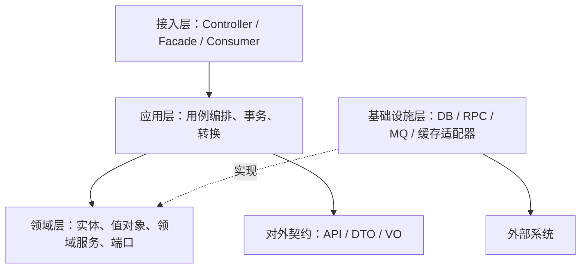
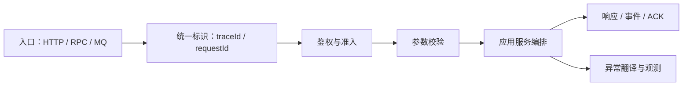
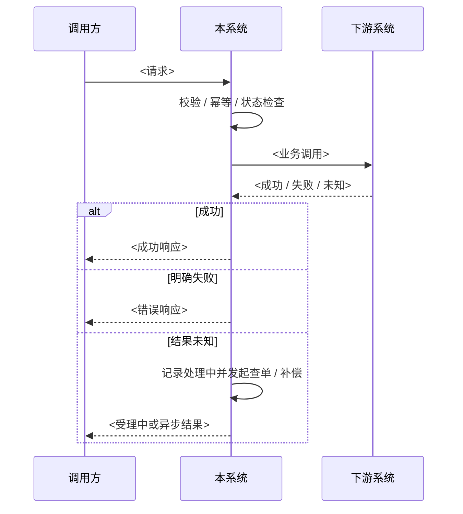

# <系统 / 模块>详细设计方案

> **模板使用说明**
>
> 1. 将 `<...>` 替换为实际内容；表格行可复制，不适用的小节可整节删除，但需保持编号连续。
> 2. 本文适用于从概要设计细化到可实现、可测试、可评审的详细设计。
> 3. 关键结论必须写明证据来源：代码路径、配置路径、接口文档、规范章节、测试结果或决策记录。
> 4. 未确认内容写入“开放问题”，不要包装成事实；与现状存在差距的内容写入“实施现状与差距”。
> 5. 涉及资金、订单、账户、状态机、异步消息、外部调用时，必须补齐幂等、事务、补偿、重复 / 乱序 / 结果未知处理。

| 项 | 内容 |
|---|---|
| 文档版本 | `<例如：v0.1 草稿 / v1.0 评审稿>` |
| 适用对象 | `<研发、测试、运维、联调方、架构评审成员>` |
| 前置条件 | `<需先阅读的概要设计、领域规范、接口文档或决策记录>` |
| 相关文档 | `<文档名与版本；链接或本地路径>` |
| 设计范围 | `<本模块 / 服务 / 能域；明确包含内容>` |
| 非目标 | `<本文不解决、由其他系统或后续版本解决的内容>` |
| 证据口径 | `<代码库、配置来源、规范版本、评审结论；标明“实证 / 设计约定 / 待确认”>` |

## 1. 概述

### 1.1 文档定位与术语

**文档定位**

- 本文档是 `<系统 / 模块>` 的 `<详细设计 / 低阶设计 / 实施设计>`，承接 `<概要设计文档名与章节>`。
- 设计目标：`<说明本方案要解决的问题、达到的可实现度和可验证度>`。
- 边界：`<说明本系统与上下游的职责切分；哪些职责明确不由本系统承担>`。

**术语表**

| 术语 / 缩写 | 含义 | 使用边界 |
|---|---|---|
| `<术语>` | `<准确定义>` | `<在本文或本域中的特殊用法>` |

### 1.2 运行环境

| 项 | 版本 / 值 | 说明 |
|---|---|---|
| 语言 / JDK | `<版本>` | `<编译字节码版本、运行时要求>` |
| 应用框架 | `<框架与版本>` | `<Boot / Cloud / RPC / ORM 等关键框架>` |
| RPC | `<协议与版本>` | `<端口、序列化、payload、兼容模式>` |
| 数据库 | `<产品与版本>` | `<字符集、时区、隔离级别、兼容模式>` |
| MQ | `<产品与版本>` | `<顺序性、重试、死信、幂等语义>` |
| 缓存 | `<产品与版本>` | `<用途、过期策略、是否允许作为最终事实>` |
| 注册 / 配置中心 | `<产品与版本>` | `<命名空间、配置格式、发布策略>` |
| 观测组件 | `<日志 / 指标 / 链路>` | `<关键约束>` |
| 部署形态 | `<物理机 / 容器 / K8s / 多可用区>` | `<副本数、资源、发布单元>` |
| 端口 | `<HTTP / RPC / 管理端口>` | `<暴露范围>` |

### 1.3 部署与启动

| 项 | 设计 | 验证方式 |
|---|---|---|
| 可执行模块 | `<模块名、打包方式、入口类>` | `<构建 / 启动命令>` |
| 启动依赖 | `<数据库、注册中心、MQ、下游服务就绪条件>` | `<启动前检查项>` |
| 环境切换 | `<dev / test / staging / prod 配置来源>` | `<配置差异清单>` |
| 优雅停机 | `<流量摘除、任务等待、资源释放>` | `<停机演练口径>` |
| 发布顺序 | `<配置、DDL、服务、消费组、上游开关>` | `<回滚与兼容要求>` |
| 健康检查 | `<存活、就绪、依赖探测>` | `<通过条件>` |

## 2. 架构与模块结构设计

### 2.1 上下文映射和领域模型

```mermaid
flowchart LR
    Upstream["<上游系统 / 调用方>"] --> System["<本系统>"]
    System --> DownstreamA["<下游系统 A>"]
    System --> DownstreamB["<下游系统 B>"]
    System -> Data["<数据库 / 缓存 / MQ>"]
```

| 外部上下文 | 交互方式 | 本系统职责 | 对方职责 | 防腐点 |
|---|---|---|---|---|
| `<上游>` | `<HTTP / RPC / MQ / 文件>` | `<接收、校验、编排>` | `<发起、鉴权、重试策略>` | `<契约转换、错误翻译>` |
| `<下游>` | `<HTTP / RPC / MQ / 文件>` | `<调用、结果判定、补偿>` | `<业务执行、状态查询>` | `<适配器、超时、错误映射>` |

**核心领域模型**

| 模型 | 类型 | 聚合根 | 不变量 | 归属模块 |
|---|---|---|---|---|
| `<领域对象>` | `<聚合 / 实体 / 值对象 / 事件>` | `<聚合根>` | `<一致性规则>` | `<模块>` |

### 2.2 领域用例与事件

| 用例 / 事件 | 触发方 | 输入 | 输出 | 状态影响 | 幂等键 |
|---|---|---|---|---|---|
| `<用例名>` | `<用户 / 系统 / MQ / 定时任务>` | `<请求或事件>` | `<响应 / 事件 / 记录>` | `<无 / 状态 A→B>` | `<业务键>` |

### 2.3 分层架构与依赖规则



| 规则 | 约束 | 违反示例 | 检查方式 |
|---|---|---|---|
| 依赖方向 | `<例如 access → app → domain；infra 实现端口>` | `<领域层引用 ORM / RPC>` | `<ArchUnit / 编译检查 / 评审>` |
| 领域纯度 | `<是否允许框架注解、中间件类型>` | `<实体直接依赖框架>` | `<静态检查>` |
| 契约收敛 | `<DTO 引用允许出现的层>` | `<领域对象暴露到外部契约>` | `<代码评审>` |
| 事务边界 | `<事务所属层与范围>` | `<事务内远程调用>` | `<代码扫描 / 测试>` |

### 2.4 战术设计元素

| 元素 | 类型 | 代码位置 | 职责与不变式 |
|---|---|---|---|
| `<聚合名>` | 聚合 | `<路径 / 包>` | `<聚合边界、唯一约束、状态保护>` |
| `<实体名>` | 实体 | `<路径 / 包>` | `<生命周期与标识>` |
| `<值对象名>` | 值对象 | `<路径 / 包>` | `<不可变性、精度、单位、校验>` |
| `<领域服务名>` | 领域服务 | `<路径 / 包>` | `<跨实体规则 / 算法>` |
| `<端口名>` | 仓储 / 外部端口 | `<路径 / 包>` | `<输入输出契约，不暴露实现>` |
| `<领域事件名>` | 事件 | `<路径 / 包>` | `<触发条件、消费语义>` |

### 2.5 应用层编排与 CQRS 语义

| 侧别 | 编排模板 | 事务 | 副作用 | 一致性口径 |
|---|---|---|---|---|
| 命令侧 | `<校验 → 权限 / 风控 → 幂等 → 状态检查 → 执行 → 记录 / 发事件>` | `<边界与隔离>` | `<写库、外部调用、消息>` | `<成功、失败、结果未知的定义>` |
| 查询侧 | `<参数校验 → 数据源路由 → 查询 → 组装>` | `<通常无事务或只读>` | `<是否有查单、缓存回填>` | `<实时性 / 快照性>` |
| 事件侧 | `<消费 → 幂等 → 状态变更 → 后续事件>` | `<事务与 ACK 关系>` | `<重试、死信、补偿>` | `<至少一次 / 最多一次 / 恰好一次实现方式>` |

### 2.6 模块与依赖约束

| 模块 | 主要内容 | 依赖方向 | 禁止依赖 | 交付物 |
|---|---|---|---|---|
| `<模块名>` | `<接口 / 应用 / 领域 / 基础设施>` | `<允许依赖>` | `<禁止依赖>` | `<jar / 服务 / 契约包>` |

### 2.7 应用服务清单

| 服务类 | 公开方法 | 入参 → 出参 | 职责 | 事务 / 幂等 | 依赖 |
|---|---|---|---|---|---|
| `<服务名>` | `<方法名>` | `<Request → Result<Response>>` | `<用例职责>` | `<规则>` | `<端口列表>` |

### 2.8 转换器与配置类

| 类 | 转换 / 配置职责 | 字段映射要点 | 测试 |
|---|---|---|---|
| `<转换器名>` | `<DTO ↔ 领域模型 / 下游模型>` | `<字段、单位、枚举、空值、时间>` | `<用例与边界>` |
| `<配置类名>` | `<前缀、绑定字段、默认值、刷新策略>` | `<配置项语义>` | `<配置加载测试>` |

### 2.9 接入组件清单

| 类型 | 组件 | 路由 / 注册方式 | 职责 | 异常处理 |
|---|---|---|---|---|
| Controller | `<类名>` | `<HTTP 路径>` | `<参数校验、响应封装>` | `<错误翻译>` |
| RPC Facade | `<类名>` | `<服务接口与版本>` | `<参数校验、委托应用服务>` | `<错误翻译>` |
| MQ Consumer | `<类名>` | `<topic / tag / group>` | `<消费、幂等、业务处理>` | `<ACK / NACK / 重试>` |
| Filter / Interceptor | `<类名>` | `<顺序>` | `<trace、鉴权、日志、限流>` | `<fail-open / fail-closed>` |

### 2.10 请求处理管线



| 入口类型 | 处理顺序 | 超时 | 重试 | 幂等 | 日志 / 链路 |
|---|---|---|---|---|---|
| `<HTTP>` | `<Filter → Controller → AppService>` | `<值>` | `<是否允许>` | `<键>` | `<字段>` |
| `<RPC>` | `<Filter → Facade → AppService>` | `<值>` | `<次数与条件>` | `<键>` | `<attachment>` |
| `<MQ>` | `<Listener → idempotency → AppService>` | `<值>` | `<重试 / 死信>` | `<键>` | `<header>` |

## 3. 接口详细设计

### 3.1 通用约定

| 项 | 约定 | 证据 / 理由 |
|---|---|---|
| 响应包裹 | `<结构、成功码、失败码、泛型>` | `<契约文档或代码路径>` |
| 金额 | `<单位、精度、序列化、四舍五入规则>` | `<资金规范>` |
| 时间 | `<格式、时区、空值、前后端精度>` | `<契约>` |
| 长整型 | `<是否转字符串、适用端>` | `<精度损失风险>` |
| 编码 | `<字符集、字典值、大小写>` | `<规范>` |
| 分页 | `<是否支持、排序、游标 / 页码>` | `<契约>` |
| 鉴权 | `<签名、token、白名单、租户>` | `<安全规范>` |
| 重试 | `<调用方可重试条件与次数>` | `<幂等保障>` |
| 兼容性 | `<新增字段、废弃字段、版本策略>` | `<发布策略>` |

### 3.2 对外服务接口

按业务域拆分接口组；每组先给方法清单，再给关键字段表。

#### `<接口组 A>`

| 方法 | 入参 → 出参 | 语义 | 副作用 | 幂等键 | 错误语义 |
|---|---|---|---|---|---|
| `<method>` | `<Request → Result<Response>>` | `<业务动作>` | `<写库 / 调下游 / 发消息>` | `<业务单号>` | `<冲突、不存在、状态不允许>` |

**`<RequestDTO / VO>` 字段**

| 字段 | 类型 | 必填 | 校验 | 说明 | 来源 / 归属 |
|---|---|---|---|---|---|
| `<field>` | `<String / Long / Enum>` | `<是 / 否>` | `<注解或规则>` | `<业务含义、单位、格式>` | `<上游 / 本系统 / 下游>` |

**`<ResponseDTO / VO>` 字段**

| 字段 | 类型 | 说明 | 生成规则 |
|---|---|---|---|
| `<field>` | `<String / Long / Enum>` | `<业务含义>` | `<取值来源与计算方式>` |

### 3.3 HTTP 接口

| 方法 + 路径 | 用途 | 请求 | 响应 | 鉴权 | 幂等 | 备注 |
|---|---|---|---|---|---|---|
| `<GET /api/...>` | `<查询>` | `<DTO>` | `<VO>` | `<方式>` | `<无 / key>` | `<缓存 / 排序>` |
| `<POST /api/...>` | `<创建 / 执行>` | `<DTO>` | `<VO>` | `<方式>` | `<key>` | `<禁止无幂等重试>` |

### 3.4 MQ 接口

| Topic / Queue | 方向与组 | 消息体 | 触发条件 | 消费语义 | 失败策略 | 幂等键 |
|---|---|---|---|---|---|---|
| `<topic>` | `<生产 / 消费；group>` | `<事件字段>` | `<业务条件>` | `<顺序、并发、ACK>` | `<重试、死信、告警>` | `<业务键>` |

### 3.5 下游客户端

| 客户端 | 调用方式 | 超时 | 重试 | 结果判定 | 错误映射 | 查单 / 补偿 |
|---|---|---|---|---|---|---|
| `<Client>` | `<RPC / HTTP>` | `<毫秒>` | `<次数与条件>` | `<成功 / 明确失败 / 未知>` | `<code 对照>` | `<查询接口与恢复路径>` |

## 4. 数据结构设计

### 4.1 写路径模型

| 表 / 集合 | 字段 | 类型 / 约束 | 说明 |
|---|---|---|---|
| `<table>` | `<field>` | `<PK / UK / index / null / default>` | `<业务含义>` |

**写入链路**

`<DTO → 领域对象 / 命令 → 应用服务 → 仓储 → DO / ORM → 数据库>`

| 写入约束 | 设计 |
|---|---|
| 唯一约束 | `<防止重复写入的键>` |
| 事务边界 | `<方法、传播行为、隔离级别>` |
| 乐观锁 / 版本 | `<字段、冲突处理>` |
| 软删除 | `<规则与查询过滤>` |
| 审计字段 | `<creator、modifier、时间>` |

### 4.2 读路径与 SQL 清单

| Mapper / DAO | SQL ID | 语义 | 关键条件 | 索引匹配 | 风险 |
|---|---|---|---|---|---|
| `<Mapper>` | `<sqlId>` | `<查询目的>` | `<where / join / order>` | `<命中索引>` | `<全表扫、锁、数据量>` |

### 4.3 数据一致性与迁移

| 项 | 设计 |
|---|---|
| 状态字段 | `<枚举、合法流转、终态>` |
| 幂等数据 | `<唯一键、重复返回语义>` |
| 分布式一致性 | `<本地事务、TCC、SAGA、对账、补偿>` |
| 对账口径 | `<来源、周期、差异处理>` |
| DDL 迁移 | `<脚本、兼容窗口、回滚>` |
| 数据保留 | `<归档、清理、合规要求>` |

## 5. 核心流程详细设计

### 5.1 用例流程模板

为每个核心用例复制以下表格与流程图。

| 项 | 设计 |
|---|---|
| 用例名 | `<用例>` |
| 触发入口 | `<HTTP / RPC / MQ / Job>` |
| 前置条件 | `<状态、配置、依赖可用性>` |
| 输入校验 | `<字段、格式、权限、金额>` |
| 幂等设计 | `<键、存储、冲突返回>` |
| 状态机 | `<起始态 → 中间态 → 终态>` |
| 事务边界 | `<本地事务范围与外部调用拆分>` |
| 下游调用 | `<顺序、超时、重试、结果未知>` |
| 补偿策略 | `<查单、冲正、取消、人工处理>` |
| 并发处理 | `<锁、CAS、唯一约束、版本>` |
| 异常路径 | `<可重试 / 不可重试 / 需人工>` |
| 观测告警 | `<日志、指标、告警阈值>` |



### 5.2 状态机与终态保护

| 当前状态 | 事件 / 动作 | 后置状态 | 允许条件 | 并发 / 重复处理 | 说明 |
|---|---|---|---|---|---|
| `<INIT>` | `<事件>` | `<PROCESSING / SUCCESS / FAIL>` | `<条件>` | `<CAS / 唯一键 / 锁>` | `<终态不可回退>` |

### 5.3 查询、回调与通知

| 场景 | 触发 | 查询 / 通知对象 | 状态回写 | 重复处理 | 乱序处理 | 丢失处理 |
|---|---|---|---|---|---|---|
| `<主动查单>` | `<定时 / 用户触发>` | `<下游>` | `<CAS 规则>` | `<不重复推进终态>` | `<版本 / 时间戳>` | `<下一轮或人工>` |
| `<异步回调>` | `<下游通知>` | `<本系统 / 上游>` | `<验签后处理>` | `<幂等键>` | `<状态机约束>` | `<查单补偿>` |

### 5.4 异常、补偿与恢复

| 异常 | 分类 | 是否可重试 | 幂等保障 | 自动处理 | 人工处理 | 告警 |
|---|---|---|---|---|---|---|
| `<超时>` | `<结果未知>` | `<条件>` | `<键>` | `<查单 / 延迟重试>` | `<阈值与入口>` | `<级别>` |
| `<下游拒绝>` | `<明确失败>` | `<否>` | `<键>` | `<终态或回退>` | `<例外场景>` | `<级别>` |
| `<本地事务失败>` | `<未提交>` | `<是>` | `<键>` | `<重试>` | `<连续失败>` | `<级别>` |

## 6. 规则与算法设计

### 6.1 核心规则与算法

| 规则 / 算法 | 输入 | 输出 | 边界条件 | 复杂度 | 配置化 | 测试用例 |
|---|---|---|---|---|---|---|
| `<规则名>` | `<输入>` | `<输出>` | `<空值、极值、并发>` | `<时间 / 空间>` | `<配置项>` | `<正向、反向、边界>` |

### 6.2 精度、单位与字典映射

| 类型 | 外部口径 | 内部口径 | 转换规则 | 异常处理 |
|---|---|---|---|---|
| 金额 | `<分 / 元 / 币种>` | `<对象与精度>` | `<换算、舍入>` | `<精度丢失 / 舍入冲突>` |
| 时间 | `<格式与时区>` | `<对象与时区>` | `<转换>` | `<非法时间>` |
| 编码 | `<外部枚举>` | `<内部枚举>` | `<映射表>` | `<未知值>` |

### 6.3 枚举字典

| 枚举 | code / value | 含义 | 兼容值 | 归属 | 说明 |
|---|---|---|---|---|---|
| `<Enum>` | `<code>` | `<含义>` | `<历史值>` | `<模块>` | `<终态 / 可重试 / 展示>` |

## 7. 错误码与异常处理设计

| 错误码 | 含义 | 触发条件 | 对外展示 | 调用方动作 | 日志级别 | 告警 |
|---|---|---|---|---|---|---|
| `<00000>` | `<成功>` | `<条件>` | `<文案>` | `<动作>` | `<INFO>` | `<无>` |
| `<BIZ_xxx>` | `<业务错误>` | `<条件>` | `<脱敏文案>` | `<是否可重试>` | `<WARN>` | `<条件>` |
| `<SYS_xxx>` | `<系统错误>` | `<条件>` | `<统一文案>` | `<重试或联系>` | `<ERROR>` | `<条件>` |

**异常处理约定**

| 异常类型 | 捕获位置 | 转换规则 | 是否吞掉 | 堆栈要求 |
|---|---|---|---|---|
| `<参数校验异常>` | `<入口层>` | `<错误码与文案>` | `<否>` | `<可选>` |
| `<业务异常>` | `<应用层>` | `<业务错误码>` | `<否>` | `<按级别>` |
| `<远程调用异常>` | `<适配层>` | `<成功 / 失败 / 未知>` | `<禁止吞掉>` | `<必须>` |
| `<未知异常>` | `<全局处理器>` | `<系统错误>` | `<否>` | `<必须>` |

## 8. 配置设计

### 8.1 本地配置

| 配置键 | 默认值 | 环境 | 生效方式 | 是否敏感 | 校验 | 说明 |
|---|---|---|---|---|---|---|
| `<key>` | `<value>` | `<dev / test / prod>` | `<启动 / 刷新>` | `<是 / 否>` | `<规则>` | `<用途>` |

### 8.2 远程配置

| 配置文件 / Data ID | 配置组 | 键 | 默认值 | 变更影响 | 发布策略 | 回滚方式 |
|---|---|---|---|---|---|---|
| `<dataId>` | `<group>` | `<key>` | `<value>` | `<行为>` | `<灰度 / 全量>` | `<上一版本>` |

### 8.3 日志配置

| Logger / Appender | 级别 | 格式 | 脱敏 | 保留策略 | 输出目标 |
|---|---|---|---|---|---|
| `<logger>` | `<INFO / WARN / ERROR>` | `<pattern>` | `<字段>` | `<天数 / 大小>` | `<console / file / collector>` |

### 8.4 常量表

| 常量 | 值 | 使用位置 | 变更风险 | 说明 |
|---|---|---|---|---|
| `<CONSTANT>` | `<value>` | `<类 / 方法>` | `<高 / 中 / 低>` | `<语义>` |

## 9. 日志、监控与安全设计

| 面 | 设计 | 覆盖场景 | 数据样例格式 | 告警 / 指标 |
|---|---|---|---|---|
| 链路 | `<traceId 生成与透传>` | `<HTTP、RPC、MQ、异步线程>` | `<格式>` | `<采样率>` |
| 业务日志 | `<关键节点>` | `<受理、成功、失败、未知>` | `<脱敏样例>` | `<异常计数>` |
| 访问日志 | `<入出参>` | `<调用方、路径、耗时>` | `<截断与脱敏>` | `<错误率>` |
| 技术指标 | `<QPS、耗时、成功率>` | `<入口与下游>` | `<Prometheus 表达式>` | `<阈值>` |
| 业务指标 | `<业务量、状态分布>` | `<核心状态>` | `<指标名>` | `<阈值>` |
| 告警 | `<规则>` | `<资损、可用性、积压>` | `<通知内容>` | `<级别与接收人>` |
| 安全 | `<鉴权、验签、加密、脱敏>` | `<入口、存储、日志>` | `<失败策略>` | `<审计>` |
| 数据保护 | `<敏感字段分类>` | `<传输、存储、展示>` | `<算法>` | `<合规要求>` |

## 10. 测试设计

| 测试层 | 范围 | 重点用例 | 环境要求 | 通过标准 |
|---|---|---|---|---|
| 单元测试 | `<领域规则、转换、算法>` | `<正向、反向、边界>` | `<本地 / mock>` | `<覆盖率与断言>` |
| 集成测试 | `<数据库、MQ、下游>` | `<事务、幂等、状态>` | `<测试环境 / 容器>` | `<场景通过>` |
| 契约测试 | `<对外接口、下游契约>` | `<兼容性、错误码>` | `<契约文件>` | `<无破坏性差异>` |
| 并发测试 | `<重复、乱序、竞争>` | `<同一幂等键并发>` | `<压测工具>` | `<数据唯一且状态正确>` |
| 异常测试 | `<超时、下游失败、消息重投>` | `<结果未知 / 恢复>` | `<故障注入>` | `<补偿正确>` |
| 回归测试 | `<核心链路>` | `<主流程与历史缺陷>` | `<环境>` | `<用例通过>` |
| 冒烟测试 | `<发布后验证>` | `<健康检查、关键接口>` | `<生产只读 / 安全操作>` | `<指标正常>` |

## 11. 实施现状与差距

> 只填写基于证据确认的差距；不要把计划中的能力描述为已实现。

| # | 差距 / 风险 | 现状证据 | 影响 | 等级 | 处理建议 | 负责人 / 时间 |
|---|---|---|---|---|---|---|
| 1 | `<差距>` | `<代码 / 配置 / 测试 / 文档路径>` | `<业务与技术影响>` | `<P0 / P1 / P2>` | `<修复方向>` | `<待定>` |

## 12. 开放问题与决策记录

| # | 问题 | 影响 | 备选方案 | 当前倾向 | 需要决策人 | 截止时间 |
|---|---|---|---|---|---|---|
| 1 | `<问题>` | `<影响范围>` | `<方案 A / 方案 B>` | `<倾向及理由>` | `<角色>` | `<日期>` |

## 附录 A：评审检查清单

| 检查项 | 结果 | 说明 |
|---|---|---|
| 范围、目标、非目标清晰 | `<通过 / 不通过>` | `<说明>` |
| 架构边界与依赖规则可验证 | `<通过 / 不通过>` | `<说明>` |
| 接口契约、错误码、兼容性完整 | `<通过 / 不通过>` | `<说明>` |
| 数据模型、唯一约束、迁移可落地 | `<通过 / 不通过>` | `<说明>` |
| 状态机、事务、幂等完整 | `<通过 / 不通过>` | `<说明>` |
| 结果未知、重试、补偿、对账明确 | `<通过 / 不通过>` | `<说明>` |
| 安全、日志、监控、告警明确 | `<通过 / 不通过>` | `<说明>` |
| 测试与验收标准可执行 | `<通过 / 不通过>` | `<说明>` |
| 差距与开放问题未被包装为事实 | `<通过 / 不通过>` | `<说明>` |

## 附录 B：证据清单

| 编号 | 结论位置 | 结论摘要 | 证据类型 | 证据位置 | 证据等级 | 备注 |
|---|---|---|---|---|---|---|
| E1 | `<章节>` | `<结论>` | `<代码 / 配置 / 文档 / 测试 / 决策>` | `<路径 / 章节 / 链接>` | `<A / B / C / N>` | `<限制>` |
