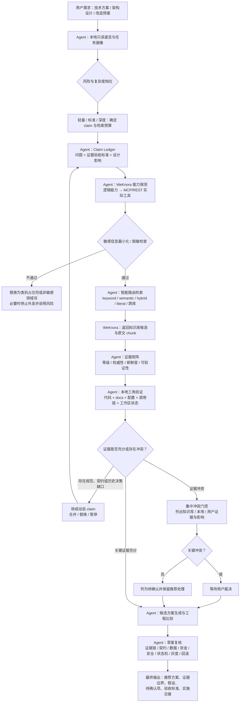
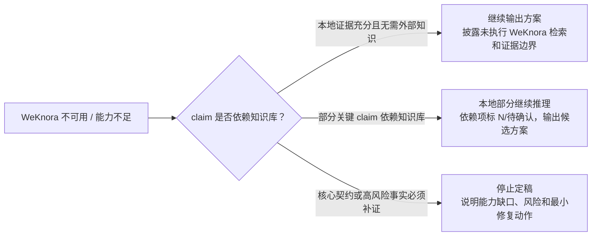

> 来源：`yy-tech-plan/SKILL.md` 及其 `references/rag-routing.md`、`weknora-tools.md`、`evidence-matrix.md`、`conflict-gate.md`、`engineering-checklist.md`、`output-templates.md`。本文是对该 skill 的机制总结，不改变 skill 本体。

## 1. 一句话定位

`yy-tech-plan` 是一个 **plan-only 的可控 Agentic RAG 技术方案生成 skill**：Agent 负责理解任务、拆解 claim、路由检索、评估证据、融合本地事实与知识库证据并生成工程方案；WeKnora 只作为知识检索和原文证据基础设施，不负责设计决策或替代本地实现事实。

它的核心目标不是“多搜几次资料”，而是把技术方案生成约束成一条可审计的证据链：关键结论必须能追溯到 A/B 级证据或用户裁决，当前系统行为必须回到本地代码、配置和调用链验证。

## 2. 核心设计原则

- **Plan-only**：只做调研、设计、对比、验证建议和方案输出，不直接修改源码、配置、数据库、依赖或外部系统。
- **Claim 驱动**：以“需要证明的设计事实”为检索单元，而不是把整段需求一次性丢给检索系统。
- **风险分档**：按轻量、标准、深度三档控制 claim 数、检索次数和上下文读取次数；发现契约、资金、安全、状态机、异步一致性等风险后只升不降。
- **证据分级**：A/B 级证据或用户裁决可支撑关键结论；C/N 级只能形成显式假设、待确认项或阻塞项。
- **本地三角验证**：知识库回答“应然规范、契约、历史决策、领域背景”；本地代码、配置和调用链回答“当前系统事实”。
- **敏感信息前置治理**：发送 WeKnora 前必须最小化并脱敏，禁止外发凭据、完整敏感标识、生产敏感数据或可重识别组合。
- **冲突门控**：知识库、本地证据和用户描述冲突时不能由 Agent 凭偏好裁决，必须集中提交用户决策。
- **降级可解释**：WeKnora 不可用时按 claim 依赖程度继续、部分待确认或停止定稿，不伪造知识库结论。

## 3. Agentic RAG 主流程

| 阶段 | Agent 的关键动作 | 输出 / 门控 | 体现的 Agentic 能力 |
|---|---|---|---|
| 1. 任务画像 | 提取目标、范围、非目标、约束、验收信号和不可假设事实；识别资金、安全、公共契约、状态机、异步一致性、发布风险 | 任务画像与风险初判 | 不是直接检索，而是先理解问题和风险 |
| 2. 选择档位 | 根据复杂度和风险选择轻量 / 标准 / 深度 | claim、检索 call、上下文读取预算 | 让流程强度随风险伸缩，避免过度检索或漏检 |
| 3. Claim 拆解 | 将需求转成可验证问题，定义证据验收标准和设计影响 | Claim Ledger | 把模糊设计问题变成可验证证据单元 |
| 4. 能力探测与脱敏 | 探测 WeKnora 实际能力，建立“逻辑能力 → 实际工具”的适配；执行数据最小化和脱敏 | 能力矩阵、脱敏查询、通道限制 | 适应工具漂移，先治理安全边界再外查 |
| 5. 智能路由检索 | 按 claim 类型选择 keyword、semantic、hybrid、literal grep、跨库检索或文档读取 | SearchRecord、候选证据 | 根据问题类型和证据空洞动态调整检索策略 |
| 6. 证据评估 | 给证据记录等级、权威性、适用范围、新鲜度和可验证性 | Evidence Matrix | 不把摘要、高分结果或合成回答当证据 |
| 7. 本地三角验证 | 读取代码、docs、配置和调用链，区分规范与当前实现 | 路径 + 符号 + 关键片段 + 工作区状态 | 用本地事实约束知识库结论 |
| 8. 缺口回补 | 将本地发现的知识缺口转成动态 claim，在预算内合并、替换或暂停 | Gap、动态 Claim | 形成检索—验证—再检索的闭环 |
| 9. 冲突门控 | 汇总知识库、本地和用户证据冲突，集中请求裁决 | 冲突决策面板 | 关键分歧不隐式裁决，保留决策权给人 |
| 10. 方案生成 | 生成有实质差异的候选方案，比较契约、数据、事务、幂等、运维、灰度、回滚和验收 | 推荐方案与排除理由 | 从证据推理到架构决策 |
| 11. 草案复核与输出 | 按工程清单复核证据链、领域风险、范围漂移和输出纪律 | 假设、待确认、验收、实施交接 | 输出可执行、可审查、可交接的方案 |

## 4. 总体流程图

### WeKnora 不可用时的分支

## 5. Agent 层与 WeKnora 层职责

### 5.1 Agent 层：编排、治理、推理和交付

Agent 是流程控制中心和责任主体，主要职责包括：

1. **任务理解与风险升档**
   - 判断目标、范围、非目标和不可假设事实。
   - 识别公共契约、数据模型、资金订单账户、安全权限、核心状态机、异步一致性、部署灰度等高风险信号。

2. **Claim 拆解与预算控制**
   - 将需求拆成可验证 claim。
   - 为每个 claim 定义证据验收标准和设计影响。
   - 控制 claim 数量、动态缺口、检索 call 和上下文读取次数。

3. **智能路由与结果解释**
   - 根据强标识、固定术语、语义解释、多跳关联或当前系统事实选择检索模式。
   - 判断结果是否满足 claim 验收标准，而不是简单采信相关度分数。

4. **证据治理**
   - 记录证据等级、权威性、适用范围、新鲜度和可验证性。
   - 区分 A/B/C/N 证据，并限制 C/N 证据的使用边界。
   - 将知识库证据与本地代码、配置、调用链互相校验。

5. **冲突处理与用户裁决**
   - 识别知识库之间、知识库与本地实现、用户描述与证据之间的冲突。
   - 集中给出决策面板、影响面、推荐选项和不裁决后果。

6. **方案生成与工程复核**
   - 生成有实质差异的候选方案。
   - 比较架构适配、契约兼容、数据正确性、事务幂等、复杂度、运维、灰度、回滚和验收。
   - 输出实施交接说明，但不实施代码。

### 5.2 WeKnora 层：检索与原文证据服务

WeKnora 是知识检索基础设施，不承担 Agent 的规划和裁决职责：

| 能力 | WeKnora 职责 | Agent 使用方式 |
|---|---|---|
| 知识库列表 | 暴露可见知识库、描述、权限范围 | 根据 claim 选择相关库，避免盲目扩大查询范围 |
| semantic search | 语义召回流程解释、设计取舍、背景知识 | 命中后仍需读取上下文并验证适用性 |
| keyword / hybrid search | 固定术语、接口名、专有名词的召回 | 保留原始术语、别名、版本和分隔符 |
| literal grep | 错误码、报文号、字段编号等强标识定位 | 要求原文命中，不把摘要当作契约 |
| read document | 提供文档或 chunk 原文上下文 | 核对章节、版本、适用范围和可验证定位 |
| cross-kb search | 在授权和预算范围内跨库检索 | 只为必要 claim 扩大范围，并记录理由 |

关键边界：

- WeKnora **不决定方案**，只提供可追溯证据。
- WeKnora **不覆盖当前系统事实**；当前实现以本地代码、配置、调用链和工作区状态为准。
- WeKnora 的摘要、合成回答或相关度分数**不能直接作为证据**，必须落到原文 chunk、文档章节或可复现查询。
- Agent 不能因为 WeKnora 不可用就编造检索结果，必须按依赖程度降级或阻塞。

## 6. 工程化辅助价值

### 6.1 降低技术方案的幻觉和拍脑袋风险

该 skill 把“设计方案”变成“证据链推理”：每个关键设计点都要有 A/B 级证据或用户裁决，C/N 级只能显式作为假设或待确认项。这样可以避免仅凭命名、记忆、摘要或模型直觉推导接口契约、状态机、资金规则或安全边界。

### 6.2 统一“规范知识”和“当前实现”的视角

传统 RAG 容易把文档结论误当成系统现实。这个 skill 强制本地三角验证：知识库回答规范、契约、历史决策和领域背景；本地代码和配置回答当前事实。两者不一致时进入冲突门控，而不是默认某一方正确。

### 6.3 让复杂方案具备可审计性

Claim Ledger、SearchRecord、ContextReadRecord、Evidence Matrix、Gap 和 Conflict 提供了可复盘结构。后续评审者可以追踪：

- 为什么提出这个问题；
- 检索了什么能力和知识范围；
- 用了哪条证据；
- 证据是否足够、是否过期、是否可验证；
- 哪些结论来自用户裁决；
- 哪些内容仍是假设。

### 6.4 控制成本与检索边界

预算矩阵避免了两类常见问题：

- 轻量问题过度检索、输出冗长模板；
- 高风险问题只做一次 hybrid 查询就仓促定稿。

风险触发后档位只升不降，使深度分析集中在契约、资金、安全、状态机、异步一致性和发布迁移等关键区域。

### 6.5 内置安全与合规治理

在调用外部知识检索前执行数据最小化、脱敏和二次复核，禁止凭据、完整敏感个人标识、生产数据和可重识别组合外发。对于必须强标识但可能关联生产实体的信息，先获得用户授权或改用本地证据与非敏感标识。

### 6.6 提升实施前评审质量

该 skill 输出的不是笼统架构描述，而是包含候选方案比较、推荐理由、排除依据、兼容性、迁移、事务幂等、灰度回滚、验收标准和实施交接的方案。它特别适配支付、订单、账户、清结算等对数据正确性和终态保护要求高的工程场景。

### 6.7 可降级、不伪装

WeKnora 不可用时，系统不会一刀切失败，也不会伪造知识库结论，而是区分：

- 本地证据充分：继续，但披露边界；
- 部分依赖知识库：输出候选方案和待确认项；
- 核心高风险事实必须补证：停止定稿并给出最小修复动作。

这使 skill 在知识库故障、权限不足或网络不可用时仍保持可信。

## 7. 适用边界与限制

- 它是方案生成与评审辅助，不是代码实现代理；不会直接改代码、跑部署或变更数据库。
- 方案质量依赖知识库覆盖度、文档新鲜度、本地工作区完整程度和用户输入清晰度。
- 强标识检索如果受工具候选数限制，只能说明“非穷尽”，不能承诺完整覆盖。
- 关键冲突、业务语义和不可逆决策仍需要用户裁决。
- 涉及生产敏感数据时，检索能力受脱敏和授权约束，不能通过逐步回填敏感片段提高召回。

## 8. 总结

`yy-tech-plan` 的价值在于把 Agentic RAG 从“检索增强回答”升级为“可控的工程决策流程”。Agent 负责拆解问题、控制预算、路由检索、治理证据、融合本地事实、处理冲突并生成方案；WeKnora 只负责提供可追溯的知识检索和原文证据。两者分工明确后，技术方案既能利用知识库沉淀，又不脱离当前代码事实，最终形成可验证、可评审、可交接的工程化输出。