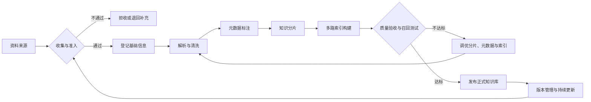
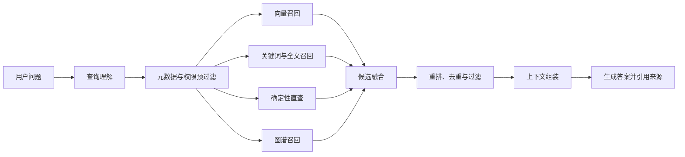
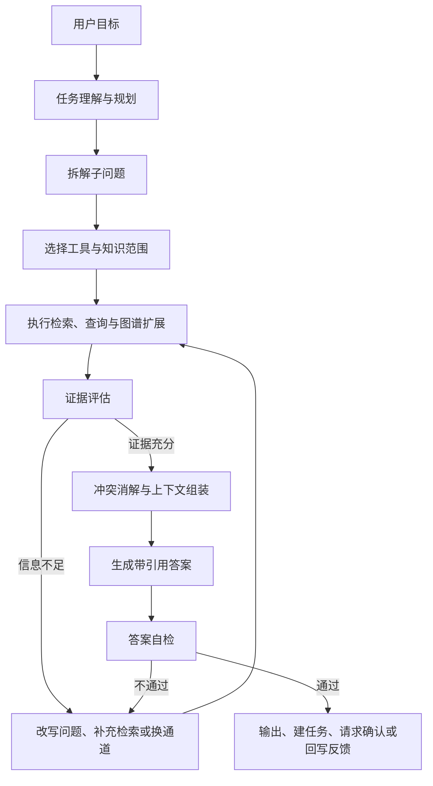
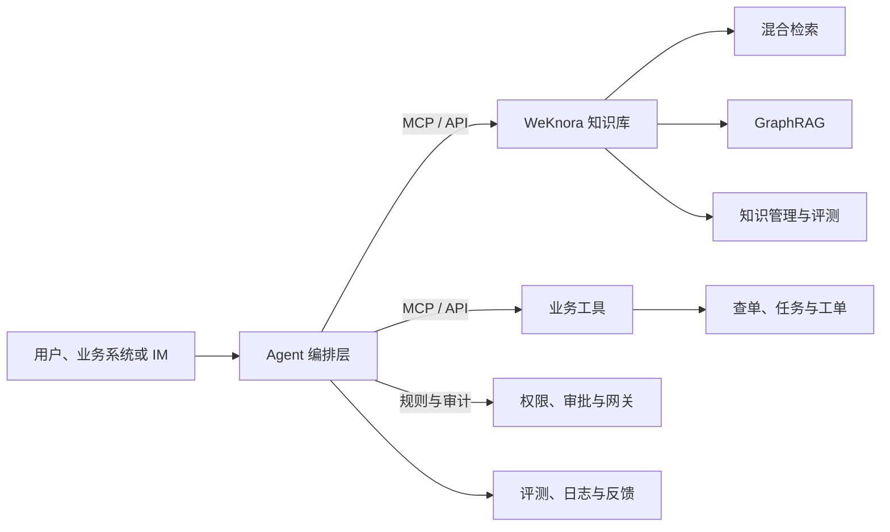
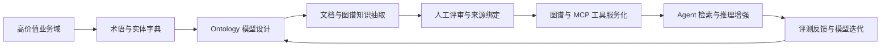

/

### 阅读路径

| 阅读目标 | 建议章节 |
| --- | --- |
| 认识 RAG、入库和检索 | [1. 认识 RAG 知识库](#1-认识-rag-知识库) |
| 比较产品与建设路线 | [2. 选型要求与产品对比](#2-选型要求与产品对比) |
| 理解架构与生态 | [3. WeKnora 方案说明](#3-weknora-方案说明) |
| 从传统 RAG 演进到 Agentic RAG | [4. 从传统 RAG 到 Agentic RAG](#4-从传统-rag-到-agentic-rag) |
| 了解后续建设和接入 | [5. 后续发展路线](#5-后续发展路线)、[6. 各 Agent MCP 接入](#6-各-agent-mcp-接入) |

---

## 1. 认识 RAG 知识库

### 1.1 RAG 知识库是什么

RAG（Retrieval-Augmented Generation，检索增强生成）不是单纯的向量库，也不是“把文件上传到后台”。它是一套让生成式 AI 在回答前先检索外部知识、再把检索结果放入上下文的架构。IBM 将其定义为：通过连接外部知识库优化 AI 模型表现，使模型生成更相关、更高质量的回答。

从工程视角看，RAG 知识库至少包含五层能力：

| 层次 | 核心作用 | 解决的典型问题 |
| --- | --- | --- |
| 资料接入层 | 统一接入 PDF、Office、网页、数据库、图片、音视频等资料 | 资料分散、版本不清、重复稿混用 |
| 知识加工层 | 解析、清洗、分片、向量化、全文索引、图谱关联 | 表格被切碎、错误码查不到、上下文丢失 |
| 检索层 | 按问题选择向量、关键词、编码直查、图谱等通道 | 语义相近但用词不同、专有名词误召回 |
| 治理层 | 管理权限、密级、版本、有效期、审计和来源引用 | 越权召回、新旧版本混用、答案不可验证 |
| 应用层 | 通过问答、搜索、MCP / API、聊天 Agent 服务人和系统 | 能力无法复用、业务系统重复集成 |

因此，RAG 知识库可以概括为：**把企业私有知识变成可检索、可授权、可追溯、可复用的上下文供给系统**。它解决的不是“模型不会说话”，而是“模型不知道公司内部事实、最新规范和业务约束”。

### 1.2 为什么现代企业要自建知识库

企业建设 RAG 知识库，不是功能跟风，而是生成式 AI 落地时共同遇到的结构性约束。

| 结构性约束 | 具体表现 | 对知识库的要求 |
| --- | --- | --- |
| 知识天然分散 | 内容散落在 SharePoint、数据库、Blob 存储、部门文档、个人电脑和业务系统中 | 形成统一检索语料，同时不破坏原有数据治理 |
| 权限安全不可回避 | 企业资料并非所有人可见，用户和 Agent 只能检索被授权内容 | 支持细粒度访问控制和文档级权限过滤 |
| 问题表达更自然 | 用户提出复杂、会话式、含上下文或表述模糊的问题 | 支持意图理解、向量检索、混合检索和语义排序 |
| Agent 需要知识基础设施 | Agent 需要数据接入、索引、检索、引用、重排和多跳推理能力 | 将知识能力工具化为 MCP / API |
| 开源产品方向收敛 | 知识问答、Agent 推理和知识治理正在同一底座上融合 | 选择能同时支撑治理和复用的平台 |

自建知识库的价值在于把私有知识变成组织能力：

1. **降低个人经验依赖**：新人、客服、研发和 Agent 查到同一口径，减少知识随人员流动而丢失。
2. **保障业务事实一致**：接口契约、资金规则、状态机、风控口径和审批要求有统一来源。
3. **让 AI 安全进入流程**：明确“能查什么”和“能做什么”，避免权限、版本和审计失控。
4. **形成持续增值资产**：方案、案例、事故复盘和坏例反馈持续回流，知识库越用越贴合业务实际。

现代企业自建 RAG 知识库，本质是在建设 AI 时代的业务基础设施，而不是复刻大厂产品。

### 1.3 RAG 如何增强 AI Agent

在 Agent 场景下，RAG 的价值可以从四个方面理解：

1. **补齐私有知识**：基座模型训练数据来自公开语料，通常不包含公司接口文档、设计方案、历史事故、审批规则和渠道规范。RAG 让 Agent 在执行任务前先拿到这些资料。
2. **提升回答可靠性**：RAG 将答案锚定在检索到的权威资料上，降低幻觉风险，并附带来源引用，便于人工核对。但 RAG 不能彻底消灭幻觉；检索错、资料错或融合错时，答案仍可能出错。
3. **让知识变成工具**：MCP 是连接 AI 应用与外部系统的开放标准。知识库通过 MCP / API 暴露检索能力后，Agent 可以在任务执行中按需调用“查资料”工具。
4. **支撑多步任务**：Agent 可以拆解复杂问题，执行多路或多次检索，评估资料是否充分，并基于带引用的证据生成答案，例如处理“查错误码 + 找处理方案 + 关联状态机 + 判断下一步动作”。

三者分工可以概括为：**模型提供推理和表达能力，Agent 提供任务编排能力，RAG 知识库提供业务事实和边界**。知识既是 Agent 时代的燃料，也是约束条件。

### 1.4 知识入库

RAG 知识库的价值首先取决于资料入口是否清晰、持续且有版本意识。资料入口不是简单“把文件上传进系统”，而是把原始资料转换成可解析、可追溯、可检索、可更新的知识对象。



各阶段的关键动作如下：

| 阶段 | 关键动作 | 质量要求 |
| --- | --- | --- |
| 收集与准入 | 明确来源、领域、适用系统、版本号、密级和负责人 | 废弃稿、重复稿、未评审结论不得进入正式库 |
| 解析与清洗 | 解析 PDF、Word、Markdown、图片、音视频；扫描件启用 OCR | 保留标题层级、表格、代码、报文示例和页码 |
| 元数据标注 | 标注渠道、系统、文档类型、版本、生效时间、适用场景、可见范围 | 支撑后续权限过滤和范围过滤 |
| 知识分片 | 按标题、语义段落、表格行、接口定义、错误码条目切分 | 分片过小丢上下文，过大稀释关键信息，需按资料类型调优 |
| 多路索引 | 构建向量、全文、图谱和确定性直查索引 | 编码、报文号、错误码、接口名等强标识保留原值 |
| 质量验收 | 用标准问题集做召回测试 | 检查来源定位、Hit@1 / Hit@3、MRR、响应耗时和权限过滤 |

质量验收发现问题后，应回到解析、元数据或分片阶段修正，而不是只调整最终排序参数。

### 1.5 检索通道

混合检索的本质是：**不同问题有不同的最佳召回方式，再用统一排序策略把多路候选合并成高置信上下文**。它不是把所有通道无差别叠加，而是按查询类型和实测收益组合。



一次典型检索包含六个阶段：

1. **查询理解**：识别意图、领域、实体、时间范围和系统范围。例如“ES000033 是什么错误，怎么处理”同时包含错误码点查和语义解释需求。
2. **预过滤**：按知识库、渠道、系统、版本、密级和用户可见范围缩小候选集，避免跨域干扰和越权内容进入上下文。
3. **多路召回**：
   - **向量检索**：适合自然语言、同义表达和跨表述召回。
   - **关键词 / 全文检索**：匹配专有名词、接口名、字段名和固定术语，补偿向量对精确词不敏感的问题。
   - **确定性直查**：错误码、报文号、接口编号、商户类型码等强标识走精确索引。
   - **图谱或关联检索**：从命中实体扩展上下游接口、状态机、错误处理和对账文档。
4. **候选融合**：不同通道分数量纲不一致，不能直接相加。常用 RRF（Reciprocal Rank Fusion）按候选在各通道中的排名计算融合分，也可对强标识直查结果赋予更高优先级。
5. **重排与去重**：用精排模型或领域规则比较问题与候选内容匹配度，合并重复分片，保留来源与版本，剔除低置信、过期或越权候选。是否启用重排应由评测数据决定。
6. **上下文组装与生成**：按相关性、完整度和 token 限制组装上下文，输出原始文档、章节或页码引用；资料不足时明确说明缺少依据。

检索优化应遵循三个原则：**先保证资料和分片质量，再优化通道组合，最后用分层评测确认收益**。每个通道都要回答“解决了哪类问题、带来多少命中率提升、增加了多少耗时”。

---

## 2. 选型要求与产品对比

### 2.1 能力要求

选型前先明确核心要求，避免只比较功能清单而忽略落地成本：

| 能力要求 | 具体要求 | 选型价值 |
| --- | --- | --- |
| 可视化管理 | 支持知识内容与分片查看、Embedding 干预、索引微调、召回测试 | 针对我司资料持续调优，而不是黑盒使用 |
| 文档解析 | 支持 PDF、Text、图片、音视频等多格式，保留表格、代码和层级 | 减少结构化资料被切碎后失去上下文 |
| 知识管理 | 支持知识图谱、混合检索、分片编辑和评测 | 建立文档关联，提升多类型问题召回率 |
| 生态复用 | 原生支持 MCP / API 与聊天 Agent | 一次建设，多场景复用，避免重复集成 |
| 社区与维护 | 社区活跃、版本可追踪、问题有解决途径 | 降低私有化部署和长期演进风险 |

### 2.2 建设路线判断

业界建设路线主要有两类：

1. **基于 LangChain、向量数据库等自研**：灵活度高，但需要持续投入解析、索引、权限、审计、评测和运维能力。在公司当前资源约束下，投入产出比偏低。
2. **采用成熟第三方产品**：可以复用成熟的接入、解析、检索、管理和集成能力，把主要精力放在知识质量、权限治理和业务场景适配。

因此，选型聚焦主流第三方方案，自研框架仅作为定制化能力补充或局部组件候选。

### 2.3 方案对比

| 方案 | 定位 | 优势 | 主要限制 |
| --- | --- | --- | --- |
| Dify | 低代码 LLM 应用平台 | 上手快、可视化能力强，适合快速搭建 RAG、Agent 和工作流 | 深度定制需二次开发 |
| FastGPT | RAG 问答与 Agent 平台 | 工作流与知识库能力较完整，适合内部问答和客服场景 | 深度定制和治理能力仍需开发补齐 |
| RAGFlow | 深度文档理解 RAG 引擎 | PDF、表格、扫描件、合同、研报、论文解析与引用溯源能力较强 | 更偏检索引擎，完整企业知识治理和 Agent 生态需补齐周边能力 |
| LlamaIndex | 数据索引与检索框架 | 检索能力强、扩展性好，适合海量数据接入和定制化 RAG | 开发门槛较高 |
| LangChain / LangGraph | LLM 应用与 Agent 编排框架 | 生态丰富、灵活性高，适合多工具、多 Agent 和复杂工作流 | 链路复杂后调试、评测和运维成本高 |
| Haystack | 模块化 NLP / RAG 框架 | 模块化清晰，适合生产级检索管道 | 有学习曲线，需自行组装完整产品能力 |
| **WeKnora** | 企业知识管理框架 | 多格式与多源同步；知识库、Agent、Wiki 共库；支持混合检索、GraphRAG、分片编辑、评测、MCP / API / CLI / SDK 和 IM 接入 | 完整平台私有化链路较重；深度解析与 Embedding 调优需组合模型配置 |

### 2.4 选型结论

Dify 与 FastGPT 更像综合类 LLM 应用平台，RAG 知识库只是能力之一，适合轻量问答场景。RAGFlow 的深度文档解析能力突出，但作为独立引擎，需要补齐企业知识治理与 Agent 集成生态。

**WeKnora 与当前目标匹配度最高**：既能覆盖企业文档问答、Agent 任务和知识 Wiki，又能通过 MCP / API / CLI / SDK 接入现有系统，并支持多源同步、混合检索、图谱、分片编辑、评测和权限审计。建议将其作为第一阶段底座；RAGFlow 或专用解析模型可作为后续特定文档类型的补充组件评估。

---

## 3. WeKnora 方案说明

### 3.1 方案定位与选型理由

WeKnora 是腾讯微信团队开源的企业级知识库方案，当前已形成较完整的产品能力，支持索引分片配置和检索通道配置，便于按我司资料类型调整入库与召回策略。

选择 WeKnora 的关键原因是生态完整性：

- **知识源接入**：可配置飞书、钉钉文档、语雀等外部数据源，将文档同步到知识库。
- **消费端触达**：可接入微信、飞书等 IM 平台，业务同事能在常用入口提问。
- **系统能力复用**：通过 MCP / API / CLI / SDK 将知识检索、图谱查询和知识管理能力暴露给其他 Agent 或业务系统。
- **知识治理**：支持分片查看、索引配置、评测、权限审计和版本化知识管理。

### 3.2 能力全景

> 产品使用文档与开发者指南：<https://weknora.weixin.qq.com/>

### 3.3 演示验证重点

现场演示重点建议覆盖：文档导入与解析、分片结果查看、召回测试、混合检索效果、权限过滤、MCP 调用和 IM 问答体验。

---

## 4. 从传统 RAG 到 Agentic RAG

### 4.1 传统 RAG 的逻辑

传统 RAG 是一条固定流水线：**用户提问 → 问题转向量 → 一次或少量检索 → 拼接上下文 → 模型生成答案**。其隐含假设是：知识库中已存在能直接回答问题的分片，且一次检索就能带出正确片段。

这种方式适合边界清晰、资料结构较好、问题与文档表述接近的场景，例如查询错误码含义、字段定义或接口地址。但在复杂业务问题中存在天然限制：

| 限制 | 表现 |
| --- | --- |
| 先检索后理解 | 尚未拆解问题就决定检索词和范围，容易把复杂问题简化成相似度匹配 |
| 检索通道固定 | 自然语言、编码点查、图谱关联和内部规则被迫走同一条管道 |
| 缺少自我校验 | 不判断资料是否足够、过期或冲突，只要上下文有内容就容易生成答案 |
| 难以跨库推理 | 渠道规范、内部设计、状态机、账务处理和历史案例需要拆解后汇总 |
| 只回答不行动 | 输出文本答案，不会自动查单、建任务、写入知识库或请求人工确认 |

### 4.2 Agentic RAG 的逻辑

Agentic RAG 把 RAG 从“固定检索管道”升级为“有目标、有工具、有反思的工作过程”。Agent 先理解目标并制定检索计划，再调用知识库、图谱、业务 API 或其他工具；每轮结果被评估，不足则补充检索或调整策略，最后基于可追溯证据生成答案，必要时触发受控后续动作。



Agentic RAG 的关键不是把流程画复杂，而是具备四种能力：

1. **规划能力**：判断问题是点查、多跳推理还是方案比较，决定查文档、查图谱或调用业务系统。
2. **工具调用能力**：通过 MCP / API 调用知识检索、图谱关联、业务查询、任务创建等原子工具。
3. **证据评估能力**：检查资料覆盖度、版本正确性、来源权威性和文档冲突。
4. **受控行动能力**：高风险操作前保留人工确认，不把“知道答案”等同于“可以执行动作”。

### 4.3 传统 RAG 与 Agentic RAG 的差异

| 维度 | 传统 RAG | Agentic RAG |
| --- | --- | --- |
| 控制流 | 固定流水线，通常一次检索后生成 | Agent 动态规划，可多轮检索与反思 |
| 问题处理 | 把用户问题当作整体 | 可拆解子问题、识别查询类型和约束 |
| 工具使用 | 主要依赖知识库检索 | 组合知识库、图谱、数据库、业务 API 和任务系统 |
| 检索策略 | 通道和参数相对静态 | 按问题路由到向量、全文、编码直查或图谱 |
| 结果校验 | 通常直接生成 | 检查证据充分性、一致性、版本和引用 |
| 适合问题 | 单点事实查询 | 多跳推理、跨库比较、方案生成和流程处理 |
| 行为边界 | 主要输出答案 | 在权限和审批约束下执行后续动作 |
| 可观测性 | 查看一次召回和生成结果 | 记录规划、工具调用、证据、反思和最终决策 |
| 工程复杂度 | 实现简单、时延稳定 | 架构、权限、评测和成本控制要求更高 |

演进方向不是淘汰传统 RAG，而是保留它作为高性价比基座：**简单事实查询走轻量固定管道，复杂、证据分散或需要跨系统验证的问题才进入 Agentic RAG**。

### 4.4 我们的 Agentic RAG 实现路径

结合 WeKnora 底座，后续建设采用“知识库底座 + MCP 工具层 + Agent 编排层 + 评测运营层”的架构。



落地分四个阶段推进：

1. **夯实知识底座**：完成资料准入、分片策略、元数据、权限和版本管理，建立渠道库、设计方案库、错误码库等清晰知识集。
2. **工具原子化**：将 WeKnora 能力通过 MCP / API 暴露为边界清晰的工具，例如列出知识库、执行混合检索、查询图谱关联、提交反馈或创建知识更新任务。
3. **建设 Agent 编排层**：增加查询路由、任务拆解、多轮检索、证据评估、冲突消解和答案自检。简单编码点查走确定性通道，复杂问题才启用多轮规划。
4. **建立评测与运营闭环**：沉淀标准问题集和真实业务案例，跟踪引用准确率、问题解决率、多轮次数、工具耗时、失败原因和用户反馈。

工程实现应遵守五条原则：

- **分层路由**：能点查的不做多轮，能单库回答的不跨库，确实复杂的问题才启用 Agentic 流程。
- **证据优先**：答案绑定来源、版本和适用范围；证据不足时明确说明，不强行生成结论。
- **工具最小授权**：Agent 只获得完成当前任务所需的最小工具和数据权限，敏感库做行级或租户级隔离。
- **高风险动作人工确认**：涉及资金、状态变更、对外发送、删除或批量写入时，Agent 只准备建议和操作单，由人工或既有审批流程确认。
- **全链路可追溯**：记录规划、检索、工具调用、证据取舍和最终答案，便于排障、审计和优化。

通过这条路径，知识库会从“被检索的资料集合”演进为业务问题求解基础设施：既能回答“文档里写了什么”，也能在授权范围内完成“该查哪些知识、如何验证结论、下一步做什么”。落地示例参见 [[raw/知识库/skill-yy-tech-plan|yy-tech-plan]]。

### 4.5 Ontology 演进展望

Agentic RAG 解决“怎么查、怎么验证、怎么组合工具”；Ontology 解决“业务世界里有哪类对象、如何关联、约束是什么”。二者结合后，知识库才能从“找到相关文本”进一步走向“理解业务事实”。

这里的 Ontology 不是一次性构建企业大一统图谱，而是为关键业务领域建立可治理的语义模型，明确实体类型、属性、关系、状态、约束、权威来源和适用范围。渠道、产品、交易、接口、报文字段、错误码、状态机、方案文档和历史案例都可以逐步纳入。

| 能力 | 没有 Ontology | 引入 Ontology 后 |
| --- | --- | --- |
| 查询理解 | 依赖模型猜测“支付渠道”“通道”“产品”是否同义 | 通过同义词、上下位词和实体映射统一语义 |
| 检索路由 | 主要靠问题文本判断通道 | 先识别实体与关系，再决定查文档、图谱、错误码库或业务库 |
| 多跳推理 | 依赖多次模糊检索拼线索 | 沿实体关系扩展，如“渠道 → 接口 → 报文字段 → 错误码 → 处理方案” |
| 一致性校验 | 只能比较文本表述 | 用类型、状态流转、取值范围和唯一约束检查矛盾 |
| 证据治理 | 引用停留在文档片段级 | 追溯权威实体、属性值、来源版本和变更记录 |

落地应避免“先建完整图谱、再找应用场景”，采用渐进式路径：



推进节奏建议如下：

1. **选择试点域**：从高频问题中选 1～2 个业务域，例如“支付渠道与接口规范”或“错误码与处理方案”，先沉淀实体字典、同义词表和核心关系。
2. **打通元数据**：让文档、分片、表格、错误码和接口定义绑定实体 ID 或标准标签，同时保留原文引用、业务对象和版本信息。
3. **半自动抽取与人工评审**：用 LLM 生成候选实体、属性和关系，由业务专家审核权威来源、状态约束、资金语义和版本适用范围。
4. **服务化查询能力**：将实体识别、关系扩展、属性查询、约束校验和影响面分析封装成 MCP 工具，减少 Agent 无效多轮检索。
5. **持续运营**：实体有 owner，属性有权威来源，版本有生命周期，坏例回流为 schema 修正、抽取规则优化或文档补齐。

后续演进可以概括为：**以 Agentic RAG 建立可靠的推理与工具调用过程，以 Ontology 固化业务语义和约束，最终形成“文本证据 + 业务对象 + 关系网络 + 治理规则”一体的企业知识基础设施**。

---

## 5. 后续发展路线

高质量知识库依赖两件事：一是准确、结构合理且贴合业务实际的知识；二是能持续优化的检索通道。后续建设集中在三个方向：

| 发展方向 | 关键动作 | 验收产物 |
| --- | --- | --- |
| 索引数据质量标注 | 按知识库类型调优文档解析与分片策略；根据召回测试和日常使用持续微调分片内容 | 分片规范、召回基线、坏例修正记录 |
| 检索质量优化 | 优化 MCP 检索通道逻辑；补充和优化 Agentic 工作流与 Skill | 查询路由规则、通道收益评测、Skill 使用说明 |
| 标准化知识产出 | 统一文档格式和产出过程；将产出能力封装为 Skill；建立知识库准入和更新同步机制 | 文档模板、产出 Skill、准入评审流程、更新机制 |

执行顺序上，先用现有资料建立评测基线，再优化分片和通道，最后固化产出与准入流程。这样能避免“只调检索参数、不改知识质量”的局部优化。

---

## 6. 各 Agent MCP 接入

### 6.1 接入原则

- **统一入口**：各 Agent 使用同一 WeKnora MCP 配置，不各自维护检索实现和知识库地址。
- **最小授权**：按 Agent 场景发放访问范围和凭据，避免共享高权限账号。
- **凭据安全**：Token 由管理员单独发放并定期轮换，不写入方案文档、代码仓库或日志。

### 6.2 MCP 配置模板

```json
{
  "mcpServers": {
    "weknora-mcp": {
      "url": "http://192.168.21.119/mcp/56caaca2-01bd-4259-8117-1b2176b35971",
      "headers": {
        "Authorization": "Bearer <MCP_TOKEN>"
      }
    }
  }
}
```
