# 账户财务域详细设计方案

| 项 | 内容 |
|---|---|
| 版本 | v0.2.1 排版优化；在 v0.2 精简版基础上统一空白、标题编号与标注形式，内容不变 |
| 适用对象 | 账户财务域研发、测试、运维、上游联调方、财务运营、架构评审 |
| 依据 | `账户财务详细设计方案.md`、`技术方案通用模板.md`、`技术方案模板.md` |
| 范围 | 账户中心与财务核算中心的架构、模型、接口、数据、流程、规则、异常、配置、观测、测试与实施 |
| 非目标 | 交易支付编排、清分计费、结算出金、退款路由、渠道结果处理、撤销业务判断、会计科目体系定义、历史迁移定稿 |
| 证据口径 | 本仓库文档设计产物，不代表已实现；技术栈、精确配置、错误码数值待实施确认 |

## 1. 概述

### 1.1 定位与术语

- 目标：以幂等、原子、不可变、可勾稽方式承接明确动账指令；账户中心维护实时资金事实，财务核算中心异步生成借贷分录、凭证、科目汇总与试算平衡。
- 边界：输入必须包含==账户、金额、方向、币种、余额==影响；本域不反推清分规则。双系统不共享 Repository，不直连对方数据库。
- 差错口径：历史成功事实只追加；当日未日结差错可整笔冲正，跨日或已日结差错走审批调账。

| 术语 | 含义 |
|---|---|
| 外部户 | 客户基本户 / 结算户；余额由记账簿承载，自身不直接动账 |
| 记账簿 | 外部户下按业务场景拆分的余额载体，`book_type` 表达担保、待结算等场景 |
| 余额桶 | 记账簿下高并发执行单元；单条外部户指令行不跨桶，冲正 / 冻结操作回原桶 |
| 内部户 | 内部核算与过渡账户；单余额、可为负、无冻结与控制位 |
| 动账指令 / 明细 | 指令是意图；成功明细是不可变资金事实 |
| 分录 / 凭证 | 成功明细生成借贷分录；同一指令的分录同事务归集为凭证 |
| 冻结单 | 记录冻结、累计解冻、累计转出与目标桶 |
| 冲正 / 调账 | 冲正由账户中心整笔镜像成功指令；调账来自审批后的新指令 |
| 日切 / 日结 | 00:00 固化快照，01:00 勾稽、汇总、试算；日结后禁止补录 |
| Outbox | 与业务同事务写入的本地消息；提交后异步投递，消费方幂等 |
| 资金守恒 | 加钱 / 减钱原子组内账面流入合计等于流出合计；冻结转出不套用 |

### 1.2 运行环境

| 项 | 设计约束 | 状态 |
|---|---|---|
| 语言 / 框架 | 支持高精度 decimal、本地事务、唯一键、行锁 / 乐观锁 | 待确认 |
| RPC / API | `Facade` 为逻辑接口，可落 HTTP / RPC / 网关；必须有超时、鉴权、限流、重试语义 | 待确认 |
| 数据库 | 账户中心与财务核算两套逻辑库；支持事务、唯一键、毫秒时间 | 待确认 |
| MQ | At-least-once、重试、死信；顺序或乱序均可，但消费必须幂等 | 待确认 |
| 缓存 | 只能作读加速，不得作为余额、明细、分录、凭证的事实来源 | 待确认 |
| 配置 / 观测 | 支持环境隔离、版本化配置、结构化日志、指标、链路、告警 | 待确认 |
| 部署 | 双系统多副本；Outbox Relay 与批任务需分布式锁或任务唯一键互斥 | 待确认 |

### 1.3 部署与启动

| 项 | 设计与验证 |
|---|---|
| 可执行模块 | `account-center`、`financial-accounting` 独立构建、配置、发布；构建产物独立 |
| 启动依赖 | DB、MQ、配置中心、财务配置域可用；账户中心启动不依赖分录完成 |
| 环境切换 | dev / test / staging / prod 独立命名空间；校验日切、路由、Outbox、批任务配置 |
| 优雅停机 | 摘流后等待本地事务与 Outbox 写入；消费线程完成或安全重投；批任务幂等重跑 |
| 发布顺序 | 兼容 DDL → 配置 → 消费组 → 服务 → 上游开关；先影子 / 双写验证再切流 |
| 健康检查 | 存活、就绪、DB、MQ、Outbox 积压、批任务状态；异常阻断发布 |
| 定时任务 | 00:00 快照、01:00 勾稽；多实例通过会计日 + jobType + triggerNo 互斥 |

## 2. 架构与模块结构设计

### 2.1 上下文映射和领域模型

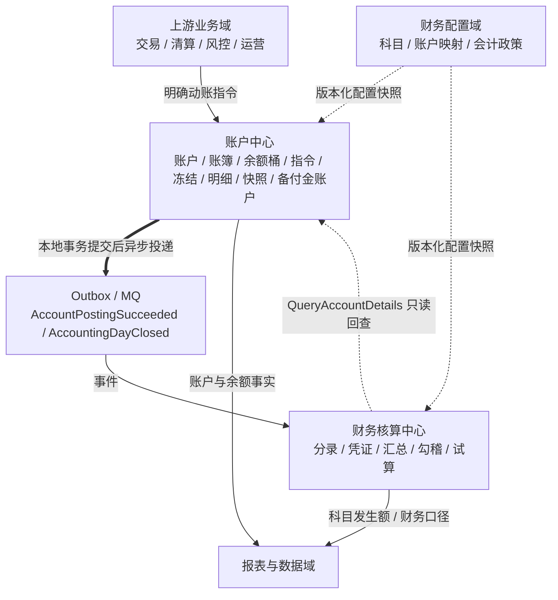

| 外部上下文       | 交互                 | 防腐与失败边界                  |
| ----------- | ------------------ | ------------------------ |
| 上游业务域       | 同步 Facade 发起明确动账   | 校验语义完整，不透传上游库表；错误语义翻译    |
| 财务配置域       | 版本化科目、账户映射、会计政策    | 执行与核算使用快照，避免配置漂移         |
| 财务核算 ↔ 账户中心 | Outbox 事件 + 只读明细回查 | 事件去重、唯一键兜底；不得反向修改余额      |
| 报表与数据域      | 读模型 / 数据服务         | 只读，不写业务事实                |
| 定时调度        | 快照、勾稽、汇总、试算        | 会计日 + triggerNo 幂等；失败可重跑 |

| 模型                                   | 类型 / 归属   | 核心不变量                                    |
| ------------------------------------ | --------- | ---------------------------------------- |
| `OuterAccount`                       | 聚合 / 账户中心 | 余额为有效账簿桶汇总；销户后禁新动账；余额非负                  |
| `AccountBook`                        | 聚合 / 账户中心 | 映射唯一外部户；余额为有效桶之和；同账户同类型唯一                |
| `AccountBookBucket`                  | 实体 / 账簿   | `ledger = available + frozen`；可用、冻结非负    |
| `InnerAccount`                       | 聚合 / 账户中心 | 单余额可为负；可用 / 冻结增量恒为 0                     |
| `PostingInstruction` / `PostingLine` | 聚合 / 账户中心 | 原子组全部成功或失败；幂等键唯一；失败重试复用原指令               |
| `AccountDetail`                      | 不可变事实     | 指令 + 行唯一；余额快照连续；只插入                      |
| `FreezeOrder` / `FreezeOperation`    | 聚合 / 账户中心 | `released + transferred <= amount`；操作回原桶 |
| `AccountingEntry`                    | 聚合 / 财务核算 | `detailNo` 唯一；必须落科目；金额等于来源明细             |
| `AccountingVoucher`                  | 聚合 / 财务核算 | `instructionNo` 唯一；借方合计 = 贷方合计 = 分录合计    |
| `SubjectDailySummary`                | 聚合 / 财务核算 | 科目 + 会计日 + 币种唯一；只统计已复核分录                 |
| `AccountingSubject`                  | 聚合 / 财务核算 | 科目号唯一；类型与余额方向符合会计规则                      |
| `ReserveAccount` / `ReserveOperation`  | 聚合 / 值对象 / 账户中心 | ACS 总额、映射、可用、未分配守恒；一次成功操作形成一条不可变明细 |

#### 2.1.1 备付金账户领域模型

`ReserveAccount` 是账户中心新增的聚合根，承载 ACS 备付金余额及其向银联、网联的映射和可用口径。`ReserveOperation` 是聚合内的不可变值对象。进入领域事务的每一次备付金操作都会生成一条操作明细；成功明细承载六项余额联动，明确失败明细记录零增量与失败语义。

| 字段 | 映射业务口径 | 说明 |
|---|---|---|
| `reserveAccountNo` | 备付金账户号 | 聚合标识，全局唯一 |
| `currency` | 币种 | 操作与六项余额统一币种，禁止隐式换汇 |
| `status` | 状态 | `ACTIVE`、`FROZEN`、`CLOSED`；冻结 / 关闭禁止新操作 |
| `acsBalance` | ACS 账户余额 | 总余额；等于银联映射 + 网联映射 + 未分配 |
| `unionpayMappingBalance` | 银联映射 | 已映射到银联的总额 |
| `unionpayAvailableBalance` | 银联可用 | 银联映射内可继续使用的额度 |
| `epccMappingBalance` | 网联映射 | 已映射到网联的总额 |
| `epccAvailableBalance` | 网联可用 | 网联映射内可继续使用的额度 |
| `unallocatedBalance` | 未分配 | 尚未映射到银联或网联的余额 |
| `version` | 乐观锁版本 | 并发操作保护 |
| `openedAt / closedAt` | 时间 | 生命周期审计字段 |

**聚合不变量**

```text
acs_balance = unionpay_mapping_balance + epcc_mapping_balance + unallocated_balance
0 <= unionpay_available_balance <= unionpay_mapping_balance
0 <= epcc_available_balance <= epcc_mapping_balance
acs_balance >= 0
unionpay_mapping_balance >= 0
epcc_mapping_balance >= 0
unallocated_balance >= 0
```

**操作明细字段**

| 字段 | 说明 |
|---|---|
| `operationNo` | 操作明细号，全局唯一 |
| `operationSeq` | 聚合内操作序号，随每次成功操作递增 |
| `operationType` | `ACS_IN`、`ACS_OUT`、`MAPPING_ALLOCATE`、`MAPPING_RELEASE`、`AVAILABLE_ADJUST`、`ADJUSTMENT`、`REVERSAL` |
| `channel` | `NONE`、`UNIONPAY`、`EPCC`；非渠道操作为 `NONE` |
| `amount` | 本次操作主金额 |
| `acsDelta / unionpayMappingDelta / unionpayAvailableDelta / epccMappingDelta / epccAvailableDelta / unallocatedDelta` | 六项余额增量，正负表示增加或减少 |
| 六项 `beforeBalance` | 操作执行前六项余额快照 |
| 六项 `afterBalance` | 操作完成后的六项余额快照；失败时等于执行前快照 |
| `status` | `SUCCESS`、`FAILED`；进入领域事务的每次操作都会生成明细 |
| `errorSemanticCode / failureReason` | 明确失败语义与原因；成功为空 |
| `sourceDomain / sourceOrderType / sourceOrderNo / idempotencyNo` | 来源与幂等键 |
| `accountingDate / occurredAt` | 会计日和业务发生时间 |
| `reason / approvalNo / operatorOrSystem / traceId` | 差异解释、审批和审计 |

**领域规则**

1. 进入领域事务的每次操作只生成一条 `ReserveOperation`；一条明细记录本次操作的完整六项增量与前后快照，不按余额项拆成多条。
2. 成功明细发布领域事件；失败明细不发布成功事件、不改变余额。两类明细都不可修改、不可删除。
3. 同一幂等键的已成功操作必须命中首次结果；此前失败的幂等键允许复用重试。
4. 成功路径下，聚合更新、操作明细插入、事件 Outbox 写入在同一账户中心本地事务提交；失败路径同样提交失败明细，但不写成功事件 Outbox。
5. `ACS_IN` 增加 ACS 总额与未分配；`ACS_OUT` 只能从未分配扣减，同步减少 ACS 总额。
6. `MAPPING_ALLOCATE` 将未分配转入目标渠道映射；`MAPPING_RELEASE` 只能释放未使用的映射额度，即不超过目标渠道映射减可用。
7. `AVAILABLE_ADJUST` 只调整目标渠道可用，不改变映射和 ACS 总额；调整后可用仍不超过映射。
8. 调账和冲正必须使用审批号或原操作引用，并通过显式增量保持六项余额守恒。
9. 成功幂等键为 `sourceDomain + sourceOrderType + sourceOrderNo + operationType + channel + idempotencyNo`；失败重试复用原键，不占用成功唯一键。
10. 成功操作发布 `ReserveAccountOperated` Outbox 事件；该事件是否复用现有财务分录链路仍需契约确认。

### 2.2 领域用例与事件

| 用例 / 事件 | 触发方 | 状态或输出 | 幂等键 |
|---|---|---|---|
| 开户 / 开簿 / 关簿 / 销户 / 控制位 | 上游、运营、风控 | 账户与账簿状态变化 | `requestId` + 业务唯一键 / 审批号 |
| `postEntries` | 上游 | 指令、明细、余额快照、成功事件 | 来源域 + 来源单号 + 业务类型 + 幂等号 |
| 调账 / 冲正 | 上游、工单、运营 | 追加新事实，不改原事实 | 调账请求号；原指令生效冲正唯一键 |
| 冻结 / 解冻 / 冻结转出 | 上游、风控、清结算 | 冻结单状态、操作流水、明细 | 冻结来源组合；操作唯一键 |
| 会计日快照 | 00:00 调度 | 三层快照、余额连续性、关闭事件 | 会计日 + jobType + triggerNo |
| 查询成功明细 | 财务核算、上游、运营 | 只读明细与快照 | 可安全重试 |
| 备付金操作 | ACS、清结算、运营 | 每次领域操作一条明细；成功后余额变化并发布 `ReserveAccountOperated` | 成功来源 + 单号 + 类型 + 渠道 + 幂等号 |
| 生成分录凭证 | `AccountPostingSucceeded` | 分录、凭证、`EntryGenerated` | `eventId`、`detailNo`、`instructionNo` |
| 勾稽 / 汇总 / 试算 | 01:00 调度 | 日结结果、科目汇总、试算结论 | 会计日 + jobType + triggerNo；科目 + 日 + 币种 |

### 2.3 分层架构与依赖规则

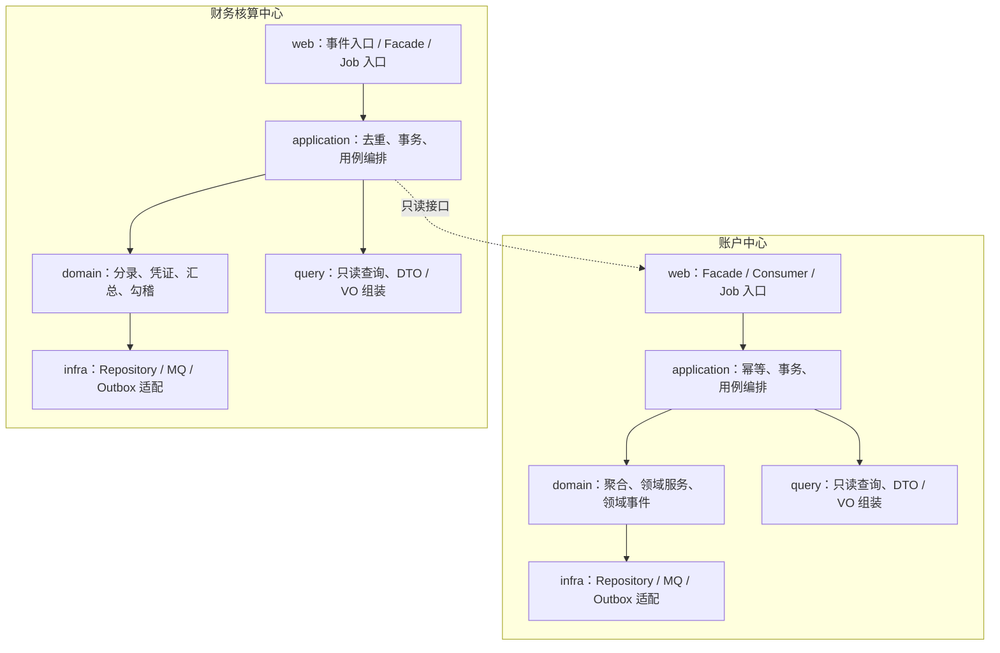

1. `web` 只做协议完整性校验和 Command / Query 转换，不判断余额、状态、可冲正等业务规则。
2. `application` 负责幂等、事务边界、用例编排和结果转换，不实现聚合不变量。
3. `domain` 保存聚合、值对象、领域服务、事件和仓储端口，不依赖 DB、MQ、HTTP 等基础设施。
4. `infra` 实现仓储、Outbox Relay、MQ、缓存、外部客户端，不承载业务规则。
5. `query` 走 CQRS 只读路径，可用 Mapper / 读模型；不维护聚合、不修改状态、不承载不变量。
6. 跨系统同步查询只能进入对方 web 层；不得共享数据库事务、连接或 Repository。

### 2.4 战术元素与模块

| 元素 / 模块 | 设计 |
|---|---|
| 聚合与实体 | 外部户、账簿、余额桶、内部户、指令、指令行、冻结单、分录、凭证、科目汇总 |
| 值对象 | `Money`、`AccountControl`、`BalanceImpact`、`PostingDirection`、冻结操作、明细快照 |
| 领域事件 | `AccountOpened`、`AccountBookOpened`、`AccountBookClosed`、`AccountPostingSucceeded`、`AccountingDayClosed`、`EntryGenerated`、`ReserveAccountOperated` |
| 领域服务 | 记账执行、桶路由、冲正、冻结、分录生成、凭证组装、科目汇总、试算 |
| 应用服务 | Account、Posting、Freeze、Snapshot、ReserveAccount、AccountingEvent、AccountingDay、Query 八类编排服务 |
| 模块依赖 | api / web / application / domain / infra / query / job / consumer；web → application → domain，infra 实现端口，query 独立只读 |
| 防腐转换 | 上游 DTO → Command；财务配置 → 版本快照；事件 → 财务核算 Command；跨系统查询 DTO |
| 接入组件 | 两个 Facade、事件消费者、快照任务、勾稽任务、Outbox Relay |
| 请求管线 | 鉴权 / 限流 / trace → schema 校验 → 幂等 → 领域事务 / 只读查询 → DTO → Outbox 异步发布 |

## 3. 接口详细设计

### 3.1 通用约定

1. 金额用字符串或高精度 decimal，禁止浮点；币种为 ISO代码；业务编号不超过 64 字符。
2. 写请求携带来源域、来源单号、请求 ID / 幂等键、操作者或系统、请求时间。
3. 同步返回区分受理成功、业务明确失败、系统失败；查询超时或响应未知可重试。
4. 写接口重试必须保持幂等键与请求体不变，不得为失败请求换新幂等键。
5. 事件必须携带 `eventId`；`AccountPostingSucceeded` 必须携带完整指令头快照，消费方不得反推凭证头。
6. 接口协议、路径、鉴权、错误码数值由实施契约定稿；原方案旧命名需通过别名兼容。

### 3.2 `AccountCenterFacade`

#### 3.2.1 接口清单

| 接口 | 场景 | 关键幂等 / 约束 |
|---|---|---|
| `openAccount` | 开户 | `requestId` 幂等返回首次结果。
| `openAccountBook` | 开账簿 | `requestId` 与 `accountNo + bookType` 双重幂等。
| `closeAccountBook` | 关账簿 | 校验审批、归属、状态。
| `changeAccountControl` | 调整账户控制位 | 控制位可组合，新增不改变既有语义；动账前逐项校验。
| `closeAccount` | 销户 | 全部有效账簿桶余额为零，无未完成冻结与待固化缓冲。
| `postEntries` | 执行动账指令 | 按来源域 + 来源单号 + 业务类型 + 幂等号数据库兜底。
| `adjustEntries` | 调账 | 必须来自审批通过工单或上游交易。
| `reversePosting` | 冲正 | 原指令成功、会计日未日结、无生效冲正。
| `freeze` | 冻结 | 按来源域 + 来源单号 + 冻结类型 + 幂等号唯一。
| `releaseFreeze` | 解冻 | `freezeNo + RELEASED + operationNo` 防重。
| `transferFreeze` | 冻结转出 | 操作类型固定 `TRANSFERRED`，操作唯一键防重。
| `snapshotAccountingDay` | 会计日快照 | 会计日 + jobType + triggerNo 幂等重跑。
| `queryAccountDetails` | 查询账务明细 | CQRS 只读，不进入聚合写路径。

> [!NOTE]
> 原方案概览使用 `changeAccountStatus`、`adjustAccount`、`reversal`、`unFreeze`、`freezeOut`；本文采用领域用例命名，旧名需在 API 契约中定义别名与弃用策略。

#### 3.2.2 `openAccount` 开户

**1. 接口**

- 接口名：`AccountCenterFacade#openAccount`
- 场景：首次开立外部户；不开放内部户。
- 调用方：上游业务系统

**接口时序图**

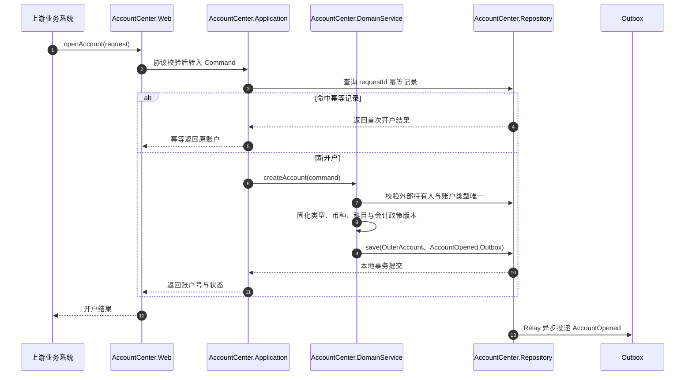

**2. 入参**

- `requestId`（必）：开户请求号
- `ownerId / ownerType`（必）：持有人标识与性质
- `accountName`（必）：账户展示名称
- `accountType`（必）：BASIC 或 SETTLEMENT
- `currency`（必）：ISO 币种
- `subjectNo`（必）：初始会计科目
- `operatorOrSystem`（必）：操作者或系统

**3. 响应**

- `accountNo`：服务端账户号
- `accountStatus`：账户状态
- `requestId`：原请求号

**4. 规则描述**

- `requestId` 幂等返回首次结果。
- 同一外部持有人 + 账户类型数据库唯一。
- 只创建外部户身份，不创建账簿或桶；固化币种、类型、科目、会计政策。
- 成功发布 `AccountOpened`，失败不发布。

#### 3.2.3 `openAccountBook` 开账簿

**1. 接口**

- 接口名：`AccountCenterFacade#openAccountBook`
- 场景：在外部户下按业务场景开立记账簿。
- 调用方：上游业务系统

**接口时序图**

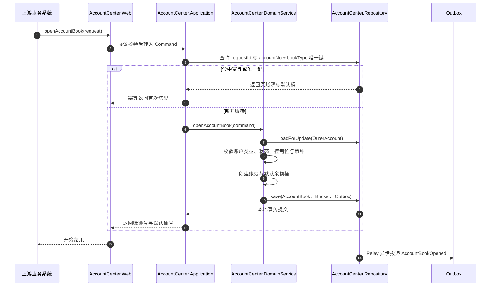

**2. 入参**

- `requestId`（必）：开簿请求号
- `accountNo`（必）：所属外部户
- `category / ownerId / ownerName`（必）：账簿类别与持有人
- `memberNo / orgNo`（条件）：按类别必填
- `bookType`（必）：业务账簿类型
- `currency`（必）：须等于账户币种
- `subjectNo`（必）：账簿科目
- `operatorOrSystem`（必）：操作者或系统

**3. 响应**

- `bookNo`：账簿号
- `defaultBucketNo`：默认余额桶号
- `status`：账簿状态

**4. 规则描述**

- `requestId` 与 `accountNo + bookType` 双重幂等。
- 账户须为可用外部基本户 / 结算户，控制位允许开簿。
- 至少创建一个可用、路由开启、余额为零的默认桶。
- 创建后不得变更所属账户；类型与科目固化；成功发布 `AccountBookOpened`。

#### 3.2.4 `closeAccountBook` 关账簿

**1. 接口**

- 接口名：`AccountCenterFacade#closeAccountBook`
- 场景：关闭单个业务记账簿。
- 调用方：运营 / 财务运营

**接口时序图**

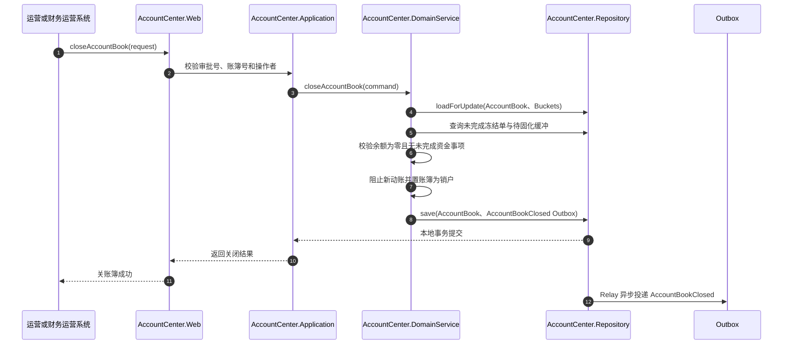

**2. 入参**

- `accountNo / bookNo`（必）：目标账户与账簿
- `approvalNo`（必）：审批单号
- `reason`（必）：关闭原因
- `operator`（必）：操作者

**3. 响应**

- `bookNo`：账簿号
- `status`：关闭后状态
- `closedAt`：关闭时间

**4. 规则描述**

- 校验审批、归属、状态。
- 全部桶三口径余额为零，无未完成冻结、无 PENDING 缓冲。
- 先阻止新动账再关闭；关闭为终态，恢复业务应新开账簿。
- 成功发布 `AccountBookClosed`。

#### 3.2.5 `changeAccountControl` 调整账户控制位

**1. 接口**

- 接口名：`AccountCenterFacade#changeAccountControl`
- 场景：叠加或移除止入、止出、冻结等控制。
- 调用方：运营 / 风控

**接口时序图**

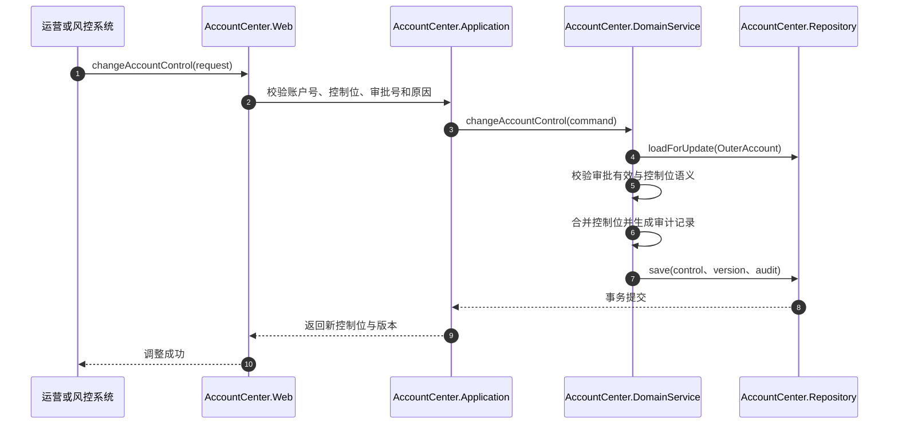

**2. 入参**

- `accountNo`（必）：外部户
- `controls`（必）：控制位集合
- `reason / approvalNo`（必）：原因与审批
- `operator`（必）：操作者

**3. 响应**

- `accountNo`：账户号
- `controls`：新控制位集合
- `version`：聚合版本

**4. 规则描述**

- 控制位可组合，新增不改变既有语义；动账前逐项校验。
- 不产生余额变化或动账明细。
- 高危控制绑定审批与审计；并发用版本或行锁防覆盖。

#### 3.2.6 `closeAccount` 销户

**1. 接口**

- 接口名：`AccountCenterFacade#closeAccount`
- 场景：关闭外部户。
- 调用方：运营 / 财务运营

**接口时序图**

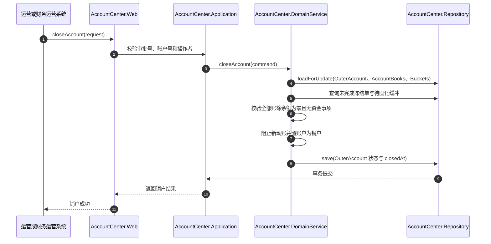

**2. 入参**

- `accountNo`（必）：外部户
- `approvalNo / reason / operator`（必）：审批、原因、操作者

**3. 响应**

- `accountNo`：账户号
- `status`：销户状态
- `closedAt`：销户时间

**4. 规则描述**

- 全部有效账簿桶余额为零，无未完成冻结与待固化缓冲。
- 先阻止新动账、开簿、冻结，再销户。
- 销户为终态；历史明细与审计保留。

#### 3.2.7 `postEntries` 执行动账指令

**1. 接口**

- 接口名：`AccountCenterFacade#postEntries`
- 场景：执行五类原子动账方向。
- 调用方：上游业务系统

**接口时序图**

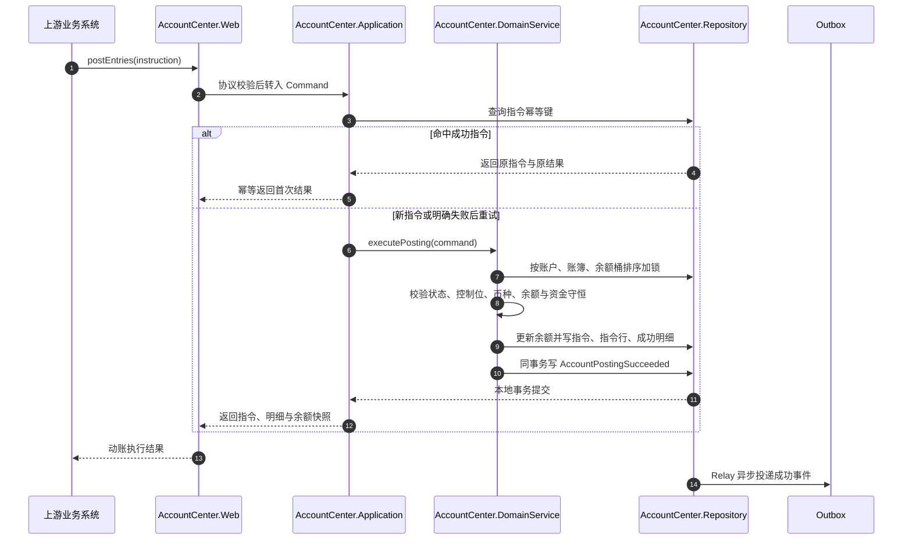

**2. 入参**

- `sourceDomain / sourceOrderType / sourceOrderNo`（必）：来源与追溯
- `requestId / idempotencyNo`（必）：幂等键
- `businessType / currency / accountingDate`（必）：业务类型、币种、会计日
- `financialErrorType`（条件）：NONE / ADJUSTMENT / REVERSAL
- `reversalOfInstructionNo`（冲正必填）：原指令
- `orders`（必）：1..N 指令行
- `orders[].accountNo`（必）：目标账户
- `orders[].bookNo / bookType`（条件）：外部户定位账簿，bookNo 优先
- `orders[].direction`（必）：五方向之一
- `orders[].amount`（必）：大于 0 的高精度金额
- `orders[].subjectNo / summary`（条件 / 可选）：科目与摘要

**3. 响应**

- `instructionNo / requestId / status`：指令号、原请求、状态
- `details`：明细号、余额影响、执行后快照
- `accountingDate`：会计日

**4. 规则描述**

- 按来源域 + 来源单号 + 业务类型 + 幂等号数据库兜底。
- 同一原子组全部成功或失败；失败不留成功事实。
- 按账户、账簿、桶排序加锁；外部户单行不跨桶。
- 校验归属、状态、控制位、币种、余额、资金守恒。
- 余额、指令、明细、Outbox 同本地事务；成功明细不可修改。
- 失败重试复用原指令号和幂等键，禁止影子指令。

#### 3.2.8 `adjustEntries` 调账

**1. 接口**

- 接口名：`AccountCenterFacade#adjustEntries`
- 场景：跨日差错、审批后的余额或科目差异。
- 调用方：上游交易 / 工单 / 财务运营

**接口时序图**

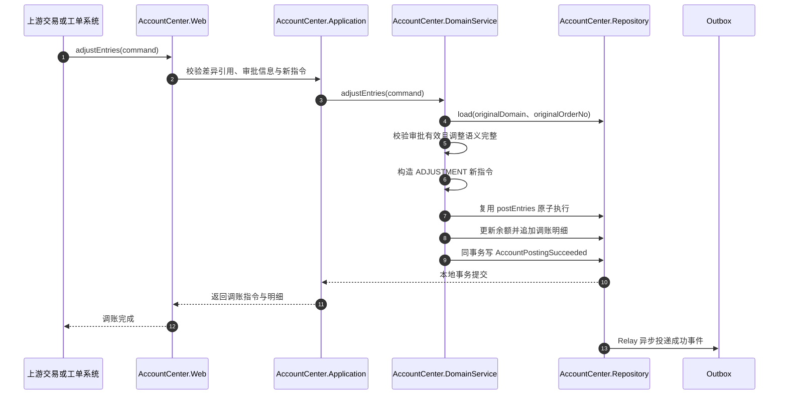

**2. 入参**

- `originalDomain / originalOrderNo`（必）：原差异引用
- `adjustmentReason / approvalNo`（必）：原因与审批
- `applicant / approver`（必）：申请人与审批人
- `instruction`（必）：新动账指令，结构同 postEntries
- `instruction.requestId`（必）：调账幂等键
- `operatorOrSystem`（必）：操作者或系统

**3. 响应**

- `instructionNo`：调账指令号
- `details`：调账明细
- `status`：执行状态

**4. 规则描述**

- 必须来自审批通过工单或上游交易。
- 生成 `ADJUSTMENT` 新指令，禁止直接改余额或原事实。
- 跨日 / 已日结差错不得普通冲正，走后续会计日调账。
- 科目调账须解释核算变化；申请、审批、操作、原因、前后快照留痕。

#### 3.2.9 `reversePosting` 冲正

**1. 接口**

- 接口名：`AccountCenterFacade#reversePosting`
- 场景：当日成功且未日结指令整笔冲正。
- 调用方：上游 / 授权运营

**接口时序图**

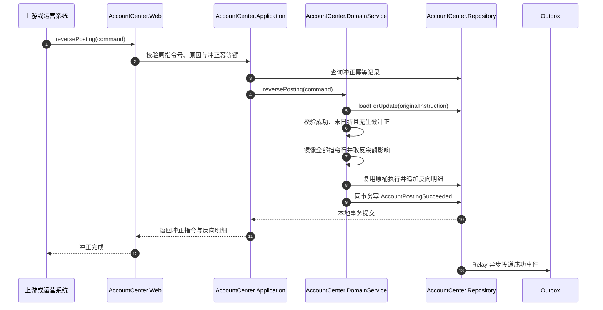

**2. 入参**

- `originalInstructionNo`（必）：原成功指令
- `reason`（必）：冲正原因
- `idempotencyNo`（必）：冲正幂等键
- `operatorOrSystem`（必）：操作者或系统

**3. 响应**

- `instructionNo`：冲正指令号
- `details`：全部反向明细
- `balanceSnapshots`：反向执行后快照
- `status`：指令状态

**4. 规则描述**

- 原指令成功、会计日未日结、无生效冲正。
- 账户中心生成整笔镜像指令；不支持部分冲正。
- 复用原账簿、桶、金额、币种、科目、辅助维度；方向与余额影响取反。
- 原指令、明细、分录不变；一条原指令最多一条生效冲正。
- 冲正指令、反向明细、余额、Outbox 同事务。

#### 3.2.10 `freeze` 冻结

**1. 接口**

- 接口名：`AccountCenterFacade#freeze`
- 场景：外部户账簿可用转冻结。
- 调用方：上游交易 / 清结算 / 风控 / 运营

**接口时序图**

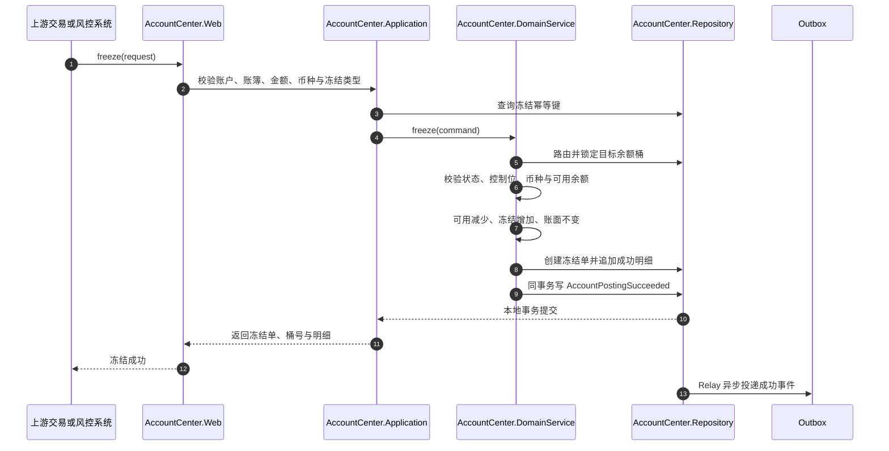

**2. 入参**

- `accountNo / bookNo`（必）：目标账户与账簿
- `freezeType`（必）：交易占用、出金预留、风控、司法、调账占用
- `sourceDomain / sourceOrderNo / idempotencyNo`（必）：来源与幂等
- `amount / currency`（必）：金额与币种
- `reason / operator`（必）：原因与操作者

**3. 响应**

- `freezeNo`：冻结单号
- `bucketNo`：目标桶
- `detailNo`：成功明细
- `status`：冻结单状态

**4. 规则描述**

- 按来源域 + 来源单号 + 冻结类型 + 幂等号唯一。
- 路由唯一桶；可用减少、冻结增加、账面不变。
- 冻结单、桶余额、明细、Outbox 同事务。
- 余额或控制校验失败整体回滚；后续操作复用原桶。

#### 3.2.11 `releaseFreeze` 解冻

**1. 接口**

- 接口名：`AccountCenterFacade#releaseFreeze`
- 场景：冻结余额转回可用余额。
- 调用方：上游交易 / 风控 / 运营

**接口时序图**

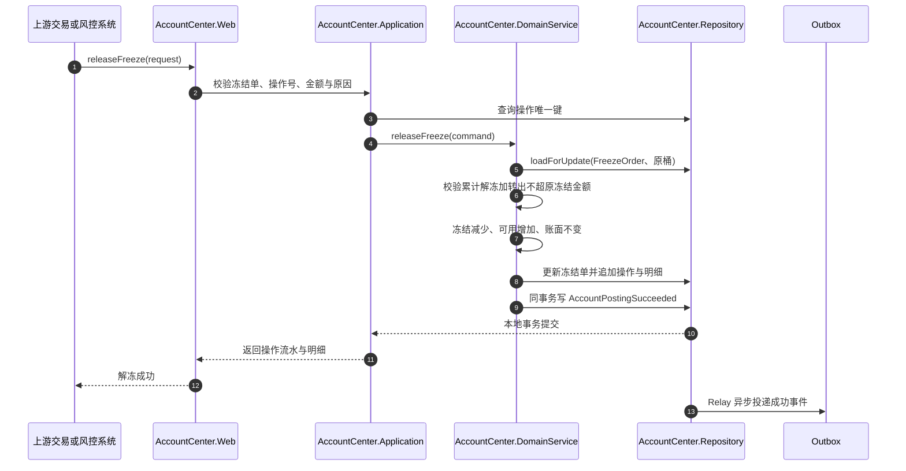

**2. 入参**

- `accountNo / bookNo / freezeNo`（必）：原冻结目标
- `operationNo`（必）：操作号
- `amount / currency`（必）：解冻金额与币种
- `reason / operator`（必）：原因与操作者

**3. 响应**

- `freezeNo / operationNo`：冻结单与操作号
- `detailNo`：成功明细
- `status`：冻结单状态

**4. 规则描述**

- `freezeNo + RELEASED + operationNo` 防重。
- 必须回原账簿与原桶；冻结减少、可用增加、账面不变。
- 累计解冻 + 转出不超原冻结金额。
- 风控 / 司法解除须来源域明确指令；外部结果未知不得解冻。
- 冻结单、操作、桶、明细、Outbox 同事务。

#### 3.2.12 `transferFreeze` 冻结转出

**1. 接口**

- 接口名：`AccountCenterFacade#transferFreeze`
- 场景：冻结资金正式转出。
- 调用方：上游交易 / 清结算 / 运营

**接口时序图**

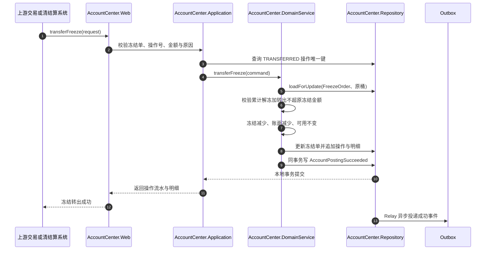

**2. 入参**

- `accountNo / bookNo / freezeNo`（必）：原冻结目标
- `operationNo`（必）：操作号
- `amount / currency`（必）：转出金额与币种
- `reason / operator`（必）：原因与操作者

**3. 响应**

- `freezeNo / operationNo`：冻结单与操作号
- `detailNo`：成功明细
- `status`：冻结单状态

**4. 规则描述**

- 操作类型固定 `TRANSFERRED`，操作唯一键防重。
- 回原桶；冻结减少、账面减少、可用不变。
- 累计操作不超原冻结；外部结果未知不得自动转出。
- 操作、明细、余额、冻结单、Outbox 同事务；冲正追加新事实。

#### 3.2.13 `snapshotAccountingDay` 会计日快照

**1. 接口**

- 接口名：`AccountCenterFacade#snapshotAccountingDay`
- 场景：00:00 固化上一会计日。
- 调用方：定时调度

**接口时序图**

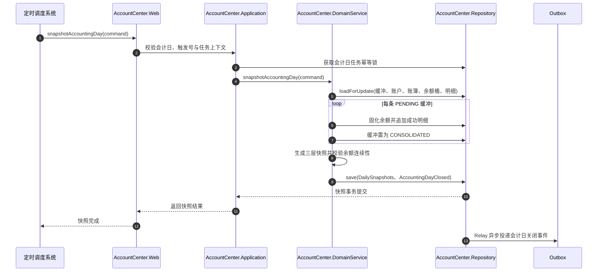

**2. 入参**

- `accountingDate / triggerNo`（必）：会计日与触发号
- `jobContext`（必）：任务实例、分片、执行上下文
- `operatorOrSystem`（必）：调度系统

**3. 响应**

- `accountingDate / jobStatus / snapshotVersion`：会计日、状态、版本
- `accountCount / bookCount / bucketCount`：快照数量

**4. 规则描述**

- 会计日 + jobType + triggerNo 幂等重跑。
- 先固化 PENDING 缓冲，且固化、余额、明细同事务，再置 CONSOLIDATED。
- 生成外部户、账簿、桶三层三口径快照；内部户按单余额校验。
- 校验日初、明细合计、日终余额连续。
- 快照成功后才写 `AccountingDayClosed`；日结后禁止补录。

#### 3.2.14 `queryAccountDetails` 查询账务明细

**1. 接口**

- 接口名：`AccountCenterFacade#queryAccountDetails`
- 场景：事件缺明细回查与审计查询。
- 调用方：财务核算 / 上游 / 运营

**接口时序图**

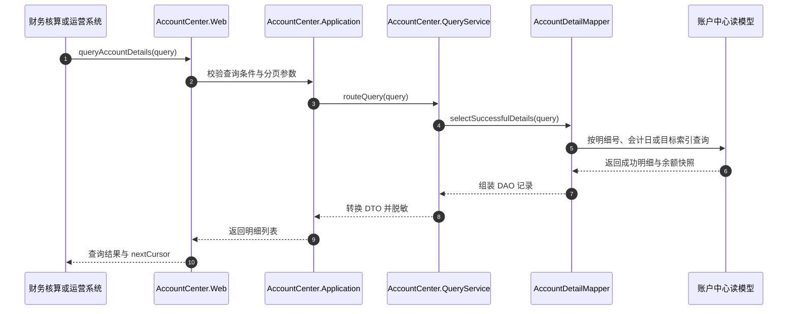

**2. 入参**

- `detailNos`（条件）：明细号集合
- `instructionNo`（条件）：指令号
- `accountNo / bookNo / bucketNo`（条件）：目标对象
- `accountingDate`（条件）：会计日
- `sourceDomain / sourceOrderNo`（条件）：来源
- `cursor / limit`（可选）：分页

**3. 响应**

- `details`：成功明细、余额影响、快照、冲正引用
- `nextCursor / total`：分页游标与总数

**4. 规则描述**

- CQRS 只读，不进入聚合写路径。
- 只返回成功明细；失败、待执行、取消不作为成功事实。
- 不改变余额和状态；超时 / 未知可重试。
- 财务核算不得绕过接口直连账户库；返回按权限最小化并脱敏。

### 3.3 财务核算接口

#### 3.3.1 接口清单

| 接口 | 场景 | 关键幂等 / 约束 |
|---|---|---|
| `generateEntry` | 生成分录与凭证 | 先按 `eventId` 去重；缺失明细用账户中心只读回查。
| `reviewEntry` | 复核分录 | 乐观锁防并发覆盖。
| `reconcileAccountingDay` | 会计日勾稽 | 会计日 + jobType + triggerNo 幂等。
| `summarizeSubjectOccurrence` | 科目发生额汇总 | 科目 + 会计日 + 币种唯一，可幂等重算。
| `queryAccountingResult` | 查询财务核算结果 | CQRS 只读，不修改事实；超时 / 未知可重试。

#### 3.3.2 `generateEntry` 生成分录与凭证

**1. 接口**

- 接口名：`FinancialAccountingFacade#generateEntry`
- 场景：消费动账成功事件生成借贷分录与凭证。
- 调用方：财务核算事件消费者 / 内部任务

**接口时序图**

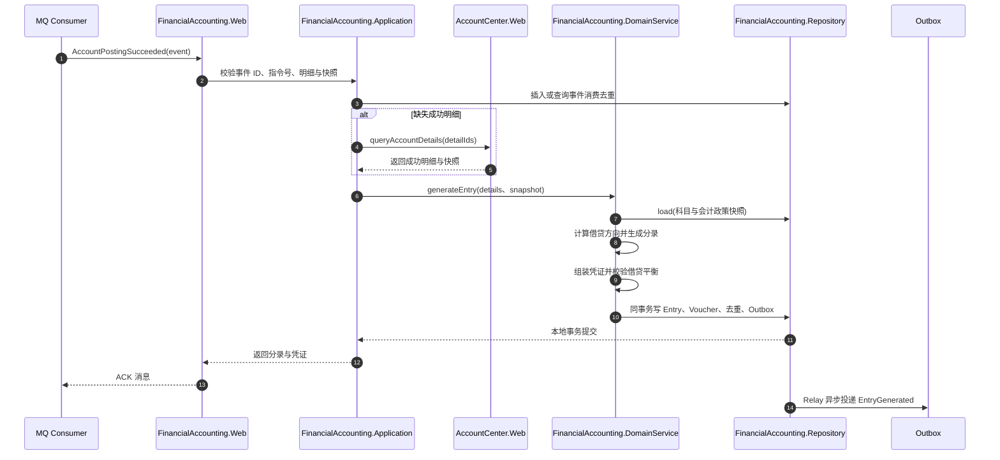

**2. 入参**

- `eventId / instructionNo / detailIds`（必）：事件、指令、成功明细
- `instructionHeaderSnapshot`（必）：凭证头快照
- `snapshot.accountingEvent / relatedOrderType / relatedOrderNo / sourceDomain / maker / completedAt`（必）：凭证头字段
- `financialErrorType`（必）：NONE / ADJUSTMENT / REVERSAL
- `reversalOfInstructionNo`（冲正必填）：原指令

**3. 响应**

- `instructionNo / voucherNo / entryNos`：来源指令、凭证、分录
- `reviewStatus`：复核状态
- `debitTotalAmount / creditTotalAmount`：借贷合计
- `idempotent`：是否幂等命中

**4. 规则描述**

- 先按 `eventId` 去重；缺失明细用账户中心只读回查。
- 一条成功明细一条分录，`detailNo` 唯一；一条指令一张凭证，`instructionNo` 唯一。
- 分录、凭证、事件去重、`EntryGenerated` Outbox 同事务。
- 校验科目、方向、金额、冲正、借贷平衡。
- 冲正追加反向分录与冲销凭证，不改原事实。
- 消费失败保留重试，不回滚账户成功动账。

#### 3.3.3 `reviewEntry` 复核分录

**1. 接口**

- 接口名：`FinancialAccountingFacade#reviewEntry`
- 场景：人工复核预留；当前自动路径已复核。
- 调用方：财务复核人员 / 工单流程

**接口时序图**

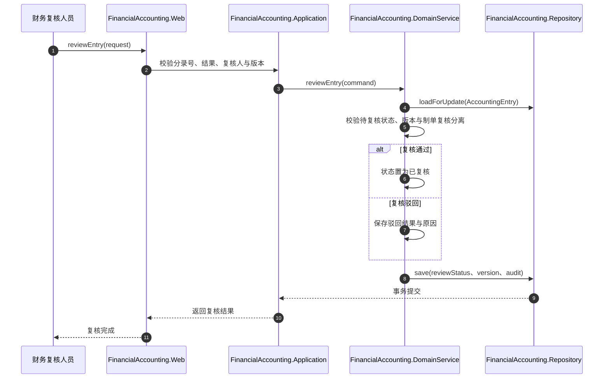

**2. 入参**

- `entryNo / reviewResult`（必）：分录与结果
- `reviewer / reviewTime`（必）：复核人与时间
- `reason`（驳回必填）：原因
- `version`（必）：当前版本

**3. 响应**

- `entryNo / reviewStatus / reviewer / reviewTime`：复核结果
- `version`：新版本

**4. 规则描述**

- 乐观锁防并发覆盖。
- 仅待复核可处理；终态不被普通请求覆盖。
- 复核通过后才进科目汇总。
- 驳回不改账户余额，不回滚成功明细。
- 制单与复核分离；操作留痕；自动路径 `reviewer=SYSTEM`。

#### 3.3.4 `reconcileAccountingDay` 会计日勾稽

**1. 接口**

- 接口名：`FinancialAccountingFacade#reconcileAccountingDay`
- 场景：01:00 追平、勾稽、试算。
- 调用方：定时调度

**接口时序图**

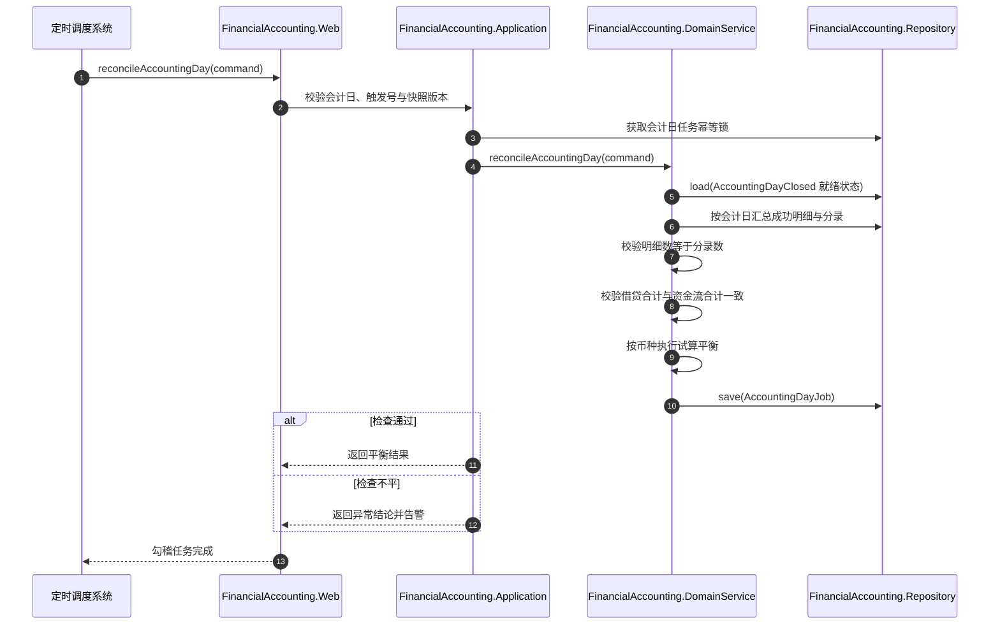

**2. 入参**

- `accountingDate / triggerNo / jobType`（必）：会计日、触发号、任务类型
- `snapshotVersion`（必）：依赖快照版本
- `operatorOrSystem`（必）：调度系统

**3. 响应**

- `accountingDate / jobStatus`：任务状态
- `detailCount / entryCount`：明细与分录数
- `debitTotalAmount / creditTotalAmount`：借贷合计
- `balanceOk / errorMessage`：是否平衡与异常

**4. 规则描述**

- 会计日 + jobType + triggerNo 幂等。
- 必须收到 `AccountingDayClosed` 或确认快照版本完成。
- 追平：成功明细数 = 分录数。
- 勾稽：借贷合计与账户资金流合计一致。
- 按币种试算借贷发生额与余额；不平只告警并阻断报表，不自动修事实。
- 结果落库；日结后禁止补录，差异走调账。

#### 3.3.5 `summarizeSubjectOccurrence` 科目发生额汇总

**1. 接口**

- 接口名：`FinancialAccountingFacade#summarizeSubjectOccurrence`
- 场景：按科目、会计日、币种汇总。
- 调用方：会计日任务 / 授权内部任务

**接口时序图**

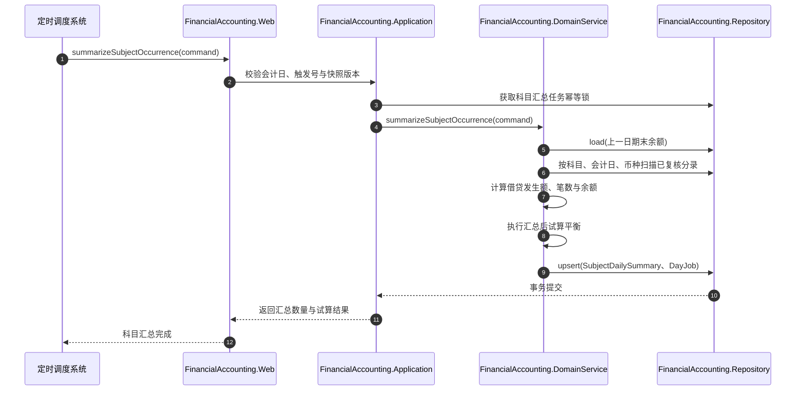

**2. 入参**

- `accountingDate / triggerNo`（必）：会计日与触发号
- `currency / subjectNos`（条件）：币种与科目范围
- `snapshotVersion`（必）：快照版本
- `operatorOrSystem`（必）：调度系统

**3. 响应**

- `accountingDate / summaryCount`：会计日与记录数
- `debitAmountTotal / creditAmountTotal`：借贷合计
- `trialBalanceOk / jobStatus`：试算与任务状态

**4. 规则描述**

- 科目 + 会计日 + 币种唯一，可幂等重算。
- 只统计已复核分录。
- 汇总借贷发生额、笔数、余额，延续上日期初余额。
- 必须在追平与勾稽后执行；金额与分录同精度。
- 汇总不平阻断日报并告警。

#### 3.3.6 `queryAccountingResult` 查询财务核算结果

**1. 接口**

- 接口名：`FinancialAccountingFacade#queryAccountingResult`
- 场景：查询分录、凭证、汇总。
- 调用方：报表 / 运营 / 财务复核

**接口时序图**

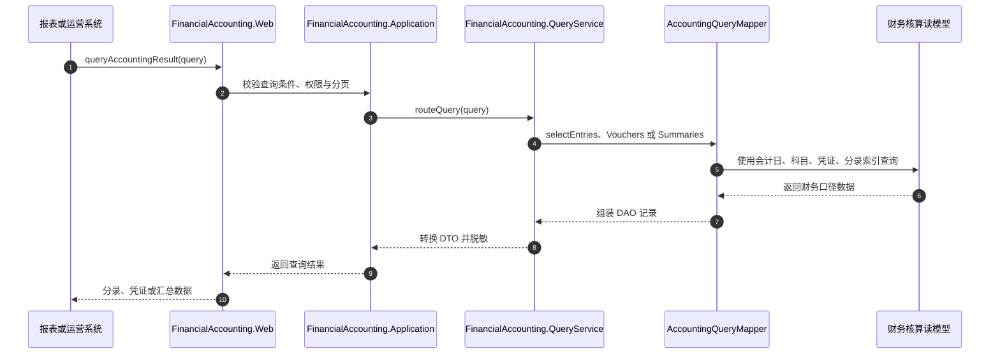

**2. 入参**

- `accountingDate / subjectNo`（条件）：会计日与科目
- `voucherNo / entryNo / instructionNo`（条件）：凭证、分录、指令
- `sourceDomain / relatedOrderNo`（条件）：来源单据
- `reviewStatus`（条件）：复核状态
- `cursor / limit`（可选）：分页

**3. 响应**

- `entries / vouchers`：分录与凭证
- `subjectDailySummaries`：科目日汇总
- `nextCursor / total`：分页信息

**4. 规则描述**

- CQRS 只读，不修改事实；超时 / 未知可重试。
- 按权限最小化返回并脱敏。
- 报表结论依赖已复核数据；试算不平不得输出平衡结论。

### 3.4 MQ 接口

| 事件 | 发布 → 消费 | 关键 Payload | 语义 |
|---|---|---|---|
| `AccountPostingSucceeded` | 账户中心 → 财务核算 | `eventId`、`instructionNo`、`detailIds`、指令头快照 | 动账成功后生成分录凭证；At-least-once + 幂等 |
| `AccountingDayClosed` | 账户中心 → 财务核算 | `eventId`、`accountingDate`、`snapshotVersion` | 快照完成信号，门控勾稽 |
| `EntryGenerated` | 财务核算 → 报表 / 后续方 | `eventId`、`voucherNo`、`instructionNo` | 凭证生成完成通知，不参与动账回滚 |

### 3.5 下游客户端

| 客户端 | 方向与用途 | 失败处理 |
|---|---|---|
| AccountDetailQueryClient | 财务核算 → 账户中心，事件缺明细回查 | 只读重试，不修改账户事实 |
| AccountingSubjectConfigClient | 账户财务域 → 财务配置域，取科目 / 映射 / 政策 | 预加载 + 版本刷新；失败阻断相关新指令或核算 |
| ReportDataClient | 账户财务域 → 报表域，输出读模型 | 失败不影响核心事实，告警重试 |

## 4. 数据结构设计

### 4.1 写路径模型

账户中心与财务核算中心使用两套逻辑库。DDL 按原方案 MySQL 逻辑模型整理，用于评审字段、唯一键和索引；执行前需按目标库版本、分库分表、字符集、时区、容量完成物理化。两库不建跨库物理外键。

#### 4.1.1 账户中心表清单

| 表 | 对象 | 关键唯一约束 |
|---|---|---|
| `t_ac_account` | account | 见下方 DDL |
| `t_ac_account_book` | account book | 见下方 DDL |
| `t_ac_account_book_balance_bucket` | account book balance bucket | 见下方 DDL |
| `t_ac_posting_instruction` | posting instruction | 见下方 DDL |
| `t_ac_posting_line` | posting line | 见下方 DDL |
| `t_ac_account_detail` | account detail | 见下方 DDL |
| `t_ac_freeze_order` | freeze order | 见下方 DDL |
| `t_ac_freeze_operation` | freeze operation | 见下方 DDL |
| `t_ac_hotspot_buffer` | hotspot buffer | 见下方 DDL |
| `t_ac_account_daily_snapshot` | account daily snapshot | 见下方 DDL |
| `t_ac_account_book_daily_snapshot` | account book daily snapshot | 见下方 DDL |
| `t_ac_account_book_bucket_daily_snapshot` | account book bucket daily snapshot | 见下方 DDL |
| `t_ac_outbox_event` | outbox event | 见下方 DDL |
| `t_ac_reserve_account` | reserve account / 备付金账户聚合 | `reserve_account_no` 唯一 |
| `t_ac_reserve_operation` | reserve operation / 不可变操作明细 | 操作号、聚合内序号、来源幂等键唯一 |

#### 4.1.2 账户中心 DDL

##### 1. `t_ac_account`

```sql
-- 外部户与内部户统一账户主表：
-- 1) account_category 创建后不可变更，外部户与内部户不得互相转换；
-- 2) 外部户余额列 = 全部有效记账簿余额桶的汇总投影，动账主事务只更新余额桶；
-- 3) 内部户单余额复用 ledger_balance，允许为负，available/frozen 恒为 0。
CREATE TABLE `t_ac_account` (
  `id`                   BIGINT UNSIGNED NOT NULL AUTO_INCREMENT COMMENT '自增主键',
  `account_no`           VARCHAR(64)  NOT NULL COMMENT '账户号，全局唯一；外部户与内部户使用隔离号段',
  `account_category`     VARCHAR(32)  NOT NULL COMMENT '账户类别：OUTER=外部户，INNER=内部户；创建后不可变更',
  `account_type`         VARCHAR(32)  NOT NULL COMMENT '外部户：BASIC=基本户，SETTLEMENT=结算户；内部户固定 INNER',
  `account_name`         VARCHAR(256) NOT NULL COMMENT '账户名称',
  `owner_id`             VARCHAR(64)  NULL COMMENT '持有人标识；仅外部户填写，内部户为 NULL',
  `owner_type`           VARCHAR(32)  NULL COMMENT '持有人性质：对公 / 对私；仅外部户填写',
  `currency`             CHAR(3)      NULL COMMENT '账户币种；仅外部户填写，必须与账簿和余额桶一致',
  `available_balance`    DECIMAL(32,8) NOT NULL DEFAULT 0 COMMENT '外部户可用余额汇总，>=0；内部户恒为 0',
  `frozen_balance`       DECIMAL(32,8) NOT NULL DEFAULT 0 COMMENT '外部户冻结余额汇总，>=0；内部户恒为 0',
  `ledger_balance`       DECIMAL(32,8) NOT NULL DEFAULT 0 COMMENT '外部户账面余额=可用+冻结；内部户单余额，允许为负',
  `control_bits`         BIGINT       NOT NULL DEFAULT 0 COMMENT '账户控制位位图（冻结、止入、止出可组合）；仅外部户使用，内部户固定 0',
  `accounting_subject_no` VARCHAR(64) NOT NULL COMMENT '关联会计科目',
  `outer_owner_key`      VARCHAR(129)
    GENERATED ALWAYS AS (CASE WHEN `account_category` = 'OUTER'
                              THEN CONCAT(`owner_id`, ':', `account_type`)
                              ELSE NULL END) STORED COMMENT '外部户持有人唯一键：仅 OUTER 行取 owner_id:account_type，其余 NULL',
  `version`              BIGINT       NOT NULL DEFAULT 0 COMMENT '乐观锁版本',
  `opened_at`            DATETIME(3)  NULL COMMENT '开户时间；内部户记录创建时间',
  `closed_at`            DATETIME(3)  NULL COMMENT '销户时间；NULL 表示未销户，内部户不使用销户语义',
  `created_at`           DATETIME(3)  NOT NULL DEFAULT CURRENT_TIMESTAMP(3) COMMENT '创建时间',
  `updated_at`           DATETIME(3)  NOT NULL DEFAULT CURRENT_TIMESTAMP(3) ON UPDATE CURRENT_TIMESTAMP(3) COMMENT '更新时间',
  PRIMARY KEY (`id`),
  UNIQUE KEY `UK_ACCOUNT_NO` (`account_no`),
  UNIQUE KEY `UK_OUTER_OWNER_TYPE` (`outer_owner_key`),          -- 同一外部持有人同一账户类型唯一
  KEY `IDX_CATEGORY_OWNER` (`account_category`, `owner_id`, `account_type`, `closed_at`),
  KEY `IDX_INNER_SUBJECT` (`account_category`, `accounting_subject_no`)
) ENGINE=InnoDB DEFAULT CHARSET=utf8mb4 COMMENT='账户主表：外部户与内部户统一存储，account_category 区分';
```

##### 2. `t_ac_account_book`

```sql
CREATE TABLE `t_ac_account_book` (
  `id`                BIGINT UNSIGNED NOT NULL AUTO_INCREMENT COMMENT '自增主键',
  `book_no`           VARCHAR(64)   NOT NULL COMMENT '账簿号，业务唯一键',
  `account_no`        VARCHAR(64)   NOT NULL COMMENT '所属外部户号，创建后不可变更',
  `category`          VARCHAR(64)   NOT NULL COMMENT '账簿类别',
  `owner_id`          VARCHAR(64)   NOT NULL COMMENT '持有人标识',
  `owner_name`        VARCHAR(256)  NOT NULL COMMENT '持有人展示名称',
  `member_no`         VARCHAR(64)   NULL COMMENT '会员号，按类别条件必填',
  `org_no`            VARCHAR(64)   NULL COMMENT '机构号，按类别条件必填',
  `book_type`         VARCHAR(64)   NOT NULL COMMENT '业务账簿类型：担保、待结算等',
  `currency`          CHAR(3)       NOT NULL COMMENT '账簿币种，必须等于所属外部户币种',
  `available_balance` DECIMAL(32,8) NOT NULL DEFAULT 0 COMMENT '可用余额汇总投影，>=0',
  `frozen_balance`    DECIMAL(32,8) NOT NULL DEFAULT 0 COMMENT '冻结余额汇总投影，>=0',
  `ledger_balance`    DECIMAL(32,8) NOT NULL DEFAULT 0 COMMENT '账面余额汇总投影=可用+冻结',
  `status`            VARCHAR(32)   NOT NULL COMMENT '状态：正常、冻结、停用、销户',
  `subject_id`        VARCHAR(64)   NOT NULL COMMENT '开簿时固化的会计科目',
  `version`           BIGINT        NOT NULL DEFAULT 0 COMMENT '乐观锁版本',
  `created_at`        DATETIME(3)   NOT NULL DEFAULT CURRENT_TIMESTAMP(3) COMMENT '开簿时间',
  `closed_at`         DATETIME(3)   NULL COMMENT '销簿时间',
  `updated_at`        DATETIME(3)   NOT NULL DEFAULT CURRENT_TIMESTAMP(3) ON UPDATE CURRENT_TIMESTAMP(3) COMMENT '更新时间',
  PRIMARY KEY (`id`),
  UNIQUE KEY `UK_BOOK_NO` (`book_no`),
  UNIQUE KEY `UK_BOOK_ACCOUNT_TYPE` (`account_no`, `book_type`)  -- 同一外部户同一业务类型最多一条账簿，覆盖全生命周期
) ENGINE=InnoDB DEFAULT CHARSET=utf8mb4 COMMENT='外部户业务场景账簿主表';
```

##### 3. `t_ac_account_book_balance_bucket`

```sql
CREATE TABLE `t_ac_account_book_balance_bucket` (
  `id`                BIGINT UNSIGNED NOT NULL AUTO_INCREMENT COMMENT '自增主键',
  `bucket_no`         VARCHAR(64)   NOT NULL COMMENT '全局唯一余额桶号',
  `book_no`           VARCHAR(64)   NOT NULL COMMENT '所属业务账簿号',
  `account_no`        VARCHAR(64)   NOT NULL COMMENT '冗余所属外部户号，减少校验和查询回表',
  `bucket_seq`        INT           NOT NULL COMMENT '账簿内桶序号，从 1 开始',
  `bucket_name`       VARCHAR(128)  NOT NULL COMMENT '桶名称：默认桶、并发桶 02 等',
  `currency`          CHAR(3)       NOT NULL COMMENT '桶币种，必须等于账簿和外部户币种',
  `available_balance` DECIMAL(32,8) NOT NULL DEFAULT 0 COMMENT '可用余额，>=0',
  `frozen_balance`    DECIMAL(32,8) NOT NULL DEFAULT 0 COMMENT '冻结余额，>=0',
  `ledger_balance`    DECIMAL(32,8) NOT NULL DEFAULT 0 COMMENT '账面余额=可用+冻结',
  `status`            VARCHAR(32)   NOT NULL COMMENT '状态：ACTIVE、FROZEN、DISABLED、CLOSED',
  `route_enabled`     TINYINT       NOT NULL DEFAULT 1 COMMENT '是否参与新指令路由：1=是，0=否',
  `route_weight`      INT           NOT NULL DEFAULT 0 COMMENT '路由权重；0 表示只允许定向操作',
  `is_default`        TINYINT       NOT NULL DEFAULT 0 COMMENT '是否默认桶：1=是，0=否',
  `default_book_key`  VARCHAR(64)
    GENERATED ALWAYS AS (CASE WHEN `is_default` = 1 THEN `book_no` ELSE NULL END) STORED COMMENT '默认桶唯一键：默认桶取 book_no，非默认桶 NULL',
  `version`           BIGINT        NOT NULL DEFAULT 0 COMMENT '乐观锁版本',
  `created_at`        DATETIME(3)   NOT NULL DEFAULT CURRENT_TIMESTAMP(3) COMMENT '建桶时间',
  `closed_at`         DATETIME(3)   NULL COMMENT '关桶时间',
  `updated_at`        DATETIME(3)   NOT NULL DEFAULT CURRENT_TIMESTAMP(3) ON UPDATE CURRENT_TIMESTAMP(3) COMMENT '更新时间',
  PRIMARY KEY (`id`),
  UNIQUE KEY `UK_BUCKET_NO` (`bucket_no`),
  UNIQUE KEY `UK_BOOK_BUCKET_SEQ` (`book_no`, `bucket_seq`),
  UNIQUE KEY `UK_BOOK_DEFAULT_BUCKET` (`default_book_key`),       -- 每个账簿最多一个默认桶
  KEY `IDX_BUCKET_ROUTE` (`book_no`, `status`, `route_enabled`, `bucket_seq`),
  KEY `IDX_BUCKET_ACCOUNT` (`account_no`, `book_no`, `status`)
) ENGINE=InnoDB DEFAULT CHARSET=utf8mb4 COMMENT='账簿余额桶：权威余额执行单元';
```

##### 4. `t_ac_posting_instruction`

```sql
CREATE TABLE `t_ac_posting_instruction` (
  `id`                         BIGINT UNSIGNED NOT NULL AUTO_INCREMENT COMMENT '自增主键',
  `instruction_no`             VARCHAR(64)    NOT NULL COMMENT '动账指令号',
  `source_domain`              VARCHAR(64)    NOT NULL COMMENT '来源系统编码',
  `source_order_no`            VARCHAR(64)    NOT NULL COMMENT '来源业务单号',
  `source_order_type`          VARCHAR(32)    NOT NULL COMMENT '来源单据类型：TRANSACTION_ORDER、PAYMENT_ORDER、ACS_RECORD',
  `business_type`              VARCHAR(64)    NOT NULL COMMENT '业务动账类型',
  `idempotency_no`             VARCHAR(64)    NOT NULL COMMENT '上游 requestId，参与幂等键',
  `atomic_group_no`            VARCHAR(64)    NOT NULL COMMENT '原子组号，普通请求从 requestId 派生',
  `currency`                   CHAR(3)        NOT NULL COMMENT '指令币种',
  `accounting_date`            DATE           NOT NULL COMMENT '会计日',
  `status`                     VARCHAR(32)    NOT NULL COMMENT '状态：CREATED、SUCCEEDED、FAILED、CANCELLED',
  `financial_error_type`       VARCHAR(32)    NOT NULL DEFAULT 'NONE' COMMENT '财务差错类型：NONE、ADJUSTMENT、REVERSAL',
  `reversal_of_instruction_no` VARCHAR(64)    NULL COMMENT '冲正引用的原指令号；非冲正为 NULL',
  `active_reversal_key`        VARCHAR(64)
    GENERATED ALWAYS AS (CASE WHEN `financial_error_type` = 'REVERSAL'
                               AND `status` IN ('CREATED', 'SUCCEEDED')
                              THEN `reversal_of_instruction_no` ELSE NULL END) STORED COMMENT '生效冲正唯一键：生效冲正取原指令号，其余 NULL',
  `error_reason`               VARCHAR(1024)  NULL COMMENT '调账、冲正原因',
  `operator_or_system`         VARCHAR(128)   NOT NULL COMMENT '操作者或系统标识',
  `version`                    BIGINT         NOT NULL DEFAULT 0 COMMENT '乐观锁版本',
  `created_at`                 DATETIME(3)    NOT NULL DEFAULT CURRENT_TIMESTAMP(3) COMMENT '创建时间',
  `updated_at`                 DATETIME(3)    NOT NULL DEFAULT CURRENT_TIMESTAMP(3) ON UPDATE CURRENT_TIMESTAMP(3) COMMENT '更新时间',
  PRIMARY KEY (`id`),
  UNIQUE KEY `UK_INSTRUCTION_NO` (`instruction_no`),
  UNIQUE KEY `UK_POSTING_IDEMPOTENCY` (`source_domain`, `source_order_no`, `business_type`, `idempotency_no`),
  UNIQUE KEY `UK_ACTIVE_REVERSAL` (`reversal_of_instruction_no`, `active_reversal_key`), -- 一条原指令最多一条生效冲正
  KEY `IDX_POSTING_DATE` (`accounting_date`, `status`)
) ENGINE=InnoDB DEFAULT CHARSET=utf8mb4 COMMENT='动账指令头：意图与幂等键';
```

##### 5. `t_ac_posting_line`

```sql
CREATE TABLE `t_ac_posting_line` (
  `id`                  BIGINT UNSIGNED NOT NULL AUTO_INCREMENT COMMENT '自增主键',
  `instruction_no`      VARCHAR(64)    NOT NULL COMMENT '所属动账指令号',
  `line_no`             INT            NOT NULL COMMENT '指令行号，同一指令内唯一',
  `account_no`          VARCHAR(64)    NOT NULL COMMENT '目标外部户或内部户号',
  `book_no`             VARCHAR(64)    NULL COMMENT '外部户账簿号；内部户为 NULL',
  `bucket_no`           VARCHAR(64)    NULL COMMENT '外部户执行余额桶号；执行成功后必填，内部户为 NULL',
  `freeze_no`           VARCHAR(64)    NULL COMMENT '冻结类方向关联的冻结单号；加钱、减钱为 NULL',
  `freeze_type`         VARCHAR(64)    NULL COMMENT '通用可用转冻结新建冻结单时的类型；其他方向为 NULL',
  `direction`           VARCHAR(32)    NOT NULL COMMENT '资金执行方向：INCREAMENT、DECREASE、AVAILABLE_TO_FROZEN、FROZEN_TO_AVAILABLE、FROZEN_TRANSFER_OUT',
  `amount`              DECIMAL(32,8)  NOT NULL COMMENT '动账金额',
  `available_delta`     DECIMAL(32,8)  NOT NULL DEFAULT 0 COMMENT '可用余额影响',
  `frozen_delta`        DECIMAL(32,8)  NOT NULL DEFAULT 0 COMMENT '冻结余额影响',
  `ledger_delta`        DECIMAL(32,8)  NOT NULL DEFAULT 0 COMMENT '账面余额影响',
  `account_subject_no`  VARCHAR(64)    NOT NULL COMMENT '创建指令时的科目快照',
  `summary`             VARCHAR(512)   NULL COMMENT '摘要',
  `created_at`          DATETIME(3)    NOT NULL DEFAULT CURRENT_TIMESTAMP(3) COMMENT '创建时间',
  `updated_at`          DATETIME(3)    NOT NULL DEFAULT CURRENT_TIMESTAMP(3) ON UPDATE CURRENT_TIMESTAMP(3) COMMENT '更新时间',
  PRIMARY KEY (`id`),
  UNIQUE KEY `UK_POSTING_LINE` (`instruction_no`, `line_no`),
  KEY `IDX_LINE_TARGET` (`account_no`, `book_no`),
  KEY `IDX_LINE_FREEZE` (`freeze_no`)
) ENGINE=InnoDB DEFAULT CHARSET=utf8mb4 COMMENT='动账指令行：目标与余额影响';
```

##### 6. `t_ac_account_detail`

```sql
-- 成功账务明细是余额变化的不可变事实：
-- 1) 外部户明细归属账簿余额桶，内部户明细归属内部户；
-- 2) 执行后余额快照必须等于目标桶 / 内部户原余额 + 本行余额影响。
CREATE TABLE `t_ac_account_detail` (
  `id`                        BIGINT UNSIGNED NOT NULL AUTO_INCREMENT COMMENT '自增主键',
  `detail_no`                 VARCHAR(64)    NOT NULL COMMENT '成功明细号',
  `instruction_no`            VARCHAR(64)    NOT NULL COMMENT '来源动账指令号',
  `instruction_line_no`       INT            NOT NULL COMMENT '来源指令行号',
  `account_no`                VARCHAR(64)    NOT NULL COMMENT '外部户或内部户号',
  `book_no`                   VARCHAR(64)    NULL COMMENT '外部户账簿号；内部户为 NULL',
  `bucket_no`                 VARCHAR(64)    NULL COMMENT '外部户执行余额桶号；内部户为 NULL',
  `account_txn_type`          VARCHAR(64)    NOT NULL COMMENT '账务交易类型',
  `direction`                 VARCHAR(32)    NOT NULL COMMENT '资金执行方向：加钱、减钱、可用转冻结、冻结转可用、冻结转出',
  `currency`                  CHAR(3)        NOT NULL COMMENT '币种',
  `amount`                    DECIMAL(32,8)  NOT NULL COMMENT '动账金额',
  `available_delta`           DECIMAL(32,8)  NOT NULL DEFAULT 0 COMMENT '可用余额影响；内部户恒为 0',
  `frozen_delta`              DECIMAL(32,8)  NOT NULL DEFAULT 0 COMMENT '冻结余额影响；内部户恒为 0',
  `ledger_delta`              DECIMAL(32,8)  NOT NULL COMMENT '账面余额影响',
  `available_balance_after`   DECIMAL(32,8)  NOT NULL COMMENT '执行后可用余额快照',
  `frozen_balance_after`      DECIMAL(32,8)  NOT NULL COMMENT '执行后冻结余额快照',
  `ledger_balance_after`      DECIMAL(32,8)  NOT NULL COMMENT '执行后账面余额快照；内部户只校验账面口径',
  `accounting_date`           DATE           NOT NULL COMMENT '会计日',
  `source_domain`             VARCHAR(64)    NOT NULL COMMENT '来源域',
  `source_order_no`           VARCHAR(64)    NOT NULL COMMENT '来源业务单号',
  `financial_error_type`      VARCHAR(32)    NOT NULL DEFAULT 'NONE' COMMENT '财务差错类型：NONE、ADJUSTMENT、REVERSAL',
  `adjustment_reason`         VARCHAR(1024)  NULL COMMENT '调账、冲正原因',
  `reversal_of_detail_no`     VARCHAR(64)    NULL COMMENT '冲正引用的原明细号；非冲正为 NULL',
  `effective_reversal_key`    VARCHAR(64)
    GENERATED ALWAYS AS (CASE WHEN `financial_error_type` = 'REVERSAL'
                              THEN `reversal_of_detail_no` ELSE NULL END) STORED COMMENT '生效冲正明细唯一键：冲正明细取原明细号，其余 NULL',
  `created_at`                DATETIME(3)    NOT NULL DEFAULT CURRENT_TIMESTAMP(3) COMMENT '明细生成时间；事实表不维护 updated_at',
  PRIMARY KEY (`id`),
  UNIQUE KEY `UK_DETAIL_NO` (`detail_no`),
  UNIQUE KEY `UK_DETAIL_INSTRUCTION_LINE` (`instruction_no`, `instruction_line_no`),
  UNIQUE KEY `UK_EFFECTIVE_REVERSAL` (`reversal_of_detail_no`, `effective_reversal_key`), -- 一条原明细最多一条生效冲正
  KEY `IDX_DETAIL_ACCOUNT_DATE` (`account_no`, `accounting_date`, `detail_no`),
  KEY `IDX_DETAIL_BOOK_DATE` (`book_no`, `accounting_date`, `detail_no`),
  KEY `IDX_DETAIL_BUCKET_DATE` (`book_no`, `bucket_no`, `accounting_date`, `detail_no`),
  KEY `IDX_DETAIL_SOURCE` (`source_domain`, `source_order_no`, `accounting_date`)
) ENGINE=InnoDB DEFAULT CHARSET=utf8mb4 COMMENT='成功账务明细：只插入、不更新、不删除';
```

##### 7. `t_ac_freeze_order`

```sql
CREATE TABLE `t_ac_freeze_order` (
  `id`                  BIGINT UNSIGNED NOT NULL AUTO_INCREMENT COMMENT '自增主键',
  `freeze_no`           VARCHAR(64)    NOT NULL COMMENT '冻结单号，全局唯一',
  `account_no`          VARCHAR(64)    NOT NULL COMMENT '外部户号',
  `book_no`             VARCHAR(64)    NOT NULL COMMENT '原冻结业务账簿号',
  `bucket_no`           VARCHAR(64)    NOT NULL COMMENT '原冻结余额桶号；解冻、转出不得更换',
  `freeze_type`         VARCHAR(64)    NOT NULL COMMENT '冻结类型：交易占用、出金预留、风控冻结、司法冻结、调账占用等',
  `source_domain`       VARCHAR(64)    NOT NULL COMMENT '发起域',
  `source_order_no`     VARCHAR(64)    NOT NULL COMMENT '来源业务单号',
  `currency`            CHAR(3)        NOT NULL COMMENT '冻结币种',
  `amount`              DECIMAL(32,8)  NOT NULL COMMENT '原冻结金额',
  `released_amount`     DECIMAL(32,8)  NOT NULL DEFAULT 0 COMMENT '累计解冻金额，对应 FROZEN_TO_AVAILABLE',
  `transferred_amount`  DECIMAL(32,8)  NOT NULL DEFAULT 0 COMMENT '累计转出金额，对应 FROZEN_TRANSFER_OUT',
  `status`              VARCHAR(32)    NOT NULL COMMENT '状态：已创建、冻结中、部分解冻、部分转出、已解冻、已转出、已关闭',
  `idempotency_no`      VARCHAR(64)    NOT NULL COMMENT '冻结请求幂等键',
  `version`             BIGINT         NOT NULL DEFAULT 0 COMMENT '乐观锁版本',
  `created_at`          DATETIME(3)    NOT NULL DEFAULT CURRENT_TIMESTAMP(3) COMMENT '冻结时间',
  `updated_at`          DATETIME(3)    NOT NULL DEFAULT CURRENT_TIMESTAMP(3) ON UPDATE CURRENT_TIMESTAMP(3) COMMENT '更新时间',
  PRIMARY KEY (`id`),
  UNIQUE KEY `UK_FREEZE_NO` (`freeze_no`),
  UNIQUE KEY `UK_FREEZE_IDEMPOTENCY` (`source_domain`, `source_order_no`, `freeze_type`, `idempotency_no`),
  KEY `IDX_FREEZE_TARGET` (`account_no`, `book_no`, `bucket_no`, `status`)
) ENGINE=InnoDB DEFAULT CHARSET=utf8mb4 COMMENT='冻结主单：资金占用与累计操作金额';
```

##### 8. `t_ac_freeze_operation`

```sql
CREATE TABLE `t_ac_freeze_operation` (
  `id`                  BIGINT UNSIGNED NOT NULL AUTO_INCREMENT COMMENT '自增主键',
  `operation_no`        VARCHAR(64)    NOT NULL COMMENT '冻结单内操作号',
  `freeze_no`           VARCHAR(64)    NOT NULL COMMENT '所属冻结单号',
  `account_no`          VARCHAR(64)    NOT NULL COMMENT '外部户号；冗余原冻结目标，必须与冻结单一致',
  `book_no`             VARCHAR(64)    NOT NULL COMMENT '原冻结业务账簿号；冗余且必须与冻结单一致',
  `bucket_no`           VARCHAR(64)    NOT NULL COMMENT '原冻结余额桶号；冗余且必须与冻结单一致',
  `operation_type`      VARCHAR(32)    NOT NULL COMMENT '操作类型：RELEASED=冻结转可用，TRANSFERRED=冻结转出',
  `instruction_no`      VARCHAR(64)    NOT NULL COMMENT '本次操作生成的动账指令号',
  `result_detail_no`    VARCHAR(64)    NOT NULL COMMENT '本次操作生成的成功账务明细号',
  `amount`              DECIMAL(32,8)  NOT NULL COMMENT '本次操作金额',
  `currency`            CHAR(3)        NOT NULL COMMENT '操作币种',
  `reason`              VARCHAR(1024)  NULL COMMENT '解冻或转出原因',
  `operator_or_system`  VARCHAR(128)   NOT NULL COMMENT '操作者或系统标识',
  `created_at`          DATETIME(3)    NOT NULL DEFAULT CURRENT_TIMESTAMP(3) COMMENT '操作时间；成功事实，不维护 updated_at',
  PRIMARY KEY (`id`),
  UNIQUE KEY `UK_FREEZE_OPERATION` (`freeze_no`, `operation_type`, `operation_no`),
  UNIQUE KEY `UK_OPERATION_DETAIL` (`result_detail_no`),
  KEY `IDX_OPERATION_TARGET` (`account_no`, `book_no`, `bucket_no`, `operation_type`, `created_at`)
) ENGINE=InnoDB DEFAULT CHARSET=utf8mb4 COMMENT='冻结操作流水：只插入成功操作';
```

##### 9. `t_ac_hotspot_buffer`

```sql
CREATE TABLE `t_ac_hotspot_buffer` (
  `id`                   BIGINT UNSIGNED NOT NULL AUTO_INCREMENT COMMENT '自增主键',
  `buffer_no`            VARCHAR(64)    NOT NULL COMMENT '缓冲记录号',
  `account_no`           VARCHAR(64)    NOT NULL COMMENT '外部户或内部户号',
  `book_no`              VARCHAR(64)    NULL COMMENT '外部户账簿号；内部户为 NULL',
  `bucket_no`            VARCHAR(64)    NULL COMMENT '外部户目标余额桶号；内部户为 NULL',
  `freeze_no`            VARCHAR(64)    NULL COMMENT '冻结类方向关联的冻结单号；非冻结方向为 NULL',
  `accounting_date`      DATE           NOT NULL COMMENT '会计日',
  `instruction_no`       VARCHAR(64)    NOT NULL COMMENT '来源动账指令号',
  `instruction_line_no`  INT            NOT NULL COMMENT '来源指令行号',
  `available_delta`      DECIMAL(32,8)  NOT NULL DEFAULT 0 COMMENT '待固化可用余额影响',
  `frozen_delta`         DECIMAL(32,8)  NOT NULL DEFAULT 0 COMMENT '待固化冻结余额影响',
  `ledger_delta`         DECIMAL(32,8)  NOT NULL COMMENT '待固化账面余额影响',
  `status`               VARCHAR(32)    NOT NULL COMMENT '状态：PENDING、CONSOLIDATED、FAILED',
  `consolidated_at`      DATETIME(3)    NULL COMMENT '固化时间',
  `version`              BIGINT         NOT NULL DEFAULT 0 COMMENT '乐观锁版本',
  `created_at`           DATETIME(3)    NOT NULL DEFAULT CURRENT_TIMESTAMP(3) COMMENT '创建时间',
  `updated_at`           DATETIME(3)    NOT NULL DEFAULT CURRENT_TIMESTAMP(3) ON UPDATE CURRENT_TIMESTAMP(3) COMMENT '更新时间',
  PRIMARY KEY (`id`),
  UNIQUE KEY `UK_HOTSPOT_BUFFER_NO` (`buffer_no`),
  UNIQUE KEY `UK_HOTSPOT_INSTRUCTION` (`instruction_no`, `instruction_line_no`),
  KEY `IDX_HOTSPOT_PENDING` (`account_no`, `book_no`, `bucket_no`, `accounting_date`, `status`)
) ENGINE=InnoDB DEFAULT CHARSET=utf8mb4 COMMENT='可选热点缓冲：待固化余额影响，非权威余额';
```

##### 10. `t_ac_account_daily_snapshot`

```sql
CREATE TABLE `t_ac_account_daily_snapshot` (
  `id`                 BIGINT UNSIGNED NOT NULL AUTO_INCREMENT COMMENT '自增主键',
  `snapshot_date`      DATE          NOT NULL COMMENT '会计日',
  `account_no`         VARCHAR(64)   NOT NULL COMMENT '外部户号',
  `available_balance`  DECIMAL(32,8) NOT NULL COMMENT '00:00 可用余额快照',
  `frozen_balance`     DECIMAL(32,8) NOT NULL COMMENT '00:00 冻结余额快照',
  `ledger_balance`     DECIMAL(32,8) NOT NULL COMMENT '00:00 账面余额快照',
  `snapshot_version`   BIGINT        NOT NULL DEFAULT 0 COMMENT '重跑版本或固化版本',
  `created_at`         DATETIME(3)   NOT NULL DEFAULT CURRENT_TIMESTAMP(3) COMMENT '快照生成时间',
  `updated_at`         DATETIME(3)   NOT NULL DEFAULT CURRENT_TIMESTAMP(3) ON UPDATE CURRENT_TIMESTAMP(3) COMMENT '更新时间',
  PRIMARY KEY (`id`),
  UNIQUE KEY `UK_ACCOUNT_SNAPSHOT` (`snapshot_date`, `account_no`)
) ENGINE=InnoDB DEFAULT CHARSET=utf8mb4 COMMENT='外部户日终三口径快照';
```

##### 11. `t_ac_account_book_daily_snapshot`

```sql
CREATE TABLE `t_ac_account_book_daily_snapshot` (
  `id`                 BIGINT UNSIGNED NOT NULL AUTO_INCREMENT COMMENT '自增主键',
  `snapshot_date`      DATE          NOT NULL COMMENT '会计日',
  `book_no`            VARCHAR(64)   NOT NULL COMMENT '账簿号',
  `account_no`         VARCHAR(64)   NOT NULL COMMENT '所属外部户号',
  `available_balance`  DECIMAL(32,8) NOT NULL COMMENT '00:00 可用余额快照',
  `frozen_balance`     DECIMAL(32,8) NOT NULL COMMENT '00:00 冻结余额快照',
  `ledger_balance`     DECIMAL(32,8) NOT NULL COMMENT '00:00 账面余额快照',
  `detail_count`       BIGINT        NOT NULL DEFAULT 0 COMMENT '当日成功明细数量',
  `total_credit`       DECIMAL(32,8) NOT NULL DEFAULT 0 COMMENT '当日增加合计',
  `total_debit`        DECIMAL(32,8) NOT NULL DEFAULT 0 COMMENT '当日减少合计',
  `snapshot_version`   BIGINT        NOT NULL DEFAULT 0 COMMENT '重跑版本或固化版本',
  `created_at`         DATETIME(3)   NOT NULL DEFAULT CURRENT_TIMESTAMP(3) COMMENT '快照生成时间',
  `updated_at`         DATETIME(3)   NOT NULL DEFAULT CURRENT_TIMESTAMP(3) ON UPDATE CURRENT_TIMESTAMP(3) COMMENT '更新时间',
  PRIMARY KEY (`id`),
  UNIQUE KEY `UK_BOOK_SNAPSHOT` (`snapshot_date`, `book_no`),
  KEY `IDX_BOOK_SNAPSHOT_ACCOUNT` (`snapshot_date`, `account_no`)
) ENGINE=InnoDB DEFAULT CHARSET=utf8mb4 COMMENT='账簿日终快照与当日统计';
```

##### 12. `t_ac_account_book_bucket_daily_snapshot`

```sql
CREATE TABLE `t_ac_account_book_bucket_daily_snapshot` (
  `id`                 BIGINT UNSIGNED NOT NULL AUTO_INCREMENT COMMENT '自增主键',
  `snapshot_date`      DATE          NOT NULL COMMENT '会计日',
  `book_no`            VARCHAR(64)   NOT NULL COMMENT '所属账簿号',
  `account_no`         VARCHAR(64)   NOT NULL COMMENT '所属外部户号',
  `bucket_no`          VARCHAR(64)   NOT NULL COMMENT '余额桶号',
  `bucket_seq`         INT           NOT NULL COMMENT '账簿内桶序号',
  `available_balance`  DECIMAL(32,8) NOT NULL COMMENT '00:00 可用余额快照',
  `frozen_balance`     DECIMAL(32,8) NOT NULL COMMENT '00:00 冻结余额快照',
  `ledger_balance`     DECIMAL(32,8) NOT NULL COMMENT '00:00 账面余额快照',
  `detail_count`       BIGINT        NOT NULL DEFAULT 0 COMMENT '当日成功明细数量',
  `total_credit`       DECIMAL(32,8) NOT NULL DEFAULT 0 COMMENT '当日增加合计',
  `total_debit`        DECIMAL(32,8) NOT NULL DEFAULT 0 COMMENT '当日减少合计',
  `snapshot_version`   BIGINT        NOT NULL DEFAULT 0 COMMENT '重跑版本或固化版本',
  `created_at`         DATETIME(3)   NOT NULL DEFAULT CURRENT_TIMESTAMP(3) COMMENT '快照生成时间',
  `updated_at`         DATETIME(3)   NOT NULL DEFAULT CURRENT_TIMESTAMP(3) ON UPDATE CURRENT_TIMESTAMP(3) COMMENT '更新时间',
  PRIMARY KEY (`id`),
  UNIQUE KEY `UK_BUCKET_SNAPSHOT` (`snapshot_date`, `bucket_no`),
  KEY `IDX_BUCKET_SNAPSHOT_BOOK` (`snapshot_date`, `book_no`, `bucket_seq`)
) ENGINE=InnoDB DEFAULT CHARSET=utf8mb4 COMMENT='余额桶日终快照与当日统计';
```

##### 13. `t_ac_outbox_event`

```sql
CREATE TABLE `t_ac_outbox_event` (
  `id`              BIGINT UNSIGNED NOT NULL AUTO_INCREMENT COMMENT '自增主键',
  `event_id`        VARCHAR(64)   NOT NULL COMMENT '全局唯一事件 ID',
  `event_type`      VARCHAR(128)  NOT NULL COMMENT '领域事件类型',
  `aggregate_type`  VARCHAR(64)   NOT NULL COMMENT '事件来源聚合类型',
  `aggregate_id`    VARCHAR(64)   NOT NULL COMMENT '事件来源聚合 ID',
  `payload`         JSON          NOT NULL COMMENT '事件体，不保存大对象',
  `accounting_date` DATE          NOT NULL COMMENT '关联会计日，便于补偿和归档',
  `status`          VARCHAR(32)   NOT NULL DEFAULT 'NEW' COMMENT '状态：NEW、PUBLISHED、ACKED、DEAD',
  `retry_count`     INT           NOT NULL DEFAULT 0 COMMENT '已重试次数',
  `next_retry_at`   DATETIME(3)   NULL COMMENT '下次重试时间',
  `published_at`    DATETIME(3)   NULL COMMENT '投递时间',
  `acked_at`        DATETIME(3)   NULL COMMENT '确认时间',
  `created_at`      DATETIME(3)   NOT NULL DEFAULT CURRENT_TIMESTAMP(3) COMMENT '创建时间',
  `updated_at`      DATETIME(3)   NOT NULL DEFAULT CURRENT_TIMESTAMP(3) ON UPDATE CURRENT_TIMESTAMP(3) COMMENT '更新时间',
  PRIMARY KEY (`id`),
  UNIQUE KEY `UK_OUTBOX_EVENT` (`event_id`),
  KEY `IDX_OUTBOX_DISPATCH` (`status`, `next_retry_at`),
  KEY `IDX_OUTBOX_ARCHIVE` (`accounting_date`, `status`)
) ENGINE=InnoDB DEFAULT CHARSET=utf8mb4 COMMENT='账户中心 Outbox 本地消息';
```

##### 14. `t_ac_reserve_account`

```sql
CREATE TABLE `t_ac_reserve_account` (
  `id`                            BIGINT UNSIGNED NOT NULL AUTO_INCREMENT COMMENT '自增主键',
  `reserve_account_no`            VARCHAR(64)   NOT NULL COMMENT '备付金账户号，全局唯一',
  `currency`                      CHAR(3)       NOT NULL COMMENT '币种；六项余额统一币种',
  `status`                        VARCHAR(32)   NOT NULL COMMENT '状态：ACTIVE、FROZEN、CLOSED',
  `acs_balance`                   DECIMAL(32,8) NOT NULL DEFAULT 0 COMMENT 'ACS 账户余额：银联映射 + 网联映射 + 未分配',
  `unionpay_mapping_balance`      DECIMAL(32,8) NOT NULL DEFAULT 0 COMMENT '银联映射余额',
  `unionpay_available_balance`    DECIMAL(32,8) NOT NULL DEFAULT 0 COMMENT '银联可用余额，不超过银联映射',
  `epcc_mapping_balance`          DECIMAL(32,8) NOT NULL DEFAULT 0 COMMENT '网联映射余额',
  `epcc_available_balance`        DECIMAL(32,8) NOT NULL DEFAULT 0 COMMENT '网联可用余额，不超过网联映射',
  `unallocated_balance`           DECIMAL(32,8) NOT NULL DEFAULT 0 COMMENT '未分配余额',
  `version`                       BIGINT        NOT NULL DEFAULT 0 COMMENT '乐观锁版本',
  `opened_at`                     DATETIME(3)   NOT NULL COMMENT '启用时间',
  `closed_at`                     DATETIME(3)   NULL COMMENT '关闭时间；NULL 表示未关闭',
  `created_at`                    DATETIME(3)   NOT NULL DEFAULT CURRENT_TIMESTAMP(3) COMMENT '创建时间',
  `updated_at`                    DATETIME(3)   NOT NULL DEFAULT CURRENT_TIMESTAMP(3) ON UPDATE CURRENT_TIMESTAMP(3) COMMENT '更新时间',
  PRIMARY KEY (`id`),
  UNIQUE KEY `UK_RESERVE_ACCOUNT_NO` (`reserve_account_no`),
  KEY `IDX_RESERVE_STATUS_CURRENCY` (`status`, `currency`)
) ENGINE=InnoDB DEFAULT CHARSET=utf8mb4 COMMENT='备付金账户聚合：ACS 总额、银联/网联映射与可用、未分配';
```

##### 15. `t_ac_reserve_operation`

```sql
CREATE TABLE `t_ac_reserve_operation` (
  `id`                              BIGINT UNSIGNED NOT NULL AUTO_INCREMENT COMMENT '自增主键',
  `operation_no`                    VARCHAR(64)   NOT NULL COMMENT '操作明细号，全局唯一；每次领域操作一条',
  `reserve_account_no`              VARCHAR(64)   NOT NULL COMMENT '备付金账户号',
  `operation_seq`                   BIGINT        NOT NULL COMMENT '聚合内操作序号；成功与失败操作都递增',
  `operation_type`                  VARCHAR(32)   NOT NULL COMMENT '操作类型：ACS_IN、ACS_OUT、MAPPING_ALLOCATE、MAPPING_RELEASE、AVAILABLE_ADJUST、ADJUSTMENT、REVERSAL',
  `channel`                         VARCHAR(32)   NOT NULL DEFAULT 'NONE' COMMENT '渠道：NONE、UNIONPAY、EPCC',
  `status`                          VARCHAR(32)   NOT NULL COMMENT '状态：SUCCESS、FAILED；失败明细零增量',
  `source_domain`                   VARCHAR(64)   NOT NULL COMMENT '来源域',
  `source_order_type`               VARCHAR(64)   NOT NULL COMMENT '来源单据类型',
  `source_order_no`                 VARCHAR(64)   NOT NULL COMMENT '来源单据号',
  `idempotency_no`                  VARCHAR(64)   NOT NULL COMMENT '来源幂等键；成功键数据库唯一，失败键可重试',
  `success_idempotency_key`         VARCHAR(384)
    GENERATED ALWAYS AS (CASE WHEN `status` = 'SUCCESS'
                              THEN CONCAT_WS(':', `source_domain`, `source_order_type`, `source_order_no`,
                                              `operation_type`, `channel`, `idempotency_no`)
                              ELSE NULL END) STORED COMMENT '成功操作幂等键；失败行生成 NULL',
  `currency`                        CHAR(3)       NOT NULL COMMENT '操作币种',
  `amount`                          DECIMAL(32,8) NOT NULL COMMENT '操作主金额，大于 0',
  `acs_delta`                       DECIMAL(32,8) NOT NULL DEFAULT 0 COMMENT 'ACS 余额增量；失败恒为 0',
  `unionpay_mapping_delta`          DECIMAL(32,8) NOT NULL DEFAULT 0 COMMENT '银联映射增量；失败恒为 0',
  `unionpay_available_delta`        DECIMAL(32,8) NOT NULL DEFAULT 0 COMMENT '银联可用增量；失败恒为 0',
  `epcc_mapping_delta`              DECIMAL(32,8) NOT NULL DEFAULT 0 COMMENT '网联映射增量；失败恒为 0',
  `epcc_available_delta`            DECIMAL(32,8) NOT NULL DEFAULT 0 COMMENT '网联可用增量；失败恒为 0',
  `unallocated_delta`               DECIMAL(32,8) NOT NULL DEFAULT 0 COMMENT '未分配增量；失败恒为 0',
  `acs_balance_before`              DECIMAL(32,8) NOT NULL COMMENT '执行前 ACS 余额',
  `unionpay_mapping_balance_before` DECIMAL(32,8) NOT NULL COMMENT '执行前银联映射余额',
  `unionpay_available_balance_before` DECIMAL(32,8) NOT NULL COMMENT '执行前银联可用余额',
  `epcc_mapping_balance_before`     DECIMAL(32,8) NOT NULL COMMENT '执行前网联映射余额',
  `epcc_available_balance_before`   DECIMAL(32,8) NOT NULL COMMENT '执行前网联可用余额',
  `unallocated_balance_before`      DECIMAL(32,8) NOT NULL COMMENT '执行前未分配余额',
  `acs_balance_after`               DECIMAL(32,8) NOT NULL COMMENT '执行后 ACS 余额；失败等于执行前余额',
  `unionpay_mapping_balance_after`  DECIMAL(32,8) NOT NULL COMMENT '执行后银联映射余额；失败等于执行前余额',
  `unionpay_available_balance_after` DECIMAL(32,8) NOT NULL COMMENT '执行后银联可用余额；失败等于执行前余额',
  `epcc_mapping_balance_after`      DECIMAL(32,8) NOT NULL COMMENT '执行后网联映射余额；失败等于执行前余额',
  `epcc_available_balance_after`    DECIMAL(32,8) NOT NULL COMMENT '执行后网联可用余额；失败等于执行前余额',
  `unallocated_balance_after`       DECIMAL(32,8) NOT NULL COMMENT '执行后未分配余额；失败等于执行前余额',
  `accounting_date`                 DATE          NOT NULL COMMENT '会计日',
  `error_semantic_code`             VARCHAR(64)   NULL COMMENT '失败语义码；成功为空',
  `failure_reason`                  VARCHAR(1024) NULL COMMENT '失败原因；成功为空',
  `reason`                          VARCHAR(1024) NULL COMMENT '操作原因或差异说明',
  `approval_no`                     VARCHAR(64)   NULL COMMENT '审批单号；调账、冲正必填',
  `operator_or_system`              VARCHAR(128)  NOT NULL COMMENT '操作者或系统标识',
  `trace_id`                        VARCHAR(64)   NULL COMMENT '链路追踪 ID',
  `occurred_at`                     DATETIME(3)   NOT NULL COMMENT '业务发生时间',
  `created_at`                      DATETIME(3)   NOT NULL DEFAULT CURRENT_TIMESTAMP(3) COMMENT '明细创建时间；成功与失败事实只插入',
  PRIMARY KEY (`id`),
  UNIQUE KEY `UK_RESERVE_OPERATION_NO` (`operation_no`),
  UNIQUE KEY `UK_RESERVE_OPERATION_SEQ` (`reserve_account_no`, `operation_seq`),
  UNIQUE KEY `UK_RESERVE_OPERATION_SUCCESS_IDEMPOTENCY` (`success_idempotency_key`),
  KEY `IDX_RESERVE_OPERATION_RETRY` (`source_domain`, `source_order_type`, `source_order_no`, `operation_type`, `channel`, `idempotency_no`, `status`),
  KEY `IDX_RESERVE_OPERATION_ACCOUNT_DATE` (`reserve_account_no`, `accounting_date`, `operation_seq`),
  KEY `IDX_RESERVE_OPERATION_SOURCE` (`source_domain`, `source_order_no`, `accounting_date`)
) ENGINE=InnoDB DEFAULT CHARSET=utf8mb4 COMMENT='备付金账户操作明细：一次领域操作一条不可变明细';
```

#### 4.1.3 财务核算表清单

| 表 | 对象 | 关键唯一约束 |
|---|---|---|
| `t_fa_accounting_subject` | accounting subject | 见下方 DDL |
| `t_fa_accounting_entry` | accounting entry | 见下方 DDL |
| `t_fa_accounting_voucher` | accounting voucher | 见下方 DDL |
| `t_fa_subject_daily_summary` | subject daily summary | 见下方 DDL |
| `t_fa_accounting_day_job` | accounting day job | 见下方 DDL |
| `t_fa_event_consume` | event consume | 见下方 DDL |
| `t_fa_outbox_event` | outbox event | 见下方 DDL |

#### 4.1.4 财务核算 DDL

##### 1. `t_fa_accounting_subject`

```sql
CREATE TABLE `t_fa_accounting_subject` (
  `id`                  BIGINT UNSIGNED NOT NULL AUTO_INCREMENT COMMENT '自增主键',
  `subject_no`          VARCHAR(64)   NOT NULL COMMENT '科目编号',
  `name`                VARCHAR(256)  NOT NULL COMMENT '科目名称',
  `parent_subject_no`   VARCHAR(64)   NULL COMMENT '上级科目编号；一级科目为 NULL',
  `level`               INT           NOT NULL COMMENT '科目层级',
  `subject_type`        VARCHAR(32)   NOT NULL COMMENT '科目类型：资产、负债、权益、收入、费用',
  `balance_direction`   VARCHAR(32)   NOT NULL COMMENT '余额方向：借方余额或贷方余额',
  `currency`            VARCHAR(16)   NOT NULL COMMENT '科目币种或本币口径',
  `status`              VARCHAR(32)   NOT NULL COMMENT '状态：启用、停用',
  `remark`              VARCHAR(1024) NULL COMMENT '备注',
  `version`             BIGINT        NOT NULL DEFAULT 0 COMMENT '配置版本',
  `created_at`          DATETIME(3)   NOT NULL DEFAULT CURRENT_TIMESTAMP(3) COMMENT '创建时间',
  `updated_at`          DATETIME(3)   NOT NULL DEFAULT CURRENT_TIMESTAMP(3) ON UPDATE CURRENT_TIMESTAMP(3) COMMENT '更新时间',
  PRIMARY KEY (`id`),
  UNIQUE KEY `UK_SUBJECT_NO` (`subject_no`),
  KEY `IDX_SUBJECT_PARENT` (`parent_subject_no`, `level`, `status`)
) ENGINE=InnoDB DEFAULT CHARSET=utf8mb4 COMMENT='会计科目配置';
```

##### 2. `t_fa_accounting_entry`

```sql
CREATE TABLE `t_fa_accounting_entry` (
  `id`                    BIGINT UNSIGNED NOT NULL AUTO_INCREMENT COMMENT '自增主键',
  `entry_no`              VARCHAR(64)    NOT NULL COMMENT '分录编号',
  `voucher_no`            VARCHAR(64)    NOT NULL COMMENT '所属会计凭证号',
  `detail_no`             VARCHAR(64)    NOT NULL COMMENT '来源成功明细号，分录幂等键',
  `book_no`               VARCHAR(64)    NULL COMMENT '外部户账簿号；内部户分录为 NULL',
  `payment_serial_no`     VARCHAR(64)    NULL COMMENT '来源支付流水号',
  `direction`             VARCHAR(16)    NOT NULL COMMENT '借贷方向：DEBIT、CREDIT',
  `amount`                DECIMAL(32,8)  NOT NULL COMMENT '借或贷发生额',
  `currency`              CHAR(3)        NOT NULL COMMENT '币种',
  `accounting_subject_no` VARCHAR(64)    NOT NULL COMMENT '分录科目',
  `accounting_date`       DATE           NOT NULL COMMENT '会计日',
  `review_status`         VARCHAR(32)    NOT NULL DEFAULT 'PENDING' COMMENT '复核状态：待复核、已复核',
  `remark`                VARCHAR(1024)  NULL COMMENT '备注',
  `version`               BIGINT         NOT NULL DEFAULT 0 COMMENT '复核乐观锁版本',
  `created_at`            DATETIME(3)    NOT NULL DEFAULT CURRENT_TIMESTAMP(3) COMMENT '分录生成时间',
  `updated_at`            DATETIME(3)    NOT NULL DEFAULT CURRENT_TIMESTAMP(3) ON UPDATE CURRENT_TIMESTAMP(3) COMMENT '更新时间',
  PRIMARY KEY (`id`),
  UNIQUE KEY `UK_ENTRY_NO` (`entry_no`),
  UNIQUE KEY `UK_ENTRY_DETAIL` (`detail_no`),                 -- 重复事件或重复请求的最终幂等兜底
  KEY `IDX_ENTRY_VOUCHER` (`voucher_no`),
  KEY `IDX_ENTRY_DATE_SUBJECT` (`accounting_date`, `accounting_subject_no`, `currency`, `direction`),
  KEY `IDX_ENTRY_DATE_REVIEW` (`accounting_date`, `review_status`)
) ENGINE=InnoDB DEFAULT CHARSET=utf8mb4 COMMENT='借贷分录：成功明细生成的财务核算事实';
```

##### 3. `t_fa_accounting_voucher`

```sql
CREATE TABLE `t_fa_accounting_voucher` (
  `id`                       BIGINT UNSIGNED NOT NULL AUTO_INCREMENT COMMENT '自增主键',
  `voucher_no`               VARCHAR(64)    NOT NULL COMMENT '凭证号',
  `instruction_no`           VARCHAR(64)    NOT NULL COMMENT '来源动账指令号，凭证幂等键',
  `accounting_event`         VARCHAR(128)   NOT NULL COMMENT '记账事件，取业务动账类型或核算事件映射',
  `related_order_type`       VARCHAR(32)    NOT NULL COMMENT '关联单据类型：TRANSACTION_ORDER、PAYMENT_ORDER、ACS_RECORD',
  `related_order_no`         VARCHAR(64)    NOT NULL COMMENT '关联单据号',
  `source_domain`            VARCHAR(64)    NOT NULL COMMENT '来源系统或来源域',
  `currency`                 CHAR(3)        NOT NULL COMMENT '币种',
  `accounting_date`          DATE           NOT NULL COMMENT '会计日',
  `accounting_time`          DATETIME(3)    NOT NULL COMMENT '业务记账时间',
  `debit_total_amount`       DECIMAL(32,8)  NOT NULL COMMENT '借方发生额合计',
  `credit_total_amount`      DECIMAL(32,8)  NOT NULL COMMENT '贷方发生额合计',
  `entry_count`              INT            NOT NULL COMMENT '凭证内分录数量',
  `maker`                    VARCHAR(128)   NOT NULL COMMENT '制单人或制单系统',
  `reviewer`                 VARCHAR(128)   NOT NULL COMMENT '复核人或复核系统',
  `review_time`              DATETIME(3)    NOT NULL COMMENT '复核时间',
  `review_status`            VARCHAR(32)    NOT NULL DEFAULT 'REVIEWED' COMMENT '复核状态：PENDING、REVIEWED',
  `status`                   VARCHAR(32)    NOT NULL DEFAULT 'EFFECTIVE' COMMENT '凭证状态：EFFECTIVE、REVERSED',
  `financial_error_type`     VARCHAR(32)    NOT NULL DEFAULT 'NONE' COMMENT '财务差错类型：NONE、ADJUSTMENT、REVERSAL',
  `reversal_of_voucher_no`   VARCHAR(64)    NULL COMMENT '被冲销凭证号；非冲销凭证为 NULL',
  `active_reversal_key`      VARCHAR(64)
    GENERATED ALWAYS AS (CASE WHEN `financial_error_type` = 'REVERSAL'
                              THEN `reversal_of_voucher_no` ELSE NULL END) STORED COMMENT '生效冲销唯一键：冲销凭证取被冲销凭证号，其余 NULL',
  `remark`                   VARCHAR(1024)  NULL COMMENT '备注',
  `version`                  BIGINT         NOT NULL DEFAULT 0 COMMENT '冲销标记乐观锁版本',
  `created_at`               DATETIME(3)    NOT NULL DEFAULT CURRENT_TIMESTAMP(3) COMMENT '凭证生成时间',
  `updated_at`               DATETIME(3)    NOT NULL DEFAULT CURRENT_TIMESTAMP(3) ON UPDATE CURRENT_TIMESTAMP(3) COMMENT '更新时间',
  PRIMARY KEY (`id`),
  UNIQUE KEY `UK_VOUCHER_NO` (`voucher_no`),
  UNIQUE KEY `UK_VOUCHER_INSTRUCTION` (`instruction_no`),
  UNIQUE KEY `UK_VOUCHER_ACTIVE_REVERSAL` (`reversal_of_voucher_no`, `active_reversal_key`),
  KEY `IDX_VOUCHER_DATE_STATUS` (`accounting_date`, `status`, `review_status`),
  KEY `IDX_VOUCHER_SOURCE_ORDER` (`source_domain`, `related_order_no`, `accounting_date`)
) ENGINE=InnoDB DEFAULT CHARSET=utf8mb4 COMMENT='会计凭证：按动账指令归集借贷分录';
```

##### 4. `t_fa_subject_daily_summary`

```sql
CREATE TABLE `t_fa_subject_daily_summary` (
  `id`              BIGINT UNSIGNED NOT NULL AUTO_INCREMENT COMMENT '自增主键',
  `subject_no`      VARCHAR(64)   NOT NULL COMMENT '科目编号',
  `accounting_date` DATE          NOT NULL COMMENT '会计日',
  `currency`        CHAR(3)       NOT NULL COMMENT '币种',
  `debit_amount`    DECIMAL(32,8) NOT NULL DEFAULT 0 COMMENT '借方发生额',
  `debit_count`     BIGINT        NOT NULL DEFAULT 0 COMMENT '借方笔数',
  `credit_amount`   DECIMAL(32,8) NOT NULL DEFAULT 0 COMMENT '贷方发生额',
  `credit_count`    BIGINT        NOT NULL DEFAULT 0 COMMENT '贷方笔数',
  `debit_balance`   DECIMAL(32,8) NOT NULL DEFAULT 0 COMMENT '按科目余额方向累计的借方余额',
  `credit_balance`  DECIMAL(32,8) NOT NULL DEFAULT 0 COMMENT '按科目余额方向累计的贷方余额',
  `version`         BIGINT        NOT NULL DEFAULT 0 COMMENT '汇总乐观锁版本',
  `created_at`      DATETIME(3)   NOT NULL DEFAULT CURRENT_TIMESTAMP(3) COMMENT '创建时间',
  `updated_at`      DATETIME(3)   NOT NULL DEFAULT CURRENT_TIMESTAMP(3) ON UPDATE CURRENT_TIMESTAMP(3) COMMENT '更新时间',
  PRIMARY KEY (`id`),
  UNIQUE KEY `UK_SUBJECT_DAILY` (`subject_no`, `accounting_date`, `currency`)
) ENGINE=InnoDB DEFAULT CHARSET=utf8mb4 COMMENT='科目日发生额与余额汇总';
```

##### 5. `t_fa_accounting_day_job`

```sql
CREATE TABLE `t_fa_accounting_day_job` (
  `id`              BIGINT UNSIGNED NOT NULL AUTO_INCREMENT COMMENT '自增主键',
  `accounting_date` DATE           NOT NULL COMMENT '会计日',
  `job_type`        VARCHAR(64)    NOT NULL COMMENT '任务类型：勾稽、科目汇总、试算平衡',
  `trigger_no`      VARCHAR(64)    NOT NULL COMMENT '调度或人工触发号',
  `status`          VARCHAR(32)    NOT NULL COMMENT '状态：RUNNING、SUCCESS、FAILED',
  `detail_count`    BIGINT         NOT NULL DEFAULT 0 COMMENT '追平检查的账户明细数量',
  `entry_count`     BIGINT         NOT NULL DEFAULT 0 COMMENT '追平检查的分录数量',
  `debit_total`     DECIMAL(32,8)  NOT NULL DEFAULT 0 COMMENT '借方发生额合计',
  `credit_total`    DECIMAL(32,8)  NOT NULL DEFAULT 0 COMMENT '贷方发生额合计',
  `balance_ok`      TINYINT        NOT NULL DEFAULT 0 COMMENT '借贷与余额是否平衡：1=平衡，0=不平',
  `error_message`   VARCHAR(2048)  NULL COMMENT '异常结论',
  `started_at`      DATETIME(3)    NULL COMMENT '任务开始时间',
  `finished_at`     DATETIME(3)    NULL COMMENT '任务结束时间',
  `created_at`      DATETIME(3)    NOT NULL DEFAULT CURRENT_TIMESTAMP(3) COMMENT '创建时间',
  `updated_at`      DATETIME(3)    NOT NULL DEFAULT CURRENT_TIMESTAMP(3) ON UPDATE CURRENT_TIMESTAMP(3) COMMENT '更新时间',
  PRIMARY KEY (`id`),
  UNIQUE KEY `UK_DAY_JOB` (`accounting_date`, `job_type`, `trigger_no`)
) ENGINE=InnoDB DEFAULT CHARSET=utf8mb4 COMMENT='日结任务：勾稽、汇总与试算结果';
```

##### 6. `t_fa_event_consume`

```sql
CREATE TABLE `t_fa_event_consume` (
  `id`             BIGINT UNSIGNED NOT NULL AUTO_INCREMENT COMMENT '自增主键',
  `consumer_group` VARCHAR(64)   NOT NULL COMMENT '消费组',
  `event_id`       VARCHAR(64)   NOT NULL COMMENT '去重的事件 ID',
  `event_type`     VARCHAR(128)  NOT NULL COMMENT '事件类型',
  `status`         VARCHAR(32)   NOT NULL COMMENT '消费状态',
  `error_message`  VARCHAR(2048) NULL COMMENT '最近一次消费错误',
  `first_seen_at`  DATETIME(3)   NOT NULL DEFAULT CURRENT_TIMESTAMP(3) COMMENT '首次收到时间',
  `last_seen_at`   DATETIME(3)   NOT NULL DEFAULT CURRENT_TIMESTAMP(3) COMMENT '最近处理时间',
  `created_at`     DATETIME(3)   NOT NULL DEFAULT CURRENT_TIMESTAMP(3) COMMENT '创建时间',
  `updated_at`     DATETIME(3)   NOT NULL DEFAULT CURRENT_TIMESTAMP(3) ON UPDATE CURRENT_TIMESTAMP(3) COMMENT '更新时间',
  PRIMARY KEY (`id`),
  UNIQUE KEY `UK_EVENT_CONSUME` (`consumer_group`, `event_id`)   -- 事件去重最终兜底
) ENGINE=InnoDB DEFAULT CHARSET=utf8mb4 COMMENT='财务核算事件消费去重';
```

##### 7. `t_fa_outbox_event`

```sql
CREATE TABLE `t_fa_outbox_event` (
  `id`              BIGINT UNSIGNED NOT NULL AUTO_INCREMENT COMMENT '自增主键',
  `event_id`        VARCHAR(64)   NOT NULL COMMENT '全局唯一事件 ID',
  `event_type`      VARCHAR(128)  NOT NULL COMMENT '领域事件类型',
  `aggregate_type`  VARCHAR(64)   NOT NULL COMMENT '事件来源聚合类型',
  `aggregate_id`    VARCHAR(64)   NOT NULL COMMENT '事件来源聚合 ID',
  `payload`         JSON          NOT NULL COMMENT '事件体，不保存大对象',
  `accounting_date` DATE          NOT NULL COMMENT '关联会计日，便于补偿和归档',
  `status`          VARCHAR(32)   NOT NULL DEFAULT 'NEW' COMMENT '状态：NEW、PUBLISHED、ACKED、DEAD',
  `retry_count`     INT           NOT NULL DEFAULT 0 COMMENT '已重试次数',
  `next_retry_at`   DATETIME(3)   NULL COMMENT '下次重试时间',
  `published_at`    DATETIME(3)   NULL COMMENT '投递时间',
  `acked_at`        DATETIME(3)   NULL COMMENT '确认时间',
  `created_at`      DATETIME(3)   NOT NULL DEFAULT CURRENT_TIMESTAMP(3) COMMENT '创建时间',
  `updated_at`      DATETIME(3)   NOT NULL DEFAULT CURRENT_TIMESTAMP(3) ON UPDATE CURRENT_TIMESTAMP(3) COMMENT '更新时间',
  PRIMARY KEY (`id`),
  UNIQUE KEY `UK_OUTBOX_EVENT` (`event_id`),
  KEY `IDX_OUTBOX_DISPATCH` (`status`, `next_retry_at`),
  KEY `IDX_OUTBOX_ARCHIVE` (`accounting_date`, `status`)
) ENGINE=InnoDB DEFAULT CHARSET=utf8mb4 COMMENT='财务核算 Outbox 本地消息';
```

> [!IMPORTANT]
> 原方案对 `t_fa_outbox_event` 使用 `CREATE TABLE LIKE t_ac_outbox_event` 表达结构一致；本文已等价展开，上线仍须保持两库 Outbox 字段语义一致且不得混用。

### 4.2 读路径与 SQL 清单

| 查询 | 索引 | 语义 |
|---|---|---|
| 明细号集合查询 | `UK_DETAIL_NO` | 财务核算回查，只读 |
| 账户 + 会计日 | `IDX_DETAIL_ACCOUNT_DATE` | 对账审计 |
| 账簿 / 桶 + 会计日 | `IDX_DETAIL_BOOK_DATE`、`IDX_DETAIL_BUCKET_DATE` | 账簿与桶追平 |
| 来源域 + 来源单号 | `IDX_DETAIL_SOURCE` | 差错追溯 |
| 指令查凭证分录 | `UK_VOUCHER_INSTRUCTION`、`IDX_ENTRY_VOUCHER` | 财务展示 |
| 会计日 + 科目 + 币种 | `IDX_ENTRY_DATE_SUBJECT` | 日结报表 |
| Outbox 积压 | `IDX_OUTBOX_DISPATCH` | 运维告警 |

### 4.3 数据一致性与迁移

1. 动账主事务包含幂等检查、目标锁定、控制位校验、余额增量、指令状态、成功明细、Outbox。
2. 外部户与账簿汇总可异步投影，但最终必须等于全部有效桶之和；日终追平前不得作为权威余额。
3. 成功明细、分录、凭证、冻结成功操作只插入；冲销追加反向事实并更新原凭证冲销标记。
4. 跨系统无分布式事务：动账成功后分录凭证靠事件重试与幂等最终一致；分录失败不回滚动账。
5. Outbox 与业务同事务；投递失败按退避重试并进死信，不能丢事件。
6. 历史迁移先形成基线：账户余额 = 明细投影 = 汇总 = 快照；迁移不改历史事实。
7. DDL 先兼容后切流；唯一索引先去重；大表分批、可监控、可回滚。
8. 日结后的会计日禁止补录；历史差错走后续会计日调账。
9. 备付金成功路径下，聚合更新、成功明细、`ReserveAccountOperated` Outbox 同库同事务；失败路径提交零增量失败明细但不发成功事件。六项余额必须满足 ACS 总额守恒与渠道可用不超过映射。

## 5. 核心流程详细设计

### 5.1 `postEntries` 动账流程

```mermaid
sequenceDiagram
    autonumber
    participant UP as 上游系统
    participant W as 账户中心.Web
    participant A as 账户中心.Application
    participant D as 账户中心.Domain
    participant R as 账户中心.Repository
    participant O as Outbox / MQ

    UP->>W: postEntries(command)
    W->>A: schema 校验后转 Command
    A->>R: 查询幂等键
    alt 已存在成功指令
        A-->>W: 幂等返回首次结果
    else 新指令或明确失败可重试
        A->>D: executePosting
        D->>R: 按 account+book+bucket 排序加锁
        D->>D: 校验状态、控制位、币种、余额、资金守恒
        D->>R: 更新桶/内部户余额
        D->>R: 写指令、指令行、成功明细
        D->>R: 同事务写 AccountPostingSucceeded
        R-->>A: 事务提交
        A-->>W: 返回指令、明细、余额快照
        R->>O: Relay 异步投递
    end
```

1. 指令行目标按 `accountNo + bookNo + bucketNo` 排序加锁，避免交叉死锁。
2. 原子组全部成功或失败；失败不改余额、不生成成功明细。
3. 服务端锁定后重算或条件增量更新余额，禁止无锁读改写。
4. `balance_after = 执行前余额 + BalanceImpact`；冲正、解冻、冻结转出回原桶。
5. Outbox Relay 在事务提交后异步投递。

### 5.2 冲正与调账流程

```mermaid
flowchart TD
    A[差错输入] --> B{是否当日成功指令且未日结?}
    B -->|是| C[reversePosting]
    B -->|否| D[adjustEntries]
    C --> C1[锁定原指令]
    C1 --> C2{成功且无生效冲正?}
    C2 -->|是| C3[整笔镜像反向指令]
    C2 -->|否| C4[幂等返回或明确失败]
    C3 --> C5[复用原桶执行反向余额影响]
    C5 --> C6[追加反向明细和事件]
    D --> D1[校验审批和差异引用]
    D1 --> D2[生成新调账指令]
    D2 --> D3[后续会计日落账]
```

- 当日成功且未日结：`reversePosting` 整笔镜像，原事实不变。
- 跨日 / 已日结 / 科目差异：审批后 `adjustEntries`，在后续会计日落账。
- 财务核算侧同样追加反向分录与冲销凭证，不删除或负数覆盖历史。

### 5.3 冻结、解冻与冻结转出

| 操作 | 可用 | 冻结 | 账面 | 成功事实 |
|---|---:|---:|---:|---|
| 冻结 | -A | +A | 0 | 冻结单 + 明细 |
| 解冻 | +A | -A | 0 | 操作流水 + 明细 |
| 冻结转出 | 0 | -A | -A | 操作流水 + 明细 |

累计解冻 + 转出不超原冻结金额；解冻 / 转出回原桶；外部结果未知且上游未终态时不得操作。

### 5.4 动账成功到分录与凭证

```mermaid
sequenceDiagram
    autonumber
    participant OBX as Outbox / MQ
    participant FW as 财务核算.Web
    participant FA as 财务核算.Application
    participant AC as 账户中心.Web
    participant FD as 财务核算.Domain
    participant FR as 财务核算.Repository

    OBX->>FW: AccountPostingSucceeded
    FW->>FA: 事件基础校验
    FA->>FA: eventId 去重
    FA->>AC: QueryAccountDetails(detailIds)
    AC-->>FA: 返回成功明细与快照
    FA->>FD: generateEntry
    FD->>FD: 按科目类型和资金方向计算借贷
    FD->>FD: 校验金额、科目、冲正、资金守恒
    FD->>FR: 同事务写分录、凭证、消费去重、EntryGenerated
    FR-->>FA: 提交
    FA-->>FW: ACK
```

1. 一条成功明细生成一条分录，一条成功指令生成一张凭证。
2. 分录与凭证同事务，禁止先分录后异步补凭证。
3. 自动核算路径默认已复核；消费失败保留重试，不回滚账户动账。

### 5.5 00:00 快照与 01:00 勾稽汇总

```mermaid
flowchart TD
    subgraph S["00:00 账户中心快照"]
        A[锁定任务幂等] --> B[固化热点缓冲]
        B --> C[生成账户 / 账簿 / 桶快照]
        C --> D[余额连续性校验]
        D --> E[写 AccountingDayClosed Outbox]
    end
    subgraph R["01:00 财务核算勾稽"]
        F[检查会计日关闭信号] --> G[追平检查]
        G --> H[明细与分录勾稽]
        H --> I[科目发生额汇总]
        I --> J[按币种试算平衡]
        J --> K{平衡?}
        K -->|是| L[允许日报发布]
        K -->|否| M[阻断报表结论并告警 / 人工处理]
    end
    E --> F
```

1. 缓冲必须先固化到桶并生成不可变明细，再置 `CONSOLIDATED`。
2. 追平检查明细数 = 分录数；勾稽检查借贷、资金流、余额连续性。
3. 汇总只统计已复核分录；试算不平阻断报表、告警、人工处理，不自动修事实。

### 5.6 状态机与终态保护

| 对象 | 状态 | 终态保护 |
|---|---|---|
| 指令 | `Created → Succeeded / Failed / Cancelled` | 成功后不可重复执行；是否冲正由生效冲正判断 |
| 冲正 | 复用指令状态 | 一条原指令最多一条生效冲正；失败 / 取消不占生效键 |
| 账簿 / 账户 | 正常、冻结、停用 → 销户 | 余额为零、无冻结、无缓冲 |
| 冻结单 | 冻结中、部分解冻 / 转出、已解冻 / 转出、关闭 | 累计操作不超原额；成功操作不可删 |
| 凭证 | 生效、已冲销 | 冲销只追加新凭证并标记原凭证 |
| 分录复核 | 待复核、已复核 | 汇总只统计已复核 |
| Outbox | NEW、PUBLISHED、ACKED、DEAD | ACK 后按保留期归档，不删业务事实 |

### 5.7 异常、补偿与恢复

| 异常 | 处理 | 可重试 |
|---|---|---|
| 参数 / 幂等冲突 | 拒绝，不进入事务；冲突返回首次标识 | 修正后可 / 冲突不可 |
| 状态、控制位、币种、余额不足 | 明确失败并回滚 | 解除或资金变化后按契约 |
| 本地事务失败 | 整体回滚，不发成功事件 | 复用原指令 |
| Outbox / 事件消费失败 | NEW 或不 ACK，退避重试，超限死信告警 | 是 |
| 明细回查超时 | 只读重试，不修改账户 | 是 |
| 快照失败 | 分批重跑；未完成不发布关闭事件 | 是 |
| 勾稽 / 试算不平 | 记录异常、阻断报表、人工差异处理 | 不自动修补 |
| 重复消息 | event / detail / instruction 唯一键命中 | 幂等返回或跳过 |

## 6. 规则与算法设计

### 6.1 备付金账户操作规则

| 操作 | 六项余额联动 | 关键校验 |
|---|---|---|
| `ACS_IN` | `acs +A`，`unallocated +A` | 账户 ACTIVE，币种一致 |
| `ACS_OUT` | `acs -A`，`unallocated -A` | 未分配不少于 A，账户 ACTIVE |
| `MAPPING_ALLOCATE` | `unallocated -A`，目标渠道 `mapping +A` | 未分配不少于 A |
| `MAPPING_RELEASE` | 目标渠道 `mapping -A`，`unallocated +A` | 只能释放未使用映射：`A <= mapping - available` |
| `AVAILABLE_ADJUST` | 目标渠道 `available +/- A`，映射与 ACS 不变 | 调增不超可用额度，调减后可用非负 |
| `ADJUSTMENT / REVERSAL` | 六项显式增量 | 审批号或原操作引用；调整后满足全部不变量 |

聚合加锁或乐观锁成功后计算六项增量与操作后快照；同事务写入操作明细。映射释放只允许释放未使用部分，避免把已占用可用额度转回未分配。

### 6.2 余额桶路由

```text
routeBucket(line):
  内部户 → 直接路由 InnerAccount
  外部户 → 解析 bookNo 或 accountNo + bookType
  冲正 / 解冻 / 冻结转出 → 必须复用原桶
  普通收支 → 从启用且路由开启的桶中按配置策略选择
```

路由结果写入指令行并在成功后写入明细；单行不拆桶；策略须可配置、可观测、可回放。

### 6.3 余额影响

| 方向 | available | frozen | ledger |
|---|---:|---:|---:|
| `INCREAMENT` | +A | 0 | +A |
| `DECREASE` | -A | 0 | -A |
| `AVAILABLE_TO_FROZEN` | -A | +A | 0 |
| `FROZEN_TO_AVAILABLE` | +A | -A | 0 |
| `FROZEN_TRANSFER_OUT` | 0 | -A | -A |

外部户桶满足 `ledger = available + frozen` 且可用、冻结非负；内部户只用账面增量，允许为负。

### 6.4 会计借贷方向

1. 外部户取账簿固化科目，内部户取内部户固化科目。
2. 资产、费用增加记借，减少记贷；负债、权益、收入相反。
3. 冲正生成反向分录与冲销凭证；凭证借贷合计与分录合计一致。
4. 科目汇总延续期初余额；试算按币种分别校验发生额与余额。

### 6.5 精度与尾差

| 项 | 规则 |
|---|---|
| 存储 / 应用 | `DECIMAL(32,8)` + `Money(amount,currency,scale,roundingRule)`，禁浮点 |
| 币种 | 全链路显式携带，禁止隐式换汇 |
| 舍入 / 尾差 | 来自会计政策版本；尾差落明确科目或明细，不得丢失 |
| 会计日 | 单独 DATE 字段，不从 `created_at` 推导 |

### 6.6 枚举字典

| 枚举 | 值 |
|---|---|
| 账户类别 / 外部户类型 | `OUTER` / `INNER`；`BASIC` / `SETTLEMENT` |
| 资金方向 | `INCREAMENT`、`DECREASE`、`AVAILABLE_TO_FROZEN`、`FROZEN_TO_AVAILABLE`、`FROZEN_TRANSFER_OUT` |
| 借贷方向 | `DEBIT`、`CREDIT` |
| 指令状态 | `CREATED`、`SUCCEEDED`、`FAILED`、`CANCELLED` |
| 差错类型 | `NONE`、`ADJUSTMENT`、`REVERSAL` |
| 备付金操作 / 渠道 | `ACS_IN`、`ACS_OUT`、`MAPPING_ALLOCATE`、`MAPPING_RELEASE`、`AVAILABLE_ADJUST`、`ADJUSTMENT`、`REVERSAL`；`NONE`、`UNIONPAY`、`EPCC` |
| 冻结类型 | 交易占用、出金预留、风控、司法、调账占用 |
| 冻结操作 / 复核 | `RELEASED`、`TRANSFERRED`；`PENDING`、`REVIEWED` |
| Outbox | `NEW`、`PUBLISHED`、`ACKED`、`DEAD` |

## 7. 错误码与异常处理设计

> [!NOTE]
> 以下为语义码；编号、HTTP / RPC 映射和文案由 API 契约定稿。

| 语义码 | 场景与处理 | 重试 |
|---|---|---|
| `PARAM_INVALID` | 字段、类型、金额非法；拒绝 | 修正后可 |
| `IDEMPOTENCY_CONFLICT` | 同键不同请求体；返回首次标识 | 否 |
| `ACCOUNT_NOT_FOUND` | 账户 / 账簿 / 桶不存在 | 否 |
| `ACCOUNT_STATUS_FORBIDDEN` | 销户、止入、止出、冻结控制 | 解除后按契约 |
| `CURRENCY_MISMATCH` | 币种不一致，禁止隐式换汇 | 否 |
| `INSUFFICIENT_AVAILABLE_BALANCE` | 条件更新失败，回滚 | 资金变化后可 |
| `BALANCE_INVARIANT_BROKEN` | 三口径或非负失败；阻断告警 | 排障后可 |
| `ATOMIC_GROUP_UNBALANCED` | 资金守恒失败 | 修正后可 |
| `FREEZE_AMOUNT_EXCEEDED` | 累计解冻 / 转出超限 | 否 |
| `REVERSAL_NOT_ALLOWED` / `ACCOUNTING_DAY_CLOSED` | 未成功、已冲正、已日结等 | 改调账或后续日 |
| `EVENT_DUPLICATED` / `EVENT_SNAPSHOT_INVALID` | 重复幂等；快照缺失重试 | 幂等 / 是 |
| `ACCOUNTING_EVENT_QUERY_FAILED` | 明细回查超时或未知 | 是 |
| `OUTBOX_DISPATCH_FAILED` | MQ 失败，退避重试 + 死信 | 是 |
| `VOUCHER_UNBALANCED` | 借贷不平，消费失败 | 排障后可 |
| `TRIAL_BALANCE_FAILED` | 试算不平，阻断报表并人工处理 | 不自动重试 |
| `SYSTEM_ERROR` | 未知系统异常，保留 traceId 告警 | 谨慎重试 |

超时或响应未知不得等同业务失败；只读可重试，写请求必须先幂等再重试。错误不泄露 SQL、堆栈、连接串、密钥；资损、恒等式、死信、试算不平 P0。

## 8. 配置设计

### 8.1 本地与远程配置

| 配置 | 默认建议 | 变更影响 / 发布 |
|---|---|---|
| 日切 / 勾稽时间 | 00:00 / 01:00 | 会计日口径；需评审，非日切窗口变更 |
| `money.scale` / 舍入 / 尾差 | 会计政策版本 | 新指令与核算；版本快照灰度 |
| 科目映射 | 业务类型 → 科目 / 借贷事件 | 后续分录；双版本影子验证 |
| 余额桶路由 | round-robin / weighted | 普通收支路由；先增桶再切流 |
| Outbox batch / retry / backoff | 待确认 | 最终一致时延；小流量观察 |
| 批任务 batch / 并发 / 锁超时 | 待确认 | 日结窗口；非日切窗口变更，可回滚 |
| 精确键 | `outbox.batch-size=100`；`outbox.max-retry`、`outbox.retry-backoff=指数退避`、`job.lock-timeout`、`data-retention` 待确认 | 批量 >0；重试时间合法；锁超时大于单批执行；保留期满足审计 |
| 灰度开关 | 上游路由、事件消费、汇总发布 | 流量与任务；按来源 / 会计日灰度 |

### 8.2 日志与常量

| 项 | 设计 |
|---|---|
| Logger | 入口 INFO；动账事务 INFO/WARN；Outbox INFO/WARN；事件消费与日结 INFO/ERROR；错误 ERROR |
| 脱敏 / 保留 | 账户名、持有人、证件、手机号脱敏；保留期满足审计与重试周期 |
| 常量 | 三类事件名、消费组、默认桶序号 0、最大编号长度 64、最大金额精度 8 |

## 9. 日志、监控与安全设计

| 面 | 指标 / 告警 |
|---|---|
| 链路 | traceId 贯穿 Facade、MQ、Outbox、批任务；采样率、断链率 |
| 动账 | 成功率、明确失败率、耗时、锁等待、慢 SQL、事务耗时 |
| 幂等 | 重复次数、冲突次数、命中首次结果次数 |
| 余额 | 桶级恒等式、汇总投影连续性；不平衡 P0 |
| 冻结 | 冻结余额、解冻 / 转出失败、累计超限、长期冻结中 |
| Outbox / 消费 | NEW 数、最老事件年龄、重试、死信、消费延迟 |
| 备付金 | ACS 总额守恒、渠道可用超映射、映射释放失败、操作幂等冲突、明细与聚合版本不一致；异常 P0 |
| 日结 | 任务状态、批次数、追平差异、试算结果；失败或不平 P0 |
| 安全 | 同步鉴权 / 授权、事件签名或可信通道、外部输入校验、最小权限 |
| 数据保护 | 敏感字段分级，传输加密，日志与展示脱敏，异常访问审计 |
| 审计 | 开户、控制位、关户、调账、冲正、冻结、日结、配置变更记录操作者与审批 |

## 10. 测试设计

| 层 | 重点 |
|---|---|
| 单元 / 聚合 | Money、五方向、控制位、路由、借贷方向、凭证合计、状态机 |
| 集成 | DB 事务、Outbox、MQ、跨系统查询、事件重投、回查超时 |
| 幂等并发 | 同请求、同事件、同冻结操作并发；数据唯一且结果一致 |
| 死锁热点 | 多目标排序加锁、多桶并发、条件更新 |
| 差错回归 | 当日冲正、跨日调账、整笔失败、部分行失败、历史不可变 |
| 备付金专项 | ACS 入金 / 出金、银联和网联映射分配释放、可用调整、并发操作、幂等重试、守恒与可用上限 |
| 日结 | 缓冲固化、快照重跑、追平、勾稽、汇总、试算、缺事件 |
| 契约 / 安全 | schema、事件 payload、错误语义、鉴权、越权、日志脱敏、注入 |
| 性能 / 故障 | 动账 TPS、热点账户、大原子组、Outbox 积压、DB / MQ 超时、停机恢复 |
| 冒烟 | 健康检查、开户开簿、小额动账、事件消费、日结状态 |

## 11. 实施现状与差距

> [!IMPORTANT]
> 本仓库无实现代码、DDL 落地、配置、测试或部署证据；以下为文档差距。

| # | 差距 | 等级 | 处理 |
|---|---|---|---|
| 1 | 接口命名在原方案概览与用例章节不一致 | P1 | 契约阶段定稿并定义别名 |
| 2 | 技术栈、协议、部署环境未定义 | P0 | 补环境基准 |
| 3 | 错误码数值、文案、重试次数、退避未定 | P0 | API 契约与 SRE 定稿 |
| 4 | 热点缓冲引入双事实风险 | P0 | 首版建议关闭；启用前专项评审 |
| 5 | 表清单曾遗漏热点缓冲与财务 Outbox | P1 | 以本文 20 表 DDL 为准 |
| 6 | 资金守恒与冻结转出口径需实现验证 | P0 | 专项单元与集成用例 |
| 7 | 人工分录复核未展开 | P1 | 后续工单流设计 |
| 8 | 财务配置域契约未给出 | P0 | 补 schema、审批、版本接口 |
| 9 | 历史迁移方案未定 | P0 | 单独设计基线、切流、回滚 |
| 10 | 容量与告警阈值未定义 | P0 | 压测后与 SRE 定稿 |
| 11 | 备付金账户已新增领域模型和表设计，但对外接口与核算事件映射未定稿 | P1 | 契约阶段确认操作入口和分录链路 |

## 12. 开放问题与决策记录

### 12.1 关键决策

| 决策 | 选择与证据 | 代价 / 回退 |
|---|---|---|
| D1 双系统 | 账户中心实时资金事实；财务核算异步口径；双库双 Outbox，来源 0.2、9.1 | 跨系统最终一致与事件运维；事件不可靠时短期同库分域但保留边界 |
| D2 账簿 + 桶 | 外部户余额归账簿，桶为权威执行单元，账户 / 账簿为投影，来源 0.3、6.3、9.2.3 | 投影追平与路由复杂；长期不平停止切流降级单桶 |
| D3 指令与事实分离 | 指令表达意图，成功明细不可变；差错追加反向事实，来源 0.3、6.2 | 查询需覆盖指令与事实、存储增长；不回退 |
| D4 Outbox | 业务与事件同事务，提交后异步发布，多层幂等，来源 0.3、9.4、9.7 | Relay、死信、监控成本；积压超窗口阻断日结 |
| D5 日终封闭 | 00:00 快照、01:00 勾稽；日结后禁补录，跨日走调账，来源 7.5 | 差错处理流程更长；快照失败不发关闭事件，不平不发报表 |

### 12.2 开放问题

| # | 问题 | 当前倾向 |
|---|---|---|
| 1 | API 最终命名与兼容策略 | 领域用例命名 + 旧名别名 |
| 2 | `INCREAMENT` 是否改为 `INCREMENT` | 新契约用正确拼写并兼容映射 |
| 3 | 首版是否启用热点缓冲 | 首版关闭，优先扩桶 |
| 4 | 协议、鉴权、限流标准 | 按平台标准定稿 |
| 5 | MQ 产品、顺序性、死信策略 | 公司中间件标准 |
| 6 | Outbox 重试、退避、保留期 | 指数退避 + 死信 P0 |
| 7 | 历史迁移来源与基线 | 待证据后单独方案 |
| 8 | 人工复核是否首版上线 | 首版自动复核，人工预留 |
| 9 | 容量与告警阈值 | 压测后定稿 |
| 10 | 凭证号规则与归档 | 待财务确认 |
| 11 | 备付金操作是否新增独立 Facade，还是复用 `postEntries` / 内部命令 | 新增领域命令与表；对外契约待定 |
| 12 | `ReserveAccountOperated` 是否进入财务核算，科目映射如何生成 | 先发布领域事件，核算映射待财务确认 |

## 13. 实施交接

### 13.1 前置确认

冻结接口命名、事件 schema、错误语义、协议载体；确定 DB、MQ、配置中心、部署平台、观测组件；拿到财务配置版本契约；确认历史迁移、热点缓冲、人工复核、报表发布范围。

### 13.2 阶段与验收

| 阶段 | 目标与验证 | 回滚 |
|---|---|---|
| P0 契约模型 | API、事件、枚举、错误语义、数据字典评审与 schema 测试 | 修订文档，无生产影响 |
| P1 账户写路径 | 开户、开簿、桶、动账、幂等、冻结、冲正；单元 / 并发 / 集成 / 回滚 | 测试环境回退版本 |
| P2 Outbox 事件 | Relay、死信、消费、幂等；重投与故障演练 | 关闭消费，事件保留重试 |
| P3 财务核算 | 分录、凭证、冲销、复核预留；借贷平衡与重复事件 | 关闭核算入口，不影响账户事实 |
| P4 日结 | 快照、追平、勾稽、汇总、试算；幂等重跑 | 阻断日报，任务重跑 |
| P5 灰度上线 | 按来源 / 业务类型切流；对账零差异、监控正常 | 切回旧链路，保留新增事实核对 |
| P6 验收归档 | 样本抽凭、报表核对、财务验收 | 不适用 |

### 13.3 不变式与禁止事项

- 成功事实只追加；动账、明细、Outbox 同事务；原子组全成全败。
- 外部户桶满足三口径恒等式；同一明细一条分录、同一指令一张凭证、同一原指令一条生效冲正。
- 解冻 + 转出不超原冻结；凭证借贷平衡；日结后禁补录。
- 禁止直接改余额 / 明细 / 分录 / 凭证修差异；禁止跨系统共享数据库事务或 Repository。
- 禁止缓存当事实、结果未知即判失败、失败换新幂等键、日结未完成或试算不平时发布报表结论。

### 13.4 必须复测

接口 schema、幂等键或错误语义变化；桶路由、热点缓冲、日切变化；Outbox、MQ、DB、隔离级别变化；冲正 / 调账 / 冻结规则变化；科目映射、会计政策、凭证规则变化；历史迁移或灰度切流前。

### 13.5 验收标准

1. 核心契约测试通过，重复请求幂等且结果一致。
2. 并发动账中唯一键、余额恒等式、明细快照全部正确。
3. 任一指令行失败时原子组整体回滚，不生成成功明细。
4. 冲正整笔镜像原指令并回原桶，原事实保留。
5. 重复事件、乱序事件、查询超时重试不产生重复分录或凭证。
6. 每张凭证借方合计 = 贷方合计 = 分录合计。
7. 会计日明细数 = 分录数，科目汇总和试算平衡通过。
8. Outbox 无超阈值积压，死信可追踪、可重放。
9. 安全测试通过，敏感日志和越权访问可控。
10. 灰度期间余额、明细、分录、凭证、报表对账零未解释差异。

## 附录 A：评审检查清单

| 检查项 | 结果 |
|---|---|
| 范围、目标、非目标 | 通过 |
| 架构边界与依赖规则 | 通过 |
| 接口契约、错误码、兼容性 | 有条件通过：协议、编号、旧名兼容待定 |
| 数据模型、唯一约束、迁移 | 有条件通过：物理 DDL 与历史迁移待确认 |
| 状态机、事务、幂等 | 通过 |
| 结果未知、重试、补偿、对账 | 通过 |
| 安全、日志、监控、告警 | 有条件通过：阈值与权限模型待确认 |
| 测试与验收 | 通过 |
| 差距与开放问题未包装为实现 | 通过 |

## 附录 B：证据清单

| 编号 | 结论 | 证据 |
|---|---|---|
| E1 | 双系统边界与职责 | 原方案 0.1、0.2、9.1 |
| E2 | 账簿 + 桶与外部户模型 | 原方案 0.3 D2、6.2、6.3、9.2.3 |
| E3 | 指令与事实分离、不可变明细 | 原方案 0.3 D3、6.2.1、6.2.2 |
| E4 | 五方向与余额影响 | 原方案 5.3、5.4 |
| E5 | Outbox 事件与消费幂等 | 原方案 0.3 D5、9.4、9.5、9.7 |
| E6 | 00:00 快照与 01:00 勾稽 | 原方案 7.5、9.6 |
| E7 | 核心表与唯一约束 | 原方案第 10 章 |
| E8 | 接口能力与幂等 | 原方案 8、9.2、9.3 |
| E9 | 接口命名冲突 | 原方案 8、9.2.1 与 9.2.2 |
| E10 | 运行环境与配置阈值缺失 | 本仓库无实现 / 配置 / 部署证据 |
| E11 | 模板结构与工程检查口径 | `技术方案通用模板.md` |
| E12 | 备付金账户新增模型、字段与操作明细口径 | 用户本轮需求与截图字段；新增设计见 2.1、6.1、4.1.2 |
