> [!info] 技术方案定位
> 本文档是账户财务域的总体技术方案：定义账户中心与财务核算中心两个系统的建设目标、总体架构、关键技术决策、领域模型、系统能力接口与数据库设计。

> [!warning] 领域边界
> 本域只执行已经明确的动账指令和会计核算，不负责交易支付编排、清分计费、结算出金、退款路由或渠道结果处理。撤销是交易层在结算前发起的正常业务逻辑，入参为待撤销支付单号；本域不编排撤销，只接收撤销派生出的明确动账指令。

## 0. 方案概述与建设路线

### 0.1 建设背景与目标

账户财务域承接上游业务域的明确动账指令，负责资金事实与财务口径的最终记账。本方案建设两个互相衔接但独立部署的系统，核心目标：

1. 管理会计科目、账户、账簿、余额、借贷分录与会计凭证。
2. 以幂等、原子、可勾稽的方式承接明确动账指令，沉淀不可变账务事实。

| 系统     | 建设目标                                                 | 不负责                        |
| ------ | ---------------------------------------------------- | -------------------------- |
| 账户中心系统 | 实时管理外部户 / 记账簿 / 内部户、余额桶路由、五个原子动账方向、冻结控制、冲正与调账、日终余额快照 | 交易编排、清分计费、结算出金、退款路由、渠道结果处理 |
| 财务核算系统 | 异步消费成功账务明细生成借贷分录和会计凭证，提供分录复核、科目发生额汇总、会计日勾稽与试算平衡           | 实时控制客户可用余额、参与动账主链路         |

### 0.2 总体技术架构

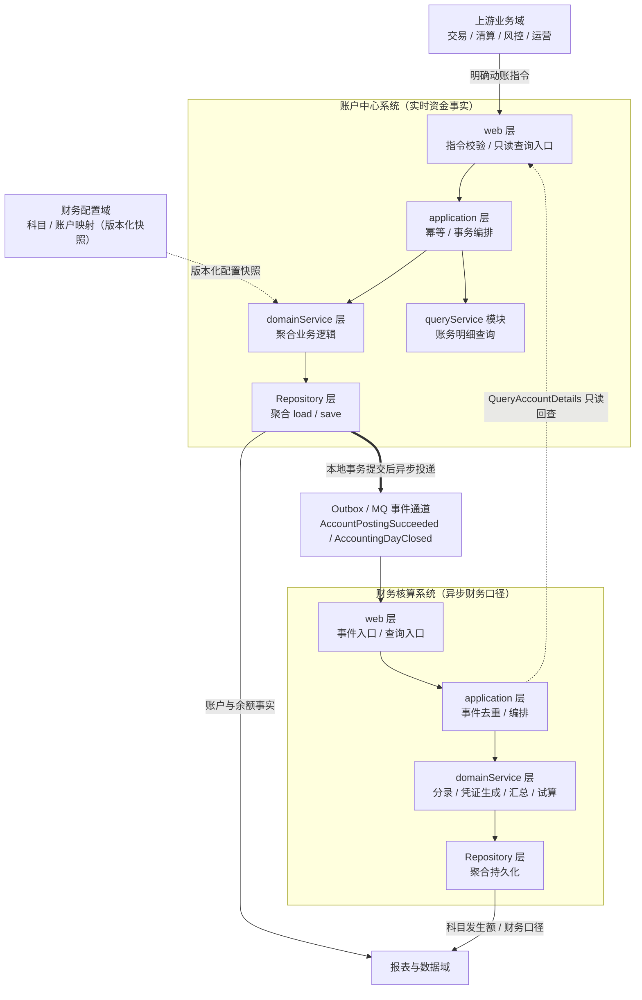

架构要点：
1. **双系统、双库、双 Outbox**：账户中心与财务核算系统使用独立数据库，各自维护 Outbox 表，不共享 `Repository`；跨系统同步查询只能进入对方 `web` 层。
2. **一条主数据流**：`明确动账指令 → PostingInstruction → 余额桶原子变更 → AccountDetail（不可变事实）→ AccountPostingSucceeded → AccountingEntry（借贷分录）→ AccountingVoucher（会计凭证）→ SubjectDailySummary → 试算平衡`。
3. **两条批处理链**：00:00 余额快照任务固化热点缓冲、生成日终快照并发布 `AccountingDayClosed`；01:00 勾稽任务执行追平检查、勾稽校验、科目汇总与试算平衡。
4. **CQRS 分层**：写路径 `web → application → domainService → Repository`，查询路径 `web → application → queryService`

### 0.3 关键技术决策

| #   | 决策          | 内容                                                              | 主要收益与代价                               |
| --- | ----------- | --------------------------------------------------------------- | ------------------------------------- |
| D1  | 子域拆分为双系统    | 账户中心管理实时资金事实，财务核算系统生成异步财务口径                                     | 资金主链路不被报表核算拖累；代价是跨系统最终一致与 Outbox 运维成本 |
| D2  | 记账簿 + 余额桶   | 外部户动账事实归属 `AccountBook`，账簿下拥有 1..N 个 `AccountBookBucket` 并发执行单元 | 分散热点账户写热点；代价是账簿 / 账户汇总需异步投影并勾稽追平      |
| D3  | 指令与事实分离     | `PostingInstruction` 表达动账意图，`AccountDetail` 是不可变成功事实            | 冲正 / 调账只追加反向事实，历史永不修改；代价是查询需同时覆盖指令与事实 |
| D4  | 五个原子动账方向    | 加钱、减钱、可用转冻结、冻结转可用、冻结转出                                          | 冻结类能力复用同一记账与明细结构，不绕过余额桶校验             |
| D5  | Outbox 最终一致 | 动账主事务同库写 Outbox，事务提交后异步发布 `AccountPostingSucceeded`             | 避免本地事务与消息发送双写不一致；代价是 Relay 与消费幂等建设    |
| D6  | 多层幂等兜底      | 请求 `requestId`、指令 / 明细唯一键、分录 `detailNo` 唯一键、凭证 `instructionNo` 唯一键、事件消费去重表             | 重复请求、重复事件、消息乱序都不产生重复事实                |
| D7  | 日终固化与冲正限制   | 00:00 固化快照；日结后的会计日禁止补录，冲正仅限未日结成功指令                              | 保证会计日封闭性；跨日差错统一走调账                    |
| D8  | 汇总异步化       | 科目日汇总只由批任务写入，线上动账不实时更新汇总表                                       | 写路径轻量；依赖日终勾稽保证最终一致                    |
| D9  | 分录与凭证同事务 | 财务核算按 `instructionNo` 归集 1..N 条借贷分录，并在同一本地事务生成一张 `AccountingVoucher` | 凭证天然与分录勾稽一致；代价是任一凭证字段或借贷平衡校验失败会整体重试 |

## 1. 建模结论

账户财务域应拆成两个互相衔接但职责清晰的子域。

| 子域     | 核心职责                                               | 不负责                 |
| ------ | -------------------------------------------------- | ------------------- |
| 账户中心   | 管理账簿/账户、余额、冻结、动账指令、动账明细和余额快照                       | 解释业务规则、计算手续费或决定资金分配 |
| 财务核算中心 | 基于“成功账务明细”异步生成借贷分录和会计凭证，归集科目发生额、期末余额和财务报表口径、提供备付金额度管理能力 | 实时控制客户可用余额或参与交易主链路  |

**核心建模原则**

| 建模事实   | 归属                                        |
| ------ | ----------------------------------------- |
| 业务事实   | 上游业务域                                     |
| 明确动账指令 | 账户中心                                      |
| 单边账务事实 | `AccountDetail`                           |
| 借贷分录   | `AccountingEntry`                         |
| 会计凭证   | `AccountingVoucher`                       |
| 科目发生额  | `AccountingSubject`、`SubjectDailySummary` |
| 财务差错处理 | 调账走上游交易或工单转化后的新指令；冲正由账户中心提供原子能力           |

> [!important]
> 账户财务域的输入必须是明确的**账户、金额、方向和余额影响**。它不反推交易应如何清分，也不依赖支付、清结算或退款模型才能完成记账。

## 2. 范围与能力模块

账户财务域的能力模型围绕一条主线展开：**上游明确动账指令 → 账务处理形成账务事实 → 会计核算与报表输出财务口径**。

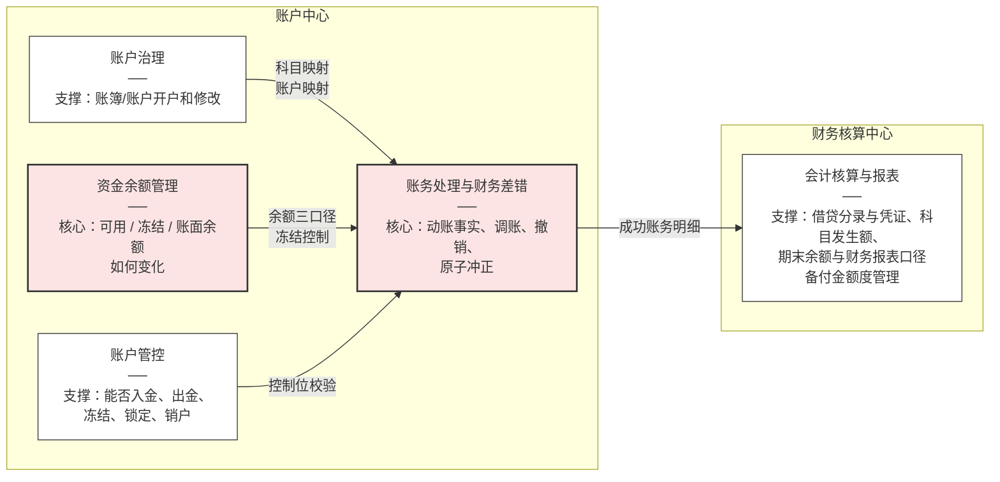

## 3. 上下文映射

账户财务域内部包含**账户中心**和**财务核算中心**两个子域，财务核算中心进一步覆盖会计核算与报表能力模块。外部域只通过校验层或事实接口与本域交互。撤销由交易层在结算前以支付单号发起；交易层完成业务判断后，把撤销产生的反向动账作为明确指令传入本域。

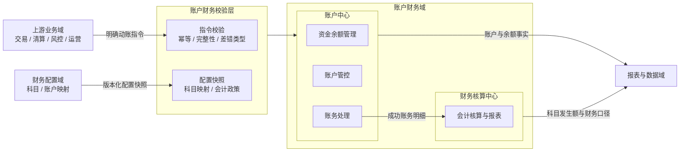

**校验层职责**
1. 校验来源域、来源单号、幂等键和指令行完整性。
2. 将外部业务动作翻译为 `PostingInstruction`，不透传上游库表结构。
3. 保存科目映射、账户映射和会计政策的版本快照。
4. 拒绝语义不完整的指令，例如缺少账户、金额、方向、币种或余额影响。
5. 区分正常动账、撤销、调账和冲正：撤销是交易层正常流程；调账走上游交易或工单转化后的新指令；冲正调用账户中心原子能力，不作为用户可见交易。

## 4. 统一语言与模型总览

### 4.1 核心术语

| 术语      | 含义                                                            |
| ------- | ------------------------------------------------------------- |
| 账户      | 本域内的身份和资金容器；外部户余额由记账簿承载，内部户直接承载单余额                            |
| 可用余额    | 当前可直接扣减或转出的余额                                                 |
| 冻结余额    | 已从可用余额占用但尚未正式转出的余额                                            |
| 账面余额    | 可用余额与冻结余额之和                                                   |
| 动账指令    | 一次明确的一组账户余额变化请求                                               |
| 动账明细    | 已成功执行的不可变账务事实                                                 |
| 分录      | 借贷方向的会计核算事实，由成功账务明细异步生成                                       |
| 凭证      | 按动账指令归集借贷分录的会计凭证，与分录在同一财务核算本地事务生成                             |
| 冻结单     | 记录冻结、解冻、冻结转出总额和状态的聚合                                          |
| 财务差错处理  | 通过调账或冲正修正已成功账务事实；历史明细只允许追加反向事实，不允许修改或删除                       |
| 调账      | 经审批后通过上游交易或工单转化出的新动账指令修正余额或科目核算，属于财务差错处理                      |
| 冲正      | 对一笔可冲正的成功动账指令整笔生成反向指令；对外只暴露 `ReversePosting` 原子能力，用户不可见、不通过交易 |
| 撤销      | 交易层在结算前发起的正常业务逻辑，入参为待撤销支付单号；保留原支付流水，通过交易流程生成冲抵动账              |
| 外部户     | 面向客户开立的账户，类型仅限基本户和结算户；业务场景余额由记账簿承载                            |
| 记账簿     | 在外部户之上按业务场景拆分的余额载体，映射到一个基本户或结算户，采用可用 / 冻结 / 账面三口径余额           |
| 内部户     | 内部核算与资金归集过渡账户，单余额                                             |
| 日切      | 会计日边界，固定为每日凌晨 00:00                                           |
| 日结      | 每日凌晨 00:00 快照任务与 01:00 勾稽任务对上一会计日执行固化、快照、追平、勾稽、汇总与试算的统称       |
| 科目发生额汇总 | 按科目、会计日、币种汇总的借贷发生额、笔数与余额                                      |
| 试算平衡    | 全科目借方与贷方发生额、余额合计相等的校验                                         |

### 4.2 账户中心模型总览

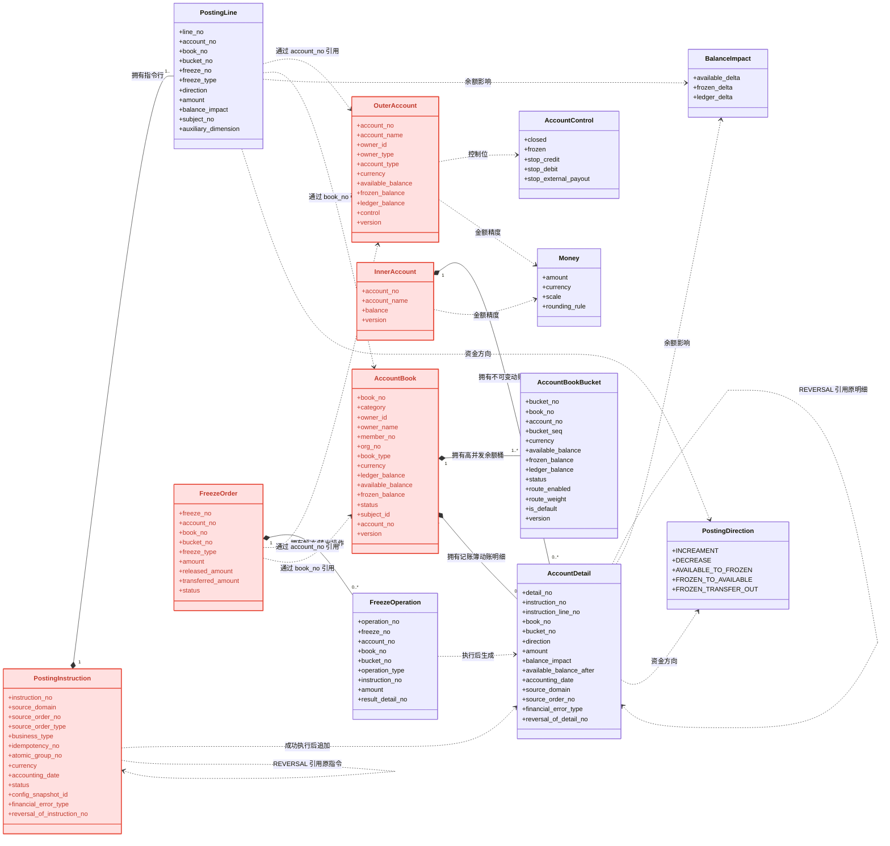

### 4.3 财务核算中心模型总览

```mermaid
classDiagram
    direction LR
    class AccountingEntry {
        +entry_no
        +voucher_no
        +detail_no
        +payment_serial_no
        +direction
        +amount
        +currency
        +accounting_subject_no
        +accounting_date
        +review_status
        +remark
    }
    class AccountingVoucher {
        +voucher_no
        +instruction_no
        +accounting_event
        +related_order_type
        +related_order_no
        +source_domain
        +accounting_date
        +accounting_time
        +debit_total_amount
        +credit_total_amount
        +maker
        +reviewer
        +review_status
        +status
        +reversal_of_voucher_no
    }
    class SubjectDailySummary {
        +subject_no
        +accounting_date
        +currency
        +debit_amount
        +debit_count
        +credit_amount
        +credit_count
        +debit_balance
        +credit_balance
    }
    class AccountingSubject {
        +subject_no
        +name
        +parent_subject_no
        +level
        +subject_type
        +balance_direction
        +currency
        +status
        +remark
        +version
    }
    class AccountDailySnapshot {
        +snapshot_date
        +account_no
        +available_balance
        +frozen_balance
        +ledger_balance
    }

    AccountingEntry ..> AccountDetail : 来源账务明细（账户中心）
    AccountingVoucher ||--|{ AccountingEntry : 按指令归集分录
    SubjectDailySummary ..> AccountingEntry : 汇总分录
    SubjectDailySummary ..> AccountingSubject : 按科目汇总
    AccountDailySnapshot ..> OuterAccount : 通过 account_no 引用

    AccountingEntry ..> Money : 金额精度

    cssClass "AccountingEntry" aggregateRoot
    cssClass "AccountingVoucher" aggregateRoot
    cssClass "SubjectDailySummary" aggregateRoot
    cssClass "AccountingSubject" aggregateRoot
    cssClass "AccountDailySnapshot" aggregateRoot

    classDef aggregateRoot fill:#ffe0e0,stroke:#e74c3c,stroke-width:2px,color:#c0392b
```

## 5. 通用核心值对象

### 5.1 `Money`

所有金额统一建模为 `Money`，禁止使用浮点数。

```text
Money = {
  amount: decimal,
  currency: string,
  scale: int,
  rounding_rule: string
}
```

约束：

1. 金额使用数据库高精度 decimal。
2. 每笔动账必须携带币种，账户币种与指令币种必须一致。
3. 小数位、舍入规则和尾差规则来自会计政策快照。
4. 科目发生额合计使用同一精度。
5. 分摊产生的尾差必须落入明确科目或明细，不允许自然丢失。

### 5.2 `AccountControl`

账户控制使用可组合控制位，而不是单一互斥状态。控制位可叠加组合，多个控制位可同时生效；控制位集合可迭代扩展，新增控制位不改变既有控制位语义。执行动账前对命中控制位逐一迭代校验。

```text
AccountControl = {
  closed: boolean,
  frozen: boolean,
  increament: boolean,
  decrease: boolean
}
```

语义：

| 控制位       | 效果                                             |
| ------------ | ------------------------------------------------ |
| `increament` | 禁止增加账面余额、止入                           |
| `decrease`   | 禁止扣减可用余额、冻结余额或账面余额、至出       |
| `frozen`     | 停止主动动账，允许按策略执行解冻或司法操作、冻结 |
| `closed`     | 销户后禁止一切新动账                             |

### 5.3 `BalanceImpact`

每条账务明细必须显式保存三类余额影响：

```text
BalanceImpact = {
  available_delta: decimal,
  frozen_delta: decimal,
  ledger_delta: decimal
}
```

| 操作         | 可用余额 | 冻结余额 | 账面余额 |
| ------------ | -------: | -------: | -------: |
| 入账 100     |     +100 |        0 |     +100 |
| 出账 100     |     -100 |        0 |     -100 |
| 冻结 100     |     -100 |     +100 |        0 |
| 解冻 100     |     +100 |     -100 |        0 |
| 冻结转出 100 |        0 |     -100 |     -100 |

### 5.4 `PostingDirection`

账户中心只使用资金执行方向，不引入会计借贷方向。资金执行方向统一为五个，覆盖记账、冻结、解冻和冻结转出。

| 方向                    | 名称    | 可用余额 | 冻结余额 | 账面余额 |
| --------------------- | ----- | ---: | ---: | ---: |
| `INCREAMENT`          | 加钱/入账 | +100 |    0 | +100 |
| `DECREASE`            | 减钱/出账 | -100 |    0 | -100 |
| `AVAILABLE_TO_FROZEN` | 可用转冻结 | -100 | +100 |    0 |
| `FROZEN_TO_AVAILABLE` | 冻结转可用 | +100 | -100 |    0 |
| `FROZEN_TRANSFER_OUT` | 冻结转出  |    0 | -100 | -100 |

## 6. 账户模型

本章统一建模账户身份、账户控制、余额口径、动账事实和资金冻结。账户按服务对象分为外部户和内部户：`OuterAccount` 聚合建模外部户，类型仅限基本户和结算户，自身不再拥有动账明细；外部户的业务余额和动账明细由 `AccountBook` 聚合承载，账簿下再拆分多个高并发余额桶；`InnerAccount` 聚合建模内部户，采用单余额，不面向客户开户销户，动账明细仍归属内部户聚合。两者复用同一套动账指令模型。

### 6.1 聚合关系总览

账户模型包含五个聚合根：`OuterAccount(外部户)`、`AccountBook(记账簿)`、`InnerAccount(内部户)`、`PostingInstruction(记账指令)`、`FreezeOrder(冻结单)`。`OuterAccount` 建模外部户身份和底层基本户 / 结算户；`AccountBook` 建模外部户按业务场景拆分的余额载体，其下 `AccountBookBucket` 表达高并发余额桶；`InnerAccount` 建模内部户单余额。

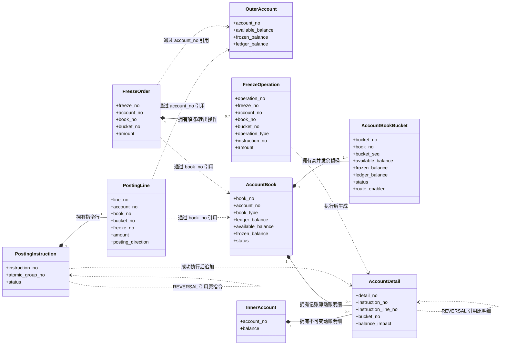

**聚合边界规则**

1. `OuterAccount` 只建模外部户身份、底层资金账户类型、账户控制和账簿汇总口径，不再拥有动账明细；外部户动账事实统一归属于 `AccountBook`。`AccountBook` 与 `InnerAccount` 是各自余额和动账事实的一致性边界，拥有 `AccountDetail` 值对象集合；历史明细在工程实现中可独立分表存储，但领域归属仍属于所属记账簿或内部户聚合，不要求一次加载全部历史明细。
2. `PostingInstruction` 是动账意图聚合根，拥有 `PostingLine` 值对象；外部户指令行必须携带 `book_no` 并引用目标记账簿，内部户指令行 `book_no` 为空。它不直接持有 `OuterAccount` 或 `AccountBook` 对象，也不长期拥有执行后的 `AccountDetail`。
3. `PostingInstruction` 成功执行后，每条 `PostingLine` 转换为一条由对应聚合（外部户为 `AccountBook`，内部户为 `InnerAccount`）拥有的 `AccountDetail` 值对象。
4. `FreezeOrder` 是资金占用聚合根，通过 `account_no` 引用外部户，同时必须通过 `book_no` 和 `bucket_no` 引用业务账簿余额桶。聚合内可拥有 0..N 条 `FreezeOperation` 值对象；冻结创建不产生解冻/转出操作，后续每次成功解冻或转出各产生一条操作。
5. `FreezeOperation` 执行成功后生成的动账事实归属于被冻结的 `AccountBook`，`FreezeOrder` 只通过 `result_detail_no` 追溯该事实。
6. 跨聚合根只保存对方标识，不保存对象引用；跨聚合执行结果通过本地事务、幂等键、事件和对账闭环保证一致。
7. `AccountBook` 只通过 `account_no` 引用 `OuterAccount`；记账簿创建后不得变更所属账户。`AccountBook` 是业务场景余额载体，拥有 1..N 个 `AccountBookBucket`；每个桶是高并发执行单元。账簿和外部户的三口径汇总数是桶余额的投影，最终必须与全部有效余额桶勾稽，不能出现无账务事实支撑的汇总数。

### 6.2 `OuterAccount` 聚合

```text
Aggregate Root: OuterAccount
```

本聚合建模外部户，统一采用账簿余额桶方案：外部户不设置 `ledger_mode`，业务余额由 `AccountBook` 下的一个或多个 `AccountBookBucket` 承载。外部户的账户类型只有基本户和结算户；担保、待结算等业务场景不再扩展 `account_type`，而是通过 `AccountBook.book_type` 表达。外部户自身不承载动账明细，账户余额只是其全部有效记账簿余额的强一致汇总或投影。内部户由独立的 `InnerAccount` 聚合建模（见 6.4）。

| 字段                      | 说明                                |
| ----------------------- | --------------------------------- |
| `account_no`            | 账户号，全局唯一                          |
| `account_name`          | 账户名称                              |
| `owner_id`              | 持有人或责任主体标识                        |
| `owner_type`            | 持有人性质：对公、对私                       |
| `account_type`          | 账户类型：基本户、结算户                      |
| `currency`              | 币种                                |
| `available_balance`     | 可用余额                              |
| `frozen_balance`        | 冻结余额                              |
| `ledger_balance`        | 账面余额；为其全部有效记账簿的汇总投影或强一致事实 |
| `control`               | 账户控制位(冻结解冻、止入支出等)                 |
| `accounting_subject_no` | 关联会计科目                            |
| `version`               | 乐观锁版本                             |
| `opened_at`             | 开户时间                              |
| `closed_at`             | 销户时间                              |

#### 6.2.1 `AccountDetail` 动账明细值对象

`AccountDetail` 是不可变事实，余额只是它的当前投影。外部户聚合不拥有该值对象；外部户明细归属于 `AccountBook`，内部户明细归属于 `InnerAccount`。

| 字段                      | 说明           |
| ------------------------- | -------------- |
| `detail_no`               | 明细号         |
| `instruction_no`          | 来源动账指令   |
| `instruction_line_no`     | 来源指令行     |
| `account_no`              | 账户号         |
| `book_no`                 | 账簿号；外部户动账必填，明细归属该记账簿 |
| `bucket_no`               | 余额桶号；外部户动账必填，标识实际执行桶 |
| `account_txn_type`        | 账务交易类型   |
| `direction`               | 资金执行方向：加钱、减钱、可用转冻结、冻结转可用、冻结转出 |
| `currency`                | 币种           |
| `amount`                  | 交易金额       |
| `available_delta`         | 可用余额变化   |
| `frozen_delta`            | 冻结余额变化   |
| `ledger_delta`            | 账面余额变化   |
| `available_balance_after` | 执行后可用余额 |
| `frozen_balance_after`    | 执行后冻结余额 |
| `ledger_balance_after`    | 执行后账面余额 |
| `accounting_date`         | 会计日         |
| `source_domain`           | 来源域         |
| `source_order_no`         | 来源业务单号   |
| `adjustment_reason`       | 调账、冲正原因 |
| `financial_error_type`    | 财务差错类型：`NONE`、`ADJUSTMENT`、`REVERSAL` |
| `reversal_of_detail_no`   | 冲正明细引用的原明细号，非冲正明细为空 |
| `created_at`              | 创建时间       |

**不变量**

1. `instruction_no + instruction_line_no` 唯一。
2. 外部户执行后余额快照必须等于目标 `AccountBookBucket` 原余额加本行余额影响；内部户执行后余额快照必须等于内部户原余额加本行余额影响。
3. 明细不可 UPDATE 或 DELETE。
4. 退款、调账、冲正都生成新明细。
5. 只有成功明细才能进入财务核算。
6. 单边账务明细是客户、渠道和内部账户余额的权威事实来源。
7. `financial_error_type = REVERSAL` 的明细必须引用原成功明细，金额和币种相同，余额影响逐项取反。
8. 一条原成功明细最多存在一条冲正明细；冲正指令失败时不得留下部分冲正明细。

#### 6.2.2 财务差错处理：调账与冲正

财务差错处理只包含调账和冲正。撤销是交易层在结算前发起的正常逻辑，不属于财务差错处理；交易层以支付单号定位原支付流水并完成业务判断后，本域只处理其派生出的明确反向动账指令。

**调账规则**

1. 调账必须来自审批通过的人工工单，并由上游交易或工单流程转化为 `PostingInstruction`。
2. 账户财务域禁止直接修改余额；调账通过新指令生成新明细。
3. 保存申请人、审批人、操作者、原因、前后余额快照。
4. 涉及科目的调账必须同时解释科目核算变化。
5. 所有调账必须设置 `financial_error_type = ADJUSTMENT`，并可追溯到原始差异来源。

**冲正边界**

1. 冲正由账户中心对外提供 `ReversePosting` 原子能力，调用方不拼反向指令行，也不经过用户可见交易流程。
2. 冲正只能处理成功且尚未被有效冲正的 `PostingInstruction`；原指令会计日已完成日结后改用调账。
3. 冲正是整笔冲正，必须镜像原指令全部指令行；不支持部分冲正。
4. 原指令和原明细保持不可变，冲正只追加反向指令和反向明细。

#### 6.2.3 核心不变量

```text
ledger_balance = available_balance + frozen_balance
available_balance >= 0
frozen_balance >= 0
```

1. 每次余额变化必须对应一条成功动账明细。
2. 余额更新、动账明细插入和事件写入必须在同一本地事务内完成。
3. 账户控制状态必须来自账户聚合，不能用账户映射状态替代。
4. 币种不同禁止记账，禁止隐式换汇。
5. 外部户余额不得为负；内部户允许负余额。
6. 销户前必须满足余额为零且无未完成冻结。
7. 账户默认科目变更只影响后续开簿，不重写历史明细。
8. 外部户自身不生成 `AccountDetail`；每次外部户余额变化都必须落在唯一 `AccountBook`，并生成归属该记账簿的成功动账明细。

#### 6.2.4 开户与销户

**开户规则**
1. 以 `request_id + owner_id + account_type + currency` 幂等。
2. 已存在同类账户时返回原账户，不重复开户。
3. 开户成功生成 `AccountOpened` 事件。
4. 开户即固化初始会计科目和会计政策版本。

**销户规则**

1. 先设置 `closed` 控制位，阻止新动账进入。
2. 处理或迁移剩余余额、冻结单和历史明细。
3. 满足销户前置条件后写入 `closed_at`。
4. 已销户账户只允许查询，不允许任何新增余额变化。
5. 如需恢复，应新建账户或执行明确反向控制操作，不建议重开历史账户。

### 6.3 `AccountBook` 聚合

```text
Aggregate Root: AccountBook
```

记账簿是在外部户之上按业务场景演进出的余额载体。一个记账簿必须映射到一个基本户或结算户；`book_type` 表达担保账户、待结算账户等业务账簿形态，不改变底层 `OuterAccount.account_type`。每个记账簿拥有一个或多个 `AccountBookBucket`，余额桶用于分散同一业务场景下的并发行锁冲突。

| 字段                  | 说明                           |
| ------------------- | ---------------------------- |
| `book_no`           | 账簿号，全局唯一                     |
| `category`          | 类别，例如客户·商户                   |
| `owner_id`          | 持有人主体标识                      |
| `owner_name`        | 持有人展示名称                      |
| `member_no`         | 会员号；类别需要会员号时必填               |
| `org_no`            | 机构号；类别需要机构号时必填               |
| `book_type`         | 账簿类型：担保账户、待结算账户或其他经配置的业务账簿类型 |
| `currency`          | 币种，必须与所属账户一致                 |
| `available_balance` | 可用余额                         |
| `frozen_balance`    | 冻结余额                         |
| `ledger_balance`    | 账户余额 / 账面余额                  |
| `status`            | 状态：正常、冻结、停用、销户               |
| `subject_id`        | 所属科目                         |
| `account_no`        | 所属账户，必须是外部基本户或结算户            |
| `version`           | 乐观锁版本                        |
| `balance_buckets`   | 记账簿拥有的高并发余额桶集合，至少一个默认桶       |
| `account_details`   | 记账簿拥有的动账明细值对象集合              |
| `created_at`        | 创建时间                         |
| `closed_at`         | 销户时间                         |

**聚合规则**

1. 记账簿是外部业务场景余额的一致性边界；它只保存 `account_no`，不持有 `OuterAccount` 对象。
2. 记账簿创建后不得变更 `account_no`；销户或迁移必须新建记账簿并产生明确余额调整事实。
3. `currency` 必须等于所属 `OuterAccount.currency`；币种不同禁止记账。
4. 记账簿动账必须校验所属账户、本记账簿状态和控制位，并把指令行路由到本记账簿下的一个有效余额桶执行；余额桶校验通过后生成归属本记账簿和目标余额桶的 `AccountDetail`。冲正回原明细桶，解冻和冻结转出回原冻结桶；单条指令行不跨桶拆分。
5. 账簿类型与 `subject_id` 在开户时固化；科目调整只影响后续动账，不重写历史明细。
6. 账簿三口径余额是其全部有效余额桶之和，外部户余额是全部有效账簿余额桶之和。高并发动账主事务只更新余额桶；账簿和外部户汇总数可作为同事务或异步强一致投影维护，最终必须勾稽相等，禁止出现无账务事实支撑的汇总数。
7. 外部户不直接动账。其动账、冻结、解冻和冻结转出都必须携带 `book_no`，并落到对应记账簿。

**核心不变量**

```text
bucket.ledger_balance = bucket.available_balance + bucket.frozen_balance
bucket.available_balance >= 0
bucket.frozen_balance >= 0
sum(AccountBookBucket.available_balance by book_no) = AccountBook.available_balance
sum(AccountBookBucket.frozen_balance by book_no) = AccountBook.frozen_balance
sum(AccountBookBucket.ledger_balance by book_no) = AccountBook.ledger_balance
sum(AccountBook.available_balance by account_no) = OuterAccount.available_balance
sum(AccountBook.frozen_balance by account_no) = OuterAccount.frozen_balance
sum(AccountBook.ledger_balance by account_no) = OuterAccount.ledger_balance
```

**开户与销户**

1. 以 `request_id + account_no + book_type + currency` 幂等；数据库对 `account_no + book_type` 建立全局唯一键，同一账户下同一业务账簿类型最多一条业务账簿。
2. 所属账户必须是 `account_type in (基本户, 结算户)` 的正常外部户。
3. 开户成功生成 `AccountBookOpened` 事件。
4. 开簿时至少创建一个默认余额桶；销户前必须满足所有余额桶余额为零、无未完成冻结单，并先阻止新动账；销户成功生成 `AccountBookClosed` 事件。

### 6.4 `InnerAccount` 聚合

```text
Aggregate Root: InnerAccount
```

内部户用于内部科目核算与资金归集过渡，不面向客户开户销户，允许负余额，不设三口径与冻结。

| 字段                    | 说明                         |
| ----------------------- | ---------------------------- |
| `account_no`            | 内部户编号，全局唯一         |
| `account_name`          | 内部户名称                   |
| `balance`               | 当前余额，允许为负           |
| `version`               | 乐观锁版本                   |
| `account_details`       | 账户拥有的动账明细值对象集合 |
| `accounting_subject_no` | 关联会计科目                 |

**聚合规则**

1. 动账明细复用 `AccountDetail`；内部户动账的 `balance_impact` 仅账面增量生效，可用与冻结增量恒为 0。
2. 余额可为负。
3. 不设可用 / 冻结 / 账面三口径，不支持冻结单与账户控制位。
4. 动账通过 `PostingInstruction` 指令模型执行，幂等与原子组规则与外部记账簿一致。
5. 跨聚合只保存 `account_no` 标识，一致性由本地事务、幂等键和事件保证。
6. `account_no` 与外部户采用不同的生成规则和号段，不会与 `OuterAccount` 冲突。

### 6.5 `PostingInstruction` 聚合

```text
Aggregate Root: PostingInstruction
```

| 字段              | 说明                                   |
| ----------------- | -------------------------------------- |
| `instruction_no`  | 动账指令号                             |
| `source_domain`   | 来源域                                 |
| `source_order_no` | 来源业务单号                           |
| `source_order_type` | 来源单据类型：交易单、支付单或 ACS 记录       |
| `business_type`   | 业务动账类型                           |
| `idempotency_no`  | 来源幂等键，上游请求号等，用于幂等处理 |
| `atomic_group_no` | 原子组号                               |
| `currency`        | 币种                                   |
| `accounting_date` | 会计日                                 |
| `status`          | 待执行、成功、失败、已取消             |
| `financial_error_type` | 财务差错类型：`NONE`、`ADJUSTMENT`、`REVERSAL` |
| `reversal_of_instruction_no` | 冲正指令引用的原动账指令号，非冲正指令为空 |
| `error_reason`    | 调账或冲正原因，普通动账为空           |
| `operator_or_system` | 发起调账或冲正的操作者或系统标识     |
| `lines`           | 指令行集合                             |

`PostingLine`：

| 字段                  | 说明              |
| --------------------- | ----------------- |
| `line_no`             | 指令行号          |
| `account_no`          | 目标账户          |
| `book_no`             | 目标账簿；外部户指令行必填，内部户指令行为空 |
| `bucket_no`           | 执行余额桶号；成功后必填，内部户为空 |
| `freeze_no`           | 冻结转可用、冻结转出引用的原冻结单；通用可用转冻结新建冻结单后回填 |
| `freeze_type`         | 通用可用转冻结创建冻结单的类型；其他方向为空 |
| `direction`           | 资金执行方向      |
| `amount`              | 金额              |
| `balance_impact`      | 三类余额影响      |
| `account_subject_no`  | 会计科目          |
| `summary`             | 摘要              |

**指令状态**

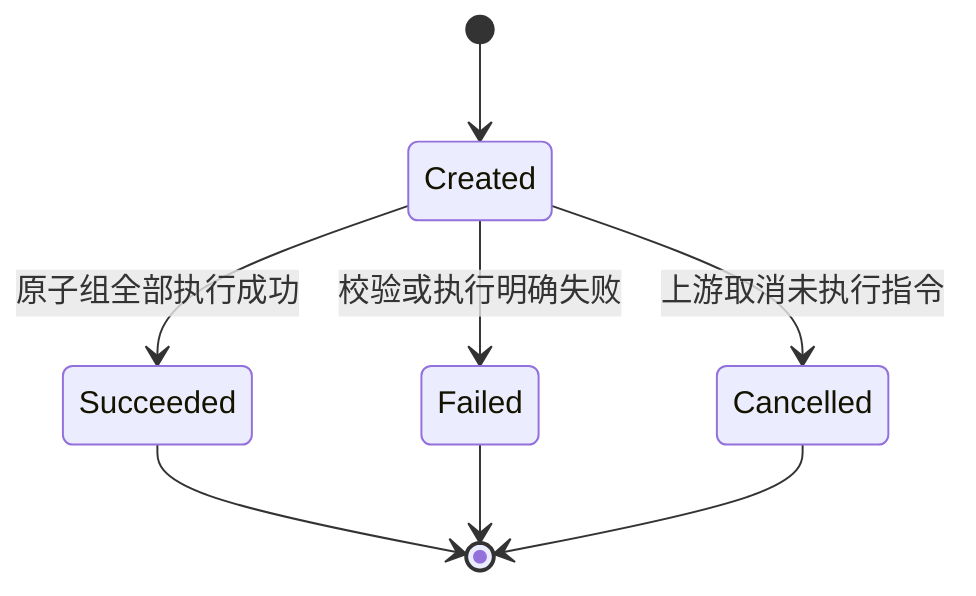

**执行规则**

1. 同一原子组内所有指令行全部成功或全部失败。
2. 已成功原子组不能重复执行。
3. 失败后重试必须复用原指令号和幂等键，不允许生成影子指令。
4. 待执行指令不改变余额，也不生成成功账务事实。
5. 加钱和减钱组成的多行原子组必须满足账面流入合计等于账面流出合计（资金守恒），保证生成的分录全科目借贷平衡。
6. 可用转冻结和冻结转可用不改变账面余额，组内可用与冻结迁移影响必须按账簿/余额桶自相抵；冻结转出是经冻结单授权的单边资金退出事实，由财务核算按科目映射生成借贷分录。
7. `book_no` 与 `account_no` 必须映射到同一条 `AccountBook`；外部户指令行 `book_no` 必填，内部户指令行 `book_no` 为空。
8. `financial_error_type = REVERSAL` 时，`reversal_of_instruction_no` 必填；指令行必须按原指令行顺序生成，账簿、余额桶、金额、币种、科目和辅助维度一致，方向与余额影响逐项取反。
9. 原指令保持 `Succeeded`；是否已冲正通过是否存在生效冲正指令判断，不修改原指令状态。
10. 冲正指令与全部反向明细、余额更新、Outbox 事件在同一本地事务内提交，禁止只冲正部分指令行。
11. 生效冲正失败后重试必须复用同一冲正指令号和幂等键；只有失败或已取消记录不占用生效冲正唯一键。

#### 6.5.1 `ReversePosting` 冲正原子能力

`ReversePosting` 是账户中心对外暴露的财务差错原子能力。调用方只需要声明原指令和冲正原因，由账户中心生成整笔反向 `PostingInstruction` 并执行。

| 项目     | 口径                                                                 |
| -------- | -------------------------------------------------------------------- |
| 输入     | 原动账指令号、冲正原因、冲正幂等键、操作者或系统标识                     |
| 输出     | 冲正指令号、冲正明细号、执行后余额快照；重复请求幂等返回首次结果           |
| 前置条件 | 原指令 `Succeeded`；无生效冲正指令；原指令会计日未完成日结                 |
| 执行边界 | 冲正指令创建、全部反向行执行、原冲突校验、明细写入和 Outbox 写入同一本地事务 |
| 失败语义 | 任一校验、控制位或余额校验失败，事务整体回滚；调用方可重试或改走调账         |

```text
procedure ReversePosting(originalInstructionNo, reason, idempotencyNo, operator):

    # 原指令加锁，串行化同一原指令的并发冲正
    original = PostingInstructionRepository.loadForUpdate(originalInstructionNo)
    assert original.status == Succeeded
    assert original.accountingDate 未完成日结
    assert not exists PostingInstruction(
        financial_error_type = REVERSAL,
        reversal_of_instruction_no = original.instruction_no,
        status in [Created, Succeeded]
    )

    reversal = buildPostingInstruction(
        financial_error_type = REVERSAL,
        reversal_of_instruction_no = original.instruction_no,
        error_reason = reason,
        idempotency_no = idempotencyNo,
        lines = reverseAll(original.lines)
    )

    result = PostEntries(reversal)          # 复用原子组执行、余额校验、明细写入和 Outbox
    assert result.allLinesSucceeded
    return result
```

> 冲正不改写原明细，也不删除原分录。财务核算中心会为冲正明细再生成反向分录；两个会计事实同时保留，净额反映差错修正结果。

### 6.6 `FreezeOrder` 聚合

```text
Aggregate Root: FreezeOrder
```

| 字段                 | 说明                                                       |
| -------------------- | ---------------------------------------------------------- |
| `freeze_no`          | 冻结单号                                                   |
| `account_no`         | 账户号                                                     |
| `book_no`            | 账簿号；外部户冻结必填，内部户冻结为空                     |
| `bucket_no`          | 冻结执行余额桶号；解冻、冻结转出必须复用该桶             |
| `freeze_type`        | 交易占用、出金预留、风控冻结、司法冻结、调账占用           |
| `source_domain`      | 发起域                                                     |
| `source_order_no`    | 来源单号                                                   |
| `currency`           | 币种                                                       |
| `amount`             | 原冻结金额                                                 |
| `released_amount`    | 累计解冻金额                                               |
| `transferred_amount` | 累计转出金额                                               |
| `status`             | 已创建、冻结中、部分解冻、部分转出、已解冻、已转出、已关闭 |
| `idempotency_no`     | 幂等键                                                     |
| `operations`         | 聚合拥有的解冻、转出操作集合，冻结创建时为空              |

**核心不变量**

```text
released_amount + transferred_amount <= amount
AccountBookBucket.frozen_balance >= 该余额桶所有冻结单未转出余额之和
```

**状态规则**

1. 外部户冻结必须指定账簿，并路由到唯一余额桶。冻结时目标余额桶可用余额减少、冻结余额增加，账面余额不变。
2. 解冻时原冻结余额桶冻结余额减少、可用余额增加，账面余额不变。
3. 冻结转出时原冻结余额桶冻结余额减少、账面余额减少。
4. 解冻和转出不能超过原冻结金额减去已操作金额。
5. 渠道或外部结果未知时，上游未给出终态前不得解冻、回补或转出；这是账户财务域的执行保护条件。
6. 风控冻结和司法冻结的解除必须使用来源域的明确指令。

#### 6.6.1 `FreezeOperation` 值对象

| 字段                 | 说明             |
| -------------------- | ---------------- |
| `operation_no`       | 操作号           |
| `freeze_no`          | 冻结单号         |
| `account_no` / `book_no` / `bucket_no` | 原冻结外部户、账簿和余额桶 |
| `operation_type`     | `RELEASED` 表示解冻，`TRANSFERRED` 表示冻结转出 |
| `instruction_no`     | 本次操作生成的动账指令号 |
| `amount`             | 操作金额         |
| `reason`             | 原因             |
| `operator_or_system` | 操作者或系统标识 |
| `result_detail_no`   | 生成的账务明细   |
| `created_at`         | 操作时间         |

每次解冻或转出必须生成一条操作记录和一条成功账务明细；操作失败不生成成功事实。

> 每次成功解冻或成功转出都会向 `FreezeOrder.operations` 追加一条 `FreezeOperation`，并生成一条不可变 `AccountDetail`。失败尝试不生成成功操作事实。

## 7. 会计核算模型

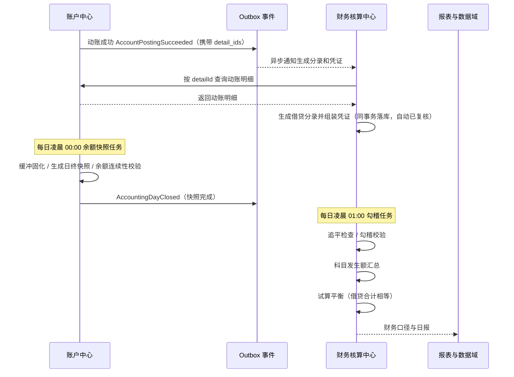

### 7.1 `AccountingEntry` 聚合（分录）

```text
Aggregate Root: AccountingEntry
```

分录是会计核算子域的核心事实：账务处理成功后，`AccountPostingSucceeded` 事件异步推送至会计核算子域，按成功账务明细生成借贷分录。分录使用 `DEBIT` / `CREDIT` 借贷方向，与账户侧资金执行方向相互独立。

| 字段                    | 说明                                    |
| ----------------------- | --------------------------------------- |
| `entry_no`              | 分录编号，全局唯一                      |
| `voucher_no`            | 所属凭证号；分录与凭证在同一事务生成        |
| `detail_no`             | 来源账务明细号，分录生成幂等键          |
| `book_no`               | 来源账簿号；外部户分录必填，内部户分录为空 |
| `payment_serial_no`     | 来源支付流水号                          |
| `direction`             | 借贷方向：借方（DEBIT）/ 贷方（CREDIT） |
| `amount`                | 金额                                    |
| `currency`              | 币种                                    |
| `accounting_subject_no` | 关联会计科目                            |
| `accounting_date`       | 会计日                                  |
| `review_status`         | 复核状态：待复核、已复核                |
| `remark`                | 备注                                    |

**分录生成与复核规则**

1. 一条成功账务明细生成一条分录，以 `detail_no` 幂等，重复推送不重复生成。
2. 分录必须落科目。外部户取来源记账簿的 `subject_id`；内部户取 `InnerAccount.accounting_subject_no`；指令行中的科目来自创建指令时的配置快照，必须与执行时目标聚合科目一致。
3. 分录借贷方向由核算科目的余额方向与资金变动方向共同决定：资产、费用类科目增加记借方、减少记贷方；负债、权益、收入类科目相反。
4. 通过动账指令入口生成的分录自动置为已复核；科目发生额汇总只统计已复核分录。人工调整分录的待复核路径暂不展开，后续引入工单流时扩展 `PostingInstruction` 流程实现。
5. 同一原子组资金守恒（流入合计 = 流出合计），保证全科目借贷发生额合计平衡。
6. 分录生成失败不回滚已成功动账。

### 7.2 `AccountingVoucher` 聚合（凭证）

```text
Aggregate Root: AccountingVoucher
```

凭证是财务核算对外展示和归档的会计载体：财务核算系统异步消费同一动账指令的成功明细并生成 1..N 条借贷分录后，按 `instruction_no` 组装一张凭证。凭证不替代分录的核算粒度，而是归集分录的凭证头、关联单据、借贷合计、制单复核和冲销关系。

| 字段                      | 说明                                                         |
| ----------------------- | ---------------------------------------------------------- |
| `voucher_no`            | 凭证号，全局唯一，建议使用 `PZ + 会计日 + 序号` 等可追溯编号规则                    |
| `instruction_no`        | 来源动账指令号，凭证生成幂等键；一条成功指令生成一张凭证                              |
| `accounting_event`      | 记账事件，取指令 `business_type` 及核算事件配置快照                         |
| `related_order_type`    | 关联单据类型：交易单、支付单或 ACS 记录                                     |
| `related_order_no`      | 关联单据号，取来源业务单号                                              |
| `source_domain`         | 来源系统或来源域                                                   |
| `accounting_date`       | 会计日                                                        |
| `accounting_time`       | 业务记账时间，取事件快照 `completedAt`；`created_at` 另行记录凭证生成时间       |
| `currency`              | 币种，同一张凭证内必须一致                                              |
| `debit_total_amount`    | 借方合计，等于凭证内全部借方分录合计                                         |
| `credit_total_amount`   | 贷方合计，等于凭证内全部贷方分录合计                                         |
| `entry_count`           | 凭证内分录数量                                                    |
| `maker`                 | 制单人或制单系统，取事件快照中的指令操作者或系统标识                                |
| `reviewer`              | 复核人或复核系统；当前自动核算路径取 `SYSTEM`                                |
| `review_time`           | 复核时间；自动核算路径为凭证生成时间                                         |
| `review_status`         | 复核状态：待复核、已复核；当前动账入口生成的凭证自动已复核                              |
| `status`                | 状态：生效、已冲销；冲销只更新冲销标记，不重写原凭证核算字段                             |
| `reversal_of_voucher_no` | 被冲销凭证号；冲销凭证必填，普通凭证为空                                       |
| `remark`                | 备注                                                         |

**凭证生成与勾稽规则**

1. 凭证与分录在同一事件消费中生成：按 `instruction_no` 聚合本次成功明细对应的全部分录，禁止先生成分录再异步补凭证。
2. 必须先完成全部分录科目、方向、金额和冲正关系校验，并确认分录的指令号、会计日和币种与凭证头一致；再计算凭证借方合计、贷方合计和分录数量。借方合计必须等于贷方合计，凭证合计必须等于分录合计。
3. `AccountingEntry.voucher_no`、`AccountingVoucher.instruction_no`、事件消费记录和 `EntryGenerated` Outbox 在财务核算库同一本地事务写入；任一失败整体回滚并依赖事件重试，不产生半张凭证。
4. 通过动账指令入口生成的凭证与分录同状态自动已复核；`maker` 取指令操作者或系统标识，`reviewer = SYSTEM`。
5. 冲正生成新的冲销凭证，并在同事务维护原凭证的 `status = 已冲销`；原凭证的科目、金额、分录和关联单据保持不变。冲销凭证本身仍按借贷分录落库，不通过删除或负数覆盖原分录实现。
6. `related_order_type` 取指令 `source_order_type`，并在 `AccountPostingSucceeded.instructionHeaderSnapshot` 中透传；禁止按单号格式反推。类型必须是交易单、支付单或 ACS 记录，缺失或非法时事件消费失败重试，不允许生成关联单据缺失的凭证。
7. 界面上的“操作”列是查询页动作能力，不建模为凭证实体字段。

### 7.3 `SubjectDailySummary` 聚合（科目发生额汇总）

```text
Aggregate Root: SubjectDailySummary
```

科目发生额汇总由日结后的定时任务生成：统计前一会计日的借贷分录，按科目汇总发生额、发生笔数与余额，供试算平衡与财务报表使用。

| 字段              | 说明         |
| ----------------- | ------------ |
| `subject_no`      | 科目编号     |
| `accounting_date` | 会计日期     |
| `currency`        | 币种         |
| `debit_amount`    | 借方发生额   |
| `debit_count`     | 借方发生笔数 |
| `credit_amount`   | 贷方发生额   |
| `credit_count`    | 贷方发生笔数 |
| `debit_balance`   | 借方余额     |
| `credit_balance`  | 贷方余额     |

**汇总与试算规则**

1. 01:00 勾稽任务在追平检查与勾稽校验后触发汇总，统计前一会计日已复核分录，按 `subject_no + accounting_date + currency` 幂等汇总，重复执行不产生重复汇总。
2. 余额按科目余额方向累计：借方余额 = 期初借方余额 + 借方发生额 − 贷方发生额，贷方余额同理。
3. 试算平衡按币种进行：当日全科目借方发生额合计等于贷方发生额合计，借方余额合计等于贷方余额合计；试算不平阻断日报发布并告警。

### 7.4 `AccountingSubject` 聚合

会计科目是配置域维护、账户财务域消费的版本化对象。

| 字段                | 说明                         |
| ------------------- | ---------------------------- |
| `subject_no`        | 科目编号                     |
| `name`              | 科目名称                     |
| `parent_subject_no` | 上级科目编号，一级科目为空   |
| `level`             | 科目层级                     |
| `subject_type`      | 资产、负债、权益、收入、费用 |
| `balance_direction` | 借方余额或贷方余额           |
| `currency`          | 科目币种或本币核算口径       |
| `status`            | 启用、停用                   |
| `remark`            | 备注                         |
| `version`           | 配置版本                     |

### 7.5 日结与日终快照

**日结时间**

日切点固定为每日凌晨 00:00：00:00 隐式关闭上一会计日，此后新发生的动账归属下一会计日。不设跨日会计期间，一个自然日对应一个会计日。日结拆分为两个定时任务：00:00 余额快照任务记录日终快照，01:00 勾稽任务执行追平检查、勾稽校验并触发科目发生额汇总。

`AccountDailySnapshot`：

账户每日余额快照只固化 00:00 时点的账户余额口径，不保存当日账务明细统计。

| 字段                | 说明         |
| ------------------- | ------------ |
| `snapshot_date`     | 快照日期     |
| `account_no`        | 账户号       |
| `available_balance` | 可用余额快照 |
| `frozen_balance`    | 冻结余额快照 |
| `ledger_balance`    | 账面余额快照 |

`AccountBookDailySnapshot`：

| 字段                | 说明           |
| ------------------- | -------------- |
| `snapshot_date`     | 快照日期       |
| `book_no`           | 账簿号         |
| `account_no`        | 所属账户号     |
| `available_balance` | 可用余额快照   |
| `frozen_balance`    | 冻结余额快照   |
| `ledger_balance`    | 账面余额快照   |
| `detail_count`      | 明细数量       |
| `total_credit`      | 明细增加合计   |
| `total_debit`       | 明细减少合计   |

日终流程：

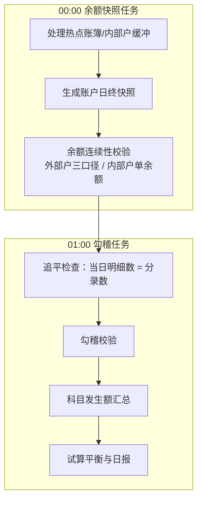

**日终规则**

1. 日切点固定为每日凌晨 00:00，隐式关闭会计日；00:00 余额快照任务固化缓冲并生成日终快照，01:00 勾稽任务执行追平检查、勾稽校验并触发科目发生额汇总，两个任务均幂等可重跑。
2. 热点账簿/内部户缓冲必须在 00:00 快照任务内固化，禁止跨日残留。
3. 日初余额、当日明细合计与日终余额必须连续。
4. 内部户纳入余额连续性校验（单余额口径），不生成三口径快照。
5. 追平检查：当日成功明细数必须等于当日分录数；不平说明分录异常，记录错误日志并继续。
6. 勾稽校验：当日分录借方发生额合计等于贷方发生额合计，并与当日账户明细资金流入流出合计一致；不平记录错误日志并继续，最终体现为试算平衡不平，由人工修补。
7. 科目发生额以科目维度汇总当日借贷分录，由 01:00 勾稽任务触发生成。
8. 日结后的会计日禁止直接补录或修改当日明细；跨日差错不再执行普通冲正，改通过调账在后续会计日完成。

## 8. 领域功能用例

账户账务域的原子功能是不可再拆分领域语义的业务用例：每个用例只维护一个明确聚合或一个本地事务边界内的业务结果，不负责交易支付编排、清分计费、结算出金或跨系统业务流程组织。多个原子功能的组合由上游业务系统或应用服务完成。

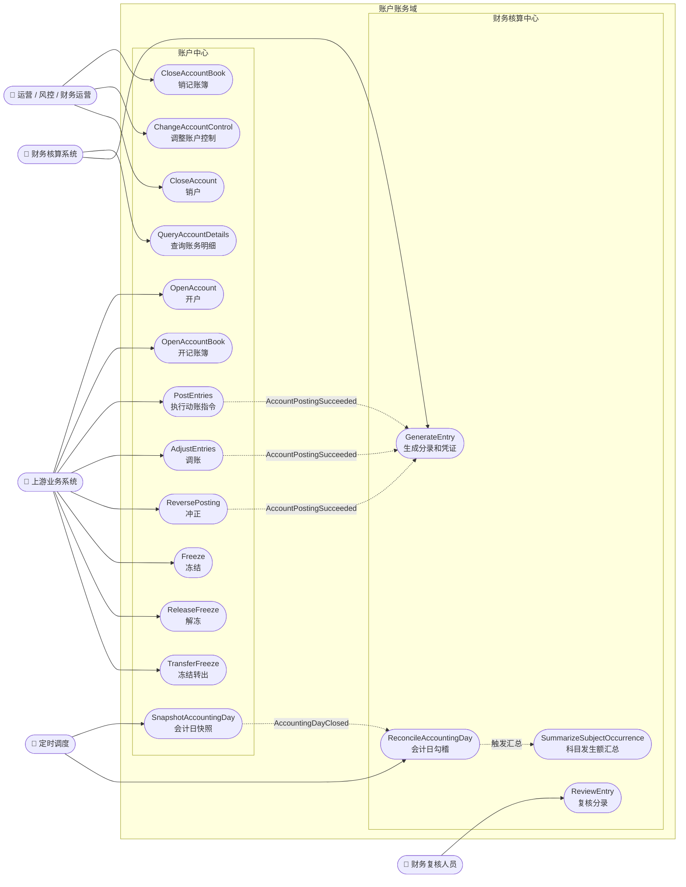

| 编号 | 原子功能 | 子域 | 主角色 | 功能边界 |
| --- | --- | --- | --- | --- |
| UC01 | `OpenAccount` | 账户中心 | 上游业务系统 | 创建外部户身份，固化账户类型、币种、科目和会计政策版本；不创建业务场景余额 |
| UC02 | `OpenAccountBook` | 账户中心 | 上游业务系统 | 在外部户下创建业务记账簿；不改变所属账户身份 |
| UC03 | `CloseAccountBook` | 账户中心 | 运营 / 财务运营 | 关闭单个记账簿；前置校验账簿余额为零且无未完成冻结 |
| UC04 | `ChangeAccountControl` | 账户中心 | 运营 / 风控 | 调整控制位集合；不产生余额变化和账务明细 |
| UC05 | `CloseAccount` | 账户中心 | 运营 / 财务运营 | 关闭外部户；前置校验全部账簿余额为零且无未完成冻结 |
| UC06 | `PostEntries` | 账户中心 | 上游业务系统 | 执行一次明确动账指令；方向覆盖加钱、减钱、可用转冻结、冻结转可用和冻结转出，一次请求内全部指令行同原子组成功或失败 |
| UC07 | `AdjustEntries` | 账户中心 | 上游业务系统 | 基于审批结果追加新调账指令；不修改原账务事实 |
| UC08 | `ReversePosting` | 账户中心 | 上游业务系统 | 对成功且未日结指令整笔冲正；不修改原指令和原明细 |
| UC09 | `Freeze` | 账户中心 | 上游业务系统 | 对入参账簿执行可用转冻结，创建冻结单并占用目标余额桶可用余额 |
| UC10 | `ReleaseFreeze` | 账户中心 | 上游业务系统 | 根据冻结单定位原账簿和余额桶，执行冻结转可用 |
| UC11 | `TransferFreeze` | 账户中心 | 上游业务系统 | 根据冻结单定位原账簿和余额桶，执行冻结转出，扣减冻结余额和账面余额 |
| UC12 | `SnapshotAccountingDay` | 账户中心 | 定时调度 | 固化 00:00 时点账户和账簿余额快照，并发布会计日关闭事件 |
| UC13 | `QueryAccountDetails` | 账户中心 | 财务核算系统 | 按明细号只读查询成功账务明细和执行后余额快照 |
| UC14 | `GenerateEntry` | 财务核算中心 | 财务核算系统 | 基于成功账务明细生成借贷分录，并按指令在同一事务生成会计凭证；不改变账户余额 |
| UC15 | `ReviewEntry` | 财务核算中心 | 财务复核人员 | 对分录执行人工或预留复核，不修改账户中心账务事实 |
| UC16 | `ReconcileAccountingDay` | 财务核算中心 | 定时调度 | 对前一会计日执行追平检查和勾稽校验；不修补账务事实 |
| UC17 | `SummarizeSubjectOccurrence` | 财务核算中心 | 定时调度 / 勾稽用例 | 按科目、会计日和币种汇总借贷发生额与余额 |

## 9. 系统能力接口与跨系统交互

### 9.1 系统边界与分层约定

账户中心与财务核算中心按两个独立系统建设。双方不共享`Repository`；跨系统同步查询只能进入对方 `web` 层，跨系统事实通知通过 `Outbox` 事件传播。本章中的 `Facade` 是逻辑接口，不绑定 HTTP、RPC 或 MQ 具体协议。

| 系统     | 对应子域   | 主要职责                          | 聚合根所有权                                                                         |
| ------ | ------ | ----------------------------- | ------------------------------------------------------------------------------ |
| 账户中心系统 | 账户中心   | 账户治理、余额变化、冻结控制、动账事实、冲正、日终余额快照 | `OuterAccount`、`AccountBook`、`InnerAccount`、`PostingInstruction`、`FreezeOrder` |
| 财务核算系统 | 财务核算中心 | 借贷分录、会计凭证、科目发生额汇总、勾稽与试算平衡、会计科目配置消费 | `AccountingEntry`、`AccountingVoucher`、`SubjectDailySummary`、`AccountingSubject`                    |

分层职责约束如下：
1. `api` 层是请求或事件入口，只校验协议字段、必填项、格式和基础完整性，并把外部请求转换为 `Command` / `Query`；不判断账户状态、余额是否充足、是否可冲正等业务规则。
2. `application` 层负责幂等检查、事务边界控制和多个领域服务之间的编排；不直接实现业务不变量。
3. `domainService` 层编排具体聚合根的业务逻辑，使用领域对象完成状态判断、余额计算、规则校验和结果生成。
4. `Repository` 层负责聚合根生命周期维护，对外暴露 `load` / `save` 语义；并发场景可表现为 `loadForUpdate`，唯一键幂等写入可表现为 `save` / `upsert`。该层不调用其他系统，不承载业务规则。
5. 系统采用 CQRS 模式：指令路径为 `web -> application -> domainService -> Repository`；查询路径为 `web -> application -> queryService`。`queryService` 模块负责具体的数据查询、结果转换和 DTO / VO 组装，会持有 `Mapper` 类直接查询数据库或读模型；该模块不维护聚合根生命周期、不修改聚合状态、不承载业务不变量。跨系统查询仍只能进入对方 `web` 层。

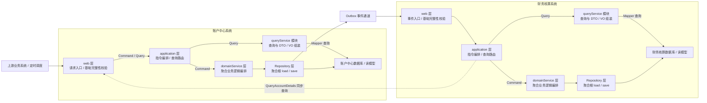

### 9.2 账户中心接口与入参

#### 9.2.1 `AccountCenterFacade` 接口概览

| 接口                    | 入参                                                                                                                       | 幂等 / 关键约束                                                                         |
| --------------------- | ------------------------------------------------------------------------------------------------------------------------ | --------------------------------------------------------------------------------- |
| `openAccount`         | `requestId`、`ownerId`、`ownerType`、`accountName`、`accountType`、`currency`、`subjectId`                                     | `requestId` 防重复开户；`ownerId + accountType` 数据库唯一并由领域服务校验                           |
| `openAccountBook`     | `requestId`、`accountNo`、`category`、`ownerId`、`ownerName`、`memberNo`、`orgNo`、`bookType`、`subjectId`                       | `requestId` 防重复开簿；`accountNo + bookType` 数据库唯一，账户映射和币种由领域服务校验                     |
| `closeAccountBook`    | `accountNo`、`bookNo`、`reason`、`approvalNo`、`operator`                                                                    | 销户前校验账户映射、状态和未完成资金事项                                                              |
| `changeAccountStatus` | `accountNo`、`controls`、`reason`、`approvalNo`、`operator`                                                                  | `controls` 为控制位集合，可叠加调整                                                           |
| `closeAccount`        | `accountNo`、`reason`、`approvalNo`、`operator`                                                                             | 销户前校验账户及其账簿状态                                                                     |
| `adjustAccount`       | `originalDomain`、`originalOrderNo`、`adjustmentReason`、`approvalInfo`、`instruction: PostingInstructionInput`              | `instruction.requestId` 作为调账指令幂等键；调账是新的明确动账指令，不修改原事实                              |
| `reversal`            | `originalInstructionNo`、`reason`、`idempotencyNo`、`operatorOrSystem`                                                      | 只能整笔冲正已成功且未完成日结的指令；生效冲正唯一                                                         |
| `freeze`              | `accountNo`、`bookNo`、`freezeType`、`sourceDomain`、`sourceOrderNo`、`idempotencyNo`、`amount`、`currency`、`reason`、`operator` | 幂等键为 `sourceDomain + sourceOrderNo + freezeType + idempotencyNo`                  |
| `unFreeze`            | `accountNo`、`bookNo`、`freezeNo`、`operationNo`、`operationType`、`amount`、`currency`、`reason`、`operator`                    | `freezeNo + operationType + operationNo` 防重复操作；累计解冻或转出不得超过冻结金额                    |
| `freezeOut`           | `accountNo`、`bookNo`、`freezeNo`、`operationNo`、`amount`、`currency`、`reason`、`operator`                                    | 操作类型固定为 `TRANSFERRED`；`freezeNo + operationType + operationNo` 防重复操作，累计转出不得超过冻结金额 |

#### 9.2.2 `AccountCenterFacade` 接口明细

##### 9.2.2.1 `AccountCenterFacade#OpenAccount` 开户

**接口描述**：开立账户，包括内部户和外部户
**使用场景**：客户、商户或机构首次开立基本户或结算户；重复请求应返回原账户

**1.1 时序图**

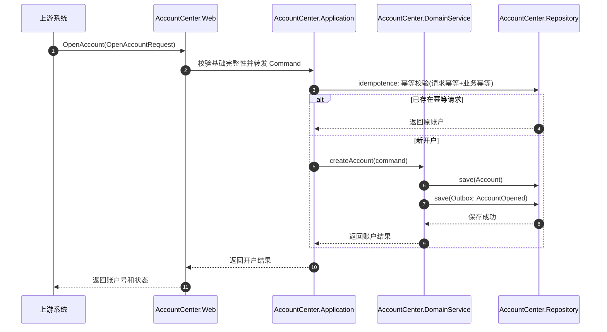

**1.2 入参字典表**

| 字段            | 类型     | 必填  | 说明                           |
| ------------- | ------ | --- | ---------------------------- |
| `requestId`   | string | 是   | 开户请求号                        |
| `memberId`    | string | 否   | 持有人主体标识，创建外部户必填，创建内部户为空      |
| `accountType` | string | 否   | 创建外部户必填(`基本户`、`结算户`)，创建内部户为空 |
| `subjectId`   | string | 是   | 初始科目 ID                      |

**1.3 响应**

| 字段            | 类型     | 说明      |
| ------------- | ------ | ------- |
| `accountNo`   | string | 账户号     |
| `accountType` | string | 基本户或结算户 |
| `requestId`   | string | 请求号     |

**1.4 注意事项**
1. requestId做请求幂等处理，重复请求必须返回原账户，不得新建同类账户
2. 建外部户场景：memberId和accountType联合唯一确定一个账户，作为业务幂等，如果重复返回已开设账户
3. 外部账户类型只支持基本户和结算户
4. 成功后发布 `AccountOpened` 事件。

##### 9.2.2.2 `AccountCenterFacade#openAccountBook` 开账簿

**接口描述**：在外部户下开立业务记账簿，形成可独立动账的业务场景余额载体。
**使用场景**：开立担保账户、待结算账户或其他配置化业务账簿。

**1.1 时序图**

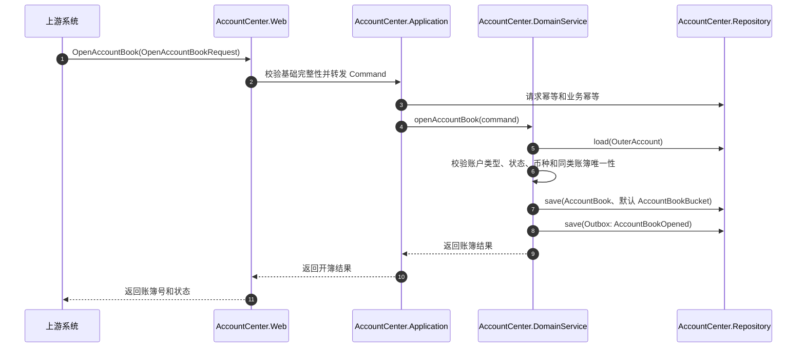

**1.2 入参字典表**

| 字段          | 类型     | 必填  | 说明                  |
| ----------- | ------ | --- | ------------------- |
| `requestId` | string | 是   | 请求号                 |
| `accountNo` | string | 是   | 所属外部户账户号            |
| `bookType`  | string | 是   | 业务账簿类型，例如担保账户、待结算账户 |

**1.3 响应**

| 字段                 | 类型      | 说明         |
| ------------------ | ------- | ---------- |
| `accountNo`        | string  | 所属账户号      |
| `bookNo`           | string  | 账簿号        |
| `bookType`         | string  | 业务账簿类型     |
| `status`           | string  | 账簿状态       |

**1.4 注意事项**

1. 所属账户必须是正常的基本户或结算户。
2. 同一账户下同类业务账簿默认唯一。
3. 客户不创建余额桶，只针对商户账簿开余额桶
4. 成功后发布 `AccountBookOpened` 事件。

##### 9.2.2.3 `AccountCenterFacade#CloseAccountBook` 关闭账簿

**接口描述**：关闭单个业务记账簿。
**使用场景**：业务账簿不再使用，且其余额和冻结事项已清理完成。

**1.1 时序图**

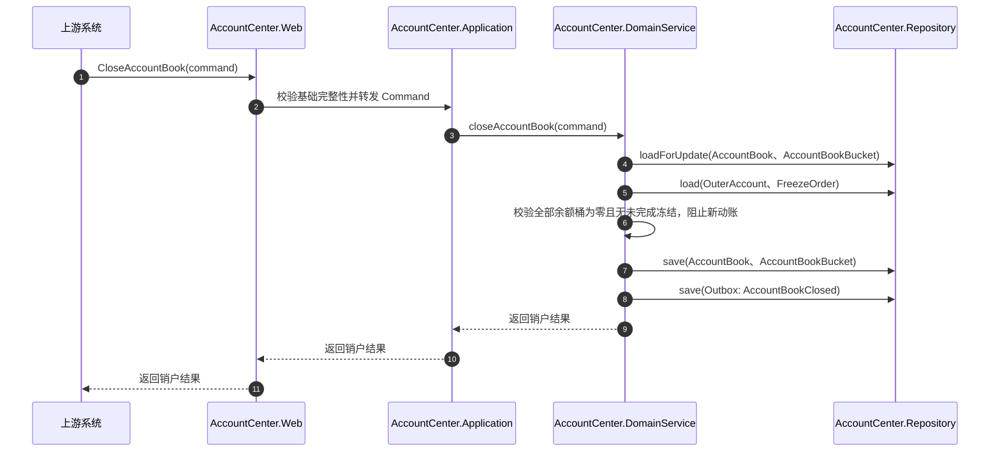

**1.2 入参字典表**

| 字段           | 类型     | 必填   | 说明             |
| ------------ | ------ | ---- | -------------- |
| `requestId`  | string | 是    | 请求号            |
| `accountNo`  | string | 条件必填 | 所属账户号          |
| `bookNo`     | string | 条件必填 | 待销账簿号          |
| `reason`     | string | 否    | 销户原因           |
| `approvalNo` | string | 否    | 审批单号           |
| `bookType`   | string | 条件必填 | 和accountNo搭配使用 |

**1.3 响应**

| 字段          | 类型       | 说明    |
| ----------- | -------- | ----- |
| `requestId` | string   | 请求号   |
| `accountNo` | string   | 所属账户号 |
| `bookNo`    | string   | 账簿号   |
| `status`    | string   | 销户后状态 |
| `closedAt`  | datetime | 销户时间  |

**1.4 注意事项**

1. 销户前可用余额、冻结余额、账面余额必须为零。
2. 必须没有未完成冻结单。
3. 销户前先阻止新动账。
4. 账簿销户不影响其他账簿，也不自动销户所属外部户。
5. 成功后发布 `AccountBookClosed` 事件。

##### 9.2.2.4 `AccountCenterFacade#ChangeAccountControl` 变更账户状态

**接口描述**：调整外部户控制位集合。
**使用场景**：冻结账户、销户预控制、止入金、止出金或禁止外部付款等管控操作。

**1.1 时序图**

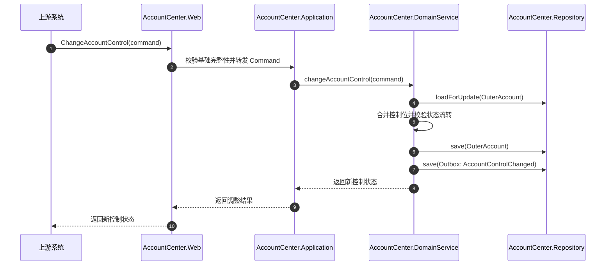

**1.2 入参字典表**

| 字段           | 类型             | 必填  | 说明          |
| ------------ | -------------- | --- | ----------- |
| `accountNo`  | string         | 是   | 外部户账户号      |
| `control`    | AccountControl | 是   | 控制位集合，可叠加生效 |
| `reason`     | string         | 否   | 调整原因        |
| `approvalNo` | string         | 否   | 审批单号        |

`AccountControl` 属性值：

| 值            | 说明   |
| ------------ | ---- |
| `closed`     | 销户控制 |
| `frozen`     | 账户冻结 |
| `stopCredit` | 止入金  |
| `stopDebit`  | 止出金  |

**1.3 响应**

| 字段          | 类型             | 说明       |
| ----------- | -------------- | -------- |
| `accountNo` | string         | 账户号      |
| `controls`  | AccountControl | 调整后控制位集合 |


**1.4 注意事项**
1. 控制位可叠加组合，不使用单一互斥状态。
2. 调整控制位本身不产生余额变化和动账明细。
3. 后续动账前必须逐项校验命中控制位。
4. 成功后发布 `AccountControlChanged` 事件。

##### 9.2.2.5 `AccountCenterFacade#CloseAccount` 销户

**接口描述**：关闭外部户账户生命周期。
**使用场景**：外部户下所有业务账簿、余额、冻结和历史事项已处理完成后的最终销户。

**1.1 时序图**

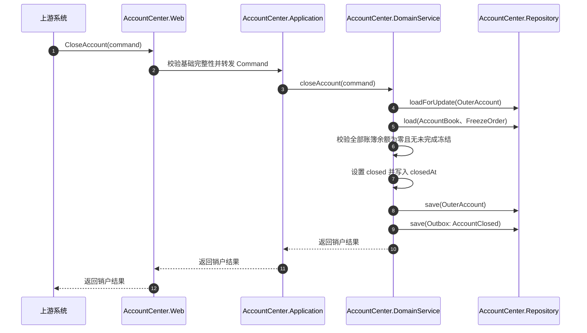

**1.2 入参字典表**

| 字段           | 类型     | 必填  | 说明        |
| ------------ | ------ | --- | --------- |
| `accountNo`  | string | 是   | 待销户外部户账户号 |
| `reason`     | string | 否   | 销户原因      |
| `approvalNo` | string | 否   | 审批单号      |

**1.3 响应**

| 字段          | 类型       | 说明    |
| ----------- | -------- | ----- |
| `accountNo` | string   | 账户号   |
| `status`    | string   | 销户后状态 |
| `closedAt`  | datetime | 销户时间  |

**1.4 注意事项**

1. 销户前必须处理或迁移剩余余额、冻结单
2. 所有记账簿必须满足销户条件，所有记账簿不能有资金存在。
3. 已销户账户只允许查询，不允许新增余额变化。
4. 不建议重开已销户账户；如需恢复，应明确反向控制或新建账户。

##### 9.2.2.6 `AccountCenterFacade#PostEntries` 记账

**接口描述**：执行明确的多行动账指令，方向覆盖加钱、减钱、可用转冻结、冻结转可用和冻结转出，生成成功账务明细并更新目标余额。
**使用场景**：支付、退款、清结算、资金调拨、冻结相关业务编排等上游系统传入明确账户、金额、方向和余额影响的动账。

**1.1 时序图**

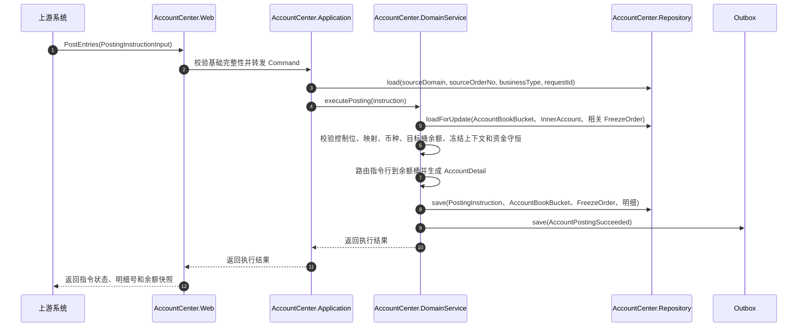

**1.2 入参**

| 字段                | 类型                       | 必填  | 说明                                          |
| ----------------- | ------------------------ | --- | ------------------------------------------- |
| `requestId`       | string                   | 是   | 全局唯一请求号，参与幂等键，并作为原子组 `groupNo`，比如：清分id、清算id |
| `sourceOrderNo`   | string                   | 是   | 来源业务单号，比如：交易单、支付单，用于串联起某笔交易/支付的所有记账明细       |
| `sourceOrderType` | string                   | 是   | 来源单据类型：`TRANSACTION_ORDER`、`PAYMENT_ORDER`、`ACS_RECORD`，供会计凭证关联单据展示 |
| `businessType`    | string                   | 是   | 业务动账类型，冗余展示用                                |
| `sourceRequestId` | string                   | 否   | 原请求号，资金从过渡户划出，需要传入原划拨近过渡户的请求id，业务幂等上处理      |
| `orders`          | `List<PostingLineInput>` | 是   | 指令行集合，结构见下方 `PostingLineInput`              |
PostingLineInput

| 字段          | 必填   | 说明                                                                                                  |
| ----------- | ---- | --------------------------------------------------------------------------------------------------- |
| `accountNo` | 条件必填 | 目标账户号                                                                                               |
| `bookNo`    | 条件必填 | 外部户业务账簿号；内部户为空                                                                                      |
| `direction` | 是    | 资金方向，枚举值为 `INCREAMENT`、`DECREASE`、`AVAILABLE_TO_FROZEN`、`FROZEN_TO_AVAILABLE`、`FROZEN_TRANSFER_OUT` |
| `amount`    | 是    | 金额，使用高精度十进制                                                                                         |
| `bookType`  | 条件必填 | 账簿类型                                                                                                |
> 支持 accountNo + bookType  或者 bookNo  两种组合传参方式，如果三个参数都传，优先级为：bookNo    >     accountNo + bookType

**1.3 响应**

| 字段              | 类型     | 说明     |
| --------------- | ------ | ------ |
| `instructionNo` | string | 动账指令号  |
| `requestId`     | string | 原请求号   |
| `status`        | string | 指令执行状态 |

**1.4 业务规则**
1. 按requestId进行幂等校验、校验入参完整性校验
2. 加钱和减钱组成的多行原子组按账面余额校验资金守恒。冻结转出不使用通用资金守恒规则
3. 同一请求的多行使用 `requestId` 派生出的原子组 `groupNo`，同一事务全部成功或全部失败
4. 成功后通过 Outbox 发布 `AccountPostingSucceeded`，财务核算异步生成分录和凭证，不参与动账主事务

##### 9.2.2.7 `AccountCenterFacade#AdjustEntries` 调账

**接口描述**：根据审批结果创建新的调账动账指令，修正余额或科目核算。
**使用场景**：跨日差错、审批后余额差异、科目核算差异处理；原账务事实保持不变。

**1.1 时序图**

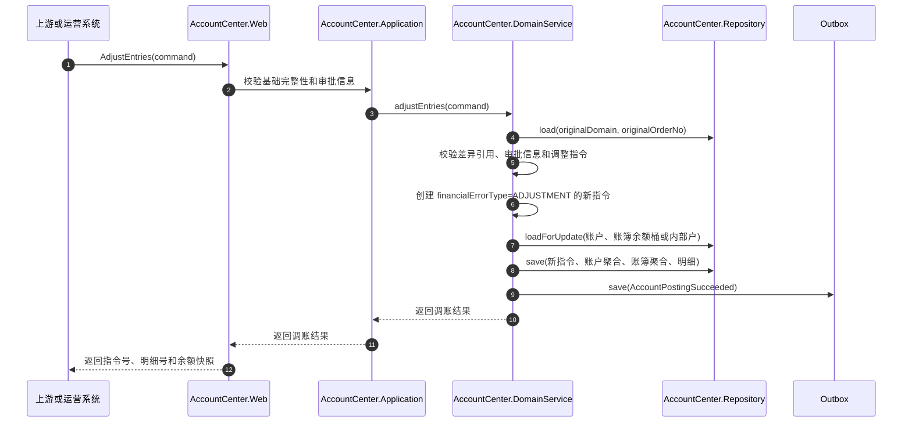

**1.2 入参字典表**
同记账接口入参

**1.3 响应**
同记账接口返回

**1.4 注意事项**
1. 调账是新的明确动账指令，不允许修改或删除原账务事实。
2. 跨日或已日结差错不得使用普通冲正，应通过调账在后续会计日处理。
3. 调账指令幂等使用 requestId

##### 9.2.2.8 `AccountCenterFacade#ReversePosting` 冲正

**接口描述**：对一笔可冲正的成功动账指令整笔生成反向指令和反向明细。
**使用场景**：当日财务差错处理；调用方只提供原指令号和原因，不自行拼反向指令行。

**1.1 时序图**

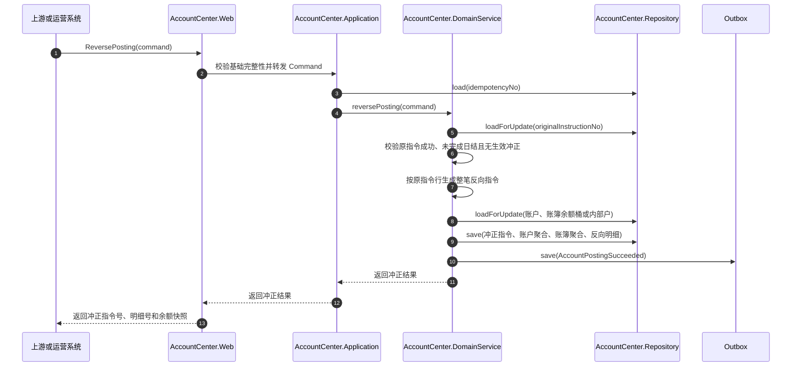

**1.2 入参字典表**

| 字段                      | 类型     | 必填  | 说明       |
| ----------------------- | ------ | --- | -------- |
| `originalInstructionNo` | string | 是   | 原成功动账指令号 |
| `reason`                | string | 否   | 冲正原因     |
| `requestId`             | string | 是   | 请求号      |

**1.3 响应**

| 字段                      | 类型     | 说明     |
| ----------------------- | ------ | ------ |
| `originalInstructionNo` | string | 原动账指令号 |
| `reversalInstructionNo` | string | 冲正指令号  |

**1.4 注意事项**
1. 只能冲正 `Succeeded` 且尚未被有效冲正的指令。
2. 原指令会计日已完成日结后改走 `AdjustEntries`。
3. 冲正必须整笔执行，禁止部分行冲正。
4. 原指令和原明细保持不可变；冲正只追加反向事实。
5. 任一行失败或余额不足时整体回滚。

##### 9.2.2.9 `AccountCenterFacade#Freeze` 余额冻结

**接口描述**：针对入参 `accountNo + bookNo` 定位业务账簿，路由余额桶后执行可用转冻结（`AVAILABLE_TO_FROZEN`），创建冻结单并占用可用余额。
**使用场景**：担保、风控、争议处理等需要先冻结后解冻或冻结转出的场景。

**1.1 时序图**

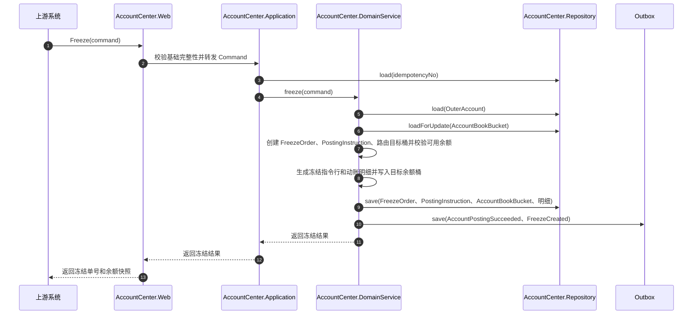

**1.2 入参字典表**

| 字段              | 类型      | 必填   | 说明     |
| --------------- | ------- | ---- | ------ |
| `accountNo`     | string  | 条件必填 | 外部户账户号 |
| `bookNo`        | string  | 条件必填 | 业务账簿号  |
| `freezeType`    | string  | 是    | 冻结业务类型 |
| `sourceOrderNo` | string  | 是    | 来源业务单号 |
| `requestId`     | string  | 是    | 请求号    |
| `amount`        | decimal | 是    | 冻结金额   |
| `bookType`      | string  | 条件必填 |        |

**1.3 响应**

| 字段         | 类型      | 说明   |
| ---------- | ------- | ---- |
| `freezeNo` | string  | 冻结单号 |
| `amount`   | decimal | 冻结金额 |

**1.4 注意事项**
1. 冻结金额不得超过路由目标余额桶的可用余额。
2. 同账簿并发冻结通过目标余额桶行锁串行化；汇总投影不参与高并发主事务行锁。

##### 9.2.2.10 `AccountCenterFacade#ReleaseFreeze` 解冻

**接口描述**：根据 `freezeNo` 定位原账户、账簿和余额桶，对原冻结余额执行冻结转可用（`FROZEN_TO_AVAILABLE`）。
**使用场景**：风控解除、担保释放或争议关闭后释放资金；不涉及冻结余额直接转出。

**1.1 时序图**

```mermaid
sequenceDiagram
    autonumber
    participant C as 上游系统
    participant W as AccountCenter.Web
    participant A as AccountCenter.Application
    participant D as AccountCenter.DomainService
    participant R as AccountCenter.Repository
    participant O as Outbox

    C->>W: ReleaseFreeze(command)
    W->>A: 校验基础完整性并转发 Command
    A->>D: releaseFreeze(command)
    D->>R: load(OuterAccount)
    D->>R: loadForUpdate(FreezeOrder)
    D->>D: 校验 accountNo/bookNo 与冻结单一致、operationNo 幂等和累计解冻金额
    D->>R: loadForUpdate(AccountBookBucket by freezeOrder.bucketNo)
    D->>D: 创建解冻 PostingInstruction，原桶冻结余额转回可用并生成动账明细
    D->>R: save(FreezeOperation、FreezeOrder、PostingInstruction、AccountBookBucket、明细)
    D->>O: save(AccountPostingSucceeded、FreezeReleased)
    D-->>A: 返回解冻结果
    A-->>W: 返回解冻结果
    W-->>C: 返回剩余冻结金额和余额快照
```

**1.2 入参字典表**

| 字段          | 类型      | 必填   | 说明               |
| ----------- | ------- | ---- | ---------------- |
| `accountNo` | string  | 条件必填 | 外部户账户号，必须等于冻结单账户 |
| `bookNo`    | string  | 条件必填 | 原冻结业务账簿号         |
| `freezeNo`  | string  | 是    | 冻结单号             |
| `amount`    | decimal | 是    | 解冻金额             |
| `requestId` | string  | 是    | 请求号              |
| `bookType`  | string  | 条件必填 | 账簿类型             |

**1.3 响应**

| 字段           | 类型     | 说明    |
| ------------ | ------ | ----- |
| `freezeNo`   | string | 冻结单号  |
| `unFreezeNo` | string | 解冻操作号 |

**1.4 注意事项**
1. 累计解冻金额不得超过原冻结金额。
2. 支持部分解冻；每次操作生成一条冻结操作和动账明细。
3. 本接口只执行 `FROZEN_TO_AVAILABLE`，不做冻结转出；冻结转出使用明确的 `TransferFreeze` 流程。

##### 9.2.2.11 `AccountCenterFacade#TransferFreeze` 冻结出账

**接口描述**：根据 `freezeNo` 定位原账户、账簿和余额桶，对原冻结余额执行冻结转出（`FROZEN_TRANSFER_OUT`），同步扣减冻结余额和账面余额。
**使用场景**：担保履约扣划、风险处置扣款、待结算资金正式划出等已冻结资金完成最终资金权属转移的场景。

**1.1 时序图**

```mermaid
sequenceDiagram
    autonumber
    participant C as 上游系统
    participant W as AccountCenter.Web
    participant A as AccountCenter.Application
    participant D as AccountCenter.DomainService
    participant R as AccountCenter.Repository
    participant O as Outbox

    C->>W: TransferFreeze(command)
    W->>A: 校验基础完整性并转发 Command
    A->>R: load(FreezeOrder by freezeNo)
    A->>D: transferFreeze(command)
    D->>R: load(OuterAccount)
    D->>R: loadForUpdate(FreezeOrder)
    D->>D: 校验 accountNo/bookNo 与冻结单一致、operationNo 幂等和累计转出金额
    D->>R: loadForUpdate(AccountBookBucket by freezeOrder.bucketNo)
    D->>D: 创建转出 PostingInstruction，原桶冻结余额与账面余额同步减少并生成动账明细
    D->>R: save(FreezeOperation、FreezeOrder、PostingInstruction、AccountBookBucket、明细)
    D->>O: save(AccountPostingSucceeded、FreezeTransferred)
    D-->>A: 返回冻结转出结果
    A-->>W: 返回转出结果
    W-->>C: 返回剩余冻结金额和余额快照
```

**1.2 入参字典表**

| 字段          | 类型      | 必填   | 说明               |
| ----------- | ------- | ---- | ---------------- |
| `accountNo` | string  | 条件必填 | 外部户账户号，必须等于冻结单账户 |
| `bookNo`    | string  | 条件必填 | 原冻结业务账簿号         |
| `freezeNo`  | string  | 是    | 冻结单号             |
| `requestId` | string  | 是    | 请求号              |
| `amount`    | decimal | 是    | 转出金额             |
| `bookType`  | string  | 条件必填 | 账簿类型             |

**1.3 响应**

| 字段            | 类型     | 说明      |
| ------------- | ------ | ------- |
| `freezeNo`    | string | 冻结单号    |
| `freezeOutNo` | string | 冻结转出操作号 |

**1.4 注意事项**
1. 操作类型由接口语义固定为 `TRANSFERRED`，调用方不传入。
2. 累计冻结转出金额不得超过原冻结金额。
3. 支持部分转出；每次操作生成一条冻结操作和一条成功动账明细。
4. 冻结转出只执行 `FROZEN_TRANSFER_OUT`，同时减少冻结余额和账面余额，不复用解冻接口。
5. 只读校验外部户状态，不加锁更新外部户汇总；冻结单行和原目标余额桶行在同一本地事务内加锁。事务提交后发布 `AccountPostingSucceeded` 和 `FreezeTransferred`。

##### 9.2.2.12 `AccountCenterFacade#SnapshotAccountingDay` 余额快照

**接口描述**：固化指定会计日 00:00 时点的账户和账簿余额快照，并通知会计日关闭。
**使用场景**：每日凌晨 00:00 定时任务；也可用于失败后的同日期幂等重跑。

**1.1 时序图**

```mermaid
sequenceDiagram
    autonumber
    participant S as 定时调度
    participant W as AccountCenter.Web
    participant A as AccountCenter.Application
    participant D as AccountCenter.DomainService
    participant R as AccountCenter.Repository
    participant O as Outbox

    S->>W: SnapshotAccountingDay(snapshotDate)
    W->>A: 校验日期并转发 Command
    A->>R: load(snapshotDate)
    A->>D: snapshotAccountingDay(snapshotDate)
    D->>R: load(热点账簿/内部户缓冲)
    D->>D: 固化热点缓冲并生成 AccountDetail
    D->>R: loadForUpdate(OuterAccount、AccountBook、AccountBookBucket)
    D->>R: save(AccountDailySnapshot、AccountBookDailySnapshot、AccountBookBucketDailySnapshot)
    D->>O: save(AccountingDayClosed)
    D-->>A: 返回快照结果
    A-->>W: 返回任务结果
    W-->>S: 任务完成
```

**1.2 入参字典表**

| 字段 | 类型 | 必填 | 说明 |
| --- | --- | --- | --- |
| `snapshotDate` | string / date | 是 | 会计日；00:00 任务处理前一会计日 |

**1.3 响应**

| 字段 | 类型 | 说明 |
| --- | --- | --- |
| `snapshotDate` | string | 快照日期 |
| `status` | string | 任务执行状态 |
| `accountSnapshotCount` | int | 生成或幂等命中的账户快照数量 |
| `bookSnapshotCount` | int | 生成或幂等命中的账簿快照数量 |

**1.4 注意事项**

1. 快照必须固化 00:00 时点余额；账户快照只保存可用、冻结、账面三类余额。
2. 账簿日终快照可包含当日明细统计。
3. 按 `snapshotDate + accountNo` 和 `snapshotDate + bookNo` 幂等，可重跑。
4. 热点账簿/内部户缓冲必须在本次任务内固化，禁止跨日残留。
5. 快照事务提交后发布 `AccountingDayClosed`，供财务核算 01:00 勾稽任务消费。

##### 9.2.2.13 `AccountCenterFacade#QueryAccountDetails` 查询动账明细

**接口描述**：按明细号查询已成功账务明细和执行后余额快照。
**使用场景**：财务核算系统收到 `AccountPostingSucceeded` 后补齐明细，或运营、数据侧做明细追溯查询。

**1.1 时序图**

```mermaid
sequenceDiagram
    autonumber
    participant C as 财务核算系统 / 上游查询方
    participant W as AccountCenter.Web
    participant A as AccountCenter.Application
    participant Q as AccountCenter.QueryService
    participant M as AccountCenter.Mapper
    participant DB as AccountCenter数据库

    C->>W: QueryAccountDetails(query)
    W->>A: 校验只读请求基础完整性
    A->>Q: queryAccountDetails(query)
    Q->>M: selectAccountDetails(query)
    M->>DB: 执行只读 SQL
    DB-->>M: 返回明细和余额后置值
    M-->>Q: 返回原始查询记录
    Q-->>A: 组装 AccountDetailResult DTO
    A-->>W: 返回查询结果
    W-->>C: 返回查询结果
```

**1.2 入参字典表**

| 字段              | 类型       | 必填   | 说明                            |
| --------------- | -------- | ---- | ----------------------------- |
| `requestId`     | string   | 是    | 查询请求号，用于调用追踪                  |
| `detailIds`     | string[] | 条件必填 | 成功动账明细号集合                     |


**1.3 响应**

| 字段 | 类型 | 说明 |
| --- | --- | --- |
| `requestId` | string | 原查询请求号 |
| `details` | `AccountDetailResult[]` | 成功账务明细集合 |

**1.4 注意事项**

1. 查询走 CQRS 路径：`web -> application -> queryService -> Mapper -> 数据库`，不经过 `domainService` 和聚合根 `Repository`。
2. `queryService` 只做数据查询和 DTO 组装，不修改聚合状态，不承载业务不变量。
3. 只返回已成功账务明细；失败或待执行指令不生成可查询成功事实。
4. 查询超时或响应未知可安全重试，不会改变账户中心余额。
5. 财务核算系统不得绕过本接口直接访问账户中心数据库。

#### 9.2.3 动账方案

账户中心统一使用 `PostingInstruction` 发起和落行动账；目标聚合决定余额维护方式：内部户使用明细流水方案，外部户账簿使用多桶方案。

| 目标对象                | 方案     | 关键规则                                                                                                                                                                                     |
| ------------------- | ------ | ---------------------------------------------------------------------------------------------------------------------------------------------------------------------------------------- |
| `InnerAccount` 内部户  | 明细流水方案 | 不拆余额桶。每笔成功指令行生成一条不可变 `AccountDetail`，`balance` 在同一本地事务内按 `ledger_delta` 更新；`available_delta`、`frozen_delta` 恒为 `0`，余额允许为负。当前余额是成功流水的当前投影，追溯和对账以明细流水为准。                                   |
| `AccountBook` 外部户账簿 | 多桶方案   | `AccountBook` 承载一个业务场景，其下划分 1..N 个 `AccountBookBucket`。每个余额桶独立维护可用、冻结、账面三口径，是高并发行锁执行单元。普通收支更新目标桶的可用和账面口径；冻结 / 解冻在目标桶的可用和冻结口径间迁移；冻结转出扣减目标桶冻结和账面口径。每笔成功指令行同时生成归属账簿和目标余额桶的 `AccountDetail`。 |

方案落地约束：

1. 外部户指令行必须携带 `bookNo`，由账户中心路由到该账簿下的唯一余额桶；内部户指令行 `bookNo` 为空，路由到内部户明细流水。单条外部户指令行不跨桶拆分。两类方案复用同一套幂等键、原子组、状态机、冲正和事件口径。
2. 余额桶或内部户余额与 `AccountDetail` 必须在同一本地事务内提交。高并发外部户主事务不强制更新 `AccountBook` / `OuterAccount` 汇总行；汇总数可由同事务或异步强一致投影维护，最终必须与全部有效余额桶勾稽一致。失败指令不生成成功明细，也不产生余额变化。
3. `AccountDetail` 中的执行后余额快照必须等于执行前余额加本行余额影响；明细不可修改或删除，冲正、调账和退款都必须生成新的成功明细。
4. 外部户余额始终是其全部有效账簿余额桶对应口径之和；日终必须完成 `OuterAccount` 汇总、`AccountBook` 汇总、`AccountBookBucket` 桶余额和成功明细之间的勾稽。
5. 内部户不参与三口径、冻结单和账户控制位；其会计日余额可通过期初余额加当日成功明细发生额推算，并与日终快照核对。

### 9.3 财务核算接口与入参

#### `FinancialAccountingFacade` 接口

| 接口                           | 入参                                                                                   | 幂等 / 关键约束                                                 |
| ---------------------------- | ------------------------------------------------------------------------------------ | --------------------------------------------------------- |
| `GenerateEntry`              | `eventId`、`instructionNo`、`detailIds`、`instructionHeaderSnapshot`、`financialErrorType`、`reversalOfInstructionNo` | 以 `AccountingEntry.detailNo` 和 `AccountingVoucher.instructionNo` 唯一键防重复生成；缺失明细通过账户中心 `QueryAccountDetails` 补齐 |
| `ReviewEntry`                | `entryNo`、`reviewResult`、`reviewer`、`reviewTime`、`reason`、`version`                  | 人工复核预留；乐观锁防止并发复核覆盖                                        |
| `ReconcileAccountingDay`     | `accountingDate`、`triggerNo`                                                         | 按 `triggerNo` 或任务唯一键幂等重跑                                  |
| `SummarizeSubjectOccurrence` | `accountingDate`、`triggerNo`                                                         | 按 `subjectNo + accountingDate + currency` 幂等汇总            |

### 9.4 两个系统之间的交互契约

| 编号  | 方向            | 交互                           | 触发条件                                              | 财务核算系统处理                                                          |
| --- | ------------- | ---------------------------- | ------------------------------------------------- | ----------------------------------------------------------------- |
| I1  | 账户中心 → 财务核算系统 | `AccountPostingSucceeded` 事件 | 账户中心加钱、减钱、冻结、解冻、冻结转出、调账或冲正在本地事务提交成功后由 `Outbox` 发布 | 消费事件，调用 `QueryAccountDetails` 查询成功账务明细，再调用 `GenerateEntry` 生成借贷分录和会计凭证 |
| I2  | 财务核算系统 → 账户中心 | `QueryAccountDetails` 同步查询   | 收到 `AccountPostingSucceeded` 且本地缺少成功账务明细          | 只读查询，不改变账户中心余额和状态；查询超时可重试                                         |
| I3  | 账户中心 → 财务核算系统 | `AccountingDayClosed` 事件     | 00:00 余额快照任务完成并固化上一会计日                            | 作为 01:00 勾稽、科目发生额汇总和试算平衡的完成信号；勾稽任务按会计日幂等重跑                        |

事件消费必须携带 `eventId` 或等价唯一标识。`AccountPostingSucceeded` 的 `instructionHeaderSnapshot` 必须携带 `accountingEvent`、`relatedOrderType`、`relatedOrderNo`、`sourceDomain`、`maker` 和 `completedAt`，财务核算不得反推凭证头；缺少快照字段时消费失败重试。`GenerateEntry` 的最终幂等兜底是 `AccountingEntry.detailNo` 和 `AccountingVoucher.instructionNo` 唯一约束；重复消费、查询重试或消息乱序不能产生重复分录或重复凭证。

### 9.5 动账成功到分录与凭证生成时序

```mermaid
sequenceDiagram
    autonumber
    participant UP as 上游系统
    participant ACW as 账户中心.Web
    participant ACA as 账户中心.Application
    participant ACQ as 账户中心.QueryService
    participant ACDB as 账户中心.Mapper / 数据库
    participant ACD as 账户中心.DomainService
    participant ACR as 账户中心.Repository
    participant OBX as Outbox / MQ
    participant FAW as 财务核算.Web
    participant FAA as 财务核算.Application
    participant FAD as 财务核算.DomainService
    participant FAR as 财务核算.Repository

    UP->>ACW: PostEntries(PostingInstructionInput)
    ACW->>ACA: 校验必填项后传入 Command
    ACA->>ACR: load(requestId)

    alt 指令已存在
        ACR-->>ACA: 返回原指令和原结果
        ACA-->>ACW: 幂等返回首次结果
        ACW-->>UP: 返回执行状态
    else 新指令
        ACR-->>ACA: 未命中幂等记录
        ACA->>ACD: executePosting(instruction)
        ACD->>ACR: loadForUpdate(账户 / 账簿 / 内部户)
        ACR-->>ACD: 返回聚合根
        ACD->>ACD: 校验控制位、币种、原子组资金守恒并执行聚合状态变化
        ACD->>ACR: save(指令聚合、账户聚合、账簿聚合、明细事实)
        ACD->>ACR: save(Outbox: AccountPostingSucceeded)
        ACR-->>ACD: 保存成功
        ACD-->>ACA: 返回指令状态、明细号、余额快照
        ACA-->>ACW: 返回执行结果
        ACW-->>UP: 返回执行状态
    end

    Note over ACR,OBX: Outbox Relay 在本地事务提交后异步投递
    OBX->>FAW: 投递 AccountPostingSucceeded(eventId, instructionNo, detailIds, instructionHeaderSnapshot)
    OBX->>FAW: 投递账户动账成功事件
    FAW->>FAA: 基础完整性校验后传入事件
    FAA->>FAR: load(AccountingEntry by detailIds、AccountingVoucher by instructionNo)

    loop 每个缺失明细 detailNo
        FAA->>ACW: QueryAccountDetails(requestId, detailIds)
        ACW->>ACA: 校验只读请求完整性
        ACA->>ACQ: queryAccountDetails(detailIds)
        ACQ->>ACDB: AccountDetailMapper.selectByDetailIds(detailIds)
        ACDB-->>ACQ: 返回成功账务明细记录
        ACQ-->>ACA: 组装不可变明细事实和余额快照 DTO
        ACA-->>ACW: 返回明细及余额快照
        ACW-->>FAA: 返回查询结果
    end

    FAA->>FAD: generateEntry(accountDetails, instructionHeaderSnapshot)
    FAD->>FAR: load(AccountingSubject)
    FAR-->>FAD: 返回科目配置
    FAD->>FAD: 生成借贷分录、组装凭证并校验科目、方向、金额、冲正关系与借贷平衡
    FAD->>FAR: save(AccountingEntry)
    FAD->>FAR: save(AccountingVoucher)
    FAD->>FAR: save(Outbox: EntryGenerated)
    FAR-->>FAD: 保存成功
    FAD-->>FAA: 返回分录号、凭证号和复核状态
    FAA-->>FAW: 事件消费完成
    FAW-->>OBX: ACK
```

### 9.6 日终快照到勾稽汇总时序

```mermaid
sequenceDiagram
    autonumber
    participant SCH as 定时调度
    participant ACW as 账户中心.Web
    participant ACA as 账户中心.Application
    participant ACD as 账户中心.DomainService
    participant ACR as 账户中心.Repository
    participant OBX as Outbox / MQ
    participant FAW as 财务核算.Web
    participant FAA as 财务核算.Application
    participant FAD as 财务核算.DomainService
    participant FAR as 财务核算.Repository

    SCH->>ACW: SnapshotAccountingDay(snapshotDate)
    ACW->>ACA: 校验日期后传入 Command
    ACA->>ACR: load(snapshotDate)
    ACA->>ACD: snapshotAccountingDay(snapshotDate)
    ACD->>ACR: loadForUpdate(热点账簿/内部户缓冲、账户、账簿、余额桶、账务明细)
    ACR-->>ACD: 返回聚合根和明细事实
    ACD->>ACD: 固化缓冲并生成 00:00 时点余额快照
    ACD->>ACR: save(AccountDailySnapshot、AccountBookDailySnapshot)
    ACD->>ACR: save(Outbox: AccountingDayClosed)
    ACR-->>ACD: 保存成功
    ACD-->>ACA: 返回快照结果
    ACA-->>ACW: 返回任务结果
    ACW-->>SCH: 任务完成

    Note over ACR,OBX: Outbox Relay 在本地事务提交后异步投递
    OBX->>FAW: 投递 AccountingDayClosed(eventId, snapshotDate)
    OBX->>FAW: 投递会计日关闭事件
    FAW->>FAA: 校验事件并传入 Command
    FAA->>FAR: save / load(会计日就绪状态, eventId)
    FAR-->>FAA: 幂等记录完成

    Note over SCH,FAW: 01:00 调度触发勾稽

    SCH->>FAW: ReconcileAccountingDay(accountingDate, triggerNo)
    FAW->>FAA: 校验会计日后传入 Command
    FAA->>FAR: load(triggerNo)
    FAA->>FAD: reconcileAccountingDay(accountingDate)
    FAD->>FAR: load(AccountDetail、AccountingEntry、AccountingSubject)
    FAR-->>FAD: 返回当日事实和科目配置
    FAD->>FAD: 执行追平检查、借贷勾稽和余额勾稽
    FAD->>FAR: save(SubjectDailySummary)
    FAD->>FAD: 执行试算平衡并生成异常结论
    FAR-->>FAD: 保存成功
    FAD-->>FAA: 返回勾稽、汇总和试算结果
    FAA-->>FAW: 返回任务结果
    FAW-->>SCH: 任务完成
```

### 9.7 失败与重试口径

1. 账户中心本地事务包含聚合状态、账务明细和 `Outbox` 事件写入；事务失败时对外返回明确失败，不发布成功事件。
2. 财务核算系统收到事件后先按 `event_id` 去重，再按 `AccountingEntry.detail_no` 唯一键兜底；重复消费只允许幂等返回或跳过。
3. `QueryAccountDetails` 是只读查询，超时、网络抖动和响应未知都可以重试；不得因为查询失败反向修改账户中心余额。
4. `AccountPostingSucceeded` 消费失败保留重试；账户中心不等待分录生成结果。加钱、减钱、冻结、解冻和转出成功事实的分录生成均不参与动账主事务。
5. 日终快照和勾稽任务均幂等可重跑；勾稽不平只记录异常并阻断对外报表结论，不直接修改已成功的账户事实或分录。

## 10. 数据库设计

### 10.1 总体约定

数据库按账户中心与财务核算中心分成两套逻辑库；两边只保存对方业务单号或事件 ID，不建立跨库物理外键。本章给出逻辑表模型，具体物理类型可按 MySQL / PostgreSQL 等数据库能力调整。

通用约定：
1. 业务编号统一使用 `VARCHAR(64)`；状态、类型、方向先使用 `VARCHAR` 承载，避免数据库枚举约束影响语义扩展。
2. 金额、余额和发生额统一使用高精度 `DECIMAL(32,8)`；应用层按 `Money.scale` 和会计政策舍入规则计算、展示和汇总，禁止浮点数。
3. 除说明外，每张表包含 `id BIGINT` 自增主键、`created_at DATETIME(3)`、`updated_at DATETIME(3)`；聚合根表另加 `version BIGINT` 乐观锁版本。
4. 表之间的引用以逻辑外键表达；高频动账、明细、分录、凭证表不建数据库物理外键，引用完整性由应用层、唯一键和对账任务保证。
5. 成功账务明细、分录、凭证、冻结操作和 Outbox 已投递记录是事实或审计数据，禁止物理删除；失败重试和状态回退必须留下状态与时间轨迹。
6. 字符集使用 `utf8mb4`；时间统一保存带毫秒精度的时间戳，会计日单独保存 `DATE`，不得从 `created_at` 隐式推导。

### 10.2 表清单与归属

| 库     | 表名                                        | 承载对象                             | 说明                                      |
| ----- | ----------------------------------------- | -------------------------------- | --------------------------------------- |
| 账户中心库 | `t_ac_account`                            | `OuterAccount` / `InnerAccount`  | 外部户与内部户统一账户主表，`account_category` 区分账户类别 |
| 账户中心库 | `t_ac_account_book`                       | `AccountBook`                    | 外部户业务账簿和三口径汇总投影                         |
| 账户中心库 | `t_ac_account_book_balance_bucket`        | `AccountBookBucket`              | 账簿下的高并发余额桶，权威余额执行单元                     |
| 账户中心库 | `t_ac_posting_instruction`                | `PostingInstruction`             | 动账指令头与幂等键                               |
| 账户中心库 | `t_ac_posting_line`                       | `PostingLine`                    | 动账指令行与余额影响                              |
| 账户中心库 | `t_ac_account_detail`                     | `AccountDetail`                  | 成功账务明细，只插入、不更新                          |
| 账户中心库 | `t_ac_freeze_order`                       | `FreezeOrder`                    | 冻结主单，绑定账户、账簿和余额桶，记录累计解冻、转出              |
| 账户中心库 | `t_ac_freeze_operation`                   | `FreezeOperation`                | 冻结单下的解冻、转出成功操作流水                        |
| 账户中心库 | `t_ac_account_daily_snapshot`             | `AccountDailySnapshot`           | 外部户 00:00 三口径快照                         |
| 账户中心库 | `t_ac_account_book_daily_snapshot`        | `AccountBookDailySnapshot`       | 账簿 00:00 三口径快照和当日统计                     |
| 账户中心库 | `t_ac_account_book_bucket_daily_snapshot` | `AccountBookBucketDailySnapshot` | 账簿余额桶 00:00 三口径快照和当日统计                  |
| 账户中心库 | `t_ac_outbox_event`                       | Outbox                           | 账户中心领域事件本地消息                            |
| 财务核算库 | `t_fa_accounting_subject`                 | `AccountingSubject`              | 会计科目配置                                  |
| 财务核算库 | `t_fa_accounting_entry`                   | `AccountingEntry`                | 成功明细生成的借贷分录                             |
| 财务核算库 | `t_fa_accounting_voucher`                 | `AccountingVoucher`              | 按动账指令归集分录的会计凭证                          |
| 财务核算库 | `t_fa_subject_daily_summary`              | `SubjectDailySummary`            | 科目日发生额与余额                               |
| 财务核算库 | `t_fa_accounting_day_job`                 | 日结任务                             | 勾稽、汇总和试算平衡执行结果                          |
| 财务核算库 | `t_fa_event_consume`                      | 事件消费                             | 消费方事件去重记录                               |

### 10.3 账户中心核心表

#### `t_ac_account`

外部户与内部户合并存储的账户主表：领域层仍保留 `OuterAccount` 与 `InnerAccount` 两个聚合（余额口径与记账方式不同），物理层共用一张表，通过 `account_category` 区分。

```sql
-- 外部户与内部户统一账户主表：
-- 1) account_category 创建后不可变更，外部户与内部户不得互相转换；
-- 2) 外部户余额列 = 全部有效记账簿余额桶的汇总投影，动账主事务只更新余额桶；
-- 3) 内部户单余额复用 ledger_balance，允许为负，available/frozen 恒为 0。
CREATE TABLE `t_ac_account` (
  `id`                   BIGINT UNSIGNED NOT NULL AUTO_INCREMENT COMMENT '自增主键',
  `account_no`           VARCHAR(64)  NOT NULL COMMENT '账户号，全局唯一；外部户与内部户使用隔离号段',
  `account_category`     VARCHAR(32)  NOT NULL COMMENT '账户类别：OUTER=外部户，INNER=内部户；创建后不可变更',
  `account_type`         VARCHAR(32)  NOT NULL COMMENT '外部户：BASIC=基本户，SETTLEMENT=结算户；内部户固定 INNER',
  `account_name`         VARCHAR(256) NOT NULL COMMENT '账户名称',
  `owner_id`             VARCHAR(64)  NULL COMMENT '持有人标识；仅外部户填写，内部户为 NULL',
  `owner_type`           VARCHAR(32)  NULL COMMENT '持有人性质：对公 / 对私；仅外部户填写',
  `currency`             CHAR(3)      NULL COMMENT '账户币种；仅外部户填写，必须与账簿和余额桶一致',
  `available_balance`    DECIMAL(32,8) NOT NULL DEFAULT 0 COMMENT '外部户可用余额汇总，>=0；内部户恒为 0',
  `frozen_balance`       DECIMAL(32,8) NOT NULL DEFAULT 0 COMMENT '外部户冻结余额汇总，>=0；内部户恒为 0',
  `ledger_balance`       DECIMAL(32,8) NOT NULL DEFAULT 0 COMMENT '外部户账面余额=可用+冻结；内部户单余额，允许为负',
  `control_bits`         BIGINT       NOT NULL DEFAULT 0 COMMENT '账户控制位位图（冻结、止入、止出可组合）；仅外部户使用，内部户固定 0',
  `accounting_subject_no` VARCHAR(64) NOT NULL COMMENT '关联会计科目',
  `outer_owner_key`      VARCHAR(129)
    GENERATED ALWAYS AS (CASE WHEN `account_category` = 'OUTER'
                              THEN CONCAT(`owner_id`, ':', `account_type`)
                              ELSE NULL END) STORED COMMENT '外部户持有人唯一键：仅 OUTER 行取 owner_id:account_type，其余 NULL',
  `version`              BIGINT       NOT NULL DEFAULT 0 COMMENT '乐观锁版本',
  `opened_at`            DATETIME(3)  NULL COMMENT '开户时间；内部户记录创建时间',
  `closed_at`            DATETIME(3)  NULL COMMENT '销户时间；NULL 表示未销户，内部户不使用销户语义',
  `created_at`           DATETIME(3)  NOT NULL DEFAULT CURRENT_TIMESTAMP(3) COMMENT '创建时间',
  `updated_at`           DATETIME(3)  NOT NULL DEFAULT CURRENT_TIMESTAMP(3) ON UPDATE CURRENT_TIMESTAMP(3) COMMENT '更新时间',
  PRIMARY KEY (`id`),
  UNIQUE KEY `UK_ACCOUNT_NO` (`account_no`),
  UNIQUE KEY `UK_OUTER_OWNER_TYPE` (`outer_owner_key`),          -- 同一外部持有人同一账户类型唯一
  KEY `IDX_CATEGORY_OWNER` (`account_category`, `owner_id`, `account_type`, `closed_at`),
  KEY `IDX_INNER_SUBJECT` (`account_category`, `accounting_subject_no`)
) ENGINE=InnoDB DEFAULT CHARSET=utf8mb4 COMMENT='账户主表：外部户与内部户统一存储，account_category 区分';
```

#### `t_ac_account_book`

外部户业务场景账簿主表；每个 `book_type` 代表一个业务场景，账簿余额列是下挂余额桶的汇总投影。

```sql
CREATE TABLE `t_ac_account_book` (
  `id`                BIGINT UNSIGNED NOT NULL AUTO_INCREMENT COMMENT '自增主键',
  `book_no`           VARCHAR(64)   NOT NULL COMMENT '账簿号，业务唯一键',
  `account_no`        VARCHAR(64)   NOT NULL COMMENT '所属外部户号，创建后不可变更',
  `category`          VARCHAR(64)   NOT NULL COMMENT '账簿类别',
  `owner_id`          VARCHAR(64)   NOT NULL COMMENT '持有人标识',
  `owner_name`        VARCHAR(256)  NOT NULL COMMENT '持有人展示名称',
  `member_no`         VARCHAR(64)   NULL COMMENT '会员号，按类别条件必填',
  `org_no`            VARCHAR(64)   NULL COMMENT '机构号，按类别条件必填',
  `book_type`         VARCHAR(64)   NOT NULL COMMENT '业务账簿类型：担保、待结算等',
  `currency`          CHAR(3)       NOT NULL COMMENT '账簿币种，必须等于所属外部户币种',
  `available_balance` DECIMAL(32,8) NOT NULL DEFAULT 0 COMMENT '可用余额汇总投影，>=0',
  `frozen_balance`    DECIMAL(32,8) NOT NULL DEFAULT 0 COMMENT '冻结余额汇总投影，>=0',
  `ledger_balance`    DECIMAL(32,8) NOT NULL DEFAULT 0 COMMENT '账面余额汇总投影=可用+冻结',
  `status`            VARCHAR(32)   NOT NULL COMMENT '状态：正常、冻结、停用、销户',
  `subject_id`        VARCHAR(64)   NOT NULL COMMENT '开簿时固化的会计科目',
  `version`           BIGINT        NOT NULL DEFAULT 0 COMMENT '乐观锁版本',
  `created_at`        DATETIME(3)   NOT NULL DEFAULT CURRENT_TIMESTAMP(3) COMMENT '开簿时间',
  `closed_at`         DATETIME(3)   NULL COMMENT '销簿时间',
  `updated_at`        DATETIME(3)   NOT NULL DEFAULT CURRENT_TIMESTAMP(3) ON UPDATE CURRENT_TIMESTAMP(3) COMMENT '更新时间',
  PRIMARY KEY (`id`),
  UNIQUE KEY `UK_BOOK_NO` (`book_no`),
  UNIQUE KEY `UK_BOOK_ACCOUNT_TYPE` (`account_no`, `book_type`)  -- 同一外部户同一业务类型最多一条账簿，覆盖全生命周期
) ENGINE=InnoDB DEFAULT CHARSET=utf8mb4 COMMENT='外部户业务场景账簿主表';
```

#### `t_ac_account_book_balance_bucket`

`AccountBook` 聚合内的高并发执行单元：每个桶独立维护三口径余额，账簿汇总余额是全部有效桶余额的投影。

```sql
CREATE TABLE `t_ac_account_book_balance_bucket` (
  `id`                BIGINT UNSIGNED NOT NULL AUTO_INCREMENT COMMENT '自增主键',
  `bucket_no`         VARCHAR(64)   NOT NULL COMMENT '全局唯一余额桶号',
  `book_no`           VARCHAR(64)   NOT NULL COMMENT '所属业务账簿号',
  `account_no`        VARCHAR(64)   NOT NULL COMMENT '冗余所属外部户号，减少校验和查询回表',
  `bucket_seq`        INT           NOT NULL COMMENT '账簿内桶序号，从 1 开始',
  `bucket_name`       VARCHAR(128)  NOT NULL COMMENT '桶名称：默认桶、并发桶 02 等',
  `currency`          CHAR(3)       NOT NULL COMMENT '桶币种，必须等于账簿和外部户币种',
  `available_balance` DECIMAL(32,8) NOT NULL DEFAULT 0 COMMENT '可用余额，>=0',
  `frozen_balance`    DECIMAL(32,8) NOT NULL DEFAULT 0 COMMENT '冻结余额，>=0',
  `ledger_balance`    DECIMAL(32,8) NOT NULL DEFAULT 0 COMMENT '账面余额=可用+冻结',
  `status`            VARCHAR(32)   NOT NULL COMMENT '状态：ACTIVE、FROZEN、DISABLED、CLOSED',
  `route_enabled`     TINYINT       NOT NULL DEFAULT 1 COMMENT '是否参与新指令路由：1=是，0=否',
  `route_weight`      INT           NOT NULL DEFAULT 0 COMMENT '路由权重；0 表示只允许定向操作',
  `is_default`        TINYINT       NOT NULL DEFAULT 0 COMMENT '是否默认桶：1=是，0=否',
  `default_book_key`  VARCHAR(64)
    GENERATED ALWAYS AS (CASE WHEN `is_default` = 1 THEN `book_no` ELSE NULL END) STORED COMMENT '默认桶唯一键：默认桶取 book_no，非默认桶 NULL',
  `version`           BIGINT        NOT NULL DEFAULT 0 COMMENT '乐观锁版本',
  `created_at`        DATETIME(3)   NOT NULL DEFAULT CURRENT_TIMESTAMP(3) COMMENT '建桶时间',
  `closed_at`         DATETIME(3)   NULL COMMENT '关桶时间',
  `updated_at`        DATETIME(3)   NOT NULL DEFAULT CURRENT_TIMESTAMP(3) ON UPDATE CURRENT_TIMESTAMP(3) COMMENT '更新时间',
  PRIMARY KEY (`id`),
  UNIQUE KEY `UK_BUCKET_NO` (`bucket_no`),
  UNIQUE KEY `UK_BOOK_BUCKET_SEQ` (`book_no`, `bucket_seq`),
  UNIQUE KEY `UK_BOOK_DEFAULT_BUCKET` (`default_book_key`),       -- 每个账簿最多一个默认桶
  KEY `IDX_BUCKET_ROUTE` (`book_no`, `status`, `route_enabled`, `bucket_seq`),
  KEY `IDX_BUCKET_ACCOUNT` (`account_no`, `book_no`, `status`)
) ENGINE=InnoDB DEFAULT CHARSET=utf8mb4 COMMENT='账簿余额桶：权威余额执行单元';
```

路由与一致性规则：

1. 每个账簿至少一个 `is_default = 1` 的默认桶；新增指令只允许路由到 `status = ACTIVE` 且 `route_enabled = 1` 的桶。
2. 入账可按 `bucket_seq`、哈希或权重路由；出账、冻结优先选择可用余额足够的一个桶。单条指令行不跨桶拆分；若所有候选桶余额都不足，指令明确失败。
3. 解冻和冻结转出必须使用原冻结明细或冻结单记录的 `bucket_no`，不得路由到其他桶。
4. 冲正必须路由回原明细的 `bucket_no`，不能默认落到新桶。
5. 动账主事务只更新命中余额桶并写明细；`t_ac_account_book` 和 `t_ac_account` 中外部户行的汇总余额可以异步投影。读取实时余额时按桶聚合，日终必须完成桶、账簿、外部户三级勾稽。

#### `t_ac_posting_instruction`

动账指令头：保存动账意图与幂等键；成功后指令不再修改业务字段。

```sql
CREATE TABLE `t_ac_posting_instruction` (
  `id`                         BIGINT UNSIGNED NOT NULL AUTO_INCREMENT COMMENT '自增主键',
  `instruction_no`             VARCHAR(64)    NOT NULL COMMENT '动账指令号',
  `source_domain`              VARCHAR(64)    NOT NULL COMMENT '来源系统编码',
  `source_order_no`            VARCHAR(64)    NOT NULL COMMENT '来源业务单号',
  `source_order_type`          VARCHAR(32)    NOT NULL COMMENT '来源单据类型：TRANSACTION_ORDER、PAYMENT_ORDER、ACS_RECORD',
  `business_type`              VARCHAR(64)    NOT NULL COMMENT '业务动账类型',
  `idempotency_no`             VARCHAR(64)    NOT NULL COMMENT '上游 requestId，参与幂等键',
  `atomic_group_no`            VARCHAR(64)    NOT NULL COMMENT '原子组号，普通请求从 requestId 派生',
  `currency`                   CHAR(3)        NOT NULL COMMENT '指令币种',
  `accounting_date`            DATE           NOT NULL COMMENT '会计日',
  `status`                     VARCHAR(32)    NOT NULL COMMENT '状态：CREATED、SUCCEEDED、FAILED、CANCELLED',
  `financial_error_type`       VARCHAR(32)    NOT NULL DEFAULT 'NONE' COMMENT '财务差错类型：NONE、ADJUSTMENT、REVERSAL',
  `reversal_of_instruction_no` VARCHAR(64)    NULL COMMENT '冲正引用的原指令号；非冲正为 NULL',
  `active_reversal_key`        VARCHAR(64)
    GENERATED ALWAYS AS (CASE WHEN `financial_error_type` = 'REVERSAL'
                               AND `status` IN ('CREATED', 'SUCCEEDED')
                              THEN `reversal_of_instruction_no` ELSE NULL END) STORED COMMENT '生效冲正唯一键：生效冲正取原指令号，其余 NULL',
  `error_reason`               VARCHAR(1024)  NULL COMMENT '调账、冲正原因',
  `operator_or_system`         VARCHAR(128)   NOT NULL COMMENT '操作者或系统标识',
  `version`                    BIGINT         NOT NULL DEFAULT 0 COMMENT '乐观锁版本',
  `created_at`                 DATETIME(3)    NOT NULL DEFAULT CURRENT_TIMESTAMP(3) COMMENT '创建时间',
  `updated_at`                 DATETIME(3)    NOT NULL DEFAULT CURRENT_TIMESTAMP(3) ON UPDATE CURRENT_TIMESTAMP(3) COMMENT '更新时间',
  PRIMARY KEY (`id`),
  UNIQUE KEY `UK_INSTRUCTION_NO` (`instruction_no`),
  UNIQUE KEY `UK_POSTING_IDEMPOTENCY` (`source_domain`, `source_order_no`, `business_type`, `idempotency_no`),
  UNIQUE KEY `UK_ACTIVE_REVERSAL` (`reversal_of_instruction_no`, `active_reversal_key`), -- 一条原指令最多一条生效冲正
  KEY `IDX_POSTING_DATE` (`accounting_date`, `status`)
) ENGINE=InnoDB DEFAULT CHARSET=utf8mb4 COMMENT='动账指令头：意图与幂等键';
```

#### `t_ac_posting_line`

动账指令行：保存每个目标账户或账簿的余额影响。

```sql
CREATE TABLE `t_ac_posting_line` (
  `id`                  BIGINT UNSIGNED NOT NULL AUTO_INCREMENT COMMENT '自增主键',
  `instruction_no`      VARCHAR(64)    NOT NULL COMMENT '所属动账指令号',
  `line_no`             INT            NOT NULL COMMENT '指令行号，同一指令内唯一',
  `account_no`          VARCHAR(64)    NOT NULL COMMENT '目标外部户或内部户号',
  `book_no`             VARCHAR(64)    NULL COMMENT '外部户账簿号；内部户为 NULL',
  `bucket_no`           VARCHAR(64)    NULL COMMENT '外部户执行余额桶号；执行成功后必填，内部户为 NULL',
  `freeze_no`           VARCHAR(64)    NULL COMMENT '冻结类方向关联的冻结单号；加钱、减钱为 NULL',
  `freeze_type`         VARCHAR(64)    NULL COMMENT '通用可用转冻结新建冻结单时的类型；其他方向为 NULL',
  `direction`           VARCHAR(32)    NOT NULL COMMENT '资金执行方向：INCREAMENT、DECREASE、AVAILABLE_TO_FROZEN、FROZEN_TO_AVAILABLE、FROZEN_TRANSFER_OUT',
  `amount`              DECIMAL(32,8)  NOT NULL COMMENT '动账金额',
  `available_delta`     DECIMAL(32,8)  NOT NULL DEFAULT 0 COMMENT '可用余额影响',
  `frozen_delta`        DECIMAL(32,8)  NOT NULL DEFAULT 0 COMMENT '冻结余额影响',
  `ledger_delta`        DECIMAL(32,8)  NOT NULL DEFAULT 0 COMMENT '账面余额影响',
  `account_subject_no`  VARCHAR(64)    NOT NULL COMMENT '创建指令时的科目快照',
  `summary`             VARCHAR(512)   NULL COMMENT '摘要',
  `created_at`          DATETIME(3)    NOT NULL DEFAULT CURRENT_TIMESTAMP(3) COMMENT '创建时间',
  `updated_at`          DATETIME(3)    NOT NULL DEFAULT CURRENT_TIMESTAMP(3) ON UPDATE CURRENT_TIMESTAMP(3) COMMENT '更新时间',
  PRIMARY KEY (`id`),
  UNIQUE KEY `UK_POSTING_LINE` (`instruction_no`, `line_no`),
  KEY `IDX_LINE_TARGET` (`account_no`, `book_no`),
  KEY `IDX_LINE_FREEZE` (`freeze_no`)
) ENGINE=InnoDB DEFAULT CHARSET=utf8mb4 COMMENT='动账指令行：目标与余额影响';
```

#### `t_ac_account_detail`

账务明细事实表：只允许 `INSERT` 和查询，应用账号不授予 `UPDATE` / `DELETE` 权限。

```sql
-- 成功账务明细是余额变化的不可变事实：
-- 1) 外部户明细归属账簿余额桶，内部户明细归属内部户；
-- 2) 执行后余额快照必须等于目标桶 / 内部户原余额 + 本行余额影响。
CREATE TABLE `t_ac_account_detail` (
  `id`                        BIGINT UNSIGNED NOT NULL AUTO_INCREMENT COMMENT '自增主键',
  `detail_no`                 VARCHAR(64)    NOT NULL COMMENT '成功明细号',
  `instruction_no`            VARCHAR(64)    NOT NULL COMMENT '来源动账指令号',
  `instruction_line_no`       INT            NOT NULL COMMENT '来源指令行号',
  `account_no`                VARCHAR(64)    NOT NULL COMMENT '外部户或内部户号',
  `book_no`                   VARCHAR(64)    NULL COMMENT '外部户账簿号；内部户为 NULL',
  `bucket_no`                 VARCHAR(64)    NULL COMMENT '外部户执行余额桶号；内部户为 NULL',
  `account_txn_type`          VARCHAR(64)    NOT NULL COMMENT '账务交易类型',
  `direction`                 VARCHAR(32)    NOT NULL COMMENT '资金执行方向：加钱、减钱、可用转冻结、冻结转可用、冻结转出',
  `currency`                  CHAR(3)        NOT NULL COMMENT '币种',
  `amount`                    DECIMAL(32,8)  NOT NULL COMMENT '动账金额',
  `available_delta`           DECIMAL(32,8)  NOT NULL DEFAULT 0 COMMENT '可用余额影响；内部户恒为 0',
  `frozen_delta`              DECIMAL(32,8)  NOT NULL DEFAULT 0 COMMENT '冻结余额影响；内部户恒为 0',
  `ledger_delta`              DECIMAL(32,8)  NOT NULL COMMENT '账面余额影响',
  `available_balance_after`   DECIMAL(32,8)  NOT NULL COMMENT '执行后可用余额快照',
  `frozen_balance_after`      DECIMAL(32,8)  NOT NULL COMMENT '执行后冻结余额快照',
  `ledger_balance_after`      DECIMAL(32,8)  NOT NULL COMMENT '执行后账面余额快照；内部户只校验账面口径',
  `accounting_date`           DATE           NOT NULL COMMENT '会计日',
  `source_domain`             VARCHAR(64)    NOT NULL COMMENT '来源域',
  `source_order_no`           VARCHAR(64)    NOT NULL COMMENT '来源业务单号',
  `financial_error_type`      VARCHAR(32)    NOT NULL DEFAULT 'NONE' COMMENT '财务差错类型：NONE、ADJUSTMENT、REVERSAL',
  `adjustment_reason`         VARCHAR(1024)  NULL COMMENT '调账、冲正原因',
  `reversal_of_detail_no`     VARCHAR(64)    NULL COMMENT '冲正引用的原明细号；非冲正为 NULL',
  `effective_reversal_key`    VARCHAR(64)
    GENERATED ALWAYS AS (CASE WHEN `financial_error_type` = 'REVERSAL'
                              THEN `reversal_of_detail_no` ELSE NULL END) STORED COMMENT '生效冲正明细唯一键：冲正明细取原明细号，其余 NULL',
  `created_at`                DATETIME(3)    NOT NULL DEFAULT CURRENT_TIMESTAMP(3) COMMENT '明细生成时间；事实表不维护 updated_at',
  PRIMARY KEY (`id`),
  UNIQUE KEY `UK_DETAIL_NO` (`detail_no`),
  UNIQUE KEY `UK_DETAIL_INSTRUCTION_LINE` (`instruction_no`, `instruction_line_no`),
  UNIQUE KEY `UK_EFFECTIVE_REVERSAL` (`reversal_of_detail_no`, `effective_reversal_key`), -- 一条原明细最多一条生效冲正
  KEY `IDX_DETAIL_ACCOUNT_DATE` (`account_no`, `accounting_date`, `detail_no`),
  KEY `IDX_DETAIL_BOOK_DATE` (`book_no`, `accounting_date`, `detail_no`),
  KEY `IDX_DETAIL_BUCKET_DATE` (`book_no`, `bucket_no`, `accounting_date`, `detail_no`),
  KEY `IDX_DETAIL_SOURCE` (`source_domain`, `source_order_no`, `accounting_date`)
) ENGINE=InnoDB DEFAULT CHARSET=utf8mb4 COMMENT='成功账务明细：只插入、不更新、不删除';
```

大数据量时按 `accounting_date` 分区，并可按 `account_no` 或 `book_no` 分片；`detail_no` 需要保证全局唯一，按明细号查多片时可通过路由规则或明细号映射表收窄范围。

#### `t_ac_freeze_order`

冻结能力主单：记录一次 `AVAILABLE_TO_FROZEN` 形成的资金占用，绑定原冻结执行的账户、账簿和余额桶。

```sql
CREATE TABLE `t_ac_freeze_order` (
  `id`                  BIGINT UNSIGNED NOT NULL AUTO_INCREMENT COMMENT '自增主键',
  `freeze_no`           VARCHAR(64)    NOT NULL COMMENT '冻结单号，全局唯一',
  `account_no`          VARCHAR(64)    NOT NULL COMMENT '外部户号',
  `book_no`             VARCHAR(64)    NOT NULL COMMENT '原冻结业务账簿号',
  `bucket_no`           VARCHAR(64)    NOT NULL COMMENT '原冻结余额桶号；解冻、转出不得更换',
  `freeze_type`         VARCHAR(64)    NOT NULL COMMENT '冻结类型：交易占用、出金预留、风控冻结、司法冻结、调账占用等',
  `source_domain`       VARCHAR(64)    NOT NULL COMMENT '发起域',
  `source_order_no`     VARCHAR(64)    NOT NULL COMMENT '来源业务单号',
  `currency`            CHAR(3)        NOT NULL COMMENT '冻结币种',
  `amount`              DECIMAL(32,8)  NOT NULL COMMENT '原冻结金额',
  `released_amount`     DECIMAL(32,8)  NOT NULL DEFAULT 0 COMMENT '累计解冻金额，对应 FROZEN_TO_AVAILABLE',
  `transferred_amount`  DECIMAL(32,8)  NOT NULL DEFAULT 0 COMMENT '累计转出金额，对应 FROZEN_TRANSFER_OUT',
  `status`              VARCHAR(32)    NOT NULL COMMENT '状态：已创建、冻结中、部分解冻、部分转出、已解冻、已转出、已关闭',
  `idempotency_no`      VARCHAR(64)    NOT NULL COMMENT '冻结请求幂等键',
  `version`             BIGINT         NOT NULL DEFAULT 0 COMMENT '乐观锁版本',
  `created_at`          DATETIME(3)    NOT NULL DEFAULT CURRENT_TIMESTAMP(3) COMMENT '冻结时间',
  `updated_at`          DATETIME(3)    NOT NULL DEFAULT CURRENT_TIMESTAMP(3) ON UPDATE CURRENT_TIMESTAMP(3) COMMENT '更新时间',
  PRIMARY KEY (`id`),
  UNIQUE KEY `UK_FREEZE_NO` (`freeze_no`),
  UNIQUE KEY `UK_FREEZE_IDEMPOTENCY` (`source_domain`, `source_order_no`, `freeze_type`, `idempotency_no`),
  KEY `IDX_FREEZE_TARGET` (`account_no`, `book_no`, `bucket_no`, `status`)
) ENGINE=InnoDB DEFAULT CHARSET=utf8mb4 COMMENT='冻结主单：资金占用与累计操作金额';
```

核心约束：`released_amount + transferred_amount <= amount`；本表不直接替代余额桶余额，每次冻结、解冻或转出仍必须生成 `AccountDetail` 并更新目标余额桶。

#### `t_ac_freeze_operation`

冻结单操作流水：记录每次成功解冻或成功转出，只保存已成功操作，失败尝试由指令失败状态记录。

```sql
CREATE TABLE `t_ac_freeze_operation` (
  `id`                  BIGINT UNSIGNED NOT NULL AUTO_INCREMENT COMMENT '自增主键',
  `operation_no`        VARCHAR(64)    NOT NULL COMMENT '冻结单内操作号',
  `freeze_no`           VARCHAR(64)    NOT NULL COMMENT '所属冻结单号',
  `account_no`          VARCHAR(64)    NOT NULL COMMENT '外部户号；冗余原冻结目标，必须与冻结单一致',
  `book_no`             VARCHAR(64)    NOT NULL COMMENT '原冻结业务账簿号；冗余且必须与冻结单一致',
  `bucket_no`           VARCHAR(64)    NOT NULL COMMENT '原冻结余额桶号；冗余且必须与冻结单一致',
  `operation_type`      VARCHAR(32)    NOT NULL COMMENT '操作类型：RELEASED=冻结转可用，TRANSFERRED=冻结转出',
  `instruction_no`      VARCHAR(64)    NOT NULL COMMENT '本次操作生成的动账指令号',
  `result_detail_no`    VARCHAR(64)    NOT NULL COMMENT '本次操作生成的成功账务明细号',
  `amount`              DECIMAL(32,8)  NOT NULL COMMENT '本次操作金额',
  `currency`            CHAR(3)        NOT NULL COMMENT '操作币种',
  `reason`              VARCHAR(1024)  NULL COMMENT '解冻或转出原因',
  `operator_or_system`  VARCHAR(128)   NOT NULL COMMENT '操作者或系统标识',
  `created_at`          DATETIME(3)    NOT NULL DEFAULT CURRENT_TIMESTAMP(3) COMMENT '操作时间；成功事实，不维护 updated_at',
  PRIMARY KEY (`id`),
  UNIQUE KEY `UK_FREEZE_OPERATION` (`freeze_no`, `operation_type`, `operation_no`),
  UNIQUE KEY `UK_OPERATION_DETAIL` (`result_detail_no`),
  KEY `IDX_OPERATION_TARGET` (`account_no`, `book_no`, `bucket_no`, `operation_type`, `created_at`)
) ENGINE=InnoDB DEFAULT CHARSET=utf8mb4 COMMENT='冻结操作流水：只插入成功操作';
```

核心约束：`operation_type = RELEASED` 累计到冻结单 `released_amount`，`TRANSFERRED` 累计到 `transferred_amount`；每条成功操作必须关联一条成功 `AccountDetail` 并同步更新原余额桶与冻结单状态。

#### `t_ac_hotspot_buffer`

可选热点缓冲表：暂存热点余额桶或内部户待固化的余额影响，不是权威余额；固化时必须写回目标桶并生成不可变明细。

```sql
CREATE TABLE `t_ac_hotspot_buffer` (
  `id`                   BIGINT UNSIGNED NOT NULL AUTO_INCREMENT COMMENT '自增主键',
  `buffer_no`            VARCHAR(64)    NOT NULL COMMENT '缓冲记录号',
  `account_no`           VARCHAR(64)    NOT NULL COMMENT '外部户或内部户号',
  `book_no`              VARCHAR(64)    NULL COMMENT '外部户账簿号；内部户为 NULL',
  `bucket_no`            VARCHAR(64)    NULL COMMENT '外部户目标余额桶号；内部户为 NULL',
  `freeze_no`            VARCHAR(64)    NULL COMMENT '冻结类方向关联的冻结单号；非冻结方向为 NULL',
  `accounting_date`      DATE           NOT NULL COMMENT '会计日',
  `instruction_no`       VARCHAR(64)    NOT NULL COMMENT '来源动账指令号',
  `instruction_line_no`  INT            NOT NULL COMMENT '来源指令行号',
  `available_delta`      DECIMAL(32,8)  NOT NULL DEFAULT 0 COMMENT '待固化可用余额影响',
  `frozen_delta`         DECIMAL(32,8)  NOT NULL DEFAULT 0 COMMENT '待固化冻结余额影响',
  `ledger_delta`         DECIMAL(32,8)  NOT NULL COMMENT '待固化账面余额影响',
  `status`               VARCHAR(32)    NOT NULL COMMENT '状态：PENDING、CONSOLIDATED、FAILED',
  `consolidated_at`      DATETIME(3)    NULL COMMENT '固化时间',
  `version`              BIGINT         NOT NULL DEFAULT 0 COMMENT '乐观锁版本',
  `created_at`           DATETIME(3)    NOT NULL DEFAULT CURRENT_TIMESTAMP(3) COMMENT '创建时间',
  `updated_at`           DATETIME(3)    NOT NULL DEFAULT CURRENT_TIMESTAMP(3) ON UPDATE CURRENT_TIMESTAMP(3) COMMENT '更新时间',
  PRIMARY KEY (`id`),
  UNIQUE KEY `UK_HOTSPOT_BUFFER_NO` (`buffer_no`),
  UNIQUE KEY `UK_HOTSPOT_INSTRUCTION` (`instruction_no`, `instruction_line_no`),
  KEY `IDX_HOTSPOT_PENDING` (`account_no`, `book_no`, `bucket_no`, `accounting_date`, `status`)
) ENGINE=InnoDB DEFAULT CHARSET=utf8mb4 COMMENT='可选热点缓冲：待固化余额影响，非权威余额';
```

核心约束：外部户缓冲必须绑定唯一目标 `bucket_no`；`PENDING` 记录必须在同一本地事务内完成余额更新和 `AccountDetail` 写入后才能置为 `CONSOLIDATED`，禁止只清缓冲、不落余额和明细。

#### `t_ac_account_daily_snapshot`

外部户 00:00 三口径日终快照。

```sql
CREATE TABLE `t_ac_account_daily_snapshot` (
  `id`                 BIGINT UNSIGNED NOT NULL AUTO_INCREMENT COMMENT '自增主键',
  `snapshot_date`      DATE          NOT NULL COMMENT '会计日',
  `account_no`         VARCHAR(64)   NOT NULL COMMENT '外部户号',
  `available_balance`  DECIMAL(32,8) NOT NULL COMMENT '00:00 可用余额快照',
  `frozen_balance`     DECIMAL(32,8) NOT NULL COMMENT '00:00 冻结余额快照',
  `ledger_balance`     DECIMAL(32,8) NOT NULL COMMENT '00:00 账面余额快照',
  `snapshot_version`   BIGINT        NOT NULL DEFAULT 0 COMMENT '重跑版本或固化版本',
  `created_at`         DATETIME(3)   NOT NULL DEFAULT CURRENT_TIMESTAMP(3) COMMENT '快照生成时间',
  `updated_at`         DATETIME(3)   NOT NULL DEFAULT CURRENT_TIMESTAMP(3) ON UPDATE CURRENT_TIMESTAMP(3) COMMENT '更新时间',
  PRIMARY KEY (`id`),
  UNIQUE KEY `UK_ACCOUNT_SNAPSHOT` (`snapshot_date`, `account_no`)
) ENGINE=InnoDB DEFAULT CHARSET=utf8mb4 COMMENT='外部户日终三口径快照';
```

#### `t_ac_account_book_daily_snapshot`

账簿 00:00 三口径快照与当日统计。

```sql
CREATE TABLE `t_ac_account_book_daily_snapshot` (
  `id`                 BIGINT UNSIGNED NOT NULL AUTO_INCREMENT COMMENT '自增主键',
  `snapshot_date`      DATE          NOT NULL COMMENT '会计日',
  `book_no`            VARCHAR(64)   NOT NULL COMMENT '账簿号',
  `account_no`         VARCHAR(64)   NOT NULL COMMENT '所属外部户号',
  `available_balance`  DECIMAL(32,8) NOT NULL COMMENT '00:00 可用余额快照',
  `frozen_balance`     DECIMAL(32,8) NOT NULL COMMENT '00:00 冻结余额快照',
  `ledger_balance`     DECIMAL(32,8) NOT NULL COMMENT '00:00 账面余额快照',
  `detail_count`       BIGINT        NOT NULL DEFAULT 0 COMMENT '当日成功明细数量',
  `total_credit`       DECIMAL(32,8) NOT NULL DEFAULT 0 COMMENT '当日增加合计',
  `total_debit`        DECIMAL(32,8) NOT NULL DEFAULT 0 COMMENT '当日减少合计',
  `snapshot_version`   BIGINT        NOT NULL DEFAULT 0 COMMENT '重跑版本或固化版本',
  `created_at`         DATETIME(3)   NOT NULL DEFAULT CURRENT_TIMESTAMP(3) COMMENT '快照生成时间',
  `updated_at`         DATETIME(3)   NOT NULL DEFAULT CURRENT_TIMESTAMP(3) ON UPDATE CURRENT_TIMESTAMP(3) COMMENT '更新时间',
  PRIMARY KEY (`id`),
  UNIQUE KEY `UK_BOOK_SNAPSHOT` (`snapshot_date`, `book_no`),
  KEY `IDX_BOOK_SNAPSHOT_ACCOUNT` (`snapshot_date`, `account_no`)
) ENGINE=InnoDB DEFAULT CHARSET=utf8mb4 COMMENT='账簿日终快照与当日统计';
```

#### `t_ac_account_book_bucket_daily_snapshot`

余额桶 00:00 时点余额与当日发生额，是账簿快照的明细来源。

```sql
CREATE TABLE `t_ac_account_book_bucket_daily_snapshot` (
  `id`                 BIGINT UNSIGNED NOT NULL AUTO_INCREMENT COMMENT '自增主键',
  `snapshot_date`      DATE          NOT NULL COMMENT '会计日',
  `book_no`            VARCHAR(64)   NOT NULL COMMENT '所属账簿号',
  `account_no`         VARCHAR(64)   NOT NULL COMMENT '所属外部户号',
  `bucket_no`          VARCHAR(64)   NOT NULL COMMENT '余额桶号',
  `bucket_seq`         INT           NOT NULL COMMENT '账簿内桶序号',
  `available_balance`  DECIMAL(32,8) NOT NULL COMMENT '00:00 可用余额快照',
  `frozen_balance`     DECIMAL(32,8) NOT NULL COMMENT '00:00 冻结余额快照',
  `ledger_balance`     DECIMAL(32,8) NOT NULL COMMENT '00:00 账面余额快照',
  `detail_count`       BIGINT        NOT NULL DEFAULT 0 COMMENT '当日成功明细数量',
  `total_credit`       DECIMAL(32,8) NOT NULL DEFAULT 0 COMMENT '当日增加合计',
  `total_debit`        DECIMAL(32,8) NOT NULL DEFAULT 0 COMMENT '当日减少合计',
  `snapshot_version`   BIGINT        NOT NULL DEFAULT 0 COMMENT '重跑版本或固化版本',
  `created_at`         DATETIME(3)   NOT NULL DEFAULT CURRENT_TIMESTAMP(3) COMMENT '快照生成时间',
  `updated_at`         DATETIME(3)   NOT NULL DEFAULT CURRENT_TIMESTAMP(3) ON UPDATE CURRENT_TIMESTAMP(3) COMMENT '更新时间',
  PRIMARY KEY (`id`),
  UNIQUE KEY `UK_BUCKET_SNAPSHOT` (`snapshot_date`, `bucket_no`),
  KEY `IDX_BUCKET_SNAPSHOT_BOOK` (`snapshot_date`, `book_no`, `bucket_seq`)
) ENGINE=InnoDB DEFAULT CHARSET=utf8mb4 COMMENT='余额桶日终快照与当日统计';
```

#### `t_ac_outbox_event`

账户中心领域事件本地消息：与业务状态在同一本地事务提交，`ACKED` 后按保留期归档或清理。

```sql
CREATE TABLE `t_ac_outbox_event` (
  `id`              BIGINT UNSIGNED NOT NULL AUTO_INCREMENT COMMENT '自增主键',
  `event_id`        VARCHAR(64)   NOT NULL COMMENT '全局唯一事件 ID',
  `event_type`      VARCHAR(128)  NOT NULL COMMENT '领域事件类型',
  `aggregate_type`  VARCHAR(64)   NOT NULL COMMENT '事件来源聚合类型',
  `aggregate_id`    VARCHAR(64)   NOT NULL COMMENT '事件来源聚合 ID',
  `payload`         JSON          NOT NULL COMMENT '事件体，不保存大对象',
  `accounting_date` DATE          NOT NULL COMMENT '关联会计日，便于补偿和归档',
  `status`          VARCHAR(32)   NOT NULL DEFAULT 'NEW' COMMENT '状态：NEW、PUBLISHED、ACKED、DEAD',
  `retry_count`     INT           NOT NULL DEFAULT 0 COMMENT '已重试次数',
  `next_retry_at`   DATETIME(3)   NULL COMMENT '下次重试时间',
  `published_at`    DATETIME(3)   NULL COMMENT '投递时间',
  `acked_at`        DATETIME(3)   NULL COMMENT '确认时间',
  `created_at`      DATETIME(3)   NOT NULL DEFAULT CURRENT_TIMESTAMP(3) COMMENT '创建时间',
  `updated_at`      DATETIME(3)   NOT NULL DEFAULT CURRENT_TIMESTAMP(3) ON UPDATE CURRENT_TIMESTAMP(3) COMMENT '更新时间',
  PRIMARY KEY (`id`),
  UNIQUE KEY `UK_OUTBOX_EVENT` (`event_id`),
  KEY `IDX_OUTBOX_DISPATCH` (`status`, `next_retry_at`),
  KEY `IDX_OUTBOX_ARCHIVE` (`accounting_date`, `status`)
) ENGINE=InnoDB DEFAULT CHARSET=utf8mb4 COMMENT='账户中心 Outbox 本地消息';
```

### 10.4 财务核算核心表

#### `t_fa_accounting_subject`

会计科目配置表；历史分录只引用 `subject_no` 和生成时口径，不因科目配置调整而重写。

```sql
CREATE TABLE `t_fa_accounting_subject` (
  `id`                  BIGINT UNSIGNED NOT NULL AUTO_INCREMENT COMMENT '自增主键',
  `subject_no`          VARCHAR(64)   NOT NULL COMMENT '科目编号',
  `name`                VARCHAR(256)  NOT NULL COMMENT '科目名称',
  `parent_subject_no`   VARCHAR(64)   NULL COMMENT '上级科目编号；一级科目为 NULL',
  `level`               INT           NOT NULL COMMENT '科目层级',
  `subject_type`        VARCHAR(32)   NOT NULL COMMENT '科目类型：资产、负债、权益、收入、费用',
  `balance_direction`   VARCHAR(32)   NOT NULL COMMENT '余额方向：借方余额或贷方余额',
  `currency`            VARCHAR(16)   NOT NULL COMMENT '科目币种或本币口径',
  `status`              VARCHAR(32)   NOT NULL COMMENT '状态：启用、停用',
  `remark`              VARCHAR(1024) NULL COMMENT '备注',
  `version`             BIGINT        NOT NULL DEFAULT 0 COMMENT '配置版本',
  `created_at`          DATETIME(3)   NOT NULL DEFAULT CURRENT_TIMESTAMP(3) COMMENT '创建时间',
  `updated_at`          DATETIME(3)   NOT NULL DEFAULT CURRENT_TIMESTAMP(3) ON UPDATE CURRENT_TIMESTAMP(3) COMMENT '更新时间',
  PRIMARY KEY (`id`),
  UNIQUE KEY `UK_SUBJECT_NO` (`subject_no`),
  KEY `IDX_SUBJECT_PARENT` (`parent_subject_no`, `level`, `status`)
) ENGINE=InnoDB DEFAULT CHARSET=utf8mb4 COMMENT='会计科目配置';
```

#### `t_fa_accounting_entry`

借贷分录事实表：由账户中心成功明细异步生成，`detail_no` 唯一键兜底重复事件。

```sql
CREATE TABLE `t_fa_accounting_entry` (
  `id`                    BIGINT UNSIGNED NOT NULL AUTO_INCREMENT COMMENT '自增主键',
  `entry_no`              VARCHAR(64)    NOT NULL COMMENT '分录编号',
  `voucher_no`            VARCHAR(64)    NOT NULL COMMENT '所属会计凭证号',
  `detail_no`             VARCHAR(64)    NOT NULL COMMENT '来源成功明细号，分录幂等键',
  `book_no`               VARCHAR(64)    NULL COMMENT '外部户账簿号；内部户分录为 NULL',
  `payment_serial_no`     VARCHAR(64)    NULL COMMENT '来源支付流水号',
  `direction`             VARCHAR(16)    NOT NULL COMMENT '借贷方向：DEBIT、CREDIT',
  `amount`                DECIMAL(32,8)  NOT NULL COMMENT '借或贷发生额',
  `currency`              CHAR(3)        NOT NULL COMMENT '币种',
  `accounting_subject_no` VARCHAR(64)    NOT NULL COMMENT '分录科目',
  `accounting_date`       DATE           NOT NULL COMMENT '会计日',
  `review_status`         VARCHAR(32)    NOT NULL DEFAULT 'PENDING' COMMENT '复核状态：待复核、已复核',
  `remark`                VARCHAR(1024)  NULL COMMENT '备注',
  `version`               BIGINT         NOT NULL DEFAULT 0 COMMENT '复核乐观锁版本',
  `created_at`            DATETIME(3)    NOT NULL DEFAULT CURRENT_TIMESTAMP(3) COMMENT '分录生成时间',
  `updated_at`            DATETIME(3)    NOT NULL DEFAULT CURRENT_TIMESTAMP(3) ON UPDATE CURRENT_TIMESTAMP(3) COMMENT '更新时间',
  PRIMARY KEY (`id`),
  UNIQUE KEY `UK_ENTRY_NO` (`entry_no`),
  UNIQUE KEY `UK_ENTRY_DETAIL` (`detail_no`),                 -- 重复事件或重复请求的最终幂等兜底
  KEY `IDX_ENTRY_VOUCHER` (`voucher_no`),
  KEY `IDX_ENTRY_DATE_SUBJECT` (`accounting_date`, `accounting_subject_no`, `currency`, `direction`),
  KEY `IDX_ENTRY_DATE_REVIEW` (`accounting_date`, `review_status`)
) ENGINE=InnoDB DEFAULT CHARSET=utf8mb4 COMMENT='借贷分录：成功明细生成的财务核算事实';
```

#### `t_fa_accounting_voucher`

会计凭证表：按动账指令归集全部借贷分录；`instruction_no` 唯一键兜底重复事件。凭证生成前必须完成分录借贷平衡和凭证合计校验。

```sql
CREATE TABLE `t_fa_accounting_voucher` (
  `id`                       BIGINT UNSIGNED NOT NULL AUTO_INCREMENT COMMENT '自增主键',
  `voucher_no`               VARCHAR(64)    NOT NULL COMMENT '凭证号',
  `instruction_no`           VARCHAR(64)    NOT NULL COMMENT '来源动账指令号，凭证幂等键',
  `accounting_event`         VARCHAR(128)   NOT NULL COMMENT '记账事件，取业务动账类型或核算事件映射',
  `related_order_type`       VARCHAR(32)    NOT NULL COMMENT '关联单据类型：TRANSACTION_ORDER、PAYMENT_ORDER、ACS_RECORD',
  `related_order_no`         VARCHAR(64)    NOT NULL COMMENT '关联单据号',
  `source_domain`            VARCHAR(64)    NOT NULL COMMENT '来源系统或来源域',
  `currency`                 CHAR(3)        NOT NULL COMMENT '币种',
  `accounting_date`          DATE           NOT NULL COMMENT '会计日',
  `accounting_time`          DATETIME(3)    NOT NULL COMMENT '业务记账时间',
  `debit_total_amount`       DECIMAL(32,8)  NOT NULL COMMENT '借方发生额合计',
  `credit_total_amount`      DECIMAL(32,8)  NOT NULL COMMENT '贷方发生额合计',
  `entry_count`              INT            NOT NULL COMMENT '凭证内分录数量',
  `maker`                    VARCHAR(128)   NOT NULL COMMENT '制单人或制单系统',
  `reviewer`                 VARCHAR(128)   NOT NULL COMMENT '复核人或复核系统',
  `review_time`              DATETIME(3)    NOT NULL COMMENT '复核时间',
  `review_status`            VARCHAR(32)    NOT NULL DEFAULT 'REVIEWED' COMMENT '复核状态：PENDING、REVIEWED',
  `status`                   VARCHAR(32)    NOT NULL DEFAULT 'EFFECTIVE' COMMENT '凭证状态：EFFECTIVE、REVERSED',
  `financial_error_type`     VARCHAR(32)    NOT NULL DEFAULT 'NONE' COMMENT '财务差错类型：NONE、ADJUSTMENT、REVERSAL',
  `reversal_of_voucher_no`   VARCHAR(64)    NULL COMMENT '被冲销凭证号；非冲销凭证为 NULL',
  `active_reversal_key`      VARCHAR(64)
    GENERATED ALWAYS AS (CASE WHEN `financial_error_type` = 'REVERSAL'
                              THEN `reversal_of_voucher_no` ELSE NULL END) STORED COMMENT '生效冲销唯一键：冲销凭证取被冲销凭证号，其余 NULL',
  `remark`                   VARCHAR(1024)  NULL COMMENT '备注',
  `version`                  BIGINT         NOT NULL DEFAULT 0 COMMENT '冲销标记乐观锁版本',
  `created_at`               DATETIME(3)    NOT NULL DEFAULT CURRENT_TIMESTAMP(3) COMMENT '凭证生成时间',
  `updated_at`               DATETIME(3)    NOT NULL DEFAULT CURRENT_TIMESTAMP(3) ON UPDATE CURRENT_TIMESTAMP(3) COMMENT '更新时间',
  PRIMARY KEY (`id`),
  UNIQUE KEY `UK_VOUCHER_NO` (`voucher_no`),
  UNIQUE KEY `UK_VOUCHER_INSTRUCTION` (`instruction_no`),
  UNIQUE KEY `UK_VOUCHER_ACTIVE_REVERSAL` (`reversal_of_voucher_no`, `active_reversal_key`),
  KEY `IDX_VOUCHER_DATE_STATUS` (`accounting_date`, `status`, `review_status`),
  KEY `IDX_VOUCHER_SOURCE_ORDER` (`source_domain`, `related_order_no`, `accounting_date`)
) ENGINE=InnoDB DEFAULT CHARSET=utf8mb4 COMMENT='会计凭证：按动账指令归集借贷分录';
```

#### `t_fa_subject_daily_summary`

科目日发生额汇总：只统计已复核分录，重跑时先校验来源分录数量和总金额，再原子覆盖同键汇总结果。

```sql
CREATE TABLE `t_fa_subject_daily_summary` (
  `id`              BIGINT UNSIGNED NOT NULL AUTO_INCREMENT COMMENT '自增主键',
  `subject_no`      VARCHAR(64)   NOT NULL COMMENT '科目编号',
  `accounting_date` DATE          NOT NULL COMMENT '会计日',
  `currency`        CHAR(3)       NOT NULL COMMENT '币种',
  `debit_amount`    DECIMAL(32,8) NOT NULL DEFAULT 0 COMMENT '借方发生额',
  `debit_count`     BIGINT        NOT NULL DEFAULT 0 COMMENT '借方笔数',
  `credit_amount`   DECIMAL(32,8) NOT NULL DEFAULT 0 COMMENT '贷方发生额',
  `credit_count`    BIGINT        NOT NULL DEFAULT 0 COMMENT '贷方笔数',
  `debit_balance`   DECIMAL(32,8) NOT NULL DEFAULT 0 COMMENT '按科目余额方向累计的借方余额',
  `credit_balance`  DECIMAL(32,8) NOT NULL DEFAULT 0 COMMENT '按科目余额方向累计的贷方余额',
  `version`         BIGINT        NOT NULL DEFAULT 0 COMMENT '汇总乐观锁版本',
  `created_at`      DATETIME(3)   NOT NULL DEFAULT CURRENT_TIMESTAMP(3) COMMENT '创建时间',
  `updated_at`      DATETIME(3)   NOT NULL DEFAULT CURRENT_TIMESTAMP(3) ON UPDATE CURRENT_TIMESTAMP(3) COMMENT '更新时间',
  PRIMARY KEY (`id`),
  UNIQUE KEY `UK_SUBJECT_DAILY` (`subject_no`, `accounting_date`, `currency`)
) ENGINE=InnoDB DEFAULT CHARSET=utf8mb4 COMMENT='科目日发生额与余额汇总';
```

#### `t_fa_accounting_day_job`

日结任务表：记录勾稽、科目汇总、试算平衡的执行结果；同一会计日如只允许一次成功结果，可增加生成列实现“成功结果唯一”。

```sql
CREATE TABLE `t_fa_accounting_day_job` (
  `id`              BIGINT UNSIGNED NOT NULL AUTO_INCREMENT COMMENT '自增主键',
  `accounting_date` DATE           NOT NULL COMMENT '会计日',
  `job_type`        VARCHAR(64)    NOT NULL COMMENT '任务类型：勾稽、科目汇总、试算平衡',
  `trigger_no`      VARCHAR(64)    NOT NULL COMMENT '调度或人工触发号',
  `status`          VARCHAR(32)    NOT NULL COMMENT '状态：RUNNING、SUCCESS、FAILED',
  `detail_count`    BIGINT         NOT NULL DEFAULT 0 COMMENT '追平检查的账户明细数量',
  `entry_count`     BIGINT         NOT NULL DEFAULT 0 COMMENT '追平检查的分录数量',
  `debit_total`     DECIMAL(32,8)  NOT NULL DEFAULT 0 COMMENT '借方发生额合计',
  `credit_total`    DECIMAL(32,8)  NOT NULL DEFAULT 0 COMMENT '贷方发生额合计',
  `balance_ok`      TINYINT        NOT NULL DEFAULT 0 COMMENT '借贷与余额是否平衡：1=平衡，0=不平',
  `error_message`   VARCHAR(2048)  NULL COMMENT '异常结论',
  `started_at`      DATETIME(3)    NULL COMMENT '任务开始时间',
  `finished_at`     DATETIME(3)    NULL COMMENT '任务结束时间',
  `created_at`      DATETIME(3)    NOT NULL DEFAULT CURRENT_TIMESTAMP(3) COMMENT '创建时间',
  `updated_at`      DATETIME(3)    NOT NULL DEFAULT CURRENT_TIMESTAMP(3) ON UPDATE CURRENT_TIMESTAMP(3) COMMENT '更新时间',
  PRIMARY KEY (`id`),
  UNIQUE KEY `UK_DAY_JOB` (`accounting_date`, `job_type`, `trigger_no`)
) ENGINE=InnoDB DEFAULT CHARSET=utf8mb4 COMMENT='日结任务：勾稽、汇总与试算结果';
```

#### `t_fa_event_consume`

财务核算事件消费去重表：消费事件先插入或命中去重记录，再执行业务。

```sql
CREATE TABLE `t_fa_event_consume` (
  `id`             BIGINT UNSIGNED NOT NULL AUTO_INCREMENT COMMENT '自增主键',
  `consumer_group` VARCHAR(64)   NOT NULL COMMENT '消费组',
  `event_id`       VARCHAR(64)   NOT NULL COMMENT '去重的事件 ID',
  `event_type`     VARCHAR(128)  NOT NULL COMMENT '事件类型',
  `status`         VARCHAR(32)   NOT NULL COMMENT '消费状态',
  `error_message`  VARCHAR(2048) NULL COMMENT '最近一次消费错误',
  `first_seen_at`  DATETIME(3)   NOT NULL DEFAULT CURRENT_TIMESTAMP(3) COMMENT '首次收到时间',
  `last_seen_at`   DATETIME(3)   NOT NULL DEFAULT CURRENT_TIMESTAMP(3) COMMENT '最近处理时间',
  `created_at`     DATETIME(3)   NOT NULL DEFAULT CURRENT_TIMESTAMP(3) COMMENT '创建时间',
  `updated_at`     DATETIME(3)   NOT NULL DEFAULT CURRENT_TIMESTAMP(3) ON UPDATE CURRENT_TIMESTAMP(3) COMMENT '更新时间',
  PRIMARY KEY (`id`),
  UNIQUE KEY `UK_EVENT_CONSUME` (`consumer_group`, `event_id`)   -- 事件去重最终兜底
) ENGINE=InnoDB DEFAULT CHARSET=utf8mb4 COMMENT='财务核算事件消费去重';
```

#### `t_fa_outbox_event`

财务核算 Outbox：结构与账户中心 `t_ac_outbox_event` 保持一致，用于发布 `EntryGenerated` 等事件；两个库的 Outbox 表不混用。

```sql
CREATE TABLE `t_fa_outbox_event` LIKE `t_ac_outbox_event`;  -- 字段与账户中心 Outbox 一致
ALTER TABLE `t_fa_outbox_event` COMMENT = '财务核算 Outbox 本地消息';
```

### 10.5 事务与一致性

1. **动账事务**：同一本地事务内完成指令幂等检查、路由并锁定目标余额桶或内部户、校验状态和控制位、更新余额、写指令行、插入成功明细、写 Outbox。外部户主事务不强制更新账簿和外部户汇总行；汇总数可异步投影，但余额桶余额必须与明细执行后快照一致。内部户流水余额也必须与明细执行后快照一致。
2. **加锁顺序**：一个原子组涉及多个目标时，按 `account_no + book_no + bucket_no` 全局排序后加锁；同一指令行只锁定一个余额桶。异步汇总任务再按相同顺序刷新账簿和外部户投影，减少交叉死锁。
3. **余额精度**：所有余额更新使用服务端增量表达式或锁定后重算，不能把应用层读取、计算、回写的中间值无锁覆盖；乐观锁版本用于异常保护和冲突检测。
4. **明细一致性**：外部户 `AccountDetail.balance_after = 目标余额桶原余额 + delta`；内部户 `AccountDetail.balance_after = 内部户原余额 + delta`，且只校验账面口径。外部户余额桶必须满足 `ledger = available + frozen`；账簿和外部户汇总投影最终等于全部有效桶之和。
5. **冻结事务**：冻结、解冻、冻结转出在同一事务内更新冻结单及其 `bucket_no`、冻结操作、目标余额桶余额、成功明细和 Outbox；累计释放加转出金额不能超过原冻结金额。解冻和转出不得更换原冻结桶。
6. **分录与凭证事务**：财务核算事件消费、分录写入、凭证写入、事件去重和 Outbox 写入使用本地事务。凭证必须按 `instruction_no` 聚齐全部分录，借方合计、贷方合计和分录数量校验通过后才能提交；任一失败不回滚账户中心成功明细，只保留事件重试。冲销凭证写入和原凭证冲销标记更新也在同一事务。
7. **日终事务**：00:00 快照先固化未处理热点缓冲，再按余额桶生成或校验外部户、账簿和内部户口径的日终数据，并写 `AccountingDayClosed` Outbox；01:00 勾稽、汇总、试算按会计日和触发号幂等落库。
8. **勾稽查询**：日终勾稽优先基于日期和科目索引汇总，不扫全表明细；科目日汇总只由任务写入，线上动账不实时更新汇总表。
