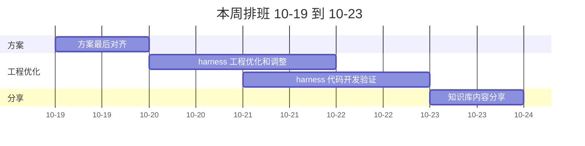

# 周计划 10-19 ~ 10-23（2026 第 43 周）

> [!IMPORTANT]
> 本周主线：**方案收口 → 工程优化 → 开发验证 → 知识库分享**。前两项是后两项的前置，按序推进。

## 任务总览

| # | 任务 | 关联文档 | 状态 | 备注 |
| - | ---- | -------- | ---- | ---- |
| 1 | 账户财务域详细方案最后对齐 | [账户财务详细设计方案](../raw/账户财务领域资料/账户财务详细设计方案.md) | 进行中 | 输出评审结论与调整清单 |
| 2 | 代码开发 harness 工程优化和调整 | — | 未开始 | 依赖 #1 的方案结论 |
| 3 | 账户财务域 harness 代码开发验证和优化 | — | 未开始 | 依赖 #2 工程调整到位 |
| 4 | 知识库内容分享 | [知识库选型以及架构方案](../raw/知识库/知识库选型以及架构方案.md) | 未开始 | 周五进行 |

## 每日排班

> [!NOTE]
> 以下按任务顺序做建议排期（假设），实际推进可按当日节奏调整，勾选框跟踪完成情况。

### 周一 10-19

- [ ] #1 方案最后对齐，形成评审调整清单

### 周二 10-20

- [ ] #2 harness 工程优化启动

### 周三 10-21

- [ ] #2 harness 工程优化收尾
- [ ] #3 harness 代码开发验证启动

### 周四 10-22

- [ ] #3 harness 代码开发验证与优化

### 周五 10-23

- [ ] #3 验证收尾
- [ ] #4 知识库内容分享

## 本周节奏

> [!WARNING]
> 依赖链：#3 依赖 #2，#2 依赖 #1。若方案对齐延期，优先压缩 #4 的准备时间，保住 #3 的验证窗口。

## 历史日志

- [2026-10-12](./2026-10-12.md)
- [2026-10-13](./2026-10-13.md)
